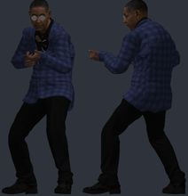
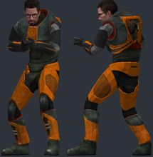
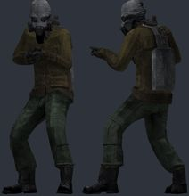
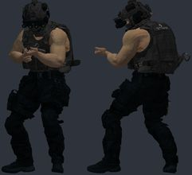
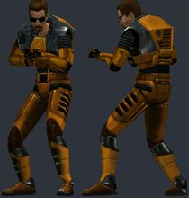
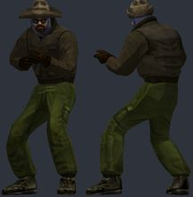
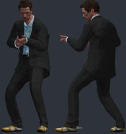
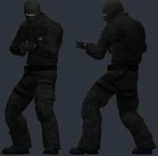
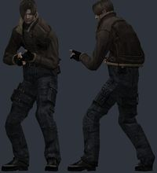
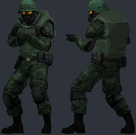

# Batch 1: 10 GMod player models

Generated by `batchnotes.py` from `catalog.json` and the conversion reports (`<work>/reports/<slug>.json`); review notes below the
marker are hand-written. All models: [MODELS.md](MODELS.md). Method and rules: [docs/creation/gmod-playermodels.md](../../docs/creation/gmod-playermodels.md).

10 models, 10 compiled, 1 with fit warnings.

Columns: **limb** = worst arm/leg joint distance from CS2's (u); **torso** = how far the upper torso was moved back (u); **head hb** = how far the
head hit box moved (z, u); **fingers** = finger fit L/R (u, < 1.8 fine).

| picture (click: every pose) | slug | workshop item | model | tris | scale | limb | torso | head hb | fingers | compile | notes |
|---|---|---|---|---|---|---|---|---|---|---|---|
|  | `gus_fring` | [[Breaking Bad] Gustavo Fring](https://steamcommunity.com/sharedfiles/filedetails/?id=3412497213) by Azkabath | `models/gustavo_fring/gustavo_suit.mdl` | 53714 | 1.038 | 2.5 | -2.51 | -3.0 z | 0.5/0.4 | OK | ok |
|  | `gordon_restored` | [Gordon Freeman Restored (PM/NPC)](https://steamcommunity.com/sharedfiles/filedetails/?id=3320656757) by Gordon Freakman | `models/gfreakman/gordonf_highpoly.mdl` | 19463 | 1.038 | 2.5 | -0.99 | -4.0 z | 0.4/0.3 | OK | ok |
|  | `caste_graffiti` | [CASTE Graffiti Playermodel + NPC](https://steamcommunity.com/sharedfiles/filedetails/?id=3673818635) by VHBC | `models/playermodels/caste_pm.mdl` | 5213 | 1.038 | 2.5 | -0.43 | -4.8 z | 0.5/0.5 | OK | ok |
|  | `vart_agent` | [Valve Account Recovery Taskforce [PM]](https://steamcommunity.com/sharedfiles/filedetails/?id=3626678503) by Fozer_T89 | `models/fozer/v.a.r.t/valveaccountrecoverytaskforce_pm.mdl` | 98787 | 1.038 | 2.6 | -2.44 | -3.4 z | 0.5/0.4 | OK | bulky torso: chest 5.2 u further forward than a stock agent; CS2 hand poses (two-handed weapons) will clip into it; hand_R inside the torso in the CS2 preview pose (chest surface 3.5 u in front of the wrist) |
|  | `gordon_promo` | [[PM+NPC] Promo Art Gordon Freeman](https://steamcommunity.com/sharedfiles/filedetails/?id=3361691203) by Vuthakral | `models/vuthakral/hl1/characters/gordon_promo.mdl` | 5850 | 1.038 | 2.5 | -1.07 | -3.2 z | 0.4/0.4 | OK | ok |
|  | `thing_macready` | [The Thing (2002) Humans (Playermodels & Ragdolls)](https://steamcommunity.com/sharedfiles/filedetails/?id=3456405055) by Kapitano Krunchyman | `models/thething2002/pm_macready.mdl` | 1956 | 1.038 | 2.7 | -0.07 | -4.6 z | 0.6/0.5 | OK | ok |
|  | `dr_house` | [House M.D: Dr Gregory House](https://steamcommunity.com/sharedfiles/filedetails/?id=3419019710) by Bunny | `models/bunny/doctor_house/doctor_house.mdl` | 38061 | 1.038 | 2.9 | -2.31 | -3.1 z | 0.4/0.4 | OK | ok |
|  | `css_swat` | [CSS ENHANCED SPECIAL FORCES /// SEB & SWAT /// PLAYERMODEL](https://steamcommunity.com/sharedfiles/filedetails/?id=3387382988) by Gruchk | `models/css_seb_swat/css_swat.mdl` | 4173 | 1.038 | 2.6 | -3.68 | -4.3 z | 0.5/0.5 | OK | ok |
|  | `leon_re4` | [Resident Evil 4 (2005) Leon S. Kennedy Playermodel](https://steamcommunity.com/sharedfiles/filedetails/?id=3735230220) by acres | `models/re4/leon/leon_pm.mdl` | 8733 | 1.056 | 5.0 | -1.18 | +1.7 z | 0.2/0.2 | OK | ok |
|  | `rotd_guard` | [Road of The Dead: Military](https://steamcommunity.com/sharedfiles/filedetails/?id=3415757440) by pvnished dej | `models/dejtriyev/rotd/ec_national_guard.mdl` | 10953 | 1.038 | 2.6 | -2.15 | -4.1 z | 0.6/0.6 | OK | ok |

## Looked at, not used

| id | item | why |
|---|---|---|
| 3621630161 | Christmas Sweater Citizens (Playermodel & Ragdoll) | face, eye and mouth textures are HL2 citizen textures not in the item (came out flat grey in batch 1 run 1) |
| 3374404008 | BAGGY JEANS SKELETON / Playermodel | materials come from base-game (HL2/GMod) content that is not in the item |
| 3682482439 | Resident Evil: Requiem - Former Umbrella Security Service (The Connections) [PMS] | 272k-308k vertices per model (680 MB item): too heavy without decimation |
| 3716275712 | Roscoe the Friendly Playermodel (and Ragdoll) | 43 u tall (head joint 32 u): would need 2.2x scale, not CS2-sized |

<!-- review notes: kept by batchnotes.py -->
## Review (6 Nov 2026)

Source: Steam Workshop, Garry's Mod, tag Model, top rated this week (pages 1-2). First batch: the method was worked out on it.

- **Stretching dropped.** The first run stretched each bone onto CS2's bone lengths: arms/legs shortened 8-12%, upper chest and neck stretched
  1.5-1.65x (tall collars). Now: uniform scale (~1.04) and limbs only turned into CS2's pose (`rigid` mode).
- **Fingers wrung in CS2's pose** (fine in the bind pose): hands sat 2-3 u off CS2's finger pivots. Fixed by seating each arm on CS2's shoulder
  and the hand on CS2's wrist (`hand_scale` ~1.0). Finger joints within ~0.5 u.
- **Back of the hand through the sleeve cuff** when bent back (rifle grip): the last 3 u of the forearm/cuff now follow the hand (up to 60%).
  A slight poke remains on stiff cuffs; accepted.
- **Hands inside the torso** (SWAT): GMod chests sit 2-3.5 u further forward on the spine than an agent's; the upper torso is now moved back
  (0.1-3.7 u). SWAT and V.A.R.T. still clip (armour 5-6 u thicker than an agent): warned, kept.
- **Head hit box**: heads ended up 2.5-3.3 u from CS2's head capsule (own neck length). Each model's head capsule now moves onto its head
  (from the eyes; MacReady has no eyeballs, so from the head mesh), the neck capsule half as far. `fit_hitboxes.py` does this for converted models.
- Christmas sweater citizen swapped out (face/eyes/mouth were base-game textures, flat grey) for the National Guard. Leon's rig is non-standard
  (pelvis 7 u high, three spine bones stacked) but bends fine. MacReady's mitten hands are the 2002 source mesh.
- Not yet tried in game.
