# Batch 10: 309 GMod player models

Generated by `batchnotes.py` from `catalog.json` and the conversion reports (`<work>/reports/<slug>.json`); review notes below the
marker are hand-written. All models: [MODELS.md](MODELS.md). Method and rules: [docs/creation/gmod-playermodels.md](../../docs/creation/gmod-playermodels.md).

309 models, 309 compiled, 137 with fit warnings.

Columns: **limb** = worst arm/leg joint distance from CS2's (u); **torso** = how far the upper torso was moved back (u); **head hb** = how far the
head hit box moved (z, u); **fingers** = finger fit L/R (u, < 1.8 fine).

| picture (click: every pose) | slug | workshop item | model | tris | scale | limb | torso | head hb | fingers | compile | notes |
|---|---|---|---|---|---|---|---|---|---|---|---|
| <a href="img/poses/kizuna_ai.jpg">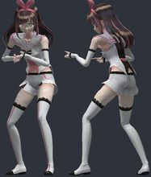</a> | `kizuna_ai` | [Kizuna AI P.M. & NPC](https://steamcommunity.com/sharedfiles/filedetails/?id=870523620) by dewobedil | `models/player/dewobedil/vocaloid/kizuna_ai/default_p.mdl` | 72638 | 1.254 | 5.6 | 0.0 | -3.8 z | 0.8/0.8 | OK | ok |
| <a href="img/poses/fnaf3_springtrap.jpg">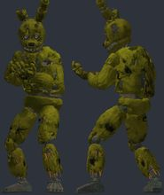</a> | `fnaf3_springtrap` | [FNAF 3 - Springtrap (Playermodel)](https://steamcommunity.com/sharedfiles/filedetails/?id=426924291) by Kitsumy ✦ | `models/player/maximo/springtrap1.mdl` | 51262 | 1.038 | 2.6 | -1.26 | +1.6 z |  | OK | hand_L not aligned to CS2 (the rig has no index finger plus an outer finger): fingers will bend about the wrong points; hand_R not aligned to CS2 (the rig has no index finger plus an outer finger): fingers will bend about the wrong points |
| <a href="img/poses/withered_foxy.jpg">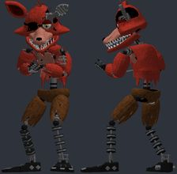</a> | `withered_foxy` | [Fnaf 2 / Withered Animatronics / NPCs + Playermodels](https://steamcommunity.com/sharedfiles/filedetails/?id=699784388) by Sneglen | `models/player/aileri_withered_foxy.mdl` | 56573 | 1.038 | 2.5 | -0.71 | +1.1 z |  | OK | hand_L not aligned to CS2 (the rig has no index finger plus an outer finger): fingers will bend about the wrong points; hand_R not aligned to CS2 (the rig has no index finger plus an outer finger): fingers will bend about the wrong points |
| <a href="img/poses/withered_golden_freddy.jpg">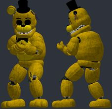</a> | `withered_golden_freddy` | [Fnaf 2 / Withered Animatronics / NPCs + Playermodels](https://steamcommunity.com/sharedfiles/filedetails/?id=699784388) by Sneglen | `models/player/aileri_withered_golden_freddy.mdl` | 57982 | 1.038 | 2.6 | -1.46 | +0.2 z |  | OK | bulky torso: chest 6.3 u further forward than a stock agent; CS2 hand poses (two-handed weapons) will clip into it; hand_R inside the torso in the CS2 preview pose (chest surface 6.1 u in front of the wrist); hand_L not aligned to CS2 (the rig has no index finger plus an outer finger): fingers will bend about the wrong points; hand_R not aligned to CS2 (the rig has no index finger plus an outer finger): fingers will bend about the wrong points |
| <a href="img/poses/withered_chica.jpg">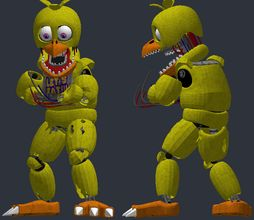</a> | `withered_chica` | [Fnaf 2 / Withered Animatronics / NPCs + Playermodels](https://steamcommunity.com/sharedfiles/filedetails/?id=699784388) by Sneglen | `models/player/aileri_withered_chica.mdl` | 50060 | 1.097 | 3.6 | -1.69 | +4.6 z |  | OK | bulky torso: chest 5.2 u further forward than a stock agent; CS2 hand poses (two-handed weapons) will clip into it; hand_L not aligned to CS2 (the rig has no index finger plus an outer finger): fingers will bend about the wrong points; hand_R not aligned to CS2 (the rig has no index finger plus an outer finger): fingers will bend about the wrong points |
| <a href="img/poses/hecu_a3_heads.jpg">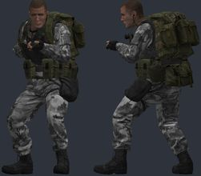</a> | `hecu_a3_heads` | [Hazardous Environment Combat Unit - Remastered (P.M. and NPCs)](https://steamcommunity.com/sharedfiles/filedetails/?id=1855801445) by Giga Sigma Goon | `models/yukon/hecu/hecu_01_player.mdl` | 24055 | 1.038 | 2.5 | 3.94 | -2.3 z | 0.4/0.4 | OK | bulky torso: chest 8.4 u further forward than a stock agent; CS2 hand poses (two-handed weapons) will clip into it; hand_R inside the torso in the CS2 preview pose (chest surface 6.2 u in front of the wrist) |
| <a href="img/poses/bonnie.jpg">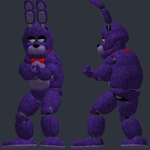</a> | `bonnie` | [Fnaf 1 / Animatronics / NPCs + Playermodels](https://steamcommunity.com/sharedfiles/filedetails/?id=658731183) by Sneglen | `models/player/aileri_bonnie.mdl` | 95508 | 1.038 | 3.0 | -1.05 | +4.7 z |  | OK | bulky torso: chest 6.0 u further forward than a stock agent; CS2 hand poses (two-handed weapons) will clip into it; hand_R inside the torso in the CS2 preview pose (chest surface 4.8 u in front of the wrist); hand_L not aligned to CS2 (the rig has no index finger plus an outer finger): fingers will bend about the wrong points; hand_R not aligned to CS2 (the rig has no index finger plus an outer finger): fingers will bend about the wrong points |
| <a href="img/poses/chica.jpg">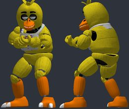</a> | `chica` | [Fnaf 1 / Animatronics / NPCs + Playermodels](https://steamcommunity.com/sharedfiles/filedetails/?id=658731183) by Sneglen | `models/player/aileri_chica.mdl` | 63126 | 1.092 | 3.4 | -0.14 | +2.4 z |  | OK | bulky torso: chest 5.7 u further forward than a stock agent; CS2 hand poses (two-handed weapons) will clip into it; hand_L not aligned to CS2 (the rig has no index finger plus an outer finger): fingers will bend about the wrong points; hand_R not aligned to CS2 (the rig has no index finger plus an outer finger): fingers will bend about the wrong points |
| <a href="img/poses/freddy.jpg">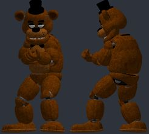</a> | `freddy` | [Fnaf 1 / Animatronics / NPCs + Playermodels](https://steamcommunity.com/sharedfiles/filedetails/?id=658731183) by Sneglen | `models/player/aileri_freddy.mdl` | 62389 | 1.038 | 3.0 | -1.05 | +4.3 z |  | OK | bulky torso: chest 6.0 u further forward than a stock agent; CS2 hand poses (two-handed weapons) will clip into it; hand_R inside the torso in the CS2 preview pose (chest surface 4.8 u in front of the wrist); hand_L not aligned to CS2 (the rig has no index finger plus an outer finger): fingers will bend about the wrong points; hand_R not aligned to CS2 (the rig has no index finger plus an outer finger): fingers will bend about the wrong points |
| <a href="img/poses/unwithered_bonnie.jpg">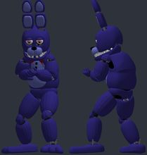</a> | `unwithered_bonnie` | [Fnaf 2 / Unwithered Animatronics / NPCs + Playermodels](https://steamcommunity.com/sharedfiles/filedetails/?id=733881374) by Sneglen | `models/player/aileri_unwithered_bonnie.mdl` | 54520 | 1.038 | 2.7 | -2.5 | +5.0 z |  | OK | bulky torso: chest 5.5 u further forward than a stock agent; CS2 hand poses (two-handed weapons) will clip into it; hand_L not aligned to CS2 (the rig has no index finger plus an outer finger): fingers will bend about the wrong points; hand_R not aligned to CS2 (the rig has no index finger plus an outer finger): fingers will bend about the wrong points |
| <a href="img/poses/fredbear.jpg">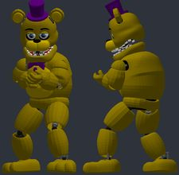</a> | `fredbear` | [Fnaf 2 / Unwithered Animatronics / NPCs + Playermodels](https://steamcommunity.com/sharedfiles/filedetails/?id=733881374) by Sneglen | `models/player/aileri_fredbear.mdl` | 50944 | 1.038 | 2.6 | -1.98 | +4.9 z |  | OK | bulky torso: chest 6.3 u further forward than a stock agent; CS2 hand poses (two-handed weapons) will clip into it; hand_R inside the torso in the CS2 preview pose (chest surface 6.1 u in front of the wrist); hand_L not aligned to CS2 (the rig has no index finger plus an outer finger): fingers will bend about the wrong points; hand_R not aligned to CS2 (the rig has no index finger plus an outer finger): fingers will bend about the wrong points |
| <a href="img/poses/unwithered_freddy.jpg">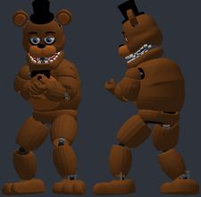</a> | `unwithered_freddy` | [Fnaf 2 / Unwithered Animatronics / NPCs + Playermodels](https://steamcommunity.com/sharedfiles/filedetails/?id=733881374) by Sneglen | `models/player/aileri_unwithered_freddy.mdl` | 50944 | 1.038 | 2.6 | -1.98 | +4.9 z |  | OK | bulky torso: chest 6.3 u further forward than a stock agent; CS2 hand poses (two-handed weapons) will clip into it; hand_R inside the torso in the CS2 preview pose (chest surface 6.1 u in front of the wrist); hand_L not aligned to CS2 (the rig has no index finger plus an outer finger): fingers will bend about the wrong points; hand_R not aligned to CS2 (the rig has no index finger plus an outer finger): fingers will bend about the wrong points |
| <a href="img/poses/peter_griffin_2.jpg">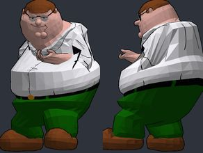</a> | `peter_griffin_2` | [Peter Griffin Family Guy Player Model/NPC/Ragdoll/Custom Animations](https://steamcommunity.com/sharedfiles/filedetails/?id=2175750122) by Petaly | `models/petaly/peter_griffin/petergriffin.mdl` | 11192 | 0.809 | 18.2 | -0.69 | -4.9 z | 0.6/0.6 | OK | hand_R inside the torso in the CS2 preview pose (chest surface 5.4 u in front of the wrist) |
| <a href="img/poses/phantom_foxy.jpg">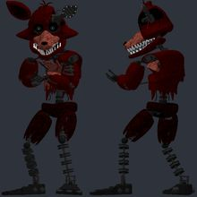</a> | `phantom_foxy` | [Fnaf 3 / Phantom Animatronics / NPCs + Playermodels](https://steamcommunity.com/sharedfiles/filedetails/?id=788031787) by Sneglen | `models/player/aileri_ph_foxy.mdl` | 55025 | 1.038 | 2.5 | -5.02 | +1.1 z |  | OK | hand_L not aligned to CS2 (the rig has no index finger plus an outer finger): fingers will bend about the wrong points; hand_R not aligned to CS2 (the rig has no index finger plus an outer finger): fingers will bend about the wrong points |
| <a href="img/poses/phantom_mangle.jpg">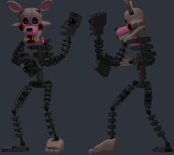</a> | `phantom_mangle` | [Fnaf 3 / Phantom Animatronics / NPCs + Playermodels](https://steamcommunity.com/sharedfiles/filedetails/?id=788031787) by Sneglen | `models/player/aileri_ph_mangle.mdl` | 60181 | 1.092 | 3.4 | -4.82 | +1.2 z |  | OK | hand_L not aligned to CS2 (the rig has no index finger plus an outer finger): fingers will bend about the wrong points; hand_R not aligned to CS2 (the rig has no index finger plus an outer finger): fingers will bend about the wrong points |
| <a href="img/poses/phantom_chica.jpg">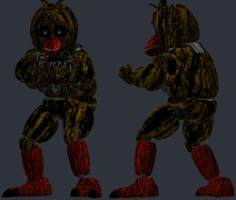</a> | `phantom_chica` | [Fnaf 3 / Phantom Animatronics / NPCs + Playermodels](https://steamcommunity.com/sharedfiles/filedetails/?id=788031787) by Sneglen | `models/player/aileri_ph_chica.mdl` | 57358 | 1.092 | 3.4 | -0.14 | +1.9 z |  | OK | bulky torso: chest 5.7 u further forward than a stock agent; CS2 hand poses (two-handed weapons) will clip into it; hand_L not aligned to CS2 (the rig has no index finger plus an outer finger): fingers will bend about the wrong points; hand_R not aligned to CS2 (the rig has no index finger plus an outer finger): fingers will bend about the wrong points |
| <a href="img/poses/r6s_r6_hazmat.jpg">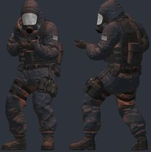</a> | `r6s_r6_hazmat` | [R6S: R6-Hazmat P.M. and Ragdoll](https://steamcommunity.com/sharedfiles/filedetails/?id=790460967) by Lenoax | `models/player/r6s_r6hazmat.mdl` | 34687 | 1.045 | 2.7 | 0.09 | -4.8 z | 0.1/0.3 | OK | bulky torso: chest 5.2 u further forward than a stock agent; CS2 hand poses (two-handed weapons) will clip into it; hand_R inside the torso in the CS2 preview pose (chest surface 3.8 u in front of the wrist) |
| <a href="img/poses/mangle.jpg">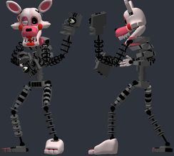</a> | `mangle` | [Fnaf 2 / Misfits Animatronics / NPCs + Playermodels](https://steamcommunity.com/sharedfiles/filedetails/?id=775770264) by Sneglen | `models/player/aileri_mangle.mdl` | 64757 | 1.092 | 3.4 | -4.51 | +2.3 z |  | OK | hand_L not aligned to CS2 (the rig has no index finger plus an outer finger): fingers will bend about the wrong points; hand_R not aligned to CS2 (the rig has no index finger plus an outer finger): fingers will bend about the wrong points |
| <a href="img/poses/rainbow_six_siege_iq.jpg">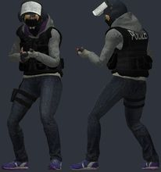</a> | `rainbow_six_siege_iq` | [R6S: IQ P.M. and Ragdoll](https://steamcommunity.com/sharedfiles/filedetails/?id=572872442) by Lenoax | `models/player/r6s_iq.mdl` | 47384 | 1.078 | 2.5 | -0.97 | -2.2 z | 0.5/0.5 | OK | ok |
| <a href="img/poses/n64_waluigi.jpg">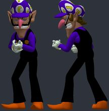</a> | `n64_waluigi` | [N64 Mario Pack (Playermodel/NPC/Ragdoll)](https://steamcommunity.com/sharedfiles/filedetails/?id=3414764340) by Rueven2005 | `models/rueven/n64/waluigi.mdl` | 66470 | 1.296 | 6.8 | -2.58 | +4.7 z | 1.6/1.6 | OK | ok |
| <a href="img/poses/xv_global_occult_coaliti.jpg">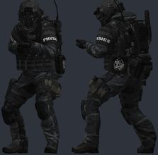</a> | `xv_global_occult_coaliti` | [Global Occult Coalition Operative [PM][SCP]](https://steamcommunity.com/sharedfiles/filedetails/?id=2829204868) by asian feet lover /CHSV/ | `models/player/xuvon/xuvon_goc_re_base.mdl` | 62916 | 1.038 | 2.5 | -1.66 | -3.9 z | 0.5/0.4 | OK | bulky torso: chest 5.6 u further forward than a stock agent; CS2 hand poses (two-handed weapons) will clip into it; hand_R inside the torso in the CS2 preview pose (chest surface 3.8 u in front of the wrist) |
| <a href="img/poses/r6s_jager.jpg">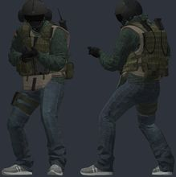</a> | `r6s_jager` | [R6S: Jäger P.M. and Ragdoll](https://steamcommunity.com/sharedfiles/filedetails/?id=667986439) by Lenoax | `models/player/r6s_jager.mdl` | 43562 | 1.045 | 2.7 | -1.08 | -2.6 z | 0.3/0.3 | OK | bulky torso: chest 4.4 u further forward than a stock agent; CS2 hand poses (two-handed weapons) will clip into it; hand_R inside the torso in the CS2 preview pose (chest surface 3.0 u in front of the wrist); eyeball_r: dark see-through glass (no texture in the item); eyeball_l: dark see-through glass (no texture in the item) |
| <a href="img/poses/steve_jack_black_a_minec.jpg">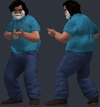</a> | `steve_jack_black_a_minec` | [A Minecraft Movie - Steve (PM/Ragdoll)](https://steamcommunity.com/sharedfiles/filedetails/?id=3503078679) by Mr. P Gremlin | `models/player/purpl/filmsteve.mdl` | 63232 | 1.007 | 7.1 | -0.81 | -5.0 z | 0.2/0.4 | OK | hand_R inside the torso in the CS2 preview pose (chest surface 3.6 u in front of the wrist) |
| <a href="img/poses/p2_p_body.jpg">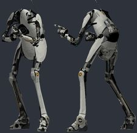</a> | `p2_p_body` | [Portal 2: P-Body P.M. and Ragdoll](https://steamcommunity.com/sharedfiles/filedetails/?id=489473735) by Lenoax | `models/player/p2_p-body.mdl` | 24951 | 0.862 | 8.1 | -1.14 | -5.0 z | 1.1/1.0 | OK | ok |
| <a href="img/poses/soldier2_desert.jpg">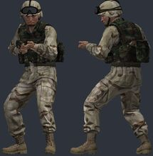</a> | `soldier2_desert` | [Early 2000s U.S. Military [P.M. Version]](https://steamcommunity.com/sharedfiles/filedetails/?id=754145149) by Giga Sigma Goon | `models/player/soldier2_desert.mdl` | 20443 | 1.038 | 2.5 | -0.3 | -3.2 z | 0.5/0.5 | OK | bulky torso: chest 5.5 u further forward than a stock agent; CS2 hand poses (two-handed weapons) will clip into it |
| <a href="img/poses/soldier2_woodland.jpg">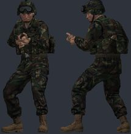</a> | `soldier2_woodland` | [Early 2000s U.S. Military [P.M. Version]](https://steamcommunity.com/sharedfiles/filedetails/?id=754145149) by Giga Sigma Goon | `models/player/soldier2_woodland.mdl` | 20443 | 1.038 | 2.5 | -0.3 | -3.2 z | 0.3/0.4 | OK | bulky torso: chest 5.5 u further forward than a stock agent; CS2 hand poses (two-handed weapons) will clip into it |
| <a href="img/poses/charple.jpg">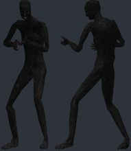</a> | `charple` | [Charple+ (Playermodels)](https://steamcommunity.com/sharedfiles/filedetails/?id=3781996675) by Vexx | `models/player/charple/charple.mdl` | 2562 | 1.038 | 2.6 | -0.62 | -4.3 z |  | OK | ok |
| <a href="img/poses/bf2_reg_clonetrooper_bf2.jpg">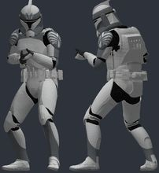</a> | `bf2_reg_clonetrooper_bf2` | [Star Wars Battlefront II: Phase One Regimental Pack- Playermodels](https://steamcommunity.com/sharedfiles/filedetails/?id=1222573658) by NotSWorthy | `models/player/worthy/phase_1/104th/bf2_p1_trooper.mdl` | 41276 | 1.062 | 2.0 | 0.75 | -2.0 z | 0.3/0.3 | OK | bulky torso: chest 5.0 u further forward than a stock agent; CS2 hand poses (two-handed weapons) will clip into it; hand_R inside the torso in the CS2 preview pose (chest surface 3.5 u in front of the wrist) |
| <a href="img/poses/mirasu_female.jpg">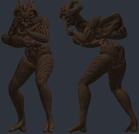</a> | `mirasu_female` | [Female Monster Playermodel](https://steamcommunity.com/sharedfiles/filedetails/?id=1655107538) by Kalimando | `models/player/kalimando/mirasu_fem.mdl` | 21228 | 1.097 | 3.7 | 14.12 | -0.6 z | 0.6/0.6 | OK | bulky torso: chest 17.7 u further forward than a stock agent; CS2 hand poses (two-handed weapons) will clip into it; hand_R inside the torso in the CS2 preview pose (chest surface 15.7 u in front of the wrist) |
| <a href="img/poses/soldier1_mopp1.jpg">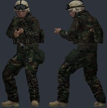</a> | `soldier1_mopp1` | [Early 2000s U.S. Military [P.M. Version]](https://steamcommunity.com/sharedfiles/filedetails/?id=754145149) by Giga Sigma Goon | `models/player/soldier1_mopp1.mdl` | 19617 | 1.038 | 2.5 | -0.3 | -3.1 z | 0.5/0.5 | OK | bulky torso: chest 5.5 u further forward than a stock agent; CS2 hand poses (two-handed weapons) will clip into it |
| <a href="img/poses/marceline.jpg">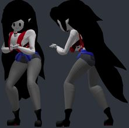</a> | `marceline` | [[VRChat] Marceline "Marcy" - [Playermodel]](https://steamcommunity.com/sharedfiles/filedetails/?id=3139608359) by Alvaro | `models/alvaroports/marcelinepm.mdl` | 52117 | 1.126 | 5.5 | 5.44 | -4.9 z | 0.8/0.8 | OK | bulky torso: chest 7.4 u further forward than a stock agent; CS2 hand poses (two-handed weapons) will clip into it; hand_R inside the torso in the CS2 preview pose (chest surface 5.2 u in front of the wrist) |
| <a href="img/poses/seraphim.jpg">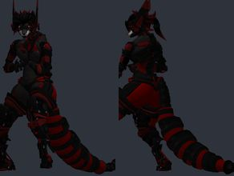</a> | `seraphim` | [[VRChat] Seraphim V-01 - [Playermodel]](https://steamcommunity.com/sharedfiles/filedetails/?id=3473040375) by Alvaro | `models/alvaroports/seraphimpm.mdl` | 65535 | 1.025 | 6.1 | -2.81 | -3.8 z | 0.3/0.3 | OK | ok |
| <a href="img/poses/cyborg.jpg">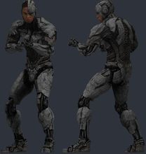</a> | `cyborg` | [Cyborg - Ray Fisher PM&NPC (Injustice 2 IOS)](https://steamcommunity.com/sharedfiles/filedetails/?id=1206870014) by Kryptonite | `models/kryptonite/inj2_cyborg/inj2_cyborg.mdl` | 63580 | 0.897 | 2.5 | -1.95 | -4.0 z | 1.0/1.0 | OK | ok |
| <a href="img/poses/azura.jpg">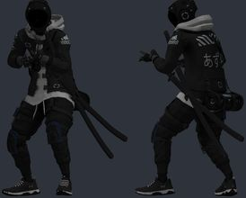</a> | `azura` | [Azura Cyberpunk [PM](https://steamcommunity.com/sharedfiles/filedetails/?id=3034885357) by Deadwater Timbles | `models/timbleweebs/azura/azura_cyberpunk_pm.mdl` | 57561 | 1.099 | 3.9 | -1.64 | -1.2 z | 0.5/0.6 | OK | ok |
| <a href="img/poses/umbrela_corpse_soldier.jpg">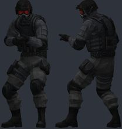</a> | `umbrela_corpse_soldier` | [RE ORC / USS Alpha Team Playermodels](https://steamcommunity.com/sharedfiles/filedetails/?id=939009415) by reborn | `models/trent/umbrellacorpse/soldier.mdl` | 53322 | 1.038 | 2.8 | -1.58 | -2.5 z | 0.4/0.5 | OK | ok |
| <a href="img/poses/rainbow_six_siege_doc.jpg">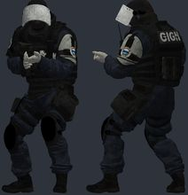</a> | `rainbow_six_siege_doc` | [R6S: Doc P.M. and Ragdoll](https://steamcommunity.com/sharedfiles/filedetails/?id=574428148) by Lenoax | `models/player/r6s_doc.mdl` | 46323 | 1.045 | 2.5 | -1.19 | -3.0 z | 0.3/0.3 | OK | bulky torso: chest 5.5 u further forward than a stock agent; CS2 hand poses (two-handed weapons) will clip into it; hand_R inside the torso in the CS2 preview pose (chest surface 4.4 u in front of the wrist) |
| <a href="img/poses/bf2_first_order_heavy_st.jpg">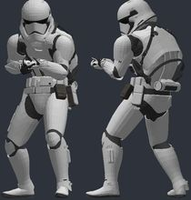</a> | `bf2_first_order_heavy_st` | [Star Wars EA Battlefront 2 - First Order Stormtrooper Playermodel Pack v1.3](https://steamcommunity.com/sharedfiles/filedetails/?id=1232265546) by Grady | `models/grady/fo_heavy_stormtrooper/fo_heavy_stormtrooper.mdl` | 47505 | 1.062 | 2.0 | -3.25 | -2.6 z | 0.3/0.3 | OK | ok |
| <a href="img/poses/rainbow_six_siege_cavier.jpg">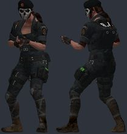</a> | `rainbow_six_siege_cavier` | [R6S: Caveira P.M. and Ragdoll](https://steamcommunity.com/sharedfiles/filedetails/?id=808616397) by Lenoax | `models/player/r6s_caviera.mdl` | 39352 | 1.078 | 2.5 | -2.13 | -2.6 z | 0.5/0.5 | OK | bulky torso: chest 4.6 u further forward than a stock agent; CS2 hand poses (two-handed weapons) will clip into it |
| <a href="img/poses/mtf_rf_juggernaut.jpg">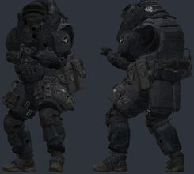</a> | `mtf_rf_juggernaut` | [MTF RF Juggernaut [PM](https://steamcommunity.com/sharedfiles/filedetails/?id=3605034675) by Fozer_T89 | `models/fozer/mtf_ru_juggernaut.mdl` | 90790 | 1.038 | 2.6 | -3.14 | -3.7 z | 0.4/0.4 | OK | bulky torso: chest 7.2 u further forward than a stock agent; CS2 hand poses (two-handed weapons) will clip into it; hand_R inside the torso in the CS2 preview pose (chest surface 5.2 u in front of the wrist) |
| <a href="img/poses/mgs4_pieuvre_armament.jpg">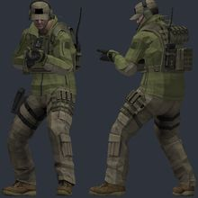</a> | `mgs4_pieuvre_armament` | [MGS4 PMC Pack (PM+Rag)](https://steamcommunity.com/sharedfiles/filedetails/?id=1975444754) by Hugh Tamlin (Piggo) | `models/ninja/mgs4_pieuvre_armament_merc.mdl` | 9361 | 1.049 | 2.9 | -1.93 | -2.9 z | 0.5/0.6 | OK | ok |
| <a href="img/poses/dhmis_yellowguy.jpg">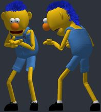</a> | `dhmis_yellowguy` | [Don't Hug Me I'm Scared Player Model Pack](https://steamcommunity.com/sharedfiles/filedetails/?id=2877889266) by Ink Retired Man | `models/bonbunfilms/dhmis/yellowguy_pm.mdl` | 95118 | 1.156 | 5.6 | -0.66 | -3.1 z | 1.5/1.5 | OK | bulky torso: chest 7.4 u further forward than a stock agent; CS2 hand poses (two-handed weapons) will clip into it |
| <a href="img/poses/dhmis_duckguy.jpg">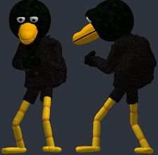</a> | `dhmis_duckguy` | [Don't Hug Me I'm Scared Player Model Pack](https://steamcommunity.com/sharedfiles/filedetails/?id=2877889266) by Ink Retired Man | `models/bonbunfilms/dhmis/duckguy_pm.mdl` | 73935 | 1.096 | 9.5 | -1.61 | -3.9 z | 2.0/2.0 | OK | bulky torso: chest 4.8 u further forward than a stock agent; CS2 hand poses (two-handed weapons) will clip into it; hand_R inside the torso in the CS2 preview pose (chest surface 4.6 u in front of the wrist); hand_L fingers sit 2.0 u from their CS2 finger bones: CS2 finger curls will distort them; hand_R fingers sit 2.0 u from their CS2 finger bones: CS2 finger curls will distort them |
| <a href="img/poses/dhmis_roy.jpg">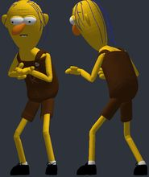</a> | `dhmis_roy` | [Don't Hug Me I'm Scared Player Model Pack](https://steamcommunity.com/sharedfiles/filedetails/?id=2877889266) by Ink Retired Man | `models/bonbunfilms/dhmis/roy_pm.mdl` | 55956 | 1.084 | 4.1 | -0.79 | -1.0 z | 1.3/1.3 | OK | ok |
| <a href="img/poses/moff.jpg">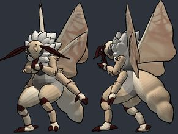</a> | `moff` | [Moth Playermodel](https://steamcommunity.com/sharedfiles/filedetails/?id=3404916714) by EVE | `models/eve/moff/moth_pm.mdl` | 103908 | 0.908 | 8.9 | 1.08 | -3.8 z | 1.5/1.5 | OK | bulky torso: chest 8.5 u further forward than a stock agent; CS2 hand poses (two-handed weapons) will clip into it; hand_R inside the torso in the CS2 preview pose (chest surface 4.4 u in front of the wrist) |
| <a href="img/poses/pumpkintrooper.jpg">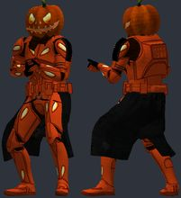</a> | `pumpkintrooper` | [Halloween Clone Troopers Playermodels](https://steamcommunity.com/sharedfiles/filedetails/?id=1186994337) by Kralich/Gonzo | `models/gonzo/halloweentroopers/pumpkintrooper/pumpkintrooper.mdl` | 51176 | 1.062 | 2.0 | -1.72 | -4.9 z | 0.3/0.3 | OK | ok |
| <a href="img/poses/pmakazan.jpg">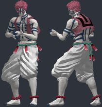</a> | `pmakazan` | [Demon Slayer Akaza Playermodel](https://steamcommunity.com/sharedfiles/filedetails/?id=2608786379) by Delamain | `models/aka/akazan - willywood#2840/akazan - willywood#2840.mdl` | 93608 | 1.073 | 4.1 | -2.01 | -0.4 z | 0.6/0.7 | OK | ok |
| <a href="img/poses/ellie_tlou.jpg">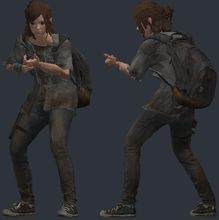</a> | `ellie_tlou` | [[PM] The Last of Us Part II: Ellie Williams](https://steamcommunity.com/sharedfiles/filedetails/?id=2930426722) by odesza | `models/the_last_of_us/ellie_part2_pm.mdl` | 122022 | 1.147 | 3.4 | 0.41 | -1.9 z | 0.6/0.5 | OK | ok |
| <a href="img/poses/puppet.jpg">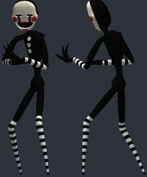</a> | `puppet` | [Fnaf 2 / Misfits Animatronics / NPCs + Playermodels](https://steamcommunity.com/sharedfiles/filedetails/?id=775770264) by Sneglen | `models/player/aileri_puppet.mdl` | 43490 | 1.092 | 3.4 | -0.78 | +1.9 z |  | OK | hand_L not aligned to CS2 (the rig has no index finger plus an outer finger): fingers will bend about the wrong points; hand_R not aligned to CS2 (the rig has no index finger plus an outer finger): fingers will bend about the wrong points |
| <a href="img/poses/yuji_itadori.jpg">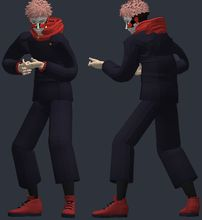</a> | `yuji_itadori` | [Yuji Itadori / Playermodel / Jujutsu no Kaisen /](https://steamcommunity.com/sharedfiles/filedetails/?id=2467868542) by Kuroso4 | `models/itadori_kuroso.mdl` | 104762 | 1.179 | 4.0 | -1.11 | +0.8 z | 0.3/0.3 | OK | ok |
| <a href="img/poses/captain_jack_sparrow.jpg">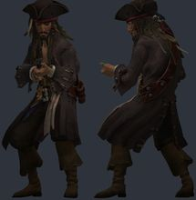</a> | `captain_jack_sparrow` | [Captain Jack Sparrow SoT [PM]](https://steamcommunity.com/sharedfiles/filedetails/?id=2810132455) by Falko | `models/models/sot_jack_sparrow/sot_jack_sparrow.mdl` | 65141 | 1.081 | 3.4 | -1.2 | -4.5 z | 0.2/0.3 | OK | bulky torso: chest 4.3 u further forward than a stock agent; CS2 hand poses (two-handed weapons) will clip into it |
|  | `unknown` | [Dead by Daylight - The Unknown (PM)](https://steamcommunity.com/sharedfiles/filedetails/?id=3287483015) by gilles671games | `models/vsj/dbd_the_unknown/the_unknown.mdl` | 64438 | 0.864 | 12.7 | -1.2 | -4.8 z | 0.5/0.7 | OK | hand_R inside the torso in the CS2 preview pose (chest surface 4.0 u in front of the wrist) |
|  | `handhead_guy` | [Handhead Playermodel](https://steamcommunity.com/sharedfiles/filedetails/?id=1574071896) by Hog Cranker | `models/player/stanmcg/handguy/handguy_playermodel.mdl` | 24594 | 1.001 | 2.6 | -1.67 | +9.1 z | 0.6/0.6 | OK | ok |
|  | `deviltrooper` | [Halloween Clone Troopers Playermodels](https://steamcommunity.com/sharedfiles/filedetails/?id=1186994337) by Kralich/Gonzo | `models/gonzo/halloweentroopers/deviltrooper/deviltrooper.mdl` | 49168 | 1.062 | 2.0 | 0.41 | +1.2 z | 0.3/0.3 | OK | bulky torso: chest 4.6 u further forward than a stock agent; CS2 hand poses (two-handed weapons) will clip into it; hand_R inside the torso in the CS2 preview pose (chest surface 3.2 u in front of the wrist) |
|  | `chloe_skull` | [Chloe Price Pack for NPC & Playermodels](https://steamcommunity.com/sharedfiles/filedetails/?id=1439548148) by On The Railroad | `models/ontherailroad/lis/chloe/ch_m_chloe_du3a_player.mdl` | 27554 | 1.126 | 3.5 | -1.01 | +0.6 z | 0.2/0.2 | OK | ok |
|  | `dr_nefarious` | [Dr. Nefarious Playermodel](https://steamcommunity.com/sharedfiles/filedetails/?id=371420002) by FeyThing.TTV | `models/player/nefarious/nefarious.mdl` | 25193 | 1.038 | 2.5 | -2.14 | -3.8 z | 1.4/1.2 | OK | bulky torso: chest 6.4 u further forward than a stock agent; CS2 hand poses (two-handed weapons) will clip into it |
|  | `playtime_worker_hazmat` | [[Poppy Playtime] - Playtime Worker Playermodel](https://steamcommunity.com/sharedfiles/filedetails/?id=3689982220) by Goldermor | `models/ppt/player/pt_worker_hazmat.mdl` | 38552 | 1.068 | 1.9 | -2.09 | -2.1 z | 0.3/0.3 | OK | ok |
|  | `mr_wolf_bad_guys` | [[Bad Guys] MR. Wolf - [Playermodel]](https://steamcommunity.com/sharedfiles/filedetails/?id=3077302606) by Alvaro | `models/mr_wolf.mdl` | 63025 | 1.173 | 8.4 | -1.19 | +3.1 z | 0.7/0.7 | OK | ok |
|  | `bf2_first_order_jet_stor` | [Star Wars EA Battlefront 2 - First Order Stormtrooper Playermodel Pack v1.3](https://steamcommunity.com/sharedfiles/filedetails/?id=1232265546) by Grady | `models/grady/fo_jet_stormtrooper/fo_jet_stormtrooper.mdl` | 43285 | 1.062 | 2.0 | -0.03 | -2.6 z | 0.3/0.3 | OK | ok |
|  | `shellythesheep` | [Bon & Shell AD PM](https://steamcommunity.com/sharedfiles/filedetails/?id=3779044997) by Burd | `models/stxrburd/shellythesheep/shellythesheep_pm.mdl` | 101737 | 0.97 | 3.1 | 1.64 | -5.0 z | 0.7/0.7 | OK | ok |
|  | `vampiretrooper` | [Halloween Clone Troopers Playermodels](https://steamcommunity.com/sharedfiles/filedetails/?id=1186994337) by Kralich/Gonzo | `models/gonzo/halloweentroopers/vampiretrooper/vampiretrooper.mdl` | 47248 | 1.062 | 2.0 | 0.41 | -2.0 z | 0.3/0.3 | OK | bulky torso: chest 4.6 u further forward than a stock agent; CS2 hand poses (two-handed weapons) will clip into it; hand_R inside the torso in the CS2 preview pose (chest surface 3.2 u in front of the wrist) |
|  | `deadpool_3` | [Deadpool 2016 movie playermodel (HD)](https://steamcommunity.com/sharedfiles/filedetails/?id=915353728) by AshraldRails | `models/player/deadpool/deadpool.mdl` | 50168 | 1.057 | 2.6 | 0.36 | -3.9 z | 0.4/0.3 | OK | ok |
|  | `comradebearpolice` | [CB-BRP PM Pack - Police Bear](https://steamcommunity.com/sharedfiles/filedetails/?id=564773784) by Comrade Bear | `models/player/comradebear/comradebear_policeru.mdl` | 11612 | 1.038 | 2.8 | -1.8 | -3.7 z | 0.4/0.4 | OK | ok |
|  | `ned_flanders_fortnite` | [Fortnite x The Simpsons - Part One (PM/Ragdolls)](https://steamcommunity.com/sharedfiles/filedetails/?id=3598734494) by Mr. P Gremlin | `models/player/mrp/fortnite/flanders.mdl` | 46980 | 1.2 | 3.7 | -1.95 | +3.0 z | 0.5/0.7 | OK | ok |
|  | `marge_simpson_fortnite` | [Fortnite x The Simpsons - Part One (PM/Ragdolls)](https://steamcommunity.com/sharedfiles/filedetails/?id=3598734494) by Mr. P Gremlin | `models/player/mrp/fortnite/marge.mdl` | 63448 | 1.295 | 6.9 | -2.1 | +4.0 z | 0.4/0.4 | OK | ok |
|  | `tda_stylized_teto` | [Tda-Stylized Teto [PM & NPC]](https://steamcommunity.com/sharedfiles/filedetails/?id=3672993818) by RKiRra | `models/pacagma/vocaloid/teto_style/teto_style_player.mdl` | 47797 | 1.29 | 9.7 | -2.19 | +3.4 z | 0.3/0.3 | OK | ok |
|  | `mkx_scorpion` | [MKX: Scorpion P.M. and Ragdoll](https://steamcommunity.com/sharedfiles/filedetails/?id=454787966) by Lenoax | `models/player/mkx_scorpion.mdl` | 34307 | 1.038 | 2.5 | -2.52 | -3.8 z | 0.6/0.5 | OK | ok |
|  | `nightmarionne` | [Fnaf 4 / Nightmare Animatronics / Part 1 / NPCs and Playermodels](https://steamcommunity.com/sharedfiles/filedetails/?id=815623528) by Sneglen | `models/player/aileri_nightmarionne.mdl` | 47110 | 1.105 | 4.8 | -1.64 | +1.2 z |  | OK | hand_L not aligned to CS2 (the rig has no index finger plus an outer finger): fingers will bend about the wrong points; hand_R not aligned to CS2 (the rig has no index finger plus an outer finger): fingers will bend about the wrong points |
|  | `lord_verity` | [[PM] Lord Verity (Horror Skunx)](https://steamcommunity.com/sharedfiles/filedetails/?id=3813655422) by croshx2 | `models/horrorskunx/lordverity/lordverity.mdl` | 140160 | 0.992 | 1.4 | -0.88 | -2.9 z | 0.3/0.3 | OK | ok |
|  | `superman_injustice` | [Superman - Injustice 2 (PM & NPC)](https://steamcommunity.com/sharedfiles/filedetails/?id=1230208712) by Kryptonite | `models/kryptonite/superman_inj2/superman_inj2.mdl` | 51067 | 1.042 | 2.6 | 1.46 | -3.1 z | 0.3/0.4 | OK | bulky torso: chest 4.3 u further forward than a stock agent; CS2 hand poses (two-handed weapons) will clip into it; hand_R inside the torso in the CS2 preview pose (chest surface 3.5 u in front of the wrist) |
|  | `bendy` | [Bendy Playermodel (CARTOON BENDY)](https://steamcommunity.com/sharedfiles/filedetails/?id=2599091514) by Christianity Gaming | `models/player/bendy.mdl` | 64702 | 1.038 | 2.4 | -1.23 | +5.0 z | 0.7/1.1 | OK | ok |
|  | `cartoon_bendy` | [Bendy Playermodel (CARTOON BENDY)](https://steamcommunity.com/sharedfiles/filedetails/?id=2599091514) by Christianity Gaming | `models/player/bendy_cartoon.mdl` | 64702 | 1.038 | 2.4 | -1.23 | +5.0 z | 0.7/1.1 | OK | ok |
|  | `verity_monster` | [Verity Monster Playermodel [FIXED RIG]](https://steamcommunity.com/sharedfiles/filedetails/?id=3752197531) by Brendan Makes | `models/brendan/veritymonster.mdl` | 20028 | 0.835 | 11.6 | -1.17 | -5.0 z | 1.5/0.9 | OK | ok |
|  | `bart_simpson_fortnite` | [Fortnite x The Simpsons - Part One (PM/Ragdolls)](https://steamcommunity.com/sharedfiles/filedetails/?id=3598734494) by Mr. P Gremlin | `models/player/mrp/fortnite/bart.mdl` | 64464 | 1.195 | 4.0 | -1.82 | -1.0 z | 0.6/0.6 | OK | bulky torso: chest 5.3 u further forward than a stock agent; CS2 hand poses (two-handed weapons) will clip into it; hand_R inside the torso in the CS2 preview pose (chest surface 5.8 u in front of the wrist) |
|  | `bf2_first_order_executio` | [Star Wars EA Battlefront 2 - First Order Stormtrooper Playermodel Pack v1.3](https://steamcommunity.com/sharedfiles/filedetails/?id=1232265546) by Grady | `models/grady/fo_executioner_stormtrooper/fo_executioner_stormtrooper.mdl` | 40989 | 1.062 | 2.0 | -2.09 | -2.6 z | 0.3/0.3 | OK | ok |
|  | `r6s_mute` | [R6S: Mute P.M. and Ragdoll](https://steamcommunity.com/sharedfiles/filedetails/?id=901330121) by Lenoax | `models/player/r6s_mute.mdl` | 40077 | 1.037 | 2.9 | -1.39 | -4.8 z | 0.2/0.4 | OK | bulky torso: chest 4.4 u further forward than a stock agent; CS2 hand poses (two-handed weapons) will clip into it |
|  | `stanmcgcorp_packmule_b` | [Packmule Robot Playermodel](https://steamcommunity.com/sharedfiles/filedetails/?id=1602587017) by Hog Cranker | `models/player/stanmcg/packmule/packmule_blue_playermodel.mdl` | 42552 | 1.001 | 2.8 | 2.98 | +12.0 z |  | OK | bulky torso: chest 8.8 u further forward than a stock agent; CS2 hand poses (two-handed weapons) will clip into it; hand_R inside the torso in the CS2 preview pose (chest surface 8.0 u in front of the wrist) |
|  | `stanmcgcorp_packmule_cle` | [Packmule Robot Playermodel](https://steamcommunity.com/sharedfiles/filedetails/?id=1602587017) by Hog Cranker | `models/player/stanmcg/packmule/packmule_custom_clean_playermodel.mdl` | 30086 | 1.001 | 2.8 | 2.98 | +12.0 z |  | OK | bulky torso: chest 6.0 u further forward than a stock agent; CS2 hand poses (two-handed weapons) will clip into it; hand_R inside the torso in the CS2 preview pose (chest surface 5.1 u in front of the wrist) |
|  | `stanmcgcorp_packmule_dam` | [Packmule Robot Playermodel](https://steamcommunity.com/sharedfiles/filedetails/?id=1602587017) by Hog Cranker | `models/player/stanmcg/packmule/packmule_custom_damaged_playermodel.mdl` | 30086 | 1.001 | 2.8 | 2.98 | +12.0 z |  | OK | bulky torso: chest 6.0 u further forward than a stock agent; CS2 hand poses (two-handed weapons) will clip into it; hand_R inside the torso in the CS2 preview pose (chest surface 5.1 u in front of the wrist) |
|  | `wonder_woman` | [Wonder Woman - Gal Gadot Playermodel (Injustice 2 IOS)](https://steamcommunity.com/sharedfiles/filedetails/?id=1206963211) by Kryptonite | `models/kryptonite/inj2_wonderwoman/inj2_wonderwoman.mdl` | 47832 | 1.047 | 2.6 | -1.45 | -2.1 z | 0.3/0.3 | OK | ok |
|  | `vortex_helluva_boss` | [[Helluva Boss] Vortex - [Playermodel]](https://steamcommunity.com/sharedfiles/filedetails/?id=3078936862) by Alvaro | `models/hlb_vortex.mdl` | 60474 | 1.1 | 5.5 | -2.16 | +3.3 z | 0.2/0.2 | OK | ok |
|  | `hev_osaka` | [Ayumu Kasuga/Osaka HEV suit Playermodel](https://steamcommunity.com/sharedfiles/filedetails/?id=3145834997) by Miss Nirny | `models/nirny/vroid/hev_osaka_san.mdl` | 45327 | 1.332 | 5.6 | -1.07 | -1.6 z | 0.3/0.3 | OK | ok |
|  | `sbfii_first_order_troope` | [Star Wars: EA's Battlefront II - First Order Stormtrooper (PM&NPC)](https://steamcommunity.com/sharedfiles/filedetails/?id=1159097832) by Kryptonite | `models/kryptonite/sbii_fotrooper/sbii_fotrooper.mdl` | 40989 | 1.062 | 2.0 | -2.09 | -2.6 z | 0.3/0.3 | OK | ok |
|  | `praying_mantis_merc_slee` | [MGS4 PMC Pack (PM+Rag)](https://steamcommunity.com/sharedfiles/filedetails/?id=1975444754) by Hugh Tamlin (Piggo) | `models/ninja/mgs4_praying_mantis_merc_short_sleeved.mdl` | 8834 | 1.049 | 2.8 | -0.38 | -3.5 z | 0.5/0.7 | OK | bulky torso: chest 7.9 u further forward than a stock agent; CS2 hand poses (two-handed weapons) will clip into it; hand_R inside the torso in the CS2 preview pose (chest surface 5.6 u in front of the wrist) |
|  | `appearance_miku_default` | [Appearence Miku (Default) P.M. & NPC](https://steamcommunity.com/sharedfiles/filedetails/?id=852648377) by dewobedil | `models/player/dewobedil/vocaloid/appearance_miku/default_p.mdl` | 37411 | 1.308 | 4.7 | -2.04 | -4.5 z | 0.3/0.2 | OK | ok |
|  | `indominus` | [Indominus Rex Playermodel](https://steamcommunity.com/sharedfiles/filedetails/?id=1182767918) by 2XMM2 | `models/indoplayer/indo.mdl` | 44802 | 1.055 | 7.8 | -0.88 | +0.2 z | 0.8/0.8 | OK | bulky torso: chest 7.2 u further forward than a stock agent; CS2 hand poses (two-handed weapons) will clip into it; hand_R inside the torso in the CS2 preview pose (chest surface 8.8 u in front of the wrist) |
|  | `hellboy` | [Hellboy - Injustice 2 IOS Playermodel](https://steamcommunity.com/sharedfiles/filedetails/?id=1207813610) by Kryptonite | `models/kryptonite/inj2_hellboy/inj2_hellboy.mdl` | 50906 | 1.001 | 3.4 | -1.96 | -4.0 z | 0.4 | OK | hand_R inside the torso in the CS2 preview pose (chest surface 3.1 u in front of the wrist); hand_R not aligned to CS2 (the rig has no index finger plus an outer finger): fingers will bend about the wrong points |
|  | `praying_mantis_merc` | [MGS4 PMC Pack (PM+Rag)](https://steamcommunity.com/sharedfiles/filedetails/?id=1975444754) by Hugh Tamlin (Piggo) | `models/ninja/mgs4_praying_mantis_merc.mdl` | 7716 | 1.049 | 2.8 | -0.38 | -3.5 z | 0.5/0.7 | OK | bulky torso: chest 7.9 u further forward than a stock agent; CS2 hand poses (two-handed weapons) will clip into it; hand_R inside the torso in the CS2 preview pose (chest surface 5.6 u in front of the wrist) |
|  | `protogen` | [[FIXED] Furry (Protogen) / NKD Protogen PM / Ragdoll / Hitboxes / LOD / NPC](https://steamcommunity.com/sharedfiles/filedetails/?id=2586573261) by Light Shoro | `models/eradium/protogen_player.mdl` | 19302 | 1.111 | 3.6 | -2.22 | -0.2 z | 0.4/0.4 | OK | ok |
|  | `fnaf_chica` | [Five Nights at Freddy's - Playermodels](https://steamcommunity.com/sharedfiles/filedetails/?id=310559057) by Ninya | `models/i6nis/chica_player.mdl` | 21482 | 1.029 | 2.7 | -2.8 | -1.7 z | 0.8/0.8 | OK | ok |
|  | `ow_tracer` | [OW: Tracer P.M. and Ragdoll](https://steamcommunity.com/sharedfiles/filedetails/?id=562524462) by Lenoax | `models/player/ow_tracer.mdl` | 26600 | 1.126 | 9.3 | -1.87 | +0.6 z | 0.5/0.6 | OK | ok |
|  | `appearance_miku_stroll` | [Appearence Miku (Stroll) P.M. & NPC](https://steamcommunity.com/sharedfiles/filedetails/?id=854634173) by dewobedil | `models/player/dewobedil/vocaloid/appearance_miku/stroll_p.mdl` | 32758 | 1.358 | 7.9 | -0.06 | -4.6 z | 0.3/0.2 | OK | ok |
|  | `mkx_jason` | [MKX: Jason P.M. and Ragdoll](https://steamcommunity.com/sharedfiles/filedetails/?id=466357313) by Lenoax | `models/player/mkx_jason.mdl` | 30193 | 1.038 | 2.5 | -2.74 | -3.7 z | 0.4/0.2 | OK | ok |
|  | `clone_cop` | [Entropy Zero 2 Playermodels](https://steamcommunity.com/sharedfiles/filedetails/?id=2853825647) by sarodip hcipap | `models/ez2models/clone_cop.mdl` | 6922 | 1.038 | 2.9 | 0.28 | -2.8 z | 0.5/0.5 | OK | bulky torso: chest 7.2 u further forward than a stock agent; CS2 hand poses (two-handed weapons) will clip into it |
|  | `high_dragon` | [High Dragon Playermodel](https://steamcommunity.com/sharedfiles/filedetails/?id=678248473) by 2XMM2 | `models/highdragon_player/hidrgpl.mdl` | 21919 | 1.038 | 2.7 | 0.94 | +2.6 z |  | OK | hand_L not aligned to CS2 (the rig has no index finger plus an outer finger): fingers will bend about the wrong points; hand_R not aligned to CS2 (the rig has no index finger plus an outer finger): fingers will bend about the wrong points |
|  | `robbie_suit_deluxe` | [Silent Hill Robbie The Rabbit DELUXE [PM & NPC]](https://steamcommunity.com/sharedfiles/filedetails/?id=1976566039) by PsycedeliMuc | `models/psycedelicum/sh3/robbie_rabbit_deluxe/robbie_rabbit_deluxe.mdl` | 7616 | 1.01 | 2.2 | -3.76 | +4.9 z | 1.1/1.9 | OK | hand_R inside the torso in the CS2 preview pose (chest surface 5.2 u in front of the wrist); hand_R fingers sit 1.9 u from their CS2 finger bones: CS2 finger curls will distort them; hand_L not aligned to CS2 (the rig has no index finger plus an outer finger): fingers will bend about the wrong points; hand_R not aligned to CS2 (the rig has no index finger plus an outer finger): fingers will bend about the wrong points |
|  | `fnaf_bonnie` | [Five Nights at Freddy's - Playermodels](https://steamcommunity.com/sharedfiles/filedetails/?id=310559057) by Ninya | `models/i6nis/bonnie_player.mdl` | 19848 | 1.029 | 2.2 | -4.24 | +2.1 z | 0.8/0.8 | OK | ok |
|  | `fnaf_freddy` | [Five Nights at Freddy's - Playermodels](https://steamcommunity.com/sharedfiles/filedetails/?id=310559057) by Ninya | `models/i6nis/freddy_player.mdl` | 18086 | 1.029 | 2.8 | -3.33 | -2.2 z | 0.8/0.8 | OK | ok |
|  | `megumi_kuroso` | [Megumi Fushiguro / Playermodel / Jujutsu no Kaisen /](https://steamcommunity.com/sharedfiles/filedetails/?id=2466973185) by Kuroso4 | `models/megumi_kuroso.mdl` | 40681 | 1.112 | 1.8 | -2.1 | +0.0 z | 0.4/0.4 | OK | ok |
|  | `batman` | [Batman - Ben Affleck PM&NPC (Injustice 2 IOS)](https://steamcommunity.com/sharedfiles/filedetails/?id=1206934309) by Kryptonite | `models/kryptonite/inj2_batman_jl/inj2_batman_jl.mdl` | 46523 | 1.047 | 2.8 | -0.07 | -1.7 z | 0.3/0.3 | OK | bulky torso: chest 4.0 u further forward than a stock agent; CS2 hand poses (two-handed weapons) will clip into it |
|  | `call_of_duty_advanced_wa` | [Call of Duty: Advanced Warfare Hazmat [PM and Nutscript!]](https://steamcommunity.com/sharedfiles/filedetails/?id=1542813882) by Giga Sigma Goon | `models/cod_aw_hazmat_player.mdl` | 28569 | 1.038 | 2.5 | -1.19 | -4.8 z | 0.5/0.5 | OK | bulky torso: chest 7.2 u further forward than a stock agent; CS2 hand poses (two-handed weapons) will clip into it; hand_R inside the torso in the CS2 preview pose (chest surface 4.7 u in front of the wrist) |
|  | `rainbow_six_siege_thatch` | [R6S: Thatcher P.M. and Ragdoll](https://steamcommunity.com/sharedfiles/filedetails/?id=901439159) by jolly ol' chap | `models/player/auditor/r6s/thatcher.mdl` | 29258 | 1.045 | 2.7 | -0.29 | -3.5 z | 0.3/0.3 | OK | ok |
|  | `afterfall_insanity_soldi` | [Afterfall InSanity - Soldiers pack [Gmod - Playermodel](https://steamcommunity.com/sharedfiles/filedetails/?id=918920904) by jolly ol' chap | `models/player/ai_soldiers.mdl` | 12112 | 1.054 | 3.3 | -1.62 | -2.9 z | 0.3/0.3 | OK | ok |
|  | `bonohare` | [Bon & Shell AD PM](https://steamcommunity.com/sharedfiles/filedetails/?id=3779044997) by Burd | `models/stxrburd/bonohare/bonohare_pm.mdl` | 56206 | 1.001 | 2.8 | -0.24 | -2.3 z | 0.8/0.8 | OK | ok |
|  | `elizacop` | [Elizabeth Police PM](https://steamcommunity.com/sharedfiles/filedetails/?id=2123122154) by Jun Nagase ´ ω` | `models/player/elizacop.mdl` | 38066 | 1.036 | 5.1 | -2.21 | -1.5 z | 0.2/0.4 | OK | ok |
|  | `black_officer` | [Star Wars - EA Battlefront 2: Huge Officer Pack [Playermodel]](https://steamcommunity.com/sharedfiles/filedetails/?id=1196025448) by smitty | `models/smitty/bf2_reg/black_officer/black_officer.mdl` | 33477 | 1.062 | 2.1 | -1.89 | +0.0 z | 0.3/0.3 | OK | ok |
|  | `blue_officer` | [Star Wars - EA Battlefront 2: Huge Officer Pack [Playermodel]](https://steamcommunity.com/sharedfiles/filedetails/?id=1196025448) by smitty | `models/smitty/bf2_reg/blue_officer/blue_officer.mdl` | 33477 | 1.062 | 2.1 | -1.89 | +0.0 z | 0.3/0.3 | OK | ok |
|  | `brown_officer` | [Star Wars - EA Battlefront 2: Huge Officer Pack [Playermodel]](https://steamcommunity.com/sharedfiles/filedetails/?id=1196025448) by smitty | `models/smitty/bf2_reg/brown_officer/brown_officer.mdl` | 33477 | 1.062 | 2.1 | -1.89 | +0.0 z | 0.3/0.3 | OK | ok |
|  | `nightmare_mangle` | [Fnaf 4 / Nightmare Animatronics / Part 1 / NPCs and Playermodels](https://steamcommunity.com/sharedfiles/filedetails/?id=815623528) by Sneglen | `models/player/aileri_nightmare_mangle.mdl` | 17256 | 1.038 | 2.7 | -1.28 | +1.0 z |  | OK | hand_L not aligned to CS2 (the rig has no index finger plus an outer finger): fingers will bend about the wrong points; hand_R not aligned to CS2 (the rig has no index finger plus an outer finger): fingers will bend about the wrong points |
|  | `nightmare_freddy` | [Fnaf 4 / Nightmare Animatronics / Part 1 / NPCs and Playermodels](https://steamcommunity.com/sharedfiles/filedetails/?id=815623528) by Sneglen | `models/player/aileri_nightmare_freddy.mdl` | 19040 | 0.968 | 5.6 | -3.02 | +5.0 z | 0.4/0.4 | OK | hand_R inside the torso in the CS2 preview pose (chest surface 3.1 u in front of the wrist) |
|  | `death_trooper_scout` | [Death Trooper Playermodel Pack](https://steamcommunity.com/sharedfiles/filedetails/?id=760331637) by Zatomus | `models/player/death_troopers/death_scout.mdl` | 32278 | 1.048 | 2.6 | 1.86 | -4.3 z | 0.4/0.5 | OK | ok |
|  | `paarthurnax` | [Skyrim Dragon Playermodels](https://steamcommunity.com/sharedfiles/filedetails/?id=652373442) by 2XMM2 | `models/skyrimdragons/parthy.mdl` | 16091 | 1.08 | 10.8 | 2.75 | +0.5 z | 1.1/1.2 | OK | bulky torso: chest 6.9 u further forward than a stock agent; CS2 hand poses (two-handed weapons) will clip into it; hand_R inside the torso in the CS2 preview pose (chest surface 8.6 u in front of the wrist) |
|  | `larping_rooms` | [[Updated]Larping the rooms PM playermodel](https://steamcommunity.com/sharedfiles/filedetails/?id=3766150494) by 所罗门啊 | `models/pm/larping_the_rooms.mdl` | 44360 | 1.078 | 2.9 | -1.97 | -4.0 z | 0.5/0.3 | OK | ok |
|  | `reverse_flash` | [Reverse Flash - Playermodel (Injustice 2)](https://steamcommunity.com/sharedfiles/filedetails/?id=1253658868) by Kryptonite | `models/kryptonite/inj2_reverse_flash/inj2_reverse_flash.mdl` | 44513 | 1.042 | 2.7 | -1.38 | -3.0 z | 0.3/0.4 | OK | ok |
|  | `death_trooper` | [Death Trooper Playermodel Pack](https://steamcommunity.com/sharedfiles/filedetails/?id=760331637) by Zatomus | `models/player/death_troopers/death_trooper.mdl` | 34890 | 1.06 | 2.3 | -1.35 | -2.1 z | 0.1/0.2 | OK | ok |
|  | `undertale_undyne` | [[UNDERTALE] Undyne (PM)](https://steamcommunity.com/sharedfiles/filedetails/?id=3167996234) by That cat from Oured | `models/kapuyas/undertale/undyne/undyne_pm.mdl` | 42050 | 1.077 | 4.8 | -2.25 | +2.4 z | 0.6/0.6 | OK | ok |
|  | `arksoldier` | [[Arknights] Reunion Soldier - Playermodel + NPC](https://steamcommunity.com/sharedfiles/filedetails/?id=2755869851) by Naitsak | `models/guy/arksoldier.mdl` | 31769 | 1.061 | 6.9 | -1.53 | -1.4 z | 0.5/0.5 | OK | ok |
|  | `alduin` | [Skyrim Dragon Playermodels](https://steamcommunity.com/sharedfiles/filedetails/?id=652373442) by 2XMM2 | `models/skyrimdragons/alduin.mdl` | 16404 | 1.08 | 10.9 | 2.57 | +1.5 z | 1.9/1.8 | OK | bulky torso: chest 12.2 u further forward than a stock agent; CS2 hand poses (two-handed weapons) will clip into it; hand_R inside the torso in the CS2 preview pose (chest surface 10.5 u in front of the wrist); hand_L fingers sit 1.9 u from their CS2 finger bones: CS2 finger curls will distort them; hand_R fingers sit 1.8 u from their CS2 finger bones: CS2 finger curls will distort them |
|  | `tpamodern1` | [Russian Spetsnaz FSB & O.M.O.N. [P.M. and NPCs]](https://steamcommunity.com/sharedfiles/filedetails/?id=771927440) by Giga Sigma Goon | `models/tpamodern.mdl` | 10548 | 1.033 | 2.6 | -2.51 | -3.3 z | 0.9/0.7 | OK | bulky torso: chest 4.1 u further forward than a stock agent; CS2 hand poses (two-handed weapons) will clip into it |
|  | `lenoax_gordon_freeman` | [HL: Gordon Freeman P.M. and Ragdoll](https://steamcommunity.com/sharedfiles/filedetails/?id=764885322) by Lenoax | `models/player/lenoax_gordon.mdl` | 19600 | 1.038 | 2.6 | -1.74 | -3.5 z | 0.4/0.4 | OK | ok |
|  | `sdragon` | [Skyrim Dragon Playermodels](https://steamcommunity.com/sharedfiles/filedetails/?id=652373442) by 2XMM2 | `models/skyrimdragons/dragon1.mdl` | 15536 | 1.08 | 10.8 | 2.24 | +1.0 z | 1.6/1.6 | OK | bulky torso: chest 6.2 u further forward than a stock agent; CS2 hand poses (two-handed weapons) will clip into it; hand_R inside the torso in the CS2 preview pose (chest surface 8.4 u in front of the wrist) |
|  | `lamarr` | [Headcrab Gijinka Playermodel](https://steamcommunity.com/sharedfiles/filedetails/?id=2637910983) by mochi | `models/player/lamarr.mdl` | 32184 | 1.038 | 2.7 | -2.45 | +2.5 z |  | OK | ok |
|  | `mfa` | [Customizable Military Males (PM/NPC)](https://steamcommunity.com/sharedfiles/filedetails/?id=1796447169) by critson | `models/mfa/mfa_08.mdl` | 7091 | 1.038 | 3.6 | -1.65 | -1.5 z | 0.3/0.3 | OK | bulky torso: chest 5.7 u further forward than a stock agent; CS2 hand poses (two-handed weapons) will clip into it |
|  | `mahito_kuroso` | [Mahito / Playermodel / Jujutsu no Kaisen /](https://steamcommunity.com/sharedfiles/filedetails/?id=2466084290) by Kuroso4 | `models/mahito_kuroso.mdl` | 41658 | 1.102 | 3.8 | -1.1 | -4.9 z | 0.6/0.6 | OK | bulky torso: chest 4.0 u further forward than a stock agent; CS2 hand poses (two-handed weapons) will clip into it |
|  | `butthead` | [Beavis & Butt-Head [PM]](https://steamcommunity.com/sharedfiles/filedetails/?id=3578348366) by ✞ poop seizure ✞ | `models/player/models/bb/bathed.mdl` | 46755 | 1.06 | 2.4 | -1.75 | +3.0 z | 0.5/0.5 | OK | ok |
|  | `charple_skeleton` | [Charple+ (Playermodels)](https://steamcommunity.com/sharedfiles/filedetails/?id=3781996675) by Vexx | `models/player/charple/charple_skeleton.mdl` | 3291 | 1.038 | 2.5 | -0.68 | -4.5 z |  | OK | ok |
|  | `gok` | [DragonBall Z Budokai Goku Playermodel](https://steamcommunity.com/sharedfiles/filedetails/?id=746214499) by Sc4recroW | `models/player/b3gok/b3gok.mdl` | 10494 | 1.054 | 4.1 | 8.79 | +0.1 z | 1.3/1.4 | OK | bulky torso: chest 10.7 u further forward than a stock agent; CS2 hand poses (two-handed weapons) will clip into it; hand_R inside the torso in the CS2 preview pose (chest surface 10.1 u in front of the wrist) |
|  | `sp_mr_robot` | [Mr. Robot: Elliot Alderson Playermodel](https://steamcommunity.com/sharedfiles/filedetails/?id=1102058691) by le beige | `models/playermodel/sterling/mr_robot.mdl` | 36259 | 1.05 | 2.9 | 1.36 | -2.0 z | 0.5/0.6 | OK | bulky torso: chest 5.3 u further forward than a stock agent; CS2 hand poses (two-handed weapons) will clip into it; hand_R inside the torso in the CS2 preview pose (chest surface 3.7 u in front of the wrist) |
|  | `resident_evil_hunk` | [Resident Evil 2 U.S.S. Alpha Team Playermodels & NPCs [Version 2 !]](https://steamcommunity.com/sharedfiles/filedetails/?id=753580222) by Giga Sigma Goon | `models/player/uss_re2hunk.mdl` | 13443 | 1.062 | 2.5 | -2.0 | -2.3 z | 0.3/0.4 | OK | ok |
|  | `general_kotov` | [The General's Boilers [PM](https://steamcommunity.com/sharedfiles/filedetails/?id=3580006023) by Fozer_T89 | `models/memes/fozer/kotli_general_kotov.mdl` | 24410 | 1.038 | 2.8 | -2.98 | -2.1 z | 1.4 | OK | ok |
|  | `ds2_security` | [DS2 Securities PM/Ragdolls](https://steamcommunity.com/sharedfiles/filedetails/?id=1000987652) by Legion | `models/player/n7legion/security_suit.mdl` | 23845 | 1.038 | 2.6 | -3.31 | -3.1 z | 0.5/0.6 | OK | bulky torso: chest 5.9 u further forward than a stock agent; CS2 hand poses (two-handed weapons) will clip into it; hand_R inside the torso in the CS2 preview pose (chest surface 3.3 u in front of the wrist) |
|  | `ds2_arctic` | [DS2 Securities PM/Ragdolls](https://steamcommunity.com/sharedfiles/filedetails/?id=1000987652) by Legion | `models/player/n7legion/security_suit_arctic.mdl` | 23845 | 1.038 | 2.6 | -3.31 | -3.1 z | 0.5/0.6 | OK | bulky torso: chest 5.9 u further forward than a stock agent; CS2 hand poses (two-handed weapons) will clip into it; hand_R inside the torso in the CS2 preview pose (chest surface 3.3 u in front of the wrist) |
|  | `ds2_earthgov` | [DS2 Securities PM/Ragdolls](https://steamcommunity.com/sharedfiles/filedetails/?id=1000987652) by Legion | `models/player/n7legion/security_suit_egov.mdl` | 23845 | 1.038 | 2.6 | -3.31 | -3.1 z | 0.5/0.6 | OK | bulky torso: chest 5.9 u further forward than a stock agent; CS2 hand poses (two-handed weapons) will clip into it; hand_R inside the torso in the CS2 preview pose (chest surface 3.3 u in front of the wrist) |
|  | `resident_evil_hunk_wound` | [Resident Evil 2 U.S.S. Alpha Team Playermodels & NPCs [Version 2 !]](https://steamcommunity.com/sharedfiles/filedetails/?id=753580222) by Giga Sigma Goon | `models/player/uss_wounded.mdl` | 12998 | 1.062 | 2.5 | -2.6 | -2.3 z | 0.3/0.4 | OK | ok |
|  | `larping_rooms_still_life` | [[Updated]Larping the rooms PM playermodel](https://steamcommunity.com/sharedfiles/filedetails/?id=3766150494) by 所罗门啊 | `models/pm/larping_the_rooms_still_life.mdl` | 36794 | 0.877 | 2.0 | -1.74 | -4.2 z |  | OK | ok |
|  | `pur` | [PUR-03 (PM/RAGDOLL)](https://steamcommunity.com/sharedfiles/filedetails/?id=3638168031) by Dr. Bobox man (Therapist) | `models/boboxmanmissions/fuch/pur03.mdl` | 29428 | 1.054 | 4.5 | -0.28 | -1.7 z | 0.5/0.5 | OK | ok |
|  | `vector` | [Vector(PM)](https://steamcommunity.com/sharedfiles/filedetails/?id=3789134595) by PIpin | `models/vector.mdl` | 34862 | 1.01 | 4.3 | -1.67 | -4.6 z | 0.7/0.7 | OK | ok |
|  | `sybil_pseudoregalia` | [[Pseudoregalia] Sybil Playermodel](https://steamcommunity.com/sharedfiles/filedetails/?id=3019993454) by Losos | `models/losos/pseudoregalia/sybil/sybil.mdl` | 2160 | 1.276 | 11.4 | 3.98 | +3.8 z | 0.8/0.8 | OK | ok |
|  | `batman_fortnite` | [Fortnite: Batman - Playermodel](https://steamcommunity.com/sharedfiles/filedetails/?id=1872021497) by Kryptonite | `models/kryptonite/batman_fortnite/batman_fortnite.mdl` | 32708 | 1.046 | 2.6 | -0.18 | -2.4 z | 0.5/0.5 | OK | ok |
|  | `snake` | [Metal Gear Solid 4: Old Snake Playermodel](https://steamcommunity.com/sharedfiles/filedetails/?id=247181062) by Voikanaa | `models/player/old_snake.mdl` | 16300 | 1.038 | 2.5 | -1.66 | -4.3 z | 0.4/0.5 | OK | bulky torso: chest 4.6 u further forward than a stock agent; CS2 hand poses (two-handed weapons) will clip into it |
|  | `butthead_real` | [Realistic Beavis & Butt-Head [PM]](https://steamcommunity.com/sharedfiles/filedetails/?id=3627692437) by ✞ poop seizure ✞ | `models/junk/beavisbutthead/butthead_pm.mdl` | 29916 | 1.088 | 2.4 | -2.1 | -1.8 z | 0.3/0.3 | OK | ok |
|  | `zenless_zone_zero_soldie` | [Zenless Zone Zero Soldier 11 [PM&NPCs]](https://steamcommunity.com/sharedfiles/filedetails/?id=3304565903) by R. Star? | `models/soldier_11/zzz/rstar/soldier_11/soldier_11.mdl` | 27906 | 1.25 | 7.0 | 0.98 | +2.6 z | 0.3/0.3 | OK | bulky torso: chest 4.5 u further forward than a stock agent; CS2 hand poses (two-handed weapons) will clip into it |
|  | `gwen_rift` | [[COMM] Gwen Rift - [Playermodel]](https://steamcommunity.com/sharedfiles/filedetails/?id=3611941971) by Alvaro | `models/alvaroports/gwenriftpm.mdl` | 31812 | 1.1 | 8.5 | -1.29 | +1.0 z | 0.4/0.5 | OK | bulky torso: chest 5.7 u further forward than a stock agent; CS2 hand poses (two-handed weapons) will clip into it |
|  | `security` | [(Official Pack) Security Guards { P.M.](https://steamcommunity.com/sharedfiles/filedetails/?id=608928002) by [CZ] Colonel Clanny | `models/player/portal/male_09_security.mdl` | 9363 | 1.038 | 2.6 | -0.46 | -2.6 z | 0.4/0.4 | OK | ok |
|  | `bill_vietnam` | [Bill "Veteran" (L4d2) [ PM / Npc / Ragdoll ]](https://steamcommunity.com/sharedfiles/filedetails/?id=1785838055) by Kemot44 | `models/kemot44/models/l4d2/characters/bill_vietnam_pm.mdl` | 20570 | 1.066 | 2.0 | -2.42 | -0.9 z | 0.3/0.7 | OK | ok |
|  | `tb3` | [Fortnite - Daft Punk [PM/NPC/Ragdoll]](https://steamcommunity.com/sharedfiles/filedetails/?id=3578537285) by blop | `models/blop/daftpunk/tb3.mdl` | 32540 | 1.087 | 3.1 | -1.35 | +0.0 z | 0.5/0.6 | OK | ok |
|  | `mordecai` | [Mordecai Playermodel - Regular Show (Fortnite)](https://steamcommunity.com/sharedfiles/filedetails/?id=3503348188) by Westycj | `models/westycj/mordecai.mdl` | 36972 | 1.103 | 3.1 | -1.05 | +0.3 z | 0.7/0.7 | OK | ok |
|  | `gm08` | [Fortnite - Daft Punk [PM/NPC/Ragdoll]](https://steamcommunity.com/sharedfiles/filedetails/?id=3578537285) by blop | `models/blop/daftpunk/gm08.mdl` | 31346 | 1.084 | 3.1 | -1.5 | -2.4 z | 0.5/0.5 | OK | ok |
|  | `fireman` | [(Official Pack) Fire Fighter { P.M.](https://steamcommunity.com/sharedfiles/filedetails/?id=608930711) by [CZ] Colonel Clanny | `models/player/portal/male_09_fireman.mdl` | 14167 | 1.038 | 2.3 | -2.17 | -3.4 z | 1.0/0.9 | OK | bulky torso: chest 7.5 u further forward than a stock agent; CS2 hand poses (two-handed weapons) will clip into it |
|  | `beavis` | [Beavis & Butt-Head [PM]](https://steamcommunity.com/sharedfiles/filedetails/?id=3578348366) by ✞ poop seizure ✞ | `models/player/models/bb/bibis.mdl` | 36505 | 1.06 | 2.4 | -1.66 | +1.4 z | 0.4/0.4 | OK | ok |
|  | `yellow_rabbit` | [FNAF Movie Yellow Rabbit Playermodel (Fractured Franchise)](https://steamcommunity.com/sharedfiles/filedetails/?id=3524268195) by Nissanette | `models/nissanette/yellowrabbit/yellowrabbit_pm.mdl` | 29759 | 1.07 | 3.9 | -2.14 | +0.1 z | 0.8/0.8 | OK | bulky torso: chest 6.2 u further forward than a stock agent; CS2 hand poses (two-handed weapons) will clip into it; hand_R inside the torso in the CS2 preview pose (chest surface 7.0 u in front of the wrist) |
|  | `thor_ragnarok` | [Thor: Ragnarok - Gladiator Thor Playermodel](https://steamcommunity.com/sharedfiles/filedetails/?id=1193960837) by Kryptonite | `models/kryptonite/thor_gladiator/thor_gladiator_new.mdl` | 28188 | 1.002 | 2.6 | -2.5 | -2.5 z | 1.4/0.7 | OK | ok |
|  | `spider_man_noir` | [Spiderman Noir [PM/NPC]](https://steamcommunity.com/sharedfiles/filedetails/?id=3642103669) by finished my contracts award | `models/furuki/spidernoirtex/spiderman_noir_model.mdl` | 34614 | 1.052 | 3.2 | -1.27 | -1.1 z | 0.3/0.3 | OK | ok |
|  | `luffy_gear` | [Luffy Gear 5 [PM]](https://steamcommunity.com/sharedfiles/filedetails/?id=2849235954) by Falko | `models/models/player/luffy_gear5_falko.mdl` | 29192 | 1.225 | 5.2 | 5.48 | +2.2 z | 0.7/0.6 | OK | bulky torso: chest 9.6 u further forward than a stock agent; CS2 hand poses (two-handed weapons) will clip into it |
|  | `bulldoger` | [Bulldoger Playermodel](https://steamcommunity.com/sharedfiles/filedetails/?id=2173441207) by Inactivity | `models/bulldoger_pm.mdl` | 26242 | 1.038 | 2.7 | 0.11 | -5.0 z | 0.3/0.4 | OK | bulky torso: chest 4.4 u further forward than a stock agent; CS2 hand poses (two-handed weapons) will clip into it; hand_R inside the torso in the CS2 preview pose (chest surface 4.7 u in front of the wrist) |
|  | `gems_paramedic_robot` | [GEMS Paramedic Playermodels](https://steamcommunity.com/sharedfiles/filedetails/?id=1957206549) by Ceiling★Spiders | `models/player/gems_paramedic1/male_10.mdl` | 13185 | 1.038 | 2.6 | -2.41 | -2.4 z | 0.3/0.3 | OK | ok |
|  | `downpour_doll` | [Silent Hill Downpour Doll [ PM ]](https://steamcommunity.com/sharedfiles/filedetails/?id=1917903551) by PsycedeliMuc | `models/psycedelicum/downpour/doll/doll.mdl` | 10689 | 1.072 | 5.8 | -1.2 | -2.4 z |  | OK | hand_L not aligned to CS2 (the rig has no index finger plus an outer finger): fingers will bend about the wrong points; hand_R not aligned to CS2 (the rig has no index finger plus an outer finger): fingers will bend about the wrong points |
|  | `beavis_real` | [Realistic Beavis & Butt-Head [PM]](https://steamcommunity.com/sharedfiles/filedetails/?id=3627692437) by ✞ poop seizure ✞ | `models/junk/beavisbutthead/beavis_pm.mdl` | 23435 | 1.088 | 2.4 | -2.1 | -2.1 z | 0.3/0.3 | OK | ok |
|  | `noose` | [Grand Theft Auto IV N.O.O.S.E. (PM Ragdoll)](https://steamcommunity.com/sharedfiles/filedetails/?id=556134845) by Gazhelmet | `models/gashelmet/gta iv/noose/noose.mdl` | 9695 | 1.038 | 2.6 | -2.18 | -3.2 z | 0.4/0.4 | OK | ok |
|  | `l_a_noire_gray_detective` | [L.A. Noire: Detective P.M. and Ragdoll](https://steamcommunity.com/sharedfiles/filedetails/?id=650242617) by Lenoax | `models/player/lanoire_gray_detective.mdl` | 15224 | 1.038 | 2.5 | -0.34 | -3.5 z | 0.4/0.4 | OK | ok |
|  | `l_a_noire_detective` | [L.A. Noire: Detective P.M. and Ragdoll](https://steamcommunity.com/sharedfiles/filedetails/?id=650242617) by Lenoax | `models/player/lanoire_detective.mdl` | 15224 | 1.038 | 2.5 | -0.34 | -3.5 z | 0.4/0.4 | OK | ok |
|  | `doctor_robotnik` | [Doctor Robotnik (Sonic Movie) [PM]](https://steamcommunity.com/sharedfiles/filedetails/?id=2189942240) by Kermit the Frog | `models/sonicthemovie/characters/doctorrobotnikpm.mdl` | 21766 | 1.069 | 7.6 | -1.2 | +2.1 z | 0.3/0.3 | OK | ok |
|  | `robo_man` | [Robotic arm. (Playermodel](https://steamcommunity.com/sharedfiles/filedetails/?id=2616803370) by DisTac | `models/bloo_ltcom/citizens/male_09_robohand.mdl` | 8984 | 1.038 | 2.5 | 0.84 | -2.9 z | 0.3/0.4 | OK | ok |
|  | `purple_guy_dark` | [Purple Man Playermodel/NPC [FNAF 2]](https://steamcommunity.com/sharedfiles/filedetails/?id=386152879) by we dont use natural ingredients | `models/player/quentindylanp/purpleguy_dark.mdl` | 5754 | 1.038 | 2.5 | -1.71 | -3.0 z | 0.5/0.5 | OK | ok |
|  | `purple_guy_human` | [Purple Man Playermodel/NPC [FNAF 2]](https://steamcommunity.com/sharedfiles/filedetails/?id=386152879) by we dont use natural ingredients | `models/player/quentindylanp/purpleguy_human.mdl` | 5754 | 1.038 | 2.5 | -1.71 | -3.0 z | 0.5/0.5 | OK | ok |
|  | `spider_man` | [Spider-Man Homecoming: Playermodel & NPC](https://steamcommunity.com/sharedfiles/filedetails/?id=973656364) by VALLEYOFDEA7H | `models/player/snickers/homecoming_spidey_pm.mdl` | 16492 | 1.038 | 2.5 | -1.5 | -4.6 z | 0.4/0.6 | OK | ok |
|  | `mgs_tps_soviet_soldier` | [MGS TPP: Soviet Soldier P.M. and Ragdoll](https://steamcommunity.com/sharedfiles/filedetails/?id=583702046) by Lenoax | `models/player/mgstps_sovietsoldier.mdl` | 13982 | 1.051 | 2.3 | -3.96 | -3.1 z | 0.3/0.3 | OK | bulky torso: chest 8.3 u further forward than a stock agent; CS2 hand poses (two-handed weapons) will clip into it; hand_R inside the torso in the CS2 preview pose (chest surface 4.7 u in front of the wrist) |
|  | `got_jon_snow` | [GOT: Jon Snow P.M. and Ragdoll](https://steamcommunity.com/sharedfiles/filedetails/?id=460211741) by Lenoax | `models/player/got_jonsnow.mdl` | 15062 | 1.052 | 2.8 | -1.51 | -1.7 z | 0.4/0.4 | OK | ok |
|  | `spawn` | [Spawn Playermodel](https://steamcommunity.com/sharedfiles/filedetails/?id=1540321543) by Kryptonite | `models/kryptonite/spawn/spawn.mdl` | 20627 | 1.046 | 8.2 | 0.43 | +2.8 z | 0.6/0.4 | OK | ok |
|  | `police_2` | [(Official Pack) Police Officer { P.M.](https://steamcommunity.com/sharedfiles/filedetails/?id=608936011) by [CZ] Colonel Clanny | `models/player/santosrp/male_09_santosrp.mdl` | 10856 | 1.038 | 2.6 | -0.46 | -2.6 z | 0.4/0.4 | OK | ok |
|  | `ssj_vgt` | [DragonBall Z Budokai Vegeta Playermodel](https://steamcommunity.com/sharedfiles/filedetails/?id=749314549) by Sc4recroW | `models/player/b3ssj_vgt/b3ssj_vgt.mdl` | 9140 | 1.196 | 3.9 | -1.81 | +1.5 z |  | OK | hand_L not aligned to CS2 (the rig has no index finger plus an outer finger): fingers will bend about the wrong points; hand_R not aligned to CS2 (the rig has no index finger plus an outer finger): fingers will bend about the wrong points |
|  | `4go_nepgear` | [Cyberdimension Neptunia - CPU Candidates - P.M. / NPC](https://steamcommunity.com/sharedfiles/filedetails/?id=1647492195) by Loyalists™ | `models/loyalists/hdn/nepgear/nepgear_n04cos00_mp_pm.mdl` | 16628 | 1.336 | 4.8 | 0.87 | -4.8 z | 0.4/0.4 | OK | ok |
|  | `charple_elitesoldier` | [Charple+ (Playermodels)](https://steamcommunity.com/sharedfiles/filedetails/?id=3781996675) by Vexx | `models/player/charple/charple_elitesoldier.mdl` | 4038 | 1.038 | 2.6 | -1.81 | -4.5 z |  | OK | ok |
|  | `abbie` | [Abbie / Starlight [PM]](https://steamcommunity.com/sharedfiles/filedetails/?id=3515929598) by TheDragonSlayer | `models/thedragonslayer/mindwave_abbie/abbie_pm.mdl` | 25830 | 1.069 | 2.0 | -1.65 | -2.4 z | 0.4/0.4 | OK | ok |
|  | `springtrap8bit` | [FNaF AFTON PACK (Playermodels/Ragdoll)](https://steamcommunity.com/sharedfiles/filedetails/?id=2706993119) by mochi | `models/player/springtrap.mdl` | 1478 | 1.081 | 12.9 | -1.46 | +0.7 z |  | OK | hand_L not aligned to CS2 (the rig has no index finger plus an outer finger): fingers will bend about the wrong points; hand_R not aligned to CS2 (the rig has no index finger plus an outer finger): fingers will bend about the wrong points |
|  | `ssu_heavy` | [Security Service of Ukraine P.M.](https://steamcommunity.com/sharedfiles/filedetails/?id=1279917778) by Reemiel | `models/player/ssu_security_heavy.mdl` | 15293 | 1.035 | 4.0 | -0.32 | -2.7 z | 0.3/0.4 | OK | bulky torso: chest 4.3 u further forward than a stock agent; CS2 hand poses (two-handed weapons) will clip into it; hand_R inside the torso in the CS2 preview pose (chest surface 3.8 u in front of the wrist) |
|  | `ssu` | [Security Service of Ukraine P.M.](https://steamcommunity.com/sharedfiles/filedetails/?id=1279917778) by Reemiel | `models/player/ssu_security_standard.mdl` | 14754 | 1.035 | 2.5 | 0.22 | -2.7 z | 0.4/0.4 | OK | bulky torso: chest 4.5 u further forward than a stock agent; CS2 hand poses (two-handed weapons) will clip into it |
|  | `hal_jordan` | [Green Lantern - Hal Jordan - Ryan Reynolds Playermodel](https://steamcommunity.com/sharedfiles/filedetails/?id=1145025185) by Kryptonite | `models/kryptonite/jordan/jordan.mdl` | 27904 | 1.048 | 2.6 | -0.84 | -3.2 z | 0.7/0.5 | OK | ok |
|  | `kisame` | [Kisame / Playermodel [Naruto]](https://steamcommunity.com/sharedfiles/filedetails/?id=1862222751) by Otis gah | `models/player/kis/kisame_pm/kisame_pm.mdl` | 17664 | 1.038 | 2.5 | 0.64 | -0.8 z | 0.3/0.5 | OK | bulky torso: chest 5.4 u further forward than a stock agent; CS2 hand poses (two-handed weapons) will clip into it; hand_R inside the torso in the CS2 preview pose (chest surface 3.7 u in front of the wrist) |
|  | `ukrainian_soldier_heavy` | [Armed Forces of Ukraine P.M.](https://steamcommunity.com/sharedfiles/filedetails/?id=1223656163) by Reemiel | `models/player/afu_security_heavy.mdl` | 15293 | 1.035 | 4.0 | -0.32 | -2.7 z | 0.3/0.4 | OK | bulky torso: chest 4.3 u further forward than a stock agent; CS2 hand poses (two-handed weapons) will clip into it; hand_R inside the torso in the CS2 preview pose (chest surface 3.8 u in front of the wrist) |
|  | `ukrainian_soldier` | [Armed Forces of Ukraine P.M.](https://steamcommunity.com/sharedfiles/filedetails/?id=1223656163) by Reemiel | `models/player/afu_security_standard.mdl` | 14754 | 1.035 | 2.5 | 0.22 | -2.7 z | 0.4/0.4 | OK | bulky torso: chest 4.5 u further forward than a stock agent; CS2 hand poses (two-handed weapons) will clip into it |
|  | `deimos_madness_combat` | [[Madness Combat] Deimos - [Playermodel]](https://steamcommunity.com/sharedfiles/filedetails/?id=3135927065) by Alvaro | `models/alvaroports/deimos_pm.mdl` | 17630 | 1.116 | 1.7 | 2.06 | -2.0 z | 0.6/0.4 | OK | bulky torso: chest 5.1 u further forward than a stock agent; CS2 hand poses (two-handed weapons) will clip into it; hand_R inside the torso in the CS2 preview pose (chest surface 3.5 u in front of the wrist) |
|  | `nappa` | [DragonBall Z Budokai Nappa Playermodel](https://steamcommunity.com/sharedfiles/filedetails/?id=754056569) by Sc4recroW | `models/player/b3nap/b3nap.mdl` | 9708 | 1.02 | 3.1 | 0.06 | -1.9 z |  | OK | bulky torso: chest 4.3 u further forward than a stock agent; CS2 hand poses (two-handed weapons) will clip into it; hand_L not aligned to CS2 (the rig has no index finger plus an outer finger): fingers will bend about the wrong points; hand_R not aligned to CS2 (the rig has no index finger plus an outer finger): fingers will bend about the wrong points |
|  | `re6_agent` | [Resident Evil 6: HUNK and Agent [P.M. and NPCs]](https://steamcommunity.com/sharedfiles/filedetails/?id=777496756) by Giga Sigma Goon | `models/bloocobalt/resident_evil/re6_agent.mdl` | 8452 | 1.051 | 3.1 | -3.2 | -3.3 z | 0.5/0.7 | OK | ok |
|  | `batman_knightfall` | [Knightfall Batman Playermodel](https://steamcommunity.com/sharedfiles/filedetails/?id=1371091981) by Kryptonite | `models/kryptonite/batman_knightfall/batman_knightfall.mdl` | 20738 | 1.046 | 3.7 | 0.65 | +0.0 z | 0.3/0.3 | OK | bulky torso: chest 4.2 u further forward than a stock agent; CS2 hand poses (two-handed weapons) will clip into it |
|  | `army_robot` | [Robot Playermodels (OLD)](https://steamcommunity.com/sharedfiles/filedetails/?id=1564047073) by Hog Cranker | `models/player/bot_camo/bot_t.mdl` | 14970 | 1.001 | 3.2 | 0.2 | +0.0 z | 0.6/0.6 | OK | ok |
|  | `counter_terrorist_robot` | [Robot Playermodels (OLD)](https://steamcommunity.com/sharedfiles/filedetails/?id=1564047073) by Hog Cranker | `models/player/bot_ct/bot_ct.mdl` | 14970 | 1.001 | 3.2 | 0.2 | +0.0 z | 0.6/0.6 | OK | ok |
|  | `papalouie` | [[PM] Papa Louie - Papa's Pizzeria](https://steamcommunity.com/sharedfiles/filedetails/?id=3798171771) by trapitooo_ | `models/papalouie.mdl` | 17712 | 0.993 | 21.3 | -0.63 | +1.0 z | 0.4/0.4 | OK | ok |
|  | `jack_skellington` | [Jack Skellington PM and NPC](https://steamcommunity.com/sharedfiles/filedetails/?id=180601311) by Vinrax | `models/vinrax/player/jack_player.mdl` | 3368 | 1.038 | 2.5 | -3.02 | -2.3 z | 0.7/1.1 | OK | hand_L not aligned to CS2 (the rig has no index finger plus an outer finger): fingers will bend about the wrong points; hand_R not aligned to CS2 (the rig has no index finger plus an outer finger): fingers will bend about the wrong points |
|  | `blacklight1` | [Blacklight Retribution NPCs and Playermodels Minipack](https://steamcommunity.com/sharedfiles/filedetails/?id=238250508) by Professor Heavy | `models/player/blacklight1player.mdl` | 13810 | 1.004 | 2.6 | -1.53 | -3.0 z | 0.4/0.5 | OK | bulky torso: chest 6.0 u further forward than a stock agent; CS2 hand poses (two-handed weapons) will clip into it; hand_R inside the torso in the CS2 preview pose (chest surface 3.6 u in front of the wrist) |
|  | `ssu_light` | [Security Service of Ukraine P.M.](https://steamcommunity.com/sharedfiles/filedetails/?id=1279917778) by Reemiel | `models/player/ssu_security_light.mdl` | 12520 | 1.035 | 2.5 | -0.3 | -2.3 z | 0.6/0.6 | OK | bulky torso: chest 4.6 u further forward than a stock agent; CS2 hand poses (two-handed weapons) will clip into it |
|  | `femmepyro_corvalho` | [Fempyro Playermodel Pack](https://steamcommunity.com/sharedfiles/filedetails/?id=1753209092) by Alaxe | `models/alaxe/tf2/playermodels/femmepyro_corvalho.mdl` | 11614 | 0.887 | 3.9 | 1.69 | -4.5 z | 0.9/0.9 | OK | bulky torso: chest 6.2 u further forward than a stock agent; CS2 hand poses (two-handed weapons) will clip into it |
|  | `ukrainian_soldier_light` | [Armed Forces of Ukraine P.M.](https://steamcommunity.com/sharedfiles/filedetails/?id=1223656163) by Reemiel | `models/player/afu_security_light.mdl` | 12520 | 1.035 | 2.5 | -0.3 | -2.3 z | 0.6/0.6 | OK | bulky torso: chest 4.6 u further forward than a stock agent; CS2 hand poses (two-handed weapons) will clip into it |
|  | `venom_snake_sneaking_var` | [MGSV: Sneaking Suit Playermodel](https://steamcommunity.com/sharedfiles/filedetails/?id=780260649) by 76561198121568138 | `models/emmaemmerich/sneakingsuit/playermodel/sneaking_suit_venom_snake.mdl` | 16993 | 1.069 | 3.6 | -1.74 | -2.9 z | 0.2/0.6 | OK | ok |
|  | `radioguy` | [Entropy Zero 2 Playermodels](https://steamcommunity.com/sharedfiles/filedetails/?id=2853825647) by sarodip hcipap | `models/ez2models/radioguy.mdl` | 5615 | 1.038 | 2.5 | 0.05 | -2.9 z | 0.4/0.4 | OK | ok |
|  | `simon_henriksson` | [Cry Of Fear: Simon Henriksson P.M.](https://steamcommunity.com/sharedfiles/filedetails/?id=255208275) by Lenoax | `models/player/player_simon_henriksson.mdl` | 3172 | 1.038 | 2.8 | -2.88 | -1.5 z |  | OK | hand_L not aligned to CS2 (the rig has no index finger plus an outer finger): fingers will bend about the wrong points; hand_R not aligned to CS2 (the rig has no index finger plus an outer finger): fingers will bend about the wrong points |
|  | `ib3_ronin_movie` | [Infinity Blade 3 Enemy Knight Playermodels: 66 Pack!](https://steamcommunity.com/sharedfiles/filedetails/?id=1498408515) by Stuffy360 | `models/infinityblade3/playermodels/ib3_ronin_movie.mdl` | 9153 | 1.038 | 2.6 | -2.01 | -3.1 z |  | OK | hand_L not aligned to CS2 (the rig has no index finger plus an outer finger): fingers will bend about the wrong points; hand_R not aligned to CS2 (the rig has no index finger plus an outer finger): fingers will bend about the wrong points |
|  | `eggman_td` | [Sonic.EXE The Disasters 1.3 Characters [PM](https://steamcommunity.com/sharedfiles/filedetails/?id=3487456553) by xXElxan | `models/td/playermodels/eggman.mdl` | 10617 | 1.054 | 3.6 | -1.31 | -0.5 z |  | OK | bulky torso: chest 6.3 u further forward than a stock agent; CS2 hand poses (two-handed weapons) will clip into it; hand_R inside the torso in the CS2 preview pose (chest surface 4.8 u in front of the wrist); hand_L not aligned to CS2 (the rig has no index finger plus an outer finger): fingers will bend about the wrong points; hand_R not aligned to CS2 (the rig has no index finger plus an outer finger): fingers will bend about the wrong points |
|  | `anime_star_platinum` | [Anime Star Platinum Playermodel](https://steamcommunity.com/sharedfiles/filedetails/?id=1100477369) by Ivretor | `models/player/animejojo3/asp.mdl` | 16648 | 1.038 | 2.5 | -2.72 | -2.1 z | 0.4/0.5 | OK | ok |
|  | `locust` | [TOE The Locust - Playermodel - Doctor Nowhere](https://steamcommunity.com/sharedfiles/filedetails/?id=3544392594) by Doumty | `models/doumty/locust/playermodel/locust_pm.mdl` | 15514 | 0.978 | 8.3 | -1.31 | -4.5 z |  | OK | hand_L not aligned to CS2 (the rig has no index finger plus an outer finger): fingers will bend about the wrong points; hand_R not aligned to CS2 (the rig has no index finger plus an outer finger): fingers will bend about the wrong points |
|  | `paper_bag_guy` | [PaperBag Playermodel](https://steamcommunity.com/sharedfiles/filedetails/?id=1567760820) by Hog Cranker | `models/player/generic01/paper_bag_guy.mdl` | 6676 | 1.001 | 2.6 | 4.75 | -2.7 z | 0.4/0.5 | OK | bulky torso: chest 7.2 u further forward than a stock agent; CS2 hand poses (two-handed weapons) will clip into it; hand_R inside the torso in the CS2 preview pose (chest surface 6.2 u in front of the wrist) |
|  | `ib3_red_bull` | [Infinity Blade 3 Enemy Knight Playermodels: 66 Pack!](https://steamcommunity.com/sharedfiles/filedetails/?id=1498408515) by Stuffy360 | `models/infinityblade3/playermodels/ib3_red_bull.mdl` | 8272 | 1.038 | 2.5 | -2.25 | -3.6 z | 0.6/0.7 | OK | hand_L not aligned to CS2 (the rig has no index finger plus an outer finger): fingers will bend about the wrong points; hand_R not aligned to CS2 (the rig has no index finger plus an outer finger): fingers will bend about the wrong points |
|  | `citizen_chef` | [Chef Citizen - Playermodel](https://steamcommunity.com/sharedfiles/filedetails/?id=2983611653) by BadMan578 | `models/ecott/chefcitizen.mdl` | 11286 | 1.038 | 2.5 | -2.65 | -3.0 z | 0.3/0.3 | OK | ok |
|  | `ib3_collector_female` | [Infinity Blade 3 Enemy Knight Playermodels: 66 Pack!](https://steamcommunity.com/sharedfiles/filedetails/?id=1498408515) by Stuffy360 | `models/infinityblade3/playermodels/ib3_thecollector_female.mdl` | 8251 | 1.038 | 2.6 | -0.74 | +0.0 z | 0.7/0.8 | OK | bulky torso: chest 4.2 u further forward than a stock agent; CS2 hand poses (two-handed weapons) will clip into it; hand_L not aligned to CS2 (the rig has no index finger plus an outer finger): fingers will bend about the wrong points; hand_R not aligned to CS2 (the rig has no index finger plus an outer finger): fingers will bend about the wrong points |
|  | `corey_taylor` | [[IOWA] SLIPKNOT - Corey Taylor PM](https://steamcommunity.com/sharedfiles/filedetails/?id=2048978091) by PsycedeliMuc | `models/psycedelicum/slipknot/corey_taylor/corey_taylor2.mdl` | 22460 | 1.038 | 2.5 | -1.99 | -3.4 z | 0.5/0.5 | OK | ok |
|  | `batman_knightmare` | [Knightmare Batman - Ben Affleck Playermodel (Injustice 2 IOS)](https://steamcommunity.com/sharedfiles/filedetails/?id=1367249830) by Kryptonite | `models/kryptonite/knightmare_batman/knightmare_batman.mdl` | 14639 | 1.046 | 2.6 | -1.43 | -3.4 z | 0.5/0.5 | OK | ok |
|  | `closers_seulbi_sylvi_lee` | [Closers - Seulbi (Sylvi) Lee 4 Pack Playermodels & NPCs](https://steamcommunity.com/sharedfiles/filedetails/?id=1518446445) by 8sianDude | `models/player/closers_sylvi.mdl` | 10783 | 1.198 | 5.8 | -2.41 | -0.6 z | 0.3/0.4 | OK | ok |
|  | `gopnik` | [The General's Boilers [PM](https://steamcommunity.com/sharedfiles/filedetails/?id=3580006023) by Fozer_T89 | `models/memes/fozer/kotli_gopnik.mdl` | 13913 | 1.038 | 2.4 | -2.03 | -3.7 z | 0.6/0.7 | OK | ok |
|  | `metrocat` | [Riz's Catbine Playermodels](https://steamcommunity.com/sharedfiles/filedetails/?id=3291722474) by Goobert | `models/rizgblue/metrocat.mdl` | 13368 | 1.038 | 2.5 | 1.05 | -4.5 z | 0.8/0.8 | OK | ok |
|  | `aquaman_legends` | [Aquaman - Jason Momoa PM&NPC (DC Legends)](https://steamcommunity.com/sharedfiles/filedetails/?id=1202134036) by Kryptonite | `models/kryptonite/dc_aquaman/dc_aquaman.mdl` | 21032 | 1.002 | 2.6 | -1.99 | -2.8 z |  | OK | hand_L not aligned to CS2 (the rig has no index finger plus an outer finger): fingers will bend about the wrong points; hand_R not aligned to CS2 (the rig has no index finger plus an outer finger): fingers will bend about the wrong points |
|  | `soap` | [Soap and Yuri Playermodel Pack](https://steamcommunity.com/sharedfiles/filedetails/?id=286531139) by Deika | `models/humans/soap.mdl` | 13355 | 0.97 | 2.5 | -0.24 | -2.1 z | 0.5/0.3 | OK | ok |
|  | `gems_paramedic_female_04` | [GEMS Paramedic Playermodels](https://steamcommunity.com/sharedfiles/filedetails/?id=1957206549) by Ceiling★Spiders | `models/player/gems_paramedic2/female_04.mdl` | 13875 | 1.097 | 3.7 | -2.44 | -1.5 z | 0.5/0.5 | OK | ok |
|  | `closers_seulbi_sylvi_lee_2` | [Closers - Seulbi (Sylvi) Lee 4 Pack Playermodels & NPCs](https://steamcommunity.com/sharedfiles/filedetails/?id=1518446445) by 8sianDude | `models/player/closers_sylvi_maid.mdl` | 8956 | 1.183 | 6.9 | -2.17 | -0.1 z | 0.4/0.2 | OK | ok |
|  | `lbpp_mr_freeze` | [LEGO BATMAN PM Project](https://steamcommunity.com/sharedfiles/filedetails/?id=3685998993) by Saint Aldrich ⚜✟⚜ | `models/aldrich/lego/batman/playermodels/mrfreeze_pm.mdl` | 8818 | 1.037 | 17.5 | 0.0 | -5.0 z |  | OK | bulky torso: chest 13.8 u further forward than a stock agent; CS2 hand poses (two-handed weapons) will clip into it; hand_R inside the torso in the CS2 preview pose (chest surface 11.0 u in front of the wrist); hand_L not aligned to CS2 (the rig has no index finger plus an outer finger): fingers will bend about the wrong points; hand_R not aligned to CS2 (the rig has no index finger plus an outer finger): fingers will bend about the wrong points |
|  | `mossman_young` | [Entropy Zero 2 Playermodels](https://steamcommunity.com/sharedfiles/filedetails/?id=2853825647) by sarodip hcipap | `models/ez2models/mossman_young.mdl` | 5846 | 1.097 | 3.5 | -1.69 | -1.4 z | 0.5/0.5 | OK | ok |
|  | `foot_soldier` | [Foot Soldier PvZ GW2 Playermodel](https://steamcommunity.com/sharedfiles/filedetails/?id=3186772239) by A_Thing | `models/a_thing/pvzgw2/footsoldier_pm.mdl` | 21382 | 1.208 | 3.8 | 13.54 | +1.9 z | 1.3/1.3 | OK | bulky torso: chest 15.7 u further forward than a stock agent; CS2 hand poses (two-handed weapons) will clip into it; hand_R inside the torso in the CS2 preview pose (chest surface 12.1 u in front of the wrist) |
|  | `lbpp_man_bat` | [LEGO BATMAN PM Project](https://steamcommunity.com/sharedfiles/filedetails/?id=3685998993) by Saint Aldrich ⚜✟⚜ | `models/aldrich/lego/batman/playermodels/manbat_pm.mdl` | 8824 | 1.056 | 17.2 | 0.0 | +1.2 z |  | OK | bulky torso: chest 4.3 u further forward than a stock agent; CS2 hand poses (two-handed weapons) will clip into it; hand_R inside the torso in the CS2 preview pose (chest surface 7.2 u in front of the wrist); hand_L not aligned to CS2 (the rig has no index finger plus an outer finger): fingers will bend about the wrong points; hand_R not aligned to CS2 (the rig has no index finger plus an outer finger): fingers will bend about the wrong points |
|  | `yuri` | [Soap and Yuri Playermodel Pack](https://steamcommunity.com/sharedfiles/filedetails/?id=286531139) by Deika | `models/humans/yuri.mdl` | 13047 | 0.97 | 2.5 | -2.14 | -3.1 z |  | OK | hand_L not aligned to CS2 (the rig has no index finger plus an outer finger): fingers will bend about the wrong points; hand_R not aligned to CS2 (the rig has no index finger plus an outer finger): fingers will bend about the wrong points |
|  | `spider_man_miles_morales` | [Spider-Man: Into the Spider-Verse - Ultimate Playermodel Bundle 2](https://steamcommunity.com/sharedfiles/filedetails/?id=1591021785) by Kryptonite | `models/kryptonite/spiderman_miles_morales/spiderman_miles_morales.mdl` | 6859 | 1.046 | 2.7 | -2.68 | -0.5 z | 0.5/0.4 | OK | ok |
|  | `captain_america` | [Captain America - Avengers: Infinity War Playermodel](https://steamcommunity.com/sharedfiles/filedetails/?id=1371734362) by Kryptonite | `models/kryptonite/inf_captainamerica/inf_captainamerica.mdl` | 15861 | 1.046 | 2.7 | -2.18 | -3.1 z | 0.4/0.5 | OK | ok |
|  | `astronaut_dempsey` | [Ultimis Crew in PES Suits Playermodels](https://steamcommunity.com/sharedfiles/filedetails/?id=1159050019) by Hidden | `models/player/black_ops_1/ultimis/p_dempsey_pes.mdl` | 8430 | 1.093 | 2.4 | -3.42 | +0.0 z | 0.5/0.5 | OK | ok |
|  | `ender_dragon` | [Ender Dragon Playermodels + NPC](https://steamcommunity.com/sharedfiles/filedetails/?id=631336969) by 2XMM2 | `models/enderdragon_player/enderdragon_player.mdl` | 3848 | 1.159 | 9.8 | 2.44 | +2.7 z |  | OK | hand_L not aligned to CS2 (the rig has no index finger plus an outer finger): fingers will bend about the wrong points; hand_R not aligned to CS2 (the rig has no index finger plus an outer finger): fingers will bend about the wrong points |
|  | `aether_dragon` | [Ender Dragon Playermodels + NPC](https://steamcommunity.com/sharedfiles/filedetails/?id=631336969) by 2XMM2 | `models/enderdragon_player/enderdragon_player_aether.mdl` | 3848 | 1.159 | 9.8 | 2.44 | +2.7 z |  | OK | hand_L not aligned to CS2 (the rig has no index finger plus an outer finger): fingers will bend about the wrong points; hand_R not aligned to CS2 (the rig has no index finger plus an outer finger): fingers will bend about the wrong points |
|  | `ender_dragon_red_eyes` | [Ender Dragon Playermodels + NPC](https://steamcommunity.com/sharedfiles/filedetails/?id=631336969) by 2XMM2 | `models/enderdragon_player/enderdragon_player_ered.mdl` | 3848 | 1.159 | 9.8 | 2.44 | +2.7 z |  | OK | hand_L not aligned to CS2 (the rig has no index finger plus an outer finger): fingers will bend about the wrong points; hand_R not aligned to CS2 (the rig has no index finger plus an outer finger): fingers will bend about the wrong points |
|  | `sevyn_nyne` | [[OC] Sevyn & Nyne (PM/Ragdoll)](https://steamcommunity.com/sharedfiles/filedetails/?id=3698956513) by sevyn | `models/xinus22/sevyn.mdl` | 7714 | 1.236 | 9.2 | 4.4 | -4.9 z | 0.4/0.4 | OK | bulky torso: chest 4.2 u further forward than a stock agent; CS2 hand poses (two-handed weapons) will clip into it |
|  | `marine_black_mesa` | [SCP - Playermodel Pack](https://steamcommunity.com/sharedfiles/filedetails/?id=760778144) by Ricardum | `models/player/blackmesa_marine.mdl` | 4698 | 1.038 | 2.5 | -0.95 | -3.2 z | 0.8/0.7 | OK | ok |
|  | `giorno` | [[JJBA] Giorno Giovanna P.M.](https://steamcommunity.com/sharedfiles/filedetails/?id=1713088581) by Chaotzu | `models/giorno_pm/giorno_pm.mdl` | 5806 | 1.105 | 4.0 | -1.13 | -2.2 z |  | OK | ok |
|  | `scientific_female_black` | [SCP - Playermodel Pack](https://steamcommunity.com/sharedfiles/filedetails/?id=760778144) by Ricardum | `models/player/blackmesa_scientific_female.mdl` | 5140 | 1.097 | 3.4 | -2.32 | -1.7 z | 0.6/0.6 | OK | ok |
|  | `aquaman_armor` | [Aquaman - Jason Momoa Playermodel (Injustice 2 IOS)](https://steamcommunity.com/sharedfiles/filedetails/?id=1454906698) by Kryptonite | `models/kryptonite/inj2_aquaman_jl/inj2_aquaman_jl.mdl` | 12455 | 1.046 | 2.7 | -0.93 | -4.6 z | 0.5/0.4 | OK | ok |
|  | `closers_seulbi_sylvi_lee_3` | [Closers - Seulbi (Sylvi) Lee 4 Pack Playermodels & NPCs](https://steamcommunity.com/sharedfiles/filedetails/?id=1518446445) by 8sianDude | `models/player/closers_sylvi_union_agent.mdl` | 7816 | 1.183 | 6.4 | -2.38 | -0.6 z | 0.6/0.4 | OK | ok |
|  | `smashing_alyx` | [Smashing Alyx PM](https://steamcommunity.com/sharedfiles/filedetails/?id=1107766458) by amusquiz | `models/amusquiz/player/smashingalyx.mdl` | 10612 | 1.097 | 3.4 | -1.71 | -2.6 z | 0.5/0.5 | OK | ok |
|  | `lbpp_killer_moth` | [LEGO BATMAN PM Project](https://steamcommunity.com/sharedfiles/filedetails/?id=3685998993) by Saint Aldrich ⚜✟⚜ | `models/aldrich/lego/batman/playermodels/killermoth_pm.mdl` | 6748 | 1.037 | 17.5 | 0.0 | -2.8 z |  | OK | bulky torso: chest 10.9 u further forward than a stock agent; CS2 hand poses (two-handed weapons) will clip into it; hand_R inside the torso in the CS2 preview pose (chest surface 7.4 u in front of the wrist); hand_L not aligned to CS2 (the rig has no index finger plus an outer finger): fingers will bend about the wrong points; hand_R not aligned to CS2 (the rig has no index finger plus an outer finger): fingers will bend about the wrong points |
|  | `spider_man_miles_morales_2` | [Spider-Man: Into the Spider-Verse - Ultimate Playermodel Bundle 2](https://steamcommunity.com/sharedfiles/filedetails/?id=1591021785) by Kryptonite | `models/kryptonite/spiderman_miles_suit/spiderman_miles_suit.mdl` | 2914 | 1.046 | 2.7 | -1.94 | -3.0 z | 0.5/0.5 | OK | ok |
|  | `death_commando` | [Death Trooper Playermodel Pack](https://steamcommunity.com/sharedfiles/filedetails/?id=760331637) by Zatomus | `models/player/death_troopers/death_commando.mdl` | 8800 | 1.038 | 2.5 | 1.15 | -2.9 z | 0.5/0.4 | OK | bulky torso: chest 5.6 u further forward than a stock agent; CS2 hand poses (two-handed weapons) will clip into it; hand_R inside the torso in the CS2 preview pose (chest surface 5.1 u in front of the wrist) |
|  | `joe_swanson` | [Family Guy - Joe Swanson Playermodel](https://steamcommunity.com/sharedfiles/filedetails/?id=1163295415) by General Gilroy | `models/players/joeswanson.mdl` | 4634 | 1.038 | 5.9 | -1.61 | -3.6 z |  | OK | bulky torso: chest 9.5 u further forward than a stock agent; CS2 hand poses (two-handed weapons) will clip into it; hand_R inside the torso in the CS2 preview pose (chest surface 9.3 u in front of the wrist); hand_L not aligned to CS2 (the rig has no index finger plus an outer finger): fingers will bend about the wrong points; hand_R not aligned to CS2 (the rig has no index finger plus an outer finger): fingers will bend about the wrong points |
|  | `pmc1` | [PMC France - Playermodel](https://steamcommunity.com/sharedfiles/filedetails/?id=760120358) by Ricardum | `models/player/pmc_1/pmc__07.mdl` | 16517 | 1.038 | 2.6 | -0.88 | -2.4 z | 0.5/0.5 | OK | bulky torso: chest 4.4 u further forward than a stock agent; CS2 hand poses (two-handed weapons) will clip into it; hand_R inside the torso in the CS2 preview pose (chest surface 4.5 u in front of the wrist) |
|  | `spider_man_blood` | [Spider-Man: Into the Spider-Verse - Ultimate Playermodel Bundle 2](https://steamcommunity.com/sharedfiles/filedetails/?id=1591021785) by Kryptonite | `models/kryptonite/spiderman_blood2/spiderman_blood2.mdl` | 4618 | 1.046 | 2.7 | -0.55 | -3.0 z | 0.5/0.5 | OK | ok |
|  | `black_panther` | [Black Panther Movie Playermodel](https://steamcommunity.com/sharedfiles/filedetails/?id=1377053196) by Kyle | `models/kaesar/blackpanther/blackpanther.mdl` | 8760 | 1.038 | 2.5 | -2.22 | -2.1 z | 0.5/0.4 | OK | ok |
|  | `jake_hotline_miami` | [Jake [Hotline Miami 2] [Pm](https://steamcommunity.com/sharedfiles/filedetails/?id=3587791655) by Fozer_T89 | `models/fozer/hm2/jake_hm2.mdl` | 12021 | 1.03 | 3.2 | -3.01 | -3.2 z | 0.5/0.6 | OK | ok |
|  | `scientific_black_mesa` | [SCP - Playermodel Pack](https://steamcommunity.com/sharedfiles/filedetails/?id=760778144) by Ricardum | `models/player/blackmesa_scientific.mdl` | 5242 | 1.038 | 2.5 | -3.76 | -3.3 z | 0.4/0.4 | OK | ok |
|  | `spider_man_jammie` | [Spider-Man Player Models](https://steamcommunity.com/sharedfiles/filedetails/?id=172303156) by Littlefoot | `models/spiderman/spiderman.mdl` | 3784 | 1.038 | 2.5 | -1.57 | -4.3 z | 0.5/0.5 | OK | mouth: generated mouth stand-in |
|  | `spider_man_black_jammie` | [Spider-Man Player Models](https://steamcommunity.com/sharedfiles/filedetails/?id=172303156) by Littlefoot | `models/spiderman/spidermanblack.mdl` | 3784 | 1.038 | 2.5 | -1.57 | -4.3 z | 0.5/0.5 | OK | mouth: generated mouth stand-in |
|  | `booker_cover_art` | [Bioshock Infinite: Booker DeWitt (NPC & Playermodels)](https://steamcommunity.com/sharedfiles/filedetails/?id=483666187) by //RatedR4Ryan// | `models/player/ratedr4ryan/booker_darker.mdl` | 13753 | 1.038 | 3.0 | -1.87 | -2.2 z | 1.1/0.8 | OK | ok |
|  | `booker_dewitt_bsi` | [Bioshock Infinite: Booker DeWitt (NPC & Playermodels)](https://steamcommunity.com/sharedfiles/filedetails/?id=483666187) by //RatedR4Ryan// | `models/player/ratedr4ryan/booker_dewitt_bsi.mdl` | 13753 | 1.038 | 3.0 | -1.87 | -2.2 z | 1.1/0.8 | OK | ok |
|  | `miles_morales_hoodie` | [Spider-Man: Into The Spider-Verse - Miles Morales (Playermodel)](https://steamcommunity.com/sharedfiles/filedetails/?id=1598884950) by Bunny | `models/player/bunny/miles_morales_spider_verse/hoodie/spiderman_miles_morales_hoodie.mdl` | 7922 | 1.046 | 2.7 | -2.68 | -0.9 z | 0.5/0.5 | OK | ok |
|  | `jim` | [Irresponsible Dad - Happy Wheels [PM]](https://steamcommunity.com/sharedfiles/filedetails/?id=3808127987) by Ellis | `models/player/happywheels/irresponsible_dad.mdl` | 12588 | 1.038 | 2.9 | -1.4 | -2.1 z | 0.4/0.4 | OK | ok |
|  | `sc_h_e_v_barney` | [Sven Co-op Playermodel Pack](https://steamcommunity.com/sharedfiles/filedetails/?id=724316656) by tiki | `models/player/sven/hevbarney2.mdl` | 6501 | 1.033 | 3.1 | -0.3 | -2.7 z |  | OK | hand_L not aligned to CS2 (the rig has no index finger plus an outer finger): fingers will bend about the wrong points; hand_R not aligned to CS2 (the rig has no index finger plus an outer finger): fingers will bend about the wrong points; scientist_glasses_Chrome: dark see-through glass (no texture in the item); barney_helmet_Chrome: dark see-through glass (no texture in the item); PLAYER_Chrome1: dark see-through glass (no texture in the item); Chrome_50Gry1: dark see-through glass (no texture in the item); rubbergloveCHROME: dark see-through glass (no texture in the item) |
|  | `cs_stickman_lagger` | [[PM][NPC] Counter strike Stickman animation character pack](https://steamcommunity.com/sharedfiles/filedetails/?id=3389958930) by AKDMMMMM233 | `models/cs_lagger.mdl` | 4204 | 1.27 | 3.8 | -0.43 | -0.2 z |  | OK | ok |
|  | `cs_stickman_striker` | [[PM][NPC] Counter strike Stickman animation character pack](https://steamcommunity.com/sharedfiles/filedetails/?id=3389958930) by AKDMMMMM233 | `models/cs_striker.mdl` | 4204 | 1.27 | 3.8 | -0.43 | -0.2 z |  | OK | ok |
|  | `cs_stickman_swat` | [[PM][NPC] Counter strike Stickman animation character pack](https://steamcommunity.com/sharedfiles/filedetails/?id=3389958930) by AKDMMMMM233 | `models/cs_swat.mdl` | 4134 | 1.27 | 3.8 | -0.43 | +0.0 z |  | OK | ok |
|  | `catbine_elite` | [Riz's Catbine Playermodels](https://steamcommunity.com/sharedfiles/filedetails/?id=3291722474) by Goobert | `models/rizgblue/catbineelite.mdl` | 9199 | 1.038 | 2.5 | -1.78 | -1.8 z | 0.7/0.7 | OK | ok |
|  | `catbine_prison` | [Riz's Catbine Playermodels](https://steamcommunity.com/sharedfiles/filedetails/?id=3291722474) by Goobert | `models/rizgblue/catbineprospekt.mdl` | 9773 | 1.038 | 2.5 | -1.78 | -2.4 z | 0.7/0.7 | OK | ok |
|  | `joe_biden` | [Joe Biden Playermodel + Ragdoll](https://steamcommunity.com/sharedfiles/filedetails/?id=3022317395) by I love BBW's | `models/collumz/joe_biden/joe.mdl` | 13038 | 1.038 | 2.5 | -2.1 | -3.5 z | 0.5/0.5 | OK | ok |
|  | `fogmat` | [FOG Playermodel](https://steamcommunity.com/sharedfiles/filedetails/?id=3590476317) by aboba | `models/player/fogmat.mdl` | 10386 | 1.038 | 2.9 | -1.35 | -2.5 z |  | OK | ok |
|  | `spider_man_symbiote` | [Spider-Man PlayerModel (Symbiote)](https://steamcommunity.com/sharedfiles/filedetails/?id=709670467) by Nogitsu | `models/player/nogitsu/blacksuitspider/blacksuitspider_pm.mdl` | 9736 | 1.053 | 2.2 | -0.95 | -3.5 z | 0.3/0.5 | OK | ok |
|  | `swtor_master_orgus_din` | [SW:TOR Master Orgus Din Playermodel](https://steamcommunity.com/sharedfiles/filedetails/?id=832352895) by Horrible | `models/players/malacore/swtor_master_orgus_din.mdl` | 10514 | 1.046 | 2.8 | -0.79 | -2.6 z | 0.6/0.5 | OK | ok |
|  | `sc_gordon_freeman` | [Sven Co-op Playermodel Pack](https://steamcommunity.com/sharedfiles/filedetails/?id=724316656) by tiki | `models/player/sven/gordon.mdl` | 5711 | 1.033 | 3.1 | -0.3 | -3.2 z |  | OK | hand_L not aligned to CS2 (the rig has no index finger plus an outer finger): fingers will bend about the wrong points; hand_R not aligned to CS2 (the rig has no index finger plus an outer finger): fingers will bend about the wrong points; PLAYER_Chrome2: dark see-through glass (no texture in the item); glasses_Chrome: dark see-through glass (no texture in the item); PLAYER_Chrome1: dark see-through glass (no texture in the item); Chrome_50Gry1: dark see-through glass (no texture in the item); rubbergloveCHROME: dark see-through glass (no texture in the item) |
|  | `animaid_freddie_low_poly` | [[PM/RAGDOLL] FNaF: ANIMAIDS](https://steamcommunity.com/sharedfiles/filedetails/?id=3783501201) by mochi | `models/player/animaids/animaid_freddie_lp.mdl` | 2303 | 1.274 | 7.2 | -2.21 | +4.9 z | 0.3/0.3 | OK | ok |
|  | `rayman` | [Rayman Player Model](https://steamcommunity.com/sharedfiles/filedetails/?id=237223649) by MonkeysInRavenholm | `models/player/rayman.mdl` | 2143 | 1.038 | 2.5 | -4.18 | +1.3 z |  | OK | hand_L not aligned to CS2 (the rig has no index finger plus an outer finger): fingers will bend about the wrong points; hand_R not aligned to CS2 (the rig has no index finger plus an outer finger): fingers will bend about the wrong points |
|  | `kf_survior_gasmask` | [Killing Floor Survivors - Playermodels](https://steamcommunity.com/sharedfiles/filedetails/?id=299469403) by Lyth | `models/brit_soldier_gasmask2.mdl` | 5826 | 1.04 | 2.0 | -1.93 | -3.9 z | 0.3/0.4 | OK | ok |
|  | `animaid_chica_low_poly` | [[PM/RAGDOLL] FNaF: ANIMAIDS](https://steamcommunity.com/sharedfiles/filedetails/?id=3783501201) by mochi | `models/player/animaids/animaid_chica_lp.mdl` | 2124 | 1.274 | 7.1 | -2.53 | +4.7 z | 0.3/0.3 | OK | ok |
|  | `animaid_foxy_low_poly` | [[PM/RAGDOLL] FNaF: ANIMAIDS](https://steamcommunity.com/sharedfiles/filedetails/?id=3783501201) by mochi | `models/player/animaids/animaid_foxy_lp.mdl` | 2342 | 1.274 | 7.2 | -2.26 | +4.6 z | 0.3 | OK | ok |
|  | `hhgregg` | [hhgregg Player Model + NPC](https://steamcommunity.com/sharedfiles/filedetails/?id=431305857) by jacob | `models/hhgregg/hhgregg.mdl` | 4828 | 1.038 | 2.5 | -0.35 | +5.6 z | 0.7/0.7 | OK | ok |
|  | `endgame_hulk` | [Hulk - Avengers: Endgame Playermodel](https://steamcommunity.com/sharedfiles/filedetails/?id=1724104103) by Kryptonite | `models/kryptonite/hulk_endgame/hulk_endgame.mdl` | 7613 | 0.653 | 26.7 | -2.83 | -5.0 z | 0.4/0.5 | OK | hand_R inside the torso in the CS2 preview pose (chest surface 13.7 u in front of the wrist) |
|  | `echidna_re_zero` | [[COMM] [Re:Zero] Echidna - [Playermodel]](https://steamcommunity.com/sharedfiles/filedetails/?id=3738396884) by Alvaro | `models/alvaroports/rezero/echidnapm.mdl` | 12678 | 1.128 | 6.0 | 2.61 | -5.0 z | 0.4/0.4 | OK | bulky torso: chest 6.1 u further forward than a stock agent; CS2 hand poses (two-handed weapons) will clip into it |
|  | `chiitan` | [Chiitan - Japan's Crazy Mascot [Playermodel](https://steamcommunity.com/sharedfiles/filedetails/?id=3313788058) by ItzDannio25 | `models/dannio/pm/chiitan.mdl` | 7966 | 1.101 | 5.6 | -3.69 | +2.8 z | 2.1/2.1 | OK | bulky torso: chest 8.8 u further forward than a stock agent; CS2 hand poses (two-handed weapons) will clip into it; hand_L fingers sit 2.1 u from their CS2 finger bones: CS2 finger curls will distort them; hand_R fingers sit 2.1 u from their CS2 finger bones: CS2 finger curls will distort them; hand_L not aligned to CS2 (the rig has no index finger plus an outer finger): fingers will bend about the wrong points; hand_R not aligned to CS2 (the rig has no index finger plus an outer finger): fingers will bend about the wrong points |
|  | `goner_maker` | [(OBSOLETE) DELTARUNE - Customizable VESSEL Playermodel](https://steamcommunity.com/sharedfiles/filedetails/?id=3760743409) by OmegaSoftware | `models/omegasoftware/vessel/vessel.mdl` | 1426 | 1.282 | 5.4 | 2.95 | +0.0 z |  | OK | bulky torso: chest 4.3 u further forward than a stock agent; CS2 hand poses (two-handed weapons) will clip into it; hand_L not aligned to CS2 (the rig has no index finger plus an outer finger): fingers will bend about the wrong points; hand_R not aligned to CS2 (the rig has no index finger plus an outer finger): fingers will bend about the wrong points |
|  | `stevemovie` | [Steve Playermodel (Minecraft Movie)](https://steamcommunity.com/sharedfiles/filedetails/?id=3330392192) by ChrisMNGames | `models/player/stevemovie_pm.mdl` | 12494 | 1.051 | 3.1 | -3.15 | -1.9 z | 0.5/0.4 | OK | ok |
|  | `optimus_prime_tfp` | [Transformers Prime: Optimus PlayerModel](https://steamcommunity.com/sharedfiles/filedetails/?id=949417172) by IssYaBoiRay | `models/player/optimustfp/optimus_tfp.mdl` | 4268 | 0.964 | 5.0 | -2.15 | -4.9 z | 0.6/1.0 | OK | ok |
|  | `endgame_captain_america` | [Captain America - Avengers: Endgame Playermodel](https://steamcommunity.com/sharedfiles/filedetails/?id=1723937697) by Kryptonite | `models/kryptonite/captain_america_endgame/captain_america_endgame.mdl` | 5841 | 1.046 | 2.6 | -2.28 | -2.8 z | 0.3/0.3 | OK | ok |
|  | `matpat_hl2_style` | [Matpat (HL2 Style) PM](https://steamcommunity.com/sharedfiles/filedetails/?id=3682038825) by panman | `models/humans/panman/matpat_09.mdl` | 7136 | 1.038 | 2.5 | -2.18 | -3.1 z | 0.6/0.6 | OK | ok |
|  | `us` | [U.S. Army Military {Playermodels & NPC's](https://steamcommunity.com/sharedfiles/filedetails/?id=669868438) by [CZ] Colonel Clanny | `models/player/military_navy/male_08.mdl` | 6566 | 1.038 | 2.5 | -1.76 | -3.3 z | 0.3/0.4 | OK | ok |
|  | `lord_joker` | [Lord Joker Playermodel (Injustice 2 IOS)](https://steamcommunity.com/sharedfiles/filedetails/?id=1455045773) by Kryptonite | `models/kryptonite/lord_joker/lord_joker.mdl` | 6738 | 1.046 | 2.9 | -2.26 | -1.1 z | 0.3/0.3 | OK | ok |
|  | `killdroid_dod` | [Die of Death Killer Playermodels/NPCs {Roblox)](https://steamcommunity.com/sharedfiles/filedetails/?id=3602222305) by prion disease | `models/dieofdeath/killdroid_pm.mdl` | 3654 | 1.213 | 8.8 | 0.0 | -2.6 z |  | OK | bulky torso: chest 5.3 u further forward than a stock agent; CS2 hand poses (two-handed weapons) will clip into it; hand_L not aligned to CS2 (the rig has no index finger plus an outer finger): fingers will bend about the wrong points; hand_R not aligned to CS2 (the rig has no index finger plus an outer finger): fingers will bend about the wrong points |
|  | `bootleg_woody` | [Bootleg Woody [PM]](https://steamcommunity.com/sharedfiles/filedetails/?id=3633925831) by olleyvar | `models/olleyvar/bootleg_woody_costume/woody_pm.mdl` | 10830 | 1.038 | 2.6 | -0.29 | +4.9 z | 2.2/2.3 | OK | hand_L fingers sit 2.2 u from their CS2 finger bones: CS2 finger curls will distort them; hand_R fingers sit 2.3 u from their CS2 finger bones: CS2 finger curls will distort them |
|  | `faceless` | [faceless_07 PM](https://steamcommunity.com/sharedfiles/filedetails/?id=3596514380) by panman | `models/faceless_07.mdl` | 4217 | 1.038 | 2.5 | -1.53 | -4.6 z | 0.3/0.3 | OK | ok |
|  | `mrbeast` | [MrBeast Citizen Playermodel](https://steamcommunity.com/sharedfiles/filedetails/?id=3265738060) by Gordon Freakman | `models/gfreakman/mrbeast.mdl` | 6435 | 1.038 | 2.5 | -1.54 | -3.4 z | 0.5/0.5 | OK | ok |
|  | `miles_morales_spider_man` | [Spider-Man PlayerModel (Miles Morales)](https://steamcommunity.com/sharedfiles/filedetails/?id=709110329) by Nogitsu | `models/player/nogitsu/moralesspider/moralesspider_pm.mdl` | 10104 | 1.17 | 2.3 | -1.01 | -3.4 z | 0.4/0.5 | OK | ok |
|  | `miles_morales_suit` | [Spider-Man: Into The Spider-Verse - Miles Morales (Playermodel)](https://steamcommunity.com/sharedfiles/filedetails/?id=1598884950) by Bunny | `models/player/bunny/miles_morales_spider_verse/suit/spiderman_miles_morales_suit.mdl` | 2914 | 1.046 | 2.7 | -1.94 | -3.0 z | 0.5/0.5 | OK | ok |
|  | `bulk_bogan` | [Bulk Bogan [PM]](https://steamcommunity.com/sharedfiles/filedetails/?id=2126816568) by Kermit the Frog | `models/vinesauce/memehouse/bulk/bulk.mdl` | 4832 | 1.133 | 2.3 | -1.11 | -3.9 z | 0.4/0.3 | OK | ok |
|  | `finleyobrien` | [Military Personal Models { Playermodels & NPC's](https://steamcommunity.com/sharedfiles/filedetails/?id=709872429) by [CZ] Colonel Clanny | `models/player/finleyobrien/male_02.mdl` | 6426 | 1.038 | 2.5 | -1.76 | -3.2 z | 0.3/0.4 | OK | ok |
|  | `arcee` | [TFP Arcee Player Model](https://steamcommunity.com/sharedfiles/filedetails/?id=395599961) by FeyThing.TTV | `models/player/arcee/arcee.mdl` | 3689 | 1.038 | 3.3 | -2.31 | -3.4 z | 0.8/0.8 | OK | ok |
|  | `symbiote_spider` | [Spider-Man PlayerModel (Symbiote Concept)](https://steamcommunity.com/sharedfiles/filedetails/?id=709124848) by Nogitsu | `models/player/nogitsu/symbiotespider/symbiotespider_pm.mdl` | 10210 | 1.053 | 2.3 | -1.01 | -3.4 z | 0.4/0.5 | OK | ok |
|  | `tiplee` | [Tiplar and Tiplee Playermodels](https://steamcommunity.com/sharedfiles/filedetails/?id=1168934210) by suno | `models/player/suno/p_tiplar.mdl` | 6863 | 1.038 | 2.4 | -2.28 | -1.7 z | 0.6/0.7 | OK | ok |
|  | `animaid_bon_low_poly` | [[PM/RAGDOLL] FNaF: DOLLFACES](https://steamcommunity.com/sharedfiles/filedetails/?id=3825514777) by mochi | `models/player/animaids/animaid_bon_lp.mdl` | 2482 | 1.341 | 7.2 | -2.34 | +4.9 z | 0.4/0.4 | OK | ok |
|  | `artful_dod` | [Die of Death Killer Playermodels/NPCs {Roblox)](https://steamcommunity.com/sharedfiles/filedetails/?id=3602222305) by prion disease | `models/dieofdeath/artful_pm.mdl` | 3794 | 1.213 | 8.6 | 0.0 | -4.5 z |  | OK | bulky torso: chest 6.2 u further forward than a stock agent; CS2 hand poses (two-handed weapons) will clip into it; hand_L not aligned to CS2 (the rig has no index finger plus an outer finger): fingers will bend about the wrong points; hand_R not aligned to CS2 (the rig has no index finger plus an outer finger): fingers will bend about the wrong points |
|  | `wawaluigi` | [Wawario & Wawaluigi [PM](https://steamcommunity.com/sharedfiles/filedetails/?id=3804934163) by Kirbin' | `models/kirbin/wawaluigi/wawaluigi.mdl` | 8803 | 0.93 | 26.7 | 0.0 | -4.6 z |  | OK | bulky torso: chest 13.7 u further forward than a stock agent; CS2 hand poses (two-handed weapons) will clip into it; hand_R inside the torso in the CS2 preview pose (chest surface 13.8 u in front of the wrist); hand_L not aligned to CS2 (the rig has no index finger plus an outer finger): fingers will bend about the wrong points; hand_R not aligned to CS2 (the rig has no index finger plus an outer finger): fingers will bend about the wrong points |
|  | `mh_armor` | [Monster Hunter Playermodel](https://steamcommunity.com/sharedfiles/filedetails/?id=400684744) by Zenmorn | `models/player/mh/armor.mdl` | 5611 | 1.046 | 2.5 | -2.59 | -4.9 z | 1.2/0.6 | OK | bulky torso: chest 4.2 u further forward than a stock agent; CS2 hand poses (two-handed weapons) will clip into it; hand_L not aligned to CS2 (the rig has no index finger plus an outer finger): fingers will bend about the wrong points |
|  | `animaid_freida_low_poly` | [[PM/RAGDOLL] FNaF: DOLLFACES](https://steamcommunity.com/sharedfiles/filedetails/?id=3825514777) by mochi | `models/player/animaids/animaid_freida_lp.mdl` | 2273 | 1.277 | 7.2 | -2.3 | +4.8 z | 0.3/0.3 | OK | ok |
|  | `ravenfield_soldier_blue` | [Ravenfield Soldier [PM/NPCS]](https://steamcommunity.com/sharedfiles/filedetails/?id=3366513462) by w/^keski | `models/ravenfield_blue_soldier.mdl` | 1632 | 1.038 | 2.5 | -3.16 | -4.6 z | 1.4/1.0 | OK | bulky torso: chest 5.3 u further forward than a stock agent; CS2 hand poses (two-handed weapons) will clip into it; hand_R inside the torso in the CS2 preview pose (chest surface 4.3 u in front of the wrist) |
|  | `ravenfield_soldier_color` | [Ravenfield Soldier [PM/NPCS]](https://steamcommunity.com/sharedfiles/filedetails/?id=3366513462) by w/^keski | `models/ravenfield_colorable_soldier.mdl` | 1632 | 1.038 | 2.5 | -3.16 | -4.6 z | 1.4/1.0 | OK | bulky torso: chest 5.3 u further forward than a stock agent; CS2 hand poses (two-handed weapons) will clip into it; hand_R inside the torso in the CS2 preview pose (chest surface 4.3 u in front of the wrist) |
|  | `ravenfield_soldier_red` | [Ravenfield Soldier [PM/NPCS]](https://steamcommunity.com/sharedfiles/filedetails/?id=3366513462) by w/^keski | `models/ravenfield_red_soldier.mdl` | 1632 | 1.038 | 2.5 | -3.16 | -4.6 z | 1.4/1.0 | OK | bulky torso: chest 5.3 u further forward than a stock agent; CS2 hand poses (two-handed weapons) will clip into it; hand_R inside the torso in the CS2 preview pose (chest surface 4.3 u in front of the wrist) |
|  | `animaid_marianne_low_pol` | [[PM/RAGDOLL] FNaF: DOLLFACES](https://steamcommunity.com/sharedfiles/filedetails/?id=3825514777) by mochi | `models/player/animaids/animaid_marianne_lp.mdl` | 2312 | 1.183 | 8.2 | 2.99 | -3.3 z | 0.5/0.5 | OK | bulky torso: chest 4.1 u further forward than a stock agent; CS2 hand poses (two-handed weapons) will clip into it |
|  | `spectacular_spider_man` | [Spider-Man PlayerModel (Spectacular)](https://steamcommunity.com/sharedfiles/filedetails/?id=709117432) by Nogitsu | `models/player/nogitsu/spectacularspider/spectacularspider_pm.mdl` | 9736 | 1.053 | 2.2 | -0.95 | -3.5 z | 0.3/0.5 | OK | ok |
|  | `superior_spider_man` | [Spider-Man PlayerModel (Superior)](https://steamcommunity.com/sharedfiles/filedetails/?id=709118555) by Nogitsu | `models/player/nogitsu/superiorspider/superiorspider_pm.mdl` | 9736 | 1.053 | 2.2 | -0.95 | -3.5 z | 0.3/0.5 | OK | ok |
|  | `junk_droid_b` | [Junk Droid Playermodels](https://steamcommunity.com/sharedfiles/filedetails/?id=3460337827) by Serika | `models/serika/junkdroids/boxydroid.mdl` | 2828 | 1.145 | 10.3 | 3.76 | -4.6 z |  | OK | bulky torso: chest 8.0 u further forward than a stock agent; CS2 hand poses (two-handed weapons) will clip into it; hand_L not aligned to CS2 (the rig has no index finger plus an outer finger): fingers will bend about the wrong points; hand_R not aligned to CS2 (the rig has no index finger plus an outer finger): fingers will bend about the wrong points |
|  | `hecu_gogglesdown` | [Militaires Français - Playermodel](https://steamcommunity.com/sharedfiles/filedetails/?id=759496275) by Ricardum | `models/wgrunt/wgrunt4/wgrunt4.mdl` | 6561 | 1.038 | 2.5 | 2.45 | -2.7 z | 0.6/0.6 | OK | bulky torso: chest 5.5 u further forward than a stock agent; CS2 hand poses (two-handed weapons) will clip into it; hand_R inside the torso in the CS2 preview pose (chest surface 4.1 u in front of the wrist) |
|  | `hecu_gogglesdown5` | [Militaires Français - Playermodel](https://steamcommunity.com/sharedfiles/filedetails/?id=759496275) by Ricardum | `models/wgrunt/wgrunt4e.mdl` | 6561 | 1.038 | 2.5 | 2.45 | -2.7 z | 0.6/0.6 | OK | bulky torso: chest 5.5 u further forward than a stock agent; CS2 hand poses (two-handed weapons) will clip into it; hand_R inside the torso in the CS2 preview pose (chest surface 4.1 u in front of the wrist) |
|  | `hecu_corpsman3` | [Militaires Français - Playermodel](https://steamcommunity.com/sharedfiles/filedetails/?id=759496275) by Ricardum | `models/wgrunt/wgrunt7c.mdl` | 6427 | 1.038 | 2.5 | 2.45 | -3.5 z | 0.6/0.6 | OK | bulky torso: chest 5.5 u further forward than a stock agent; CS2 hand poses (two-handed weapons) will clip into it; hand_R inside the torso in the CS2 preview pose (chest surface 4.1 u in front of the wrist) |
|  | `susiedeltarune` | [(OUTDATED!!) DELTARUNE - Omegasoftware.straw.page Playermodels (Kris](https://steamcommunity.com/sharedfiles/filedetails/?id=3718949503) by OmegaSoftware | `models/omegasoftware/lpsusie/lpsusie.mdl` | 2188 | 1.061 | 3.1 | 0.46 | -3.1 z |  | OK | bulky torso: chest 7.7 u further forward than a stock agent; CS2 hand poses (two-handed weapons) will clip into it; hand_L not aligned to CS2 (the rig has no index finger plus an outer finger): fingers will bend about the wrong points; hand_R not aligned to CS2 (the rig has no index finger plus an outer finger): fingers will bend about the wrong points |
|  | `barry_b_benson` | [Barry B. Benson (Bee Movie) Playermodel & NPCs](https://steamcommunity.com/sharedfiles/filedetails/?id=2186161677) by Nightbane | `models/barry_b_benson/barry_b_benson_pm.mdl` | 3146 | 1.138 | 6.0 | 1.58 | +2.6 z | 0.7/0.4 | OK | bulky torso: chest 4.7 u further forward than a stock agent; CS2 hand poses (two-handed weapons) will clip into it |
|  | `kris_omegasoftware` | [(OUTDATED!!) DELTARUNE - Omegasoftware.straw.page Playermodels (Kris](https://steamcommunity.com/sharedfiles/filedetails/?id=3718949503) by OmegaSoftware | `models/omegasoftware/kris/kris.mdl` | 2346 | 1.282 | 5.4 | 0.21 | +0.3 z |  | OK | bulky torso: chest 5.1 u further forward than a stock agent; CS2 hand poses (two-handed weapons) will clip into it; hand_L not aligned to CS2 (the rig has no index finger plus an outer finger): fingers will bend about the wrong points; hand_R not aligned to CS2 (the rig has no index finger plus an outer finger): fingers will bend about the wrong points |
|  | `ralseideltarune` | [(OUTDATED!!) DELTARUNE - Omegasoftware.straw.page Playermodels (Kris](https://steamcommunity.com/sharedfiles/filedetails/?id=3718949503) by OmegaSoftware | `models/omegasoftware/ralsei/ralsei.mdl` | 2338 | 1.323 | 11.0 | 0.58 | +5.0 z |  | OK | bulky torso: chest 6.4 u further forward than a stock agent; CS2 hand poses (two-handed weapons) will clip into it; hand_L not aligned to CS2 (the rig has no index finger plus an outer finger): fingers will bend about the wrong points; hand_R not aligned to CS2 (the rig has no index finger plus an outer finger): fingers will bend about the wrong points |
|  | `nepeta_leijon_low_poly` | [Homestuck Low-Poly Playermodels (THE REST OF THEM)](https://steamcommunity.com/sharedfiles/filedetails/?id=3579737562) by mochi | `models/player/hs_trolls/nepeta_lp.mdl` | 1158 | 1.385 | 2.9 | 0.0 | +3.2 z | 1.6/1.6 | OK | ok |
|  | `vriska_serket_low_poly` | [Homestuck Low-Poly Playermodels (THE REST OF THEM)](https://steamcommunity.com/sharedfiles/filedetails/?id=3579737562) by mochi | `models/player/hs_trolls/vriska_lp.mdl` | 1052 | 1.302 | 4.3 | 0.0 | -4.7 z | 1.2/1.2 | OK | ok |
|  | `ikari` | [Gendo Ikari - [PM/Ragdoll]](https://steamcommunity.com/sharedfiles/filedetails/?id=1219730614) by onge | `models/hesyr/ikari/ikari.mdl` | 2746 | 1.038 | 2.5 | -1.56 | -3.5 z | 0.5/0.5 | OK | ok |
|  | `aranea_serket_low_poly` | [Homestuck Low-Poly Playermodels (THE REST OF THEM)](https://steamcommunity.com/sharedfiles/filedetails/?id=3579737562) by mochi | `models/player/hs_trolls/aranea_lp.mdl` | 1189 | 1.384 | 4.4 | 0.0 | +4.8 z | 1.2/1.3 | OK | ok |
|  | `monsterhuntertigrex` | [[Monster Hunter] Tigrex Playermodel](https://steamcommunity.com/sharedfiles/filedetails/?id=918847379) by Mailer | `models/mailer/characters/tigrex.mdl` | 4240 | 1.045 | 2.4 | -1.15 | +0.4 z | 1.8/2.8 | OK | bulky torso: chest 4.8 u further forward than a stock agent; CS2 hand poses (two-handed weapons) will clip into it; hand_L fingers sit 1.8 u from their CS2 finger bones: CS2 finger curls will distort them; hand_R fingers sit 2.8 u from their CS2 finger bones: CS2 finger curls will distort them |
|  | `incredible_gassy` | [Incredible Gassy / Playermodel](https://steamcommunity.com/sharedfiles/filedetails/?id=3383788625) by 2freele | `models/player/incredibles/mr_incredible_gassy.mdl` | 3036 | 0.902 | 8.2 | -2.57 | -4.6 z | 0.5/0.5 | OK | ok |
|  | `golden_freddy` | [Fnaf 1 / Animatronics / NPCs + Playermodels](https://steamcommunity.com/sharedfiles/filedetails/?id=658731183) by Sneglen | `models/player/aileri_golden_freddy.mdl` | 57620 | 1.038 | 3.0 | -1.05 | +3.2 z |  | OK | bulky torso: chest 6.0 u further forward than a stock agent; CS2 hand poses (two-handed weapons) will clip into it; hand_R inside the torso in the CS2 preview pose (chest surface 4.8 u in front of the wrist); hand_L not aligned to CS2 (the rig has no index finger plus an outer finger): fingers will bend about the wrong points; hand_R not aligned to CS2 (the rig has no index finger plus an outer finger): fingers will bend about the wrong points |

## Looked at, not used

| id | item | why |
|---|---|---|
| 310559057 | Five Nights at Freddy's - Playermodels |  |
| 869012672 | Kanna Kamui P.M. & NPC | batch 10: no model passed the rules, or only duplicates of better ones |
| 503568129 | Chibiterasu Playermodel | batch 10: no model passed the rules, or only duplicates of better ones |
| 104533079 | Minecraft Playermodel | batch 10: no model passed the rules, or only duplicates of better ones |
| 562524462 | OW: Tracer P.M. and Ragdoll |  |
| 171925253 | Doll PM and NPC model | batch 10: no model passed the rules, or only duplicates of better ones |
| 426924291 | FNAF 3 - Springtrap (Playermodel) |  |
| 506770737 | Portal 2: Atlas P.M. and Ragdoll | batch 10: no model passed the rules, or only duplicates of better ones |
| 2849884169 | [PM] Lego Walter White | batch 10: no model passed the rules, or only duplicates of better ones |
| 870523620 | Kizuna AI P.M. & NPC |  |
| 187243854 | Sonic Player Models V3 and V2 RePack | batch 10: no model passed the rules, or only duplicates of better ones |
| 180601311 | Jack Skellington PM and NPC |  |
| 454787966 | MKX: Scorpion P.M. and Ragdoll |  |
| 489473735 | Portal 2: P-Body P.M. and Ragdoll |  |
| 1343983153 | Sonic Adventure Playermodels (With Voices) | batch 10: no model passed the rules, or only duplicates of better ones |
| 466357313 | MKX: Jason P.M. and Ragdoll |  |
| 2230068995 | Among Us: Suit P.M. and Ragdoll | batch 10: no model passed the rules, or only duplicates of better ones |
| 699784388 | Fnaf 2 / Withered Animatronics / NPCs + Playermodels |  |
| 386152879 | Purple Man Playermodel/NPC [FNAF 2] |  |
| 574428148 | R6S: Doc P.M. and Ragdoll |  |
| 608928002 | (Official Pack) Security Guards { P.M. |  |
| 952118754 | Cat Playermodel & Ragdoll | batch 10: no model passed the rules, or only duplicates of better ones |
| 262279954 | Silviu's Silly Dragon playermodel | batch 10: no model passed the rules, or only duplicates of better ones |
| 746214499 | DragonBall Z Budokai Goku Playermodel |  |
| 908040809 | Tohru P.M. & NPC | batch 10: no model passed the rules, or only duplicates of better ones |
| 170910643 | Boxman PM and NPC model | batch 10: no model passed the rules, or only duplicates of better ones |
| 731546692 | OW: Reinhardt P.M. and Ragdoll | batch 10: no model passed the rules, or only duplicates of better ones |
| 166961856 | Ghostface player model (scream) | batch 10: no model passed the rules, or only duplicates of better ones |
| 2706993119 | FNaF AFTON PACK (Playermodels/Ragdoll) |  |
| 914604640 | Shimakaze (Kancolle) P.M. & NPC | batch 10: no model passed the rules, or only duplicates of better ones |
| 572872442 | R6S: IQ P.M. and Ragdoll |  |
| 658731183 | Fnaf 1 / Animatronics / NPCs + Playermodels |  |
| 3495178291 | Funny Cats Playermodel | batch 10: no model passed the rules, or only duplicates of better ones |
| 733881374 | Fnaf 2 / Unwithered Animatronics / NPCs + Playermodels |  |
| 974221698 | Lucoa P.M. & NPC | batch 10: no model passed the rules, or only duplicates of better ones |
| 3408699282 | Sonic Redux Pack- PM/RAGDOLL (ADVENTURE UPDATE!) | batch 10: no model passed the rules, or only duplicates of better ones |
| 533059094 | DOA5: Honoka Bunny P.M. and Ragdoll | batch 10: no model passed the rules, or only duplicates of better ones |
| 681674225 | POSTAL 2: Postal Dude P.M. and Ragdoll | batch 10: no model passed the rules, or only duplicates of better ones |
| 2175750122 | Peter Griffin Family Guy Player Model/NPC/Ragdoll/Custom Animations |  |
| 663489035 | Zootopia: Nick and Judy P.M. and Ragdoll | batch 10: no model passed the rules, or only duplicates of better ones |
| 255208275 | Cry Of Fear: Simon Henriksson P.M. |  |
| 608930711 | (Official Pack) Fire Fighter { P.M. |  |
| 2821092011 | Sonic Generations: Sonic the Hedgehog [PM/NPC] | batch 10: no model passed the rules, or only duplicates of better ones |
| 852648377 | Appearence Miku (Default) P.M. & NPC |  |
| 3454531733 | Forsaken Survivor Playermodels/NPCs (Roblox) | batch 10: no model passed the rules, or only duplicates of better ones |
| 854634173 | Appearence Miku (Stroll) P.M. & NPC |  |
| 2586573261 | [FIXED] Furry (Protogen) / NKD Protogen PM / Ragdoll / Hitboxes / LOD / NPC |  |
| 749314549 | DragonBall Z Budokai Vegeta Playermodel |  |
| 247181062 | Metal Gear Solid 4: Old Snake Playermodel |  |
| 460211741 | GOT: Jon Snow P.M. and Ragdoll |  |
| 172303156 | Spider-Man Player Models |  |
| 788031787 | Fnaf 3 / Phantom Animatronics / NPCs + Playermodels |  |
| 783517400 | MK Baby P.M. & NPC | batch 10: no model passed the rules, or only duplicates of better ones |
| 808616397 | R6S: Caveira P.M. and Ragdoll |  |
| 608936011 | (Official Pack) Police Officer { P.M. |  |
| 650242617 | L.A. Noire: Detective P.M. and Ragdoll |  |
| 1136617425 | Invisible PlayerModel | batch 10: no model passed the rules, or only duplicates of better ones |
| 815623528 | Fnaf 4 / Nightmare Animatronics / Part 1 / NPCs and Playermodels |  |
| 667986439 | R6S: Jäger P.M. and Ragdoll |  |
| 3664042277 | Uncanny Cat And Canny Cat [PM | batch 10: no model passed the rules, or only duplicates of better ones |
| 3757377368 | fih playermodel / sneaker fish | batch 10: no model passed the rules, or only duplicates of better ones |
| 901330121 | R6S: Mute P.M. and Ragdoll |  |
| 678248473 | High Dragon Playermodel |  |
| 3414764340 | N64 Mario Pack (Playermodel/NPC/Ragdoll) |  |
| 3381709420 | LEGO Lord Beerus Player Model & NPC (Lythero Dragon Ball Meme) | batch 10: no model passed the rules, or only duplicates of better ones |
| 1855801445 | Hazardous Environment Combat Unit - Remastered (P.M. and NPCs) |  |
| 790460967 | R6S: R6-Hazmat P.M. and Ragdoll |  |
| 631336969 | Ender Dragon Playermodels + NPC |  |
| 237223649 | Rayman Player Model |  |
| 764885322 | HL: Gordon Freeman P.M. and Ragdoll |  |
| 775770264 | Fnaf 2 / Misfits Animatronics / NPCs + Playermodels |  |
| 771927440 | Russian Spetsnaz FSB & O.M.O.N. [P.M. and NPCs] |  |
| 652373442 | Skyrim Dragon Playermodels |  |
| 2808212654 | Junio Sonic Playermodel | batch 10: no model passed the rules, or only duplicates of better ones |
| 929735824 | Grillby (Undertale) Ragdoll + P.M. | batch 10: no model passed the rules, or only duplicates of better ones |
| 1102689890 | Fnaf 4 / Nightmare Animatronics / Part 2 / NPCs and Playermodels | batch 10: no model passed the rules, or only duplicates of better ones |
| 3487606298 | Kirby / PLAYERMODEL (Customizable) | batch 10: no model passed the rules, or only duplicates of better ones |
| 1163295415 | Family Guy - Joe Swanson Playermodel |  |
| 973656364 | Spider-Man Homecoming: Playermodel & NPC |  |
| 901439159 | R6S: Thatcher P.M. and Ragdoll |  |
| 1182767918 | Indominus Rex Playermodel |  |
| 400119994 | Digimon: Veemon player model + NPC | batch 10: no model passed the rules, or only duplicates of better ones |
| 3308382517 | [SONIC] Metal Sonic (PM) | batch 10: no model passed the rules, or only duplicates of better ones |
| 326082700 | Princess Ariel Playermodel & NPC | batch 10: no model passed the rules, or only duplicates of better ones |
| 3392364168 | Mort Playermodel | batch 10: no model passed the rules, or only duplicates of better ones |
| 1591021785 | Spider-Man: Into the Spider-Verse - Ultimate Playermodel Bundle 2 |  |
| 3571918361 | Chibi Matikanetannhauser (Mambo) {Ragdoll / NPC / PM | batch 10: no model passed the rules, or only duplicates of better ones |
| 3389958930 | [PM][NPC] Counter strike Stickman animation character pack |  |
| 3602222305 | Die of Death Killer Playermodels/NPCs {Roblox) |  |
| 3401991681 | Super Mario 64 - Playermodels/NPCs | batch 10: no model passed the rules, or only duplicates of better ones |
| 776819574 | Russian Federation Army Infantry [P.M. and NPCs] | batch 10: no model passed the rules, or only duplicates of better ones |
| 3685998993 | LEGO BATMAN PM Project |  |
| 3636132631 | Low Poly Pikachu Playermodel | batch 10: no model passed the rules, or only duplicates of better ones |
| 754056569 | DragonBall Z Budokai Nappa Playermodel |  |
| 3503078679 | A Minecraft Movie - Steve (PM/Ragdoll) |  |
| 3620278320 | Kiwi PM | batch 10: no model passed the rules, or only duplicates of better ones |
| 2025359557 | Sonic [PLAYERMODEL] // Movie | batch 10: no model passed the rules, or only duplicates of better ones |
| 2189942240 | Doctor Robotnik (Sonic Movie) [PM] |  |
| 1598884950 | Spider-Man: Into The Spider-Verse - Miles Morales (Playermodel) |  |
| 3487456553 | Sonic.EXE The Disasters 1.3 Characters [PM |  |
| 1713088581 | [JJBA] Giorno Giovanna P.M. |  |
| 709670467 | Spider-Man PlayerModel (Symbiote) |  |
| 777496756 | Resident Evil 6: HUNK and Agent [P.M. and NPCs] |  |
| 3767892962 | John Rod [PM] | batch 10: no model passed the rules, or only duplicates of better ones |
| 3440276321 | Library of Ruina - Zena Cat [PM/NPC] 제나 | batch 10: no model passed the rules, or only duplicates of better ones |
| 3544319932 | Classic Lego Construction Workers Playermodels | batch 10: no model passed the rules, or only duplicates of better ones |
| 583702046 | MGS TPP: Soviet Soldier P.M. and Ragdoll |  |
| 2938130316 | Murder Drones Playermodels (With different animations) | batch 10: no model passed the rules, or only duplicates of better ones |
| 3783501201 | [PM/RAGDOLL] FNaF: ANIMAIDS |  |
| 3370470121 | The Akaneia Build: Sonic & Friends (Playermodel/NPC/Ragdolls) | batch 10: no model passed the rules, or only duplicates of better ones |
| 2815939581 | [PM] Tyrannosaurus Rex ARK:survival evolved | batch 10: no model passed the rules, or only duplicates of better ones |
| 3538204656 | Lego Indiana Jones Playermodel | batch 10: no model passed the rules, or only duplicates of better ones |
| 2043131115 | Transformers: Devastation Soundwave (Playermodel) | batch 10: no model passed the rules, or only duplicates of better ones |
| 949417172 | Transformers Prime: Optimus PlayerModel |  |
| 2799291250 | Sonic Movie Playermodel/ragdoll pack | batch 10: no model passed the rules, or only duplicates of better ones |
| 3760743409 | (OBSOLETE) DELTARUNE - Customizable VESSEL Playermodel |  |
| 2614740720 | Jujutsu Kaisen Satoru Gojo Playermodel | batch 10: no model passed the rules, or only duplicates of better ones |
| 3667490595 | Crack Man (Original Model) Playermodel | batch 10: no model passed the rules, or only duplicates of better ones |
| 1564047073 | Robot Playermodels (OLD) |  |
| 3352140994 | Fortnite: Meow Skulls Playermodel (Low Poly) | batch 10: no model passed the rules, or only duplicates of better ones |
| 1107766458 | Smashing Alyx PM |  |
| 1371734362 | Captain America - Avengers: Infinity War Playermodel |  |
| 1100477369 | Anime Star Platinum Playermodel |  |
| 1196025448 | Star Wars - EA Battlefront 2: Huge Officer Pack [Playermodel] |  |
| 1193960837 | Thor: Ragnarok - Gladiator Thor Playermodel |  |
| 2386183057 | Police K9 Dog Playermodel | batch 10: no model passed the rules, or only duplicates of better ones |
| 3766150494 | [Updated]Larping the rooms PM playermodel |  |
| 476339604 | Metro: Last Light - Hansa Soldier - Playermodel and Ragdoll | batch 10: no model passed the rules, or only duplicates of better ones |
| 2849235954 | Luffy Gear 5 [PM] |  |
| 3383143572 | K3RF (Omega Kerfus[r]) - Voices of the Void - PM/NPC [MeerCat] | batch 10: no model passed the rules, or only duplicates of better ones |
| 2466973185 | Megumi Fushiguro / Playermodel / Jujutsu no Kaisen / |  |
| 1540321543 | Spawn Playermodel |  |
| 2186161677 | Barry B. Benson (Bee Movie) Playermodel & NPCs |  |
| 1872021497 | Fortnite: Batman - Playermodel |  |
| 1000987652 | DS2 Securities PM/Ragdolls |  |
| 527998421 | Scarface The World Is Yours - Tony Montana (Player Model & NPC) V2 | batch 10: no model passed the rules, or only duplicates of better ones |
| 3781996675 | Charple+ (Playermodels) |  |
| 3453904373 | Psychopomp - Pompy [PM/NPC] | batch 10: no model passed the rules, or only duplicates of better ones |
| 3752514646 | ( STYLIZED TETO ) PM NPC and RAGDOLL | batch 10: no model passed the rules, or only duplicates of better ones |
| 1518446445 | Closers - Seulbi (Sylvi) Lee 4 Pack Playermodels & NPCs |  |
| 1538947946 | Mike Wazowski Player Model + NPC | batch 10: no model passed the rules, or only duplicates of better ones |
| 1206963211 | Wonder Woman - Gal Gadot Playermodel (Injustice 2 IOS) |  |
| 2623117736 | A-Soul VTuber 嘉然"Jia'Ran"Diana [PM/NPC] | batch 10: no model passed the rules, or only duplicates of better ones |
| 2818731474 | Cassy [Playermodel] | batch 10: no model passed the rules, or only duplicates of better ones |
| 1206870014 | Cyborg - Ray Fisher PM&NPC (Injustice 2 IOS) |  |
| 3251588940 | Main Pokepi - Playermodels + NPCS [Doko Demo Issyo] | batch 10: no model passed the rules, or only duplicates of better ones |
| 1724104103 | Hulk - Avengers: Endgame Playermodel |  |
| 735106535 | Battlefield 3 - MP USA Playermodels | batch 10: no model passed the rules, or only duplicates of better ones |
| 1102058691 | Mr. Robot: Elliot Alderson Playermodel |  |
| 3313788058 | Chiitan - Japan's Crazy Mascot [Playermodel |  |
| 1785838055 | Bill "Veteran" (L4d2) [ PM / Npc / Ragdoll ] |  |
| 3025210916 | One Piece / Luffy Gear 5 Playermodel & Ragdoll ( NPC ) | batch 10: no model passed the rules, or only duplicates of better ones |
| 3298401394 | [PM/NPC] Battlefield 1 German Cavalry Anime girl | batch 10: no model passed the rules, or only duplicates of better ones |
| 1862222751 | Kisame / Playermodel [Naruto] |  |
| 3459915726 | Verbalase Eli [PM] | batch 10: no model passed the rules, or only duplicates of better ones |
| 1159097832 | Star Wars: EA's Battlefront II - First Order Stormtrooper (PM&NPC) |  |
| 3167996234 | [UNDERTALE] Undyne (PM) |  |
| 727976558 | IMC Spectre (Titanfall) Robot Playermodel | batch 10: no model passed the rules, or only duplicates of better ones |
| 3698956513 | [OC] Sevyn & Nyne (PM/Ragdoll) |  |
| 3798171771 | [PM] Papa Louie - Papa's Pizzeria |  |
| 3022317395 | Joe Biden Playermodel + Ragdoll |  |
| 2608786379 | Demon Slayer Akaza Playermodel |  |
| 1253658868 | Reverse Flash - Playermodel (Injustice 2) |  |
| 2637910983 | Headcrab Gijinka Playermodel |  |
| 918920904 | Afterfall InSanity - Soldiers pack [Gmod - Playermodel |  |
| 2829204868 | Global Occult Coalition Operative [PM][SCP] |  |
| 2600090284 | Girls Und Panzer Anzio Pack [PM/NPC] | batch 10: no model passed the rules, or only duplicates of better ones |
| 2525666563 | Star Wars Battlefront Animated Playermodels Expanded | batch 10: no model passed the rules, or only duplicates of better ones |
| 1937300813 | Arknights - Skyfire [MemeSheep] - Player Model | batch 10: no model passed the rules, or only duplicates of better ones |
| 3301259551 | [Chunkerbuns] Krystal Fox - [Playermodel] | batch 10: no model passed the rules, or only duplicates of better ones |
| 1471023829 | SG' Classic Metal Sonic P.M. | batch 10: no model passed the rules, or only duplicates of better ones |
| 1232265546 | Star Wars EA Battlefront 2 - First Order Stormtrooper Playermodel Pack v1.3 |  |
| 2680093013 | Emmet Playermodel & Npc (The Lego Movie) | batch 10: no model passed the rules, or only duplicates of better ones |
| 1207813610 | Hellboy - Injustice 2 IOS Playermodel |  |
| 1206934309 | Batman - Ben Affleck PM&NPC (Injustice 2 IOS) |  |
| 3808127987 | Irresponsible Dad - Happy Wheels [PM] |  |
| 2467868542 | Yuji Itadori / Playermodel / Jujutsu no Kaisen / |  |
| 3672993818 | Tda-Stylized Teto [PM & NPC] |  |
| 3529502995 | Crash Twinsanity - Animated Playermodels | batch 10: no model passed the rules, or only duplicates of better ones |
| 268874004 | Black Teletubby Playermodel & NPC | batch 10: no model passed the rules, or only duplicates of better ones |
| 915353728 | Deadpool 2016 movie playermodel (HD) |  |
| 694701717 | Enhanced Russian military playermodels | batch 10: no model passed the rules, or only duplicates of better ones |
| 3820587929 | Kick the Buddy (PM/NPC/ITEM) | batch 10: no model passed the rules, or only duplicates of better ones |
| 1454906698 | Aquaman - Jason Momoa Playermodel (Injustice 2 IOS) |  |
| 3501432330 | L Lawliet (DEATH NOTE Killer Within) [PM/NPC] | batch 10: no model passed the rules, or only duplicates of better ones |
| 2948253794 | (Half-Life) Snark Monster Girl PM/RAGDOLL | batch 10: no model passed the rules, or only duplicates of better ones |
| 1975444754 | MGS4 PMC Pack (PM+Rag) |  |
| 3163500274 | [PM/NPC] Patrick Star / Spongebob Squarepants | batch 10: no model passed the rules, or only duplicates of better ones |
| 3782840023 | [PM] Vortigaunt Half-Life 2 | batch 10: no model passed the rules, or only duplicates of better ones |
| 893522250 | Call of Duty: Black Ops 2 CDC Soldier (P.M. and NPCs)-(Version 2!) | batch 10: no model passed the rules, or only duplicates of better ones |
| 1186994337 | Halloween Clone Troopers Playermodels |  |
| 1371091981 | Knightfall Batman Playermodel |  |
| 286531139 | Soap and Yuri Playermodel Pack |  |
| 3820096301 | Pictogram Playermodel | batch 10: no model passed the rules, or only duplicates of better ones |
| 3638168031 | PUR-03 (PM/RAGDOLL) |  |
| 1542813882 | Call of Duty: Advanced Warfare Hazmat [PM and Nutscript!] |  |
| 299469403 | Killing Floor Survivors - Playermodels |  |
| 3473040375 | [VRChat] Seraphim V-01 - [Playermodel] |  |
| 3710937801 | FunVideo TV Red Angry Bird Playermodel | batch 10: no model passed the rules, or only duplicates of better ones |
| 3682038825 | Matpat (HL2 Style) PM |  |
| 760331637 | Death Trooper Playermodel Pack |  |
| 2775328136 | Police K-9 Dog - Playermodel | batch 10: no model passed the rules, or only duplicates of better ones |
| 3362260684 | (A Quiet Place) Death Angel Playermodel/Ragdoll | batch 10: no model passed the rules, or only duplicates of better ones |
| 1525452547 | Racist Yoda Playermodel [REUPLOAD] | batch 10: no model passed the rules, or only duplicates of better ones |
| 1455045773 | Lord Joker Playermodel (Injustice 2 IOS) |  |
| 1367249830 | Knightmare Batman - Ben Affleck Playermodel (Injustice 2 IOS) |  |
| 3503348188 | Mordecai Playermodel - Regular Show (Fortnite) |  |
| 1377053196 | Black Panther Movie Playermodel |  |
| 3469477315 | Laddy (Playermodel/Ragdoll) | batch 10: no model passed the rules, or only duplicates of better ones |
| 3598103142 | Tony [Hotline Miami 2] [Pm | batch 10: no model passed the rules, or only duplicates of better ones |
| 2983611653 | Chef Citizen - Playermodel |  |
| 1647492195 | Cyberdimension Neptunia - CPU Candidates - P.M. / NPC |  |
| 3762133592 | Yume Nikki - madotsuki playermodel (調理器具) | batch 10: no model passed the rules, or only duplicates of better ones |
| 3689982220 | [Poppy Playtime] - Playtime Worker Playermodel |  |
| 780260649 | MGSV: Sneaking Suit Playermodel |  |
| 564773784 | CB-BRP PM Pack - Police Bear |  |
| 3503806603 | Bean PM & Npc / Spore | batch 10: no model passed the rules, or only duplicates of better ones |
| 1223656163 | Armed Forces of Ukraine P.M. |  |
| 1279917778 | Security Service of Ukraine P.M. |  |
| 1145025185 | Green Lantern - Hal Jordan - Ryan Reynolds Playermodel |  |
| 2616803370 | Robotic arm. (Playermodel |  |
| 1723937697 | Captain America - Avengers: Endgame Playermodel |  |
| 782646199 | Phase II ARC Troopers Playermodel Pack V2.0 | batch 10: no model passed the rules, or only duplicates of better ones |
| 431305857 | hhgregg Player Model + NPC |  |
| 1123234042 | Star Wars - EA Battlefront 2: 501st Legion [Playermodel] | batch 10: no model passed the rules, or only duplicates of better ones |
| 3265738060 | MrBeast Citizen Playermodel |  |
| 754145149 | Early 2000s U.S. Military [P.M. Version] |  |
| 3404916714 | Moth Playermodel |  |
| 3019993454 | [Pseudoregalia] Sybil Playermodel |  |
| 3596514380 | faceless_07 PM |  |
| 395599961 | TFP Arcee Player Model |  |
| 3629336136 | Chowder (Monster House) Playermodel | batch 10: no model passed the rules, or only duplicates of better ones |
| 1753209092 | Fempyro Playermodel Pack |  |
| 2810132455 | Captain Jack Sparrow SoT [PM] |  |
| 3616379468 | Syobon Playermodel & Npc (Syobon action) | batch 10: no model passed the rules, or only duplicates of better ones |
| 3078936862 | [Helluva Boss] Vortex - [Playermodel] |  |
| 743734344 | Call Of Duty: Modern Warfare 3-Delta Force Playermodels | batch 10: no model passed the rules, or only duplicates of better ones |
| 3439084220 | Chewling [Playermodel/NPC] | batch 10: no model passed the rules, or only duplicates of better ones |
| 3734037843 | Deltarune SM64/Low Poly Playermodels | batch 10: no model passed the rules, or only duplicates of better ones |
| 3579737562 | Homestuck Low-Poly Playermodels (THE REST OF THEM) |  |
| 3578537285 | Fortnite - Daft Punk [PM/NPC/Ragdoll] |  |
| 939009415 | RE ORC / USS Alpha Team Playermodels |  |
| 238250508 | Blacklight Retribution NPCs and Playermodels Minipack |  |
| 3768794479 | Lego Worlds Playermodels and Npcs | batch 10: no model passed the rules, or only duplicates of better ones |
| 3825514777 | [PM/RAGDOLL] FNaF: DOLLFACES |  |
| 3779044997 | Bon & Shell AD PM |  |
| 3580006023 | The General's Boilers [PM |  |
| 3330392192 | Steve Playermodel (Minecraft Movie) |  |
| 3419284289 | TF2 Casual Medic Playermodel + NPC | batch 10: no model passed the rules, or only duplicates of better ones |
| 3077302606 | [Bad Guys] MR. Wolf - [Playermodel] |  |
| 759496275 | Militaires Français - Playermodel |  |
| 3627692437 | Realistic Beavis & Butt-Head [PM] |  |
| 1995621040 | Imperial Knight Solaria - Warhammer 40k [PM] | batch 10: no model passed the rules, or only duplicates of better ones |
| 3350601733 | Sunflower Plants Vs. Zombies Garden Warfare 2 PM | batch 10: no model passed the rules, or only duplicates of better ones |
| 2877889266 | Don't Hug Me I'm Scared Player Model Pack |  |
| 3515929598 | Abbie / Starlight [PM] |  |
| 2796156477 | Furrball Custom Playermodel | batch 10: no model passed the rules, or only duplicates of better ones |
| 694700909 | Enhanced Russian military playermodels materials | batch 10: no model passed the rules, or only duplicates of better ones |
| 2173441207 | Bulldoger Playermodel |  |
| 1816373858 | Diego Brando / Alt Outfit / Playermodel {JoJo's Bizarre Adventure | batch 10: no model passed the rules, or only duplicates of better ones |
| 2045972797 | Timmy's Dad (Fairly OddParents) Playermodel & NPCs | batch 10: no model passed the rules, or only duplicates of better ones |
| 1439548148 | Chloe Price Pack for NPC & Playermodels |  |
| 3544392594 | TOE The Locust - Playermodel - Doctor Nowhere |  |
| 3139608359 | [VRChat] Marceline "Marcy" - [Playermodel] |  |
| 2930426722 | [PM] The Last of Us Part II: Ellie Williams |  |
| 556134845 | Grand Theft Auto IV N.O.O.S.E. (PM Ragdoll) |  |
| 760778144 | SCP - Playermodel Pack |  |
| 3813655422 | [PM] Lord Verity (Horror Skunx) |  |
| 3145834997 | Ayumu Kasuga/Osaka HEV suit Playermodel |  |
| 2466084290 | Mahito / Playermodel / Jujutsu no Kaisen / |  |
| 3663878988 | yume nikki playermodels | batch 10: no model passed the rules, or only duplicates of better ones |
| 3135927065 | [Madness Combat] Deimos - [Playermodel] |  |
| 1222573658 | Star Wars Battlefront II: Phase One Regimental Pack- Playermodels |  |
| 3287483015 | Dead by Daylight - The Unknown (PM) |  |
| 1545859585 | Call of Duty: Modern Warfare 2 Operator - Remastered Edition [P.M. & NPCs] | batch 10: no model passed the rules, or only duplicates of better ones |
| 3633925831 | Bootleg Woody [PM] |  |
| 669868438 | U.S. Army Military {Playermodels & NPC's |  |
| 3718949503 | (OUTDATED!!) DELTARUNE - Omegasoftware.straw.page Playermodels (Kris |  |
| 3383788625 | Incredible Gassy / Playermodel |  |
| 3641283205 | Chrome Dino (PM & Ragdoll) | batch 10: no model passed the rules, or only duplicates of better ones |
| 709110329 | Spider-Man PlayerModel (Miles Morales) |  |
| 1285241667 | Metal Gear Solid V: The Phantom Pain - Soviet Soldier [PM & NPCs] | batch 10: no model passed the rules, or only duplicates of better ones |
| 3582007348 | Re:memento: White Shadows - Yuri (PM & NPCs) | batch 10: no model passed the rules, or only duplicates of better ones |
| 1907744644 | Shirtless Senator Steven Armstrong (PM) | batch 10: no model passed the rules, or only duplicates of better ones |
| 3547257171 | Bipedal Antlion Playermodel | batch 10: no model passed the rules, or only duplicates of better ones |
| 1202134036 | Aquaman - Jason Momoa PM&NPC (DC Legends) |  |
| 1840826402 | Pesci / Playermodel / La Squadra Esecuzioni {JoJo's Bizarre Adventure | batch 10: no model passed the rules, or only duplicates of better ones |
| 1567760820 | PaperBag Playermodel |  |
| 400684744 | Monster Hunter Playermodel |  |
| 2853825647 | Entropy Zero 2 Playermodels |  |
| 3543451853 | RetroPop Steve PM+NPC | batch 10: no model passed the rules, or only duplicates of better ones |
| 2221220551 | Astronaut (Always has been) [PM] | batch 10: no model passed the rules, or only duplicates of better ones |
| 3153331534 | Poppy Playtime CH 3 Monster Catnap Playermodel/ragdoll Pack | batch 10: no model passed the rules, or only duplicates of better ones |
| 1219730614 | Gendo Ikari - [PM/Ragdoll] |  |
| 2569975873 | (P.M.) Madness Combat 2-4 - Tricky | batch 10: no model passed the rules, or only duplicates of better ones |
| 3575388493 | Outcome Memories [PM] /RCL/ {VB | batch 10: no model passed the rules, or only duplicates of better ones |
| 2599091514 | Bendy Playermodel (CARTOON BENDY) |  |
| 2415738513 | MW3 PMC Playermodels | batch 10: no model passed the rules, or only duplicates of better ones |
| 1957206549 | GEMS Paramedic Playermodels |  |
| 3575409619 | Re:memento: White Shadows - Chesha - Summer Never Ends (PM & NPCs) | batch 10: no model passed the rules, or only duplicates of better ones |
| 1731817344 | Gothic - Hero & Mud [Playermodel] | batch 10: no model passed the rules, or only duplicates of better ones |
| 899849019 | S.T.A.L.K.E.R.: Sunrise Model-Pack (PM & NPC) | batch 10: no model passed the rules, or only duplicates of better ones |
| 2934437069 | Carter [Virtual Insanity] (Family Guy) Playermodel & NPCs | batch 10: no model passed the rules, or only duplicates of better ones |
| 3813104489 | Realistic Fish Head Playermodel | batch 10: no model passed the rules, or only duplicates of better ones |
| 3752197531 | Verity Monster Playermodel [FIXED RIG] |  |
| 3363938556 | Gordon Freeman PM | batch 10: no model passed the rules, or only duplicates of better ones |
| 3524268195 | FNAF Movie Yellow Rabbit Playermodel (Fractured Franchise) |  |
| 2123122154 | Elizabeth Police PM |  |
| 371420002 | Dr. Nefarious Playermodel |  |
| 3667147454 | [COMM] Girlfriend - [Playermodel] | batch 10: no model passed the rules, or only duplicates of better ones |
| 709124848 | Spider-Man PlayerModel (Symbiote Concept) |  |
| 623586429 | Deathrow Servers Military police playermodels | batch 10: no model passed the rules, or only duplicates of better ones |
| 724316656 | Sven Co-op Playermodel Pack |  |
| 2935871483 | SpongeBob SquarePants Player Model & NPCs (The SpongeBob SquarePants Movie) | batch 10: no model passed the rules, or only duplicates of better ones |
| 3725822429 | Frickbears 3 Lolbit (Playermodel | batch 10: no model passed the rules, or only duplicates of better ones |
| 3053003273 | Zombie Legs / PlayerModel | batch 10: no model passed the rules, or only duplicates of better ones |
| 232683100 | Black-Mesa: P.M. Zombie Guard | batch 10: no model passed the rules, or only duplicates of better ones |
| 1917903551 | Silent Hill Downpour Doll [ PM ] |  |
| 3578348366 | Beavis & Butt-Head [PM] |  |
| 107760829 | Half-Life DM:S Playermodels | batch 10: no model passed the rules, or only duplicates of better ones |
| 1655107538 | Female Monster Playermodel |  |
| 3605034675 | MTF RF Juggernaut [PM |  |
| 3509759049 | William Afton (Yellow Rabbit) / PM & RAGDOLL / FNAF Movie | batch 10: no model passed the rules, or only duplicates of better ones |
| 3460337827 | Junk Droid Playermodels |  |
| 3300446068 | Angel from TWHL (PM / Ragdoll) | batch 10: no model passed the rules, or only duplicates of better ones |
| 3789134595 | Vector(PM) |  |
| 1230208712 | Superman - Injustice 2 (PM & NPC) |  |
| 2048978091 | [IOWA] SLIPKNOT - Corey Taylor PM |  |
| 832352895 | SW:TOR Master Orgus Din Playermodel |  |
| 3301461004 | [PM/NPC] Battlefield 1 British Cavalry Anime girl | batch 10: no model passed the rules, or only duplicates of better ones |
| 3156251606 | [JASDF] Omaneko PM/NPC | batch 10: no model passed the rules, or only duplicates of better ones |
| 1189011807 | Star Wars - EA Battlefront 2: Unassigned Clone Pack [Playermodel] | batch 10: no model passed the rules, or only duplicates of better ones |
| 709117432 | Spider-Man PlayerModel (Spectacular) |  |
| 2477287901 | Baby Sonic Player Model & NPCs (Sonic Movie) | batch 10: no model passed the rules, or only duplicates of better ones |
| 760120358 | PMC France - Playermodel |  |
| 2755869851 | [Arknights] Reunion Soldier - Playermodel + NPC |  |
| 3642103669 | Spiderman Noir [PM/NPC] |  |
| 3438072540 | Niko - OneShot Playermodel (Pungsun) | batch 10: no model passed the rules, or only duplicates of better ones |
| 3593419116 | Ragdoll Pm (Mutilate-a-Doll 2) | batch 10: no model passed the rules, or only duplicates of better ones |
| 1159050019 | Ultimis Crew in PES Suits Playermodels |  |
| 2998751781 | Cat Kleiner [Playermodel] | batch 10: no model passed the rules, or only duplicates of better ones |
| 3304565903 | Zenless Zone Zero Soldier 11 [PM&NPCs] |  |
| 1498408515 | Infinity Blade 3 Enemy Knight Playermodels: 66 Pack! |  |
| 709118555 | Spider-Man PlayerModel (Superior) |  |
| 3738396884 | [COMM] [Re:Zero] Echidna - [Playermodel] |  |
| 1360582652 | The Amazing World Of Gumball - Teri [PM] | batch 10: no model passed the rules, or only duplicates of better ones |
| 1844702627 | Diego Brando / Alt Outfit 2 / Playermodel {JoJo's Bizarre Adventure | batch 10: no model passed the rules, or only duplicates of better ones |
| 3795622734 | NPC PM Anim Fix | batch 10: no model passed the rules, or only duplicates of better ones |
| 1951568610 | Uncle Grandpa Player Model + NPC | batch 10: no model passed the rules, or only duplicates of better ones |
| 483666187 | Bioshock Infinite: Booker DeWitt (NPC & Playermodels) |  |
| 1602587017 | Packmule Robot Playermodel |  |
| 753580222 | Resident Evil 2 U.S.S. Alpha Team Playermodels & NPCs [Version 2 !] |  |
| 3306508949 | [Adventure Time] MultiVersus - Finn the Human (PM/RAG) | batch 10: no model passed the rules, or only duplicates of better ones |
| 3186772239 | Foot Soldier PvZ GW2 Playermodel |  |
| 1574071896 | Handhead Playermodel |  |
| 709872429 | Military Personal Models { Playermodels & NPC's |  |
| 3587791655 | Jake [Hotline Miami 2] [Pm |  |
| 3291722474 | Riz's Catbine Playermodels |  |
| 1976566039 | Silent Hill Robbie The Rabbit DELUXE [PM & NPC] |  |
| 495034153 | Cuddles (Happy Tree Friends) Playermodel | batch 10: no model passed the rules, or only duplicates of better ones |
| 3598734494 | Fortnite x The Simpsons - Part One (PM/Ragdolls) |  |
| 1127357933 | Star Wars - EA Battlefront 2: Shock Trooper [Playermodel] | batch 10: no model passed the rules, or only duplicates of better ones |
| 3758644531 | Cabo verde - Playermodel | batch 10: no model passed the rules, or only duplicates of better ones |
| 3153526694 | [PM/NPC] Garfield / Nickeloden All-Star Brawl | batch 10: no model passed the rules, or only duplicates of better ones |
| 3491723394 | Scary Ghost Player Model and NPC (She Glows in the Dark) | batch 10: no model passed the rules, or only duplicates of better ones |
| 3366513462 | Ravenfield Soldier [PM/NPCS] |  |
| 1365119967 | The Amazing World Of Gumball - Larry [PM] | batch 10: no model passed the rules, or only duplicates of better ones |
| 3091219488 | Half-Life 25th Anniversary Skeleton (PM + Ragdoll) | batch 10: no model passed the rules, or only duplicates of better ones |
| 534745025 | HazMat Citizens (NPCs and Playermodels) | batch 10: no model passed the rules, or only duplicates of better ones |
| 3476656879 | [Optional] Green Alma Player Model and NPC (Ghost from GM Nightmare Church 2) | batch 10: no model passed the rules, or only duplicates of better ones |
| 3694740435 | Leon Kennedy - RE9 / Resident Evil: Requiem [PM/NPC] | batch 10: no model passed the rules, or only duplicates of better ones |
| 3590476317 | FOG Playermodel |  |
| 2813197201 | Horror (Dusk) Playermodel | batch 10: no model passed the rules, or only duplicates of better ones |
| 2126816568 | Bulk Bogan [PM] |  |
| 3611941971 | [COMM] Gwen Rift - [Playermodel] |  |
| 1796447169 | Customizable Military Males (PM/NPC) |  |
| 1168934210 | Tiplar and Tiplee Playermodels |  |
| 3804934163 | Wawario & Wawaluigi [PM |  |
| 918847379 | [Monster Hunter] Tigrex Playermodel |  |
| 3034885357 | Azura Cyberpunk [PM |  |

<!-- review notes: kept by batchnotes.py -->
## Review
