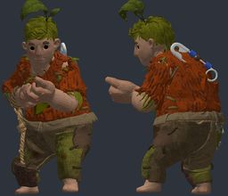
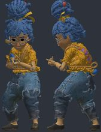
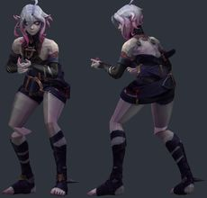

# Batch 11: 3 GMod player models

Generated by `batchnotes.py` from `catalog.json` and the conversion reports (`<work>/reports/<slug>.json`); review notes below the
marker are hand-written. All models: [MODELS.md](MODELS.md). Method and rules: [docs/creation/gmod-playermodels.md](../../docs/creation/gmod-playermodels.md).

3 models, 3 compiled, 2 with fit warnings.

Columns: **limb** = worst arm/leg joint distance from CS2's (u); **torso** = how far the upper torso was moved back (u); **head hb** = how far the
head hit box moved (z, u); **fingers** = finger fit L/R (u, < 1.8 fine).

| picture (click: every pose) | slug | workshop item | model | tris | scale | limb | torso | head hb | fingers | compile | notes |
|---|---|---|---|---|---|---|---|---|---|---|---|
|  | `itt_cody` | [It Takes Two - Playable Characters - Cody](https://models.spriters-resource.com/pc_computer/ittakestwo/) by Hazelight Studios (rip: The Models Resource) | `itt_cody.npz` | 93119 | 1.058 | 16.7 | 0.0 | +0.0 z | 0.4/0.5 | OK | bulky torso: chest 12.3 u further forward than a stock agent; CS2 hand poses (two-handed weapons) will clip into it; hand_R inside the torso in the CS2 preview pose (chest surface 7.2 u in front of the wrist) |
|  | `itt_may` | [It Takes Two - Playable Characters - May](https://models.spriters-resource.com/pc_computer/ittakestwo/) by Hazelight Studios (rip: The Models Resource) | `itt_may.npz` | 116524 | 1.359 | 5.6 | -2.28 | +4.9 z | 1.6/1.6 | OK | bulky torso: chest 5.5 u further forward than a stock agent; CS2 hand poses (two-handed weapons) will clip into it; skeleton does not match CS2 (limb joints more than 5 u off: leg_upper_L 5.6, leg_upper_R 5.6): CS2 will bend the limbs away from the joints of the model |
|  | `itt_briar` | [League of Legends - Briar](https://leagueoflegends.fandom.com/wiki/Briar) by Riot Games (rip, user-supplied GLB) | `itt_briar.npz` | 13446 | 1.338 | 10.1 | -3.03 | +1.0 z | 0.7/0.7 | OK | ok |

<!-- review notes: kept by batchnotes.py -->
## Review
