# Batch 12: 135 GMod player models

Generated by `batchnotes.py` from `catalog.json` and the conversion reports (`<work>/reports/<slug>.json`); review notes below the
marker are hand-written. All models: [MODELS.md](MODELS.md). Method and rules: [docs/creation/gmod-playermodels.md](../../docs/creation/gmod-playermodels.md).

135 models, 135 compiled, 87 with fit warnings.

Columns: **limb** = worst arm/leg joint distance from CS2's (u); **torso** = how far the upper torso was moved back (u); **head hb** = how far the
head hit box moved (z, u); **fingers** = finger fit L/R (u, < 1.8 fine).

| picture (click: every pose) | slug | workshop item | model | tris | scale | limb | torso | head hb | fingers | compile | notes |
|---|---|---|---|---|---|---|---|---|---|---|---|
| <a href="img/poses/lol_ahri.jpg">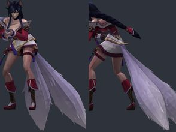</a> | `lol_ahri` | [League of Legends - Ahri](https://modelviewer.lol/model-viewer?id=103000) by Riot Games (export: modelviewer.lol) | `lol_ahri.npz` | 21062 | 1.226 | 14.0 | 5.02 | -4.0 z | 0.5/0.5 | OK | bulky torso: chest 8.6 u further forward than a stock agent; CS2 hand poses (two-handed weapons) will clip into it; hand_R inside the torso in the CS2 preview pose (chest surface 4.8 u in front of the wrist) |
| <a href="img/poses/lol_aatrox.jpg">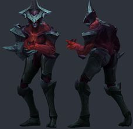</a> | `lol_aatrox` | [League of Legends - Aatrox](https://modelviewer.lol/model-viewer?id=266000) by Riot Games (export: modelviewer.lol) | `lol_aatrox.npz` | 5845 | 0.982 | 7.6 | 1.46 | +1.2 z | 1.4/2.6 | OK | hand_R fingers sit 2.6 u from their CS2 finger bones: CS2 finger curls will distort them |
| <a href="img/poses/lol_akali.jpg">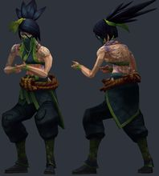</a> | `lol_akali` | [League of Legends - Akali](https://modelviewer.lol/model-viewer?id=84000) by Riot Games (export: modelviewer.lol) | `lol_akali.npz` | 6405 | 1.24 | 6.8 | -1.83 | -0.6 z | 0.3/0.3 | OK | ok |
| <a href="img/poses/lol_akshan.jpg">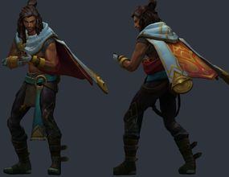</a> | `lol_akshan` | [League of Legends - Akshan](https://modelviewer.lol/model-viewer?id=166000) by Riot Games (export: modelviewer.lol) | `lol_akshan.npz` | 13752 | 1.138 | 4.1 | -0.87 | -2.0 z | 0.3/0.3 | OK | bulky torso: chest 4.1 u further forward than a stock agent; CS2 hand poses (two-handed weapons) will clip into it |
| <a href="img/poses/lol_alistar.jpg">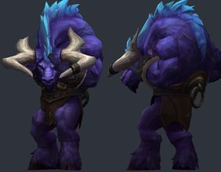</a> | `lol_alistar` | [League of Legends - Alistar](https://modelviewer.lol/model-viewer?id=12000) by Riot Games (export: modelviewer.lol) | `lol_alistar.npz` | 6382 | 1.089 | 16.6 | 0.0 | -3.9 z |  | OK | bulky torso: chest 15.7 u further forward than a stock agent; CS2 hand poses (two-handed weapons) will clip into it; hand_R inside the torso in the CS2 preview pose (chest surface 15.5 u in front of the wrist) |
| <a href="img/poses/lol_ambessa.jpg">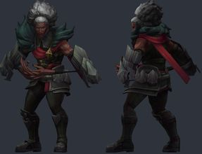</a> | `lol_ambessa` | [League of Legends - Ambessa](https://modelviewer.lol/model-viewer?id=799000) by Riot Games (export: modelviewer.lol) | `lol_ambessa.npz` | 14675 | 1.098 | 7.2 | -1.69 | +1.9 z | 6.2/6.2 | OK | hand_L fingers sit 6.2 u from their CS2 finger bones: CS2 finger curls will distort them; hand_R fingers sit 6.2 u from their CS2 finger bones: CS2 finger curls will distort them |
| <a href="img/poses/lol_amumu.jpg">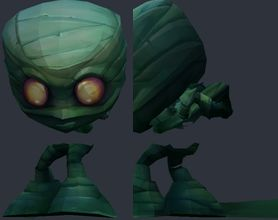</a> | `lol_amumu` | [League of Legends - Amumu](https://modelviewer.lol/model-viewer?id=32000) by Riot Games (export: modelviewer.lol) | `lol_amumu.npz` | 2403 | 1.25 | 49.0 | 0.0 | +0.0 z |  | OK | bulky torso: chest 12.1 u further forward than a stock agent; CS2 hand poses (two-handed weapons) will clip into it; hand_R inside the torso in the CS2 preview pose (chest surface 7.5 u in front of the wrist); hand_L not aligned to CS2 (the rig has no index finger plus an outer finger): fingers will bend about the wrong points; hand_R not aligned to CS2 (the rig has no index finger plus an outer finger): fingers will bend about the wrong points |
| <a href="img/poses/lol_annie.jpg">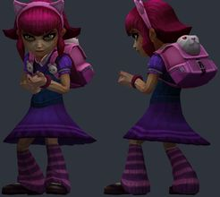</a> | `lol_annie` | [League of Legends - Annie](https://modelviewer.lol/model-viewer?id=1000) by Riot Games (export: modelviewer.lol) | `lol_annie.npz` | 6020 | 1.25 | 21.4 | 0.0 | +0.0 z | 0.1/0.1 | OK | ok |
| <a href="img/poses/lol_aphelios.jpg">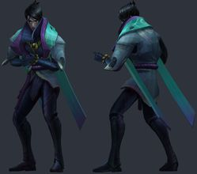</a> | `lol_aphelios` | [League of Legends - Aphelios](https://modelviewer.lol/model-viewer?id=523000) by Riot Games (export: modelviewer.lol) | `lol_aphelios.npz` | 8881 | 1.213 | 3.9 | -2.29 | +0.5 z | 0.4/0.4 | OK | ok |
| <a href="img/poses/lol_ashe.jpg">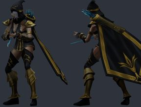</a> | `lol_ashe` | [League of Legends - Ashe](https://modelviewer.lol/model-viewer?id=22000) by Riot Games (export: modelviewer.lol) | `lol_ashe.npz` | 6554 | 1.387 | 8.2 | 1.03 | +3.0 z | 0.4/0.5 | OK | ok |
| <a href="img/poses/lol_aurora.jpg">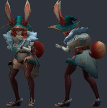</a> | `lol_aurora` | [League of Legends - Aurora](https://modelviewer.lol/model-viewer?id=893000) by Riot Games (export: modelviewer.lol) | `lol_aurora.npz` | 14741 | 1.175 | 8.9 | 4.85 | +4.2 z | 0.4/0.4 | OK | bulky torso: chest 8.9 u further forward than a stock agent; CS2 hand poses (two-handed weapons) will clip into it; hand_R inside the torso in the CS2 preview pose (chest surface 6.5 u in front of the wrist) |
| <a href="img/poses/lol_azir.jpg">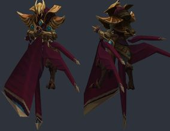</a> | `lol_azir` | [League of Legends - Azir](https://modelviewer.lol/model-viewer?id=268000) by Riot Games (export: modelviewer.lol) | `lol_azir.npz` | 5470 | 0.95 | 5.2 | -1.1 | -4.6 z | 0.5/0.5 | OK | ok |
| <a href="img/poses/lol_brand.jpg">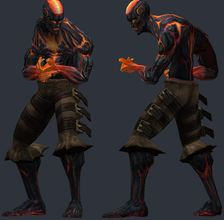</a> | `lol_brand` | [League of Legends - Brand](https://modelviewer.lol/model-viewer?id=63000) by Riot Games (export: modelviewer.lol) | `lol_brand.npz` | 3520 | 1.716 | 10.6 | -2.76 | -3.9 z | 0.8/0.8 | OK | bulky torso: chest 5.6 u further forward than a stock agent; CS2 hand poses (two-handed weapons) will clip into it |
| <a href="img/poses/lol_braum.jpg">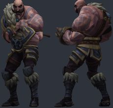</a> | `lol_braum` | [League of Legends - Braum](https://modelviewer.lol/model-viewer?id=201000) by Riot Games (export: modelviewer.lol) | `lol_braum.npz` | 10400 | 1.093 | 6.8 | -0.24 | -5.0 z | 0.2/0.2 | OK | bulky torso: chest 6.8 u further forward than a stock agent; CS2 hand poses (two-handed weapons) will clip into it; hand_R inside the torso in the CS2 preview pose (chest surface 6.6 u in front of the wrist) |
| <a href="img/poses/lol_briar.jpg">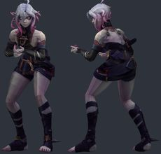</a> | `lol_briar` | [League of Legends - Briar](https://modelviewer.lol/model-viewer?id=233000) by Riot Games (export: modelviewer.lol) | `lol_briar.npz` | 13446 | 1.338 | 10.1 | -3.03 | +1.0 z | 0.7/0.7 | OK | ok |
| <a href="img/poses/lol_caitlyn.jpg">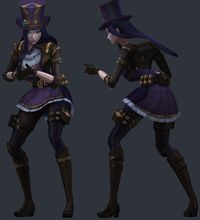</a> | `lol_caitlyn` | [League of Legends - Caitlyn](https://modelviewer.lol/model-viewer?id=51000) by Riot Games (export: modelviewer.lol) | `lol_caitlyn.npz` | 13793 | 1.187 | 9.4 | 4.17 | -2.6 z | 0.4/0.4 | OK | bulky torso: chest 5.6 u further forward than a stock agent; CS2 hand poses (two-handed weapons) will clip into it; hand_R inside the torso in the CS2 preview pose (chest surface 3.3 u in front of the wrist) |
| <a href="img/poses/lol_camille.jpg">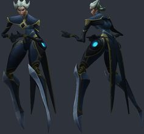</a> | `lol_camille` | [League of Legends - Camille](https://modelviewer.lol/model-viewer?id=164000) by Riot Games (export: modelviewer.lol) | `lol_camille.npz` | 5634 | 1.071 | 11.6 | -1.5 | -2.8 z | 0.2/0.3 | OK | ok |
| <a href="img/poses/lol_darius.jpg">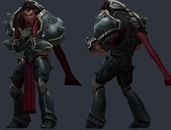</a> | `lol_darius` | [League of Legends - Darius](https://modelviewer.lol/model-viewer?id=122000) by Riot Games (export: modelviewer.lol) | `lol_darius.npz` | 8083 | 1.065 | 3.1 | 1.16 | +0.0 z | 0.7/0.7 | OK | bulky torso: chest 7.1 u further forward than a stock agent; CS2 hand poses (two-handed weapons) will clip into it; hand_R inside the torso in the CS2 preview pose (chest surface 3.2 u in front of the wrist) |
| <a href="img/poses/lol_diana.jpg">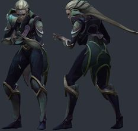</a> | `lol_diana` | [League of Legends - Diana](https://modelviewer.lol/model-viewer?id=131000) by Riot Games (export: modelviewer.lol) | `lol_diana.npz` | 10377 | 1.342 | 8.1 | 4.83 | -4.0 z | 0.5/0.5 | OK | bulky torso: chest 8.0 u further forward than a stock agent; CS2 hand poses (two-handed weapons) will clip into it; hand_R inside the torso in the CS2 preview pose (chest surface 4.5 u in front of the wrist) |
| <a href="img/poses/lol_draven.jpg">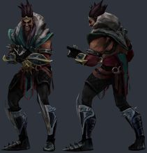</a> | `lol_draven` | [League of Legends - Draven](https://modelviewer.lol/model-viewer?id=119000) by Riot Games (export: modelviewer.lol) | `lol_draven.npz` | 7783 | 1.208 | 7.7 | 0.37 | +1.0 z | 1.2/0.7 | OK | ok |
| <a href="img/poses/lol_drmundo.jpg">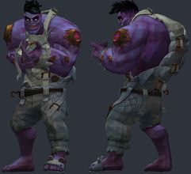</a> | `lol_drmundo` | [League of Legends - Dr. Mundo](https://modelviewer.lol/model-viewer?id=36000) by Riot Games (export: modelviewer.lol) | `lol_drmundo.npz` | 14026 | 0.707 | 10.6 | -0.47 | -4.9 z | 1.8/1.8 | OK | bulky torso: chest 4.3 u further forward than a stock agent; CS2 hand poses (two-handed weapons) will clip into it; hand_R inside the torso in the CS2 preview pose (chest surface 3.4 u in front of the wrist) |
| <a href="img/poses/lol_ekko.jpg">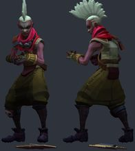</a> | `lol_ekko` | [League of Legends - Ekko](https://modelviewer.lol/model-viewer?id=245000) by Riot Games (export: modelviewer.lol) | `lol_ekko.npz` | 5441 | 1.369 | 7.1 | -0.08 | +5.0 z | 1.7/1.7 | OK | ok |
| <a href="img/poses/lol_elise.jpg">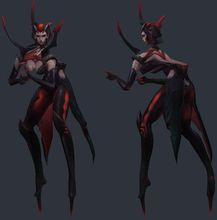</a> | `lol_elise` | [League of Legends - Elise](https://modelviewer.lol/model-viewer?id=60000) by Riot Games (export: modelviewer.lol) | `lol_elise.npz` | 8128 | 1.345 | 22.8 | -1.32 | +4.8 z | 0.5/0.5 | OK | ok |
| <a href="img/poses/lol_evelynn.jpg">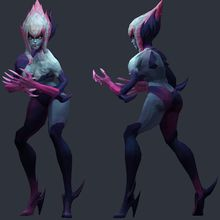</a> | `lol_evelynn` | [League of Legends - Evelynn](https://modelviewer.lol/model-viewer?id=28000) by Riot Games (export: modelviewer.lol) | `lol_evelynn.npz` | 7055 | 1.195 | 12.1 | -1.89 | +3.2 z |  | OK | hand_L not aligned to CS2 (the rig has no index finger plus an outer finger): fingers will bend about the wrong points; hand_R not aligned to CS2 (the rig has no index finger plus an outer finger): fingers will bend about the wrong points |
| <a href="img/poses/lol_ezreal.jpg">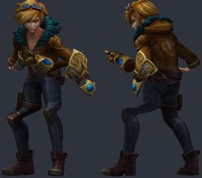</a> | `lol_ezreal` | [League of Legends - Ezreal](https://modelviewer.lol/model-viewer?id=81000) by Riot Games (export: modelviewer.lol) | `lol_ezreal.npz` | 8069 | 1.345 | 7.7 | 0.79 | +2.5 z | 0.8/0.7 | OK | ok |
| <a href="img/poses/lol_fiddlesticks.jpg">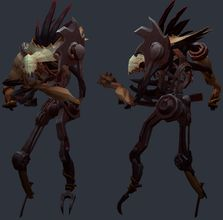</a> | `lol_fiddlesticks` | [League of Legends - Fiddlesticks](https://modelviewer.lol/model-viewer?id=9000) by Riot Games (export: modelviewer.lol) | `lol_fiddlesticks.npz` | 8681 | 0.699 | 18.5 | -4.05 | -4.8 z | 0.5/1.6 | OK | ok |
| <a href="img/poses/lol_fiora.jpg">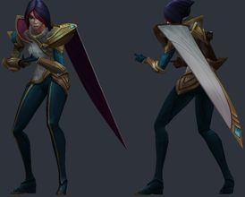</a> | `lol_fiora` | [League of Legends - Fiora](https://modelviewer.lol/model-viewer?id=114000) by Riot Games (export: modelviewer.lol) | `lol_fiora.npz` | 6456 | 1.341 | 7.5 | -0.02 | -0.9 z | 0.5/0.5 | OK | ok |
| <a href="img/poses/lol_fizz.jpg">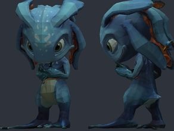</a> | `lol_fizz` | [League of Legends - Fizz](https://modelviewer.lol/model-viewer?id=105000) by Riot Games (export: modelviewer.lol) | `lol_fizz.npz` | 6964 | 1.25 | 44.7 | 0.0 | +0.0 z | 0.3/0.2 | OK | ok |
| <a href="img/poses/lol_gangplank.jpg">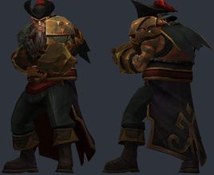</a> | `lol_gangplank` | [League of Legends - Gangplank](https://modelviewer.lol/model-viewer?id=41000) by Riot Games (export: modelviewer.lol) | `lol_gangplank.npz` | 7501 | 1.076 | 3.8 | -1.82 | -4.9 z | 1.5/0.7 | OK | bulky torso: chest 4.3 u further forward than a stock agent; CS2 hand poses (two-handed weapons) will clip into it; hand_R inside the torso in the CS2 preview pose (chest surface 3.3 u in front of the wrist) |
| <a href="img/poses/lol_garen.jpg">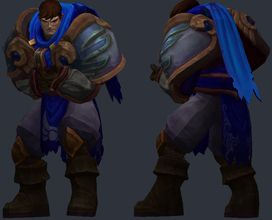</a> | `lol_garen` | [League of Legends - Garen](https://modelviewer.lol/model-viewer?id=86000) by Riot Games (export: modelviewer.lol) | `lol_garen.npz` | 5958 | 1.11 | 4.7 | 2.08 | -1.7 z | 1.4/1.3 | OK | bulky torso: chest 7.9 u further forward than a stock agent; CS2 hand poses (two-handed weapons) will clip into it; hand_R inside the torso in the CS2 preview pose (chest surface 3.9 u in front of the wrist) |
| <a href="img/poses/lol_gnar.jpg">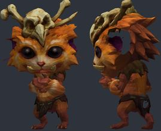</a> | `lol_gnar` | [League of Legends - Gnar](https://modelviewer.lol/model-viewer?id=150000) by Riot Games (export: modelviewer.lol) | `lol_gnar.npz` | 7238 | 1.25 | 40.4 | 0.0 | +0.0 z | 0.2/0.2 | OK | hand_R inside the torso in the CS2 preview pose (chest surface 4.8 u in front of the wrist) |
| <a href="img/poses/lol_gragas.jpg">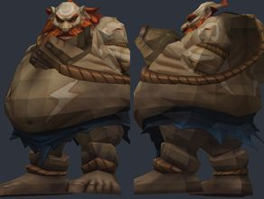</a> | `lol_gragas` | [League of Legends - Gragas](https://modelviewer.lol/model-viewer?id=79000) by Riot Games (export: modelviewer.lol) | `lol_gragas.npz` | 2782 | 1.084 | 21.3 | 0.0 | -4.7 z | 9.0/9.6 | OK | bulky torso: chest 7.7 u further forward than a stock agent; CS2 hand poses (two-handed weapons) will clip into it; hand_L inside the torso in the CS2 preview pose (chest surface 10.1 u in front of the wrist); hand_R inside the torso in the CS2 preview pose (chest surface 27.4 u in front of the wrist); hand_L fingers sit 9.0 u from their CS2 finger bones: CS2 finger curls will distort them; hand_R fingers sit 9.6 u from their CS2 finger bones: CS2 finger curls will distort them; hand_L not aligned to CS2 (the rig has no index finger plus an outer finger): fingers will bend about the wrong points; hand_R not aligned to CS2 (the rig has no index finger plus an outer finger): fingers will bend about the wrong points |
| <a href="img/poses/lol_graves.jpg">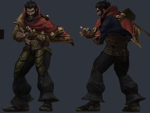</a> | `lol_graves` | [League of Legends - Graves](https://modelviewer.lol/model-viewer?id=104000) by Riot Games (export: modelviewer.lol) | `lol_graves.npz` | 6764 | 1.322 | 4.3 | 1.19 | +0.3 z | 3.8/3.8 | OK | bulky torso: chest 4.6 u further forward than a stock agent; CS2 hand poses (two-handed weapons) will clip into it; hand_L fingers sit 3.8 u from their CS2 finger bones: CS2 finger curls will distort them; hand_R fingers sit 3.8 u from their CS2 finger bones: CS2 finger curls will distort them; hand_L not aligned to CS2 (the rig has no index finger plus an outer finger): fingers will bend about the wrong points; hand_R not aligned to CS2 (the rig has no index finger plus an outer finger): fingers will bend about the wrong points |
| <a href="img/poses/lol_gwen.jpg">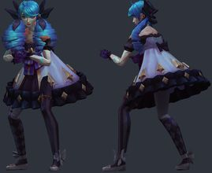</a> | `lol_gwen` | [League of Legends - Gwen](https://modelviewer.lol/model-viewer?id=887000) by Riot Games (export: modelviewer.lol) | `lol_gwen.npz` | 11887 | 1.304 | 7.2 | -3.05 | -4.3 z | 0.6/0.5 | OK | ok |
| <a href="img/poses/lol_heimerdinger.jpg">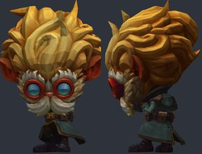</a> | `lol_heimerdinger` | [League of Legends - Heimerdinger](https://modelviewer.lol/model-viewer?id=74000) by Riot Games (export: modelviewer.lol) | `lol_heimerdinger.npz` | 3892 | 1.25 | 40.1 | 0.0 | +0.0 z | 0.5/0.5 | OK | hand_R inside the torso in the CS2 preview pose (chest surface 7.2 u in front of the wrist) |
| <a href="img/poses/lol_hwei.jpg">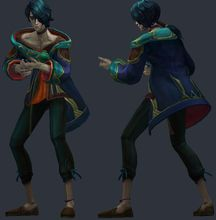</a> | `lol_hwei` | [League of Legends - Hwei](https://modelviewer.lol/model-viewer?id=910000) by Riot Games (export: modelviewer.lol) | `lol_hwei.npz` | 13915 | 1.147 | 7.4 | -0.38 | -3.5 z | 0.3/0.3 | OK | ok |
| <a href="img/poses/lol_illaoi.jpg">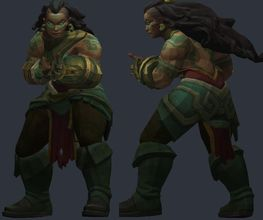</a> | `lol_illaoi` | [League of Legends - Illaoi](https://modelviewer.lol/model-viewer?id=420000) by Riot Games (export: modelviewer.lol) | `lol_illaoi.npz` | 6650 | 1.304 | 6.4 | 5.91 | -4.5 z | 1.1/1.1 | OK | bulky torso: chest 10.2 u further forward than a stock agent; CS2 hand poses (two-handed weapons) will clip into it; hand_R inside the torso in the CS2 preview pose (chest surface 8.0 u in front of the wrist) |
| <a href="img/poses/lol_irelia.jpg">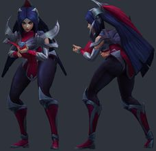</a> | `lol_irelia` | [League of Legends - Irelia](https://modelviewer.lol/model-viewer?id=39000) by Riot Games (export: modelviewer.lol) | `lol_irelia.npz` | 7211 | 1.121 | 9.3 | 5.05 | -4.7 z | 0.5/0.5 | OK | bulky torso: chest 6.4 u further forward than a stock agent; CS2 hand poses (two-handed weapons) will clip into it; hand_R inside the torso in the CS2 preview pose (chest surface 5.6 u in front of the wrist) |
| <a href="img/poses/lol_ivern.jpg">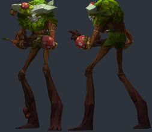</a> | `lol_ivern` | [League of Legends - Ivern](https://modelviewer.lol/model-viewer?id=427000) by Riot Games (export: modelviewer.lol) | `lol_ivern.npz` | 7401 | 0.895 | 13.8 | -0.2 | -4.9 z | 1.4/6.0 | OK | hand_R fingers sit 6.0 u from their CS2 finger bones: CS2 finger curls will distort them |
| <a href="img/poses/lol_janna.jpg">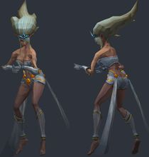</a> | `lol_janna` | [League of Legends - Janna](https://modelviewer.lol/model-viewer?id=40000) by Riot Games (export: modelviewer.lol) | `lol_janna.npz` | 4172 | 1.706 | 13.0 | -2.71 | +2.5 z | 0.3/0.3 | OK | ok |
| <a href="img/poses/lol_jarvaniv.jpg">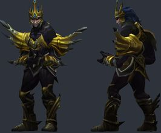</a> | `lol_jarvaniv` | [League of Legends - Jarvan IV](https://modelviewer.lol/model-viewer?id=59000) by Riot Games (export: modelviewer.lol) | `lol_jarvaniv.npz` | 7414 | 1.256 | 5.7 | -2.81 | +2.5 z | 1.9/2.3 | OK | bulky torso: chest 5.0 u further forward than a stock agent; CS2 hand poses (two-handed weapons) will clip into it; hand_R inside the torso in the CS2 preview pose (chest surface 7.9 u in front of the wrist); hand_L fingers sit 1.9 u from their CS2 finger bones: CS2 finger curls will distort them; hand_R fingers sit 2.3 u from their CS2 finger bones: CS2 finger curls will distort them; hand_L not aligned to CS2 (the rig has no index finger plus an outer finger): fingers will bend about the wrong points; hand_R not aligned to CS2 (the rig has no index finger plus an outer finger): fingers will bend about the wrong points |
| <a href="img/poses/lol_jax.jpg">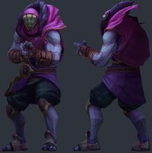</a> | `lol_jax` | [League of Legends - Jax](https://modelviewer.lol/model-viewer?id=24000) by Riot Games (export: modelviewer.lol) | `lol_jax.npz` | 10171 | 0.965 | 4.0 | -2.55 | -4.9 z | 2.3/2.3 | OK | hand_L fingers sit 2.3 u from their CS2 finger bones: CS2 finger curls will distort them; hand_R fingers sit 2.3 u from their CS2 finger bones: CS2 finger curls will distort them |
| <a href="img/poses/lol_jayce.jpg">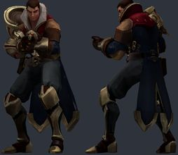</a> | `lol_jayce` | [League of Legends - Jayce](https://modelviewer.lol/model-viewer?id=126000) by Riot Games (export: modelviewer.lol) | `lol_jayce.npz` | 8326 | 1.032 | 5.7 | -0.45 | -2.0 z | 1.4/1.5 | OK | hand_L not aligned to CS2 (the rig has no index finger plus an outer finger): fingers will bend about the wrong points; hand_R not aligned to CS2 (the rig has no index finger plus an outer finger): fingers will bend about the wrong points |
| <a href="img/poses/lol_jhin.jpg">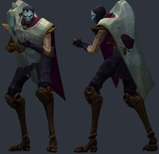</a> | `lol_jhin` | [League of Legends - Jhin](https://modelviewer.lol/model-viewer?id=202000) by Riot Games (export: modelviewer.lol) | `lol_jhin.npz` | 6448 | 1.245 | 10.0 | 1.03 | -0.4 z | 0.3/0.3 | OK | ok |
| <a href="img/poses/lol_jinx.jpg">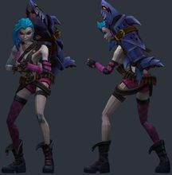</a> | `lol_jinx` | [League of Legends - Jinx](https://modelviewer.lol/model-viewer?id=222000) by Riot Games (export: modelviewer.lol) | `lol_jinx.npz` | 10147 | 1.163 | 10.3 | 4.36 | -0.2 z | 0.4/0.5 | OK | bulky torso: chest 6.0 u further forward than a stock agent; CS2 hand poses (two-handed weapons) will clip into it |
| <a href="img/poses/lol_kaisa.jpg">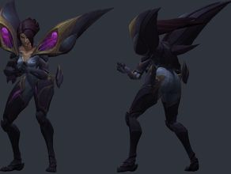</a> | `lol_kaisa` | [League of Legends - Kai'Sa](https://modelviewer.lol/model-viewer?id=145000) by Riot Games (export: modelviewer.lol) | `lol_kaisa.npz` | 9615 | 1.187 | 7.9 | 1.34 | -0.4 z | 0.4/0.4 | OK | ok |
| <a href="img/poses/lol_kalista.jpg">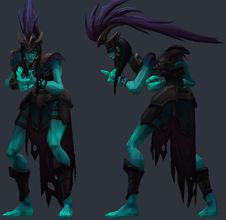</a> | `lol_kalista` | [League of Legends - Kalista](https://modelviewer.lol/model-viewer?id=429000) by Riot Games (export: modelviewer.lol) | `lol_kalista.npz` | 7078 | 0.861 | 7.8 | 13.31 | -2.2 z | 1.4/1.4 | OK | bulky torso: chest 16.6 u further forward than a stock agent; CS2 hand poses (two-handed weapons) will clip into it |
| <a href="img/poses/lol_karma.jpg">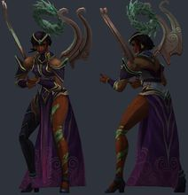</a> | `lol_karma` | [League of Legends - Karma](https://modelviewer.lol/model-viewer?id=43000) by Riot Games (export: modelviewer.lol) | `lol_karma.npz` | 11572 | 1.324 | 10.0 | -1.5 | +1.2 z | 0.3/0.3 | OK | ok |
| <a href="img/poses/lol_karthus.jpg">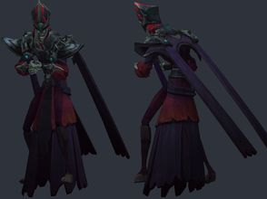</a> | `lol_karthus` | [League of Legends - Karthus](https://modelviewer.lol/model-viewer?id=30000) by Riot Games (export: modelviewer.lol) | `lol_karthus.npz` | 7002 | 1.022 | 9.4 | 0.86 | +3.6 z | 0.4/0.4 | OK | ok |
| <a href="img/poses/lol_katarina.jpg">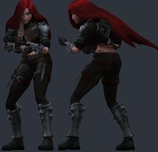</a> | `lol_katarina` | [League of Legends - Katarina](https://modelviewer.lol/model-viewer?id=55000) by Riot Games (export: modelviewer.lol) | `lol_katarina.npz` | 13568 | 1.483 | 5.1 | 5.27 | -4.5 z | 0.3/0.3 | OK | bulky torso: chest 8.6 u further forward than a stock agent; CS2 hand poses (two-handed weapons) will clip into it; hand_R inside the torso in the CS2 preview pose (chest surface 4.8 u in front of the wrist) |
|  | `lol_kayle` | [League of Legends - Kayle](https://modelviewer.lol/model-viewer?id=10000) by Riot Games (export: modelviewer.lol) | `lol_kayle.npz` | 6634 | 1.547 | 8.2 | -1.07 | +1.4 z | 0.3/0.3 | OK | ok |
|  | `lol_kayn` | [League of Legends - Kayn](https://modelviewer.lol/model-viewer?id=141000) by Riot Games (export: modelviewer.lol) | `lol_kayn.npz` | 5575 | 1.128 | 8.1 | -0.74 | -0.1 z | 0.2/0.2 | OK | ok |
|  | `lol_kennen` | [League of Legends - Kennen](https://modelviewer.lol/model-viewer?id=85000) by Riot Games (export: modelviewer.lol) | `lol_kennen.npz` | 2788 | 1.25 | 30.2 | 0.0 | +0.0 z | 0.4/1.4 | OK | bulky torso: chest 12.1 u further forward than a stock agent; CS2 hand poses (two-handed weapons) will clip into it; hand_R inside the torso in the CS2 preview pose (chest surface 12.1 u in front of the wrist) |
|  | `lol_ksante` | [League of Legends - K'Sante](https://modelviewer.lol/model-viewer?id=897000) by Riot Games (export: modelviewer.lol) | `lol_ksante.npz` | 13450 | 0.948 | 3.4 | -2.16 | -3.2 z | 1.7/1.7 | OK | bulky torso: chest 4.2 u further forward than a stock agent; CS2 hand poses (two-handed weapons) will clip into it |
|  | `lol_leblanc` | [League of Legends - LeBlanc](https://modelviewer.lol/model-viewer?id=7000) by Riot Games (export: modelviewer.lol) | `lol_leblanc.npz` | 14797 | 1.193 | 10.9 | -2.34 | +3.0 z | 0.3/0.2 | OK | ok |
|  | `lol_leesin` | [League of Legends - Lee Sin](https://modelviewer.lol/model-viewer?id=64000) by Riot Games (export: modelviewer.lol) | `lol_leesin.npz` | 13620 | 1.015 | 3.6 | -0.31 | -0.1 z | 0.5/0.5 | OK | ok |
|  | `lol_leona` | [League of Legends - Leona](https://modelviewer.lol/model-viewer?id=89000) by Riot Games (export: modelviewer.lol) | `lol_leona.npz` | 7038 | 1.58 | 10.8 | 0.54 | -2.8 z | 2.1/1.7 | OK | hand_L fingers sit 2.1 u from their CS2 finger bones: CS2 finger curls will distort them; hand_L not aligned to CS2 (the rig has no index finger plus an outer finger): fingers will bend about the wrong points; hand_R not aligned to CS2 (the rig has no index finger plus an outer finger): fingers will bend about the wrong points |
|  | `lol_locke` | [League of Legends - Locke](https://modelviewer.lol/model-viewer?id=805000) by Riot Games (export: modelviewer.lol) | `lol_locke.npz` | 25400 | 1.097 | 3.5 | -2.1 | +1.4 z | 0.2/0.2 | OK | ok |
|  | `lol_lucian` | [League of Legends - Lucian](https://modelviewer.lol/model-viewer?id=236000) by Riot Games (export: modelviewer.lol) | `lol_lucian.npz` | 11154 | 1.157 | 9.2 | 0.68 | +0.9 z | 0.5/0.5 | OK | ok |
|  | `lol_lulu` | [League of Legends - Lulu](https://modelviewer.lol/model-viewer?id=117000) by Riot Games (export: modelviewer.lol) | `lol_lulu.npz` | 8272 | 1.25 | 46.0 | 0.0 | +0.0 z | 1.6/1.8 | OK | hand_R inside the torso in the CS2 preview pose (chest surface 4.4 u in front of the wrist); hand_L not aligned to CS2 (the rig has no index finger plus an outer finger): fingers will bend about the wrong points; hand_R not aligned to CS2 (the rig has no index finger plus an outer finger): fingers will bend about the wrong points |
|  | `lol_lux` | [League of Legends - Lux](https://modelviewer.lol/model-viewer?id=99000) by Riot Games (export: modelviewer.lol) | `lol_lux.npz` | 3936 | 1.918 | 7.4 | -2.95 | +3.6 z | 2.4/2.3 | OK | hand_L fingers sit 2.4 u from their CS2 finger bones: CS2 finger curls will distort them; hand_R fingers sit 2.3 u from their CS2 finger bones: CS2 finger curls will distort them; hand_L not aligned to CS2 (the rig has no index finger plus an outer finger): fingers will bend about the wrong points; hand_R not aligned to CS2 (the rig has no index finger plus an outer finger): fingers will bend about the wrong points |
|  | `lol_malzahar` | [League of Legends - Malzahar](https://modelviewer.lol/model-viewer?id=90000) by Riot Games (export: modelviewer.lol) | `lol_malzahar.npz` | 2904 | 1.286 | 5.3 | 0.0 | -1.4 z | 5.6/5.8 | OK | hand_L fingers sit 5.6 u from their CS2 finger bones: CS2 finger curls will distort them; hand_R fingers sit 5.8 u from their CS2 finger bones: CS2 finger curls will distort them; hand_L not aligned to CS2 (the rig has no index finger plus an outer finger): fingers will bend about the wrong points; hand_R not aligned to CS2 (the rig has no index finger plus an outer finger): fingers will bend about the wrong points |
|  | `lol_masteryi` | [League of Legends - Master Yi](https://modelviewer.lol/model-viewer?id=11000) by Riot Games (export: modelviewer.lol) | `lol_masteryi.npz` | 7484 | 1.873 | 6.8 | 1.41 | +3.7 z | 0.5/0.5 | OK | ok |
|  | `lol_mel` | [League of Legends - Mel](https://modelviewer.lol/model-viewer?id=800000) by Riot Games (export: modelviewer.lol) | `lol_mel.npz` | 14707 | 1.192 | 8.9 | -2.84 | +3.0 z | 0.4/0.4 | OK | ok |
|  | `lol_milio` | [League of Legends - Milio](https://modelviewer.lol/model-viewer?id=902000) by Riot Games (export: modelviewer.lol) | `lol_milio.npz` | 10726 | 1.542 | 6.6 | -1.2 | +4.5 z | 5.2/5.2 | OK | hand_L fingers sit 5.2 u from their CS2 finger bones: CS2 finger curls will distort them; hand_R fingers sit 5.2 u from their CS2 finger bones: CS2 finger curls will distort them |
|  | `lol_missfortune` | [League of Legends - Miss Fortune](https://modelviewer.lol/model-viewer?id=21000) by Riot Games (export: modelviewer.lol) | `lol_missfortune.npz` | 5648 | 1.516 | 7.1 | -4.46 | +1.0 z | 1.2/1.2 | OK | hand_L not aligned to CS2 (the rig has no index finger plus an outer finger): fingers will bend about the wrong points; hand_R not aligned to CS2 (the rig has no index finger plus an outer finger): fingers will bend about the wrong points |
|  | `lol_mordekaiser` | [League of Legends - Mordekaiser](https://modelviewer.lol/model-viewer?id=82000) by Riot Games (export: modelviewer.lol) | `lol_mordekaiser.npz` | 8456 | 0.95 | 5.0 | -1.99 | +3.1 z | 1.1/1.1 | OK | bulky torso: chest 8.2 u further forward than a stock agent; CS2 hand poses (two-handed weapons) will clip into it; hand_R inside the torso in the CS2 preview pose (chest surface 5.6 u in front of the wrist) |
|  | `lol_morgana` | [League of Legends - Morgana](https://modelviewer.lol/model-viewer?id=25000) by Riot Games (export: modelviewer.lol) | `lol_morgana.npz` | 10053 | 1.559 | 7.8 | 8.54 | +1.8 z | 0.5/0.5 | OK | bulky torso: chest 12.0 u further forward than a stock agent; CS2 hand poses (two-handed weapons) will clip into it; hand_R inside the torso in the CS2 preview pose (chest surface 7.6 u in front of the wrist) |
|  | `lol_nasus` | [League of Legends - Nasus](https://modelviewer.lol/model-viewer?id=75000) by Riot Games (export: modelviewer.lol) | `lol_nasus.npz` | 8401 | 1.198 | 6.2 | 1.5 | -2.1 z | 0.6/0.6 | OK | bulky torso: chest 5.0 u further forward than a stock agent; CS2 hand poses (two-handed weapons) will clip into it; hand_R inside the torso in the CS2 preview pose (chest surface 4.0 u in front of the wrist) |
|  | `lol_nautilus` | [League of Legends - Nautilus](https://modelviewer.lol/model-viewer?id=111000) by Riot Games (export: modelviewer.lol) | `lol_nautilus.npz` | 5086 | 0.964 | 15.0 | 0.0 | -4.1 z | 1.3/1.4 | OK | bulky torso: chest 16.8 u further forward than a stock agent; CS2 hand poses (two-handed weapons) will clip into it; hand_L inside the torso in the CS2 preview pose (chest surface 3.9 u in front of the wrist); hand_R inside the torso in the CS2 preview pose (chest surface 18.7 u in front of the wrist) |
|  | `lol_neeko` | [League of Legends - Neeko](https://modelviewer.lol/model-viewer?id=518000) by Riot Games (export: modelviewer.lol) | `lol_neeko.npz` | 8178 | 1.333 | 30.1 | 0.27 | +5.0 z | 0.8/0.8 | OK | ok |
|  | `lol_nidalee` | [League of Legends - Nidalee](https://modelviewer.lol/model-viewer?id=76000) by Riot Games (export: modelviewer.lol) | `lol_nidalee.npz` | 9454 | 1.586 | 7.4 | 0.87 | -3.1 z | 0.8/0.8 | OK | hand_R inside the torso in the CS2 preview pose (chest surface 5.2 u in front of the wrist) |
|  | `lol_nilah` | [League of Legends - Nilah](https://modelviewer.lol/model-viewer?id=895000) by Riot Games (export: modelviewer.lol) | `lol_nilah.npz` | 14334 | 1.123 | 7.9 | 4.23 | -4.8 z | 0.4/0.4 | OK | bulky torso: chest 6.9 u further forward than a stock agent; CS2 hand poses (two-handed weapons) will clip into it |
|  | `lol_olaf` | [League of Legends - Olaf](https://modelviewer.lol/model-viewer?id=2000) by Riot Games (export: modelviewer.lol) | `lol_olaf.npz` | 3561 | 1.171 | 16.4 | -4.94 | -4.7 z | 1.8/1.0 | OK | bulky torso: chest 8.5 u further forward than a stock agent; CS2 hand poses (two-handed weapons) will clip into it; hand_R inside the torso in the CS2 preview pose (chest surface 4.5 u in front of the wrist); hand_L not aligned to CS2 (the rig has no index finger plus an outer finger): fingers will bend about the wrong points; hand_R not aligned to CS2 (the rig has no index finger plus an outer finger): fingers will bend about the wrong points |
|  | `lol_orianna` | [League of Legends - Orianna](https://modelviewer.lol/model-viewer?id=61000) by Riot Games (export: modelviewer.lol) | `lol_orianna.npz` | 9434 | 1.53 | 8.6 | 5.4 | +4.0 z | 1.5/1.4 | OK | hand_R inside the torso in the CS2 preview pose (chest surface 3.2 u in front of the wrist) |
|  | `lol_pantheon` | [League of Legends - Pantheon](https://modelviewer.lol/model-viewer?id=80000) by Riot Games (export: modelviewer.lol) | `lol_pantheon.npz` | 9897 | 0.873 | 4.1 | -1.12 | +0.0 z | 0.6/0.6 | OK | ok |
|  | `lol_poppy` | [League of Legends - Poppy](https://modelviewer.lol/model-viewer?id=78000) by Riot Games (export: modelviewer.lol) | `lol_poppy.npz` | 5233 | 1.25 | 29.7 | 0.0 | +0.0 z | 0.3/0.3 | OK | hand_R inside the torso in the CS2 preview pose (chest surface 7.5 u in front of the wrist) |
|  | `lol_pyke` | [League of Legends - Pyke](https://modelviewer.lol/model-viewer?id=555000) by Riot Games (export: modelviewer.lol) | `lol_pyke.npz` | 8164 | 1.166 | 2.4 | 3.11 | -5.0 z | 1.2/1.2 | OK | bulky torso: chest 5.0 u further forward than a stock agent; CS2 hand poses (two-handed weapons) will clip into it |
|  | `lol_qiyana` | [League of Legends - Qiyana](https://modelviewer.lol/model-viewer?id=246000) by Riot Games (export: modelviewer.lol) | `lol_qiyana.npz` | 9760 | 1.422 | 8.2 | -2.9 | -1.3 z | 0.3/0.3 | OK | ok |
|  | `lol_quinn` | [League of Legends - Quinn](https://modelviewer.lol/model-viewer?id=133000) by Riot Games (export: modelviewer.lol) | `lol_quinn.npz` | 10154 | 1.345 | 8.4 | 1.31 | +1.8 z | 0.5/0.5 | OK | ok |
|  | `lol_rakan` | [League of Legends - Rakan](https://modelviewer.lol/model-viewer?id=497000) by Riot Games (export: modelviewer.lol) | `lol_rakan.npz` | 8002 | 1.366 | 6.7 | 0.56 | +4.2 z | 0.3/0.3 | OK | ok |
|  | `lol_renataglasc` | [League of Legends - Renata Glasc](https://modelviewer.lol/model-viewer?id=888000) by Riot Games (export: modelviewer.lol) | `lol_renataglasc.npz` | 9251 | 1.116 | 9.1 | 4.32 | -4.6 z | 0.4/0.5 | OK | bulky torso: chest 6.1 u further forward than a stock agent; CS2 hand poses (two-handed weapons) will clip into it; hand_R inside the torso in the CS2 preview pose (chest surface 3.5 u in front of the wrist) |
|  | `lol_renekton` | [League of Legends - Renekton](https://modelviewer.lol/model-viewer?id=58000) by Riot Games (export: modelviewer.lol) | `lol_renekton.npz` | 7430 | 1.693 | 13.3 | -1.36 | -2.9 z | 3.2/3.5 | OK | bulky torso: chest 27.4 u further forward than a stock agent; CS2 hand poses (two-handed weapons) will clip into it; hand_R inside the torso in the CS2 preview pose (chest surface 9.1 u in front of the wrist); hand_L fingers sit 3.2 u from their CS2 finger bones: CS2 finger curls will distort them; hand_R fingers sit 3.5 u from their CS2 finger bones: CS2 finger curls will distort them; hand_L not aligned to CS2 (the rig has no index finger plus an outer finger): fingers will bend about the wrong points; hand_R not aligned to CS2 (the rig has no index finger plus an outer finger): fingers will bend about the wrong points |
|  | `lol_rengar` | [League of Legends - Rengar](https://modelviewer.lol/model-viewer?id=107000) by Riot Games (export: modelviewer.lol) | `lol_rengar.npz` | 7077 | 0.896 | 17.1 | 0.0 | -4.7 z | 1.4/1.3 | OK | bulky torso: chest 11.0 u further forward than a stock agent; CS2 hand poses (two-handed weapons) will clip into it; hand_R inside the torso in the CS2 preview pose (chest surface 9.1 u in front of the wrist) |
|  | `lol_riven` | [League of Legends - Riven](https://modelviewer.lol/model-viewer?id=92000) by Riot Games (export: modelviewer.lol) | `lol_riven.npz` | 5849 | 1.903 | 7.2 | -0.81 | +4.6 z | 2.4/5.0 | OK | hand_L fingers sit 2.4 u from their CS2 finger bones: CS2 finger curls will distort them; hand_R fingers sit 5.0 u from their CS2 finger bones: CS2 finger curls will distort them; hand_L not aligned to CS2 (the rig has no index finger plus an outer finger): fingers will bend about the wrong points; hand_R not aligned to CS2 (the rig has no index finger plus an outer finger): fingers will bend about the wrong points |
|  | `lol_ryze` | [League of Legends - Ryze](https://modelviewer.lol/model-viewer?id=13000) by Riot Games (export: modelviewer.lol) | `lol_ryze.npz` | 6588 | 0.975 | 6.1 | 3.61 | -3.4 z | 1.0/1.0 | OK | bulky torso: chest 6.8 u further forward than a stock agent; CS2 hand poses (two-handed weapons) will clip into it |
|  | `lol_samira` | [League of Legends - Samira](https://modelviewer.lol/model-viewer?id=360000) by Riot Games (export: modelviewer.lol) | `lol_samira.npz` | 9749 | 1.14 | 7.2 | -3.08 | -3.4 z | 0.4/0.4 | OK | ok |
|  | `lol_senna` | [League of Legends - Senna](https://modelviewer.lol/model-viewer?id=235000) by Riot Games (export: modelviewer.lol) | `lol_senna.npz` | 7346 | 1.196 | 7.1 | -2.43 | +0.2 z | 0.5/0.3 | OK | ok |
|  | `lol_sett` | [League of Legends - Sett](https://modelviewer.lol/model-viewer?id=875000) by Riot Games (export: modelviewer.lol) | `lol_sett.npz` | 11002 | 1.111 | 5.0 | 3.68 | +0.9 z | 0.8/0.8 | OK | bulky torso: chest 6.6 u further forward than a stock agent; CS2 hand poses (two-handed weapons) will clip into it |
|  | `lol_shaco` | [League of Legends - Shaco](https://modelviewer.lol/model-viewer?id=35000) by Riot Games (export: modelviewer.lol) | `lol_shaco.npz` | 3104 | 2.408 | 5.4 | 0.0 | +1.0 z |  | OK | bulky torso: chest 4.3 u further forward than a stock agent; CS2 hand poses (two-handed weapons) will clip into it; hand_L not aligned to CS2 (the rig has no index finger plus an outer finger): fingers will bend about the wrong points; hand_R not aligned to CS2 (the rig has no index finger plus an outer finger): fingers will bend about the wrong points |
|  | `lol_shen` | [League of Legends - Shen](https://modelviewer.lol/model-viewer?id=98000) by Riot Games (export: modelviewer.lol) | `lol_shen.npz` | 7272 | 1.146 | 3.7 | -0.85 | -1.9 z | 0.8/0.8 | OK | ok |
|  | `lol_shyvana` | [League of Legends - Shyvana](https://modelviewer.lol/model-viewer?id=102000) by Riot Games (export: modelviewer.lol) | `lol_shyvana.npz` | 23134 | 1.068 | 13.0 | 2.0 | +3.0 z | 0.5/0.5 | OK | bulky torso: chest 4.2 u further forward than a stock agent; CS2 hand poses (two-handed weapons) will clip into it; hand_R inside the torso in the CS2 preview pose (chest surface 3.4 u in front of the wrist) |
|  | `lol_singed` | [League of Legends - Singed](https://modelviewer.lol/model-viewer?id=27000) by Riot Games (export: modelviewer.lol) | `lol_singed.npz` | 6032 | 1.613 | 4.3 | 0.0 | -1.0 z |  | OK | hand_L not aligned to CS2 (the rig has no index finger plus an outer finger): fingers will bend about the wrong points; hand_R not aligned to CS2 (the rig has no index finger plus an outer finger): fingers will bend about the wrong points |
|  | `lol_sion` | [League of Legends - Sion](https://modelviewer.lol/model-viewer?id=14000) by Riot Games (export: modelviewer.lol) | `lol_sion.npz` | 7806 | 0.798 | 13.0 | 0.06 | -4.8 z | 1.9/1.6 | OK | bulky torso: chest 4.8 u further forward than a stock agent; CS2 hand poses (two-handed weapons) will clip into it; hand_R inside the torso in the CS2 preview pose (chest surface 9.3 u in front of the wrist); hand_L fingers sit 1.9 u from their CS2 finger bones: CS2 finger curls will distort them |
|  | `lol_sivir` | [League of Legends - Sivir](https://modelviewer.lol/model-viewer?id=15000) by Riot Games (export: modelviewer.lol) | `lol_sivir.npz` | 5475 | 1.112 | 9.2 | -0.82 | -0.5 z | 9.2/9.2 | OK | hand_L fingers sit 9.2 u from their CS2 finger bones: CS2 finger curls will distort them; hand_R fingers sit 9.2 u from their CS2 finger bones: CS2 finger curls will distort them |
|  | `lol_soraka` | [League of Legends - Soraka](https://modelviewer.lol/model-viewer?id=16000) by Riot Games (export: modelviewer.lol) | `lol_soraka.npz` | 9794 | 1.484 | 12.5 | 3.39 | +4.7 z | 0.4/0.4 | OK | hand_R inside the torso in the CS2 preview pose (chest surface 3.4 u in front of the wrist) |
|  | `lol_swain` | [League of Legends - Swain](https://modelviewer.lol/model-viewer?id=50000) by Riot Games (export: modelviewer.lol) | `lol_swain.npz` | 8110 | 0.979 | 4.8 | 1.61 | -1.7 z | 0.6/0.4 | OK | bulky torso: chest 5.8 u further forward than a stock agent; CS2 hand poses (two-handed weapons) will clip into it |
|  | `lol_sylas` | [League of Legends - Sylas](https://modelviewer.lol/model-viewer?id=517000) by Riot Games (export: modelviewer.lol) | `lol_sylas.npz` | 7158 | 1.091 | 5.8 | 0.71 | -1.9 z | 0.4/0.4 | OK | ok |
|  | `lol_syndra` | [League of Legends - Syndra](https://modelviewer.lol/model-viewer?id=134000) by Riot Games (export: modelviewer.lol) | `lol_syndra.npz` | 11182 | 1.333 | 8.0 | -2.08 | -1.7 z | 0.4/0.4 | OK | ok |
|  | `lol_taliyah` | [League of Legends - Taliyah](https://modelviewer.lol/model-viewer?id=163000) by Riot Games (export: modelviewer.lol) | `lol_taliyah.npz` | 5595 | 1.821 | 5.4 | 1.55 | +3.3 z | 0.4/0.4 | OK | ok |
|  | `lol_talon` | [League of Legends - Talon](https://modelviewer.lol/model-viewer?id=91000) by Riot Games (export: modelviewer.lol) | `lol_talon.npz` | 6197 | 1.469 | 6.3 | 0.04 | +3.4 z | 0.4/1.6 | OK | hand_R not aligned to CS2 (the rig has no index finger plus an outer finger): fingers will bend about the wrong points |
|  | `lol_taric` | [League of Legends - Taric](https://modelviewer.lol/model-viewer?id=44000) by Riot Games (export: modelviewer.lol) | `lol_taric.npz` | 6872 | 1.004 | 2.6 | 1.32 | -4.6 z | 1.5/0.4 | OK | bulky torso: chest 5.9 u further forward than a stock agent; CS2 hand poses (two-handed weapons) will clip into it; hand_R inside the torso in the CS2 preview pose (chest surface 4.1 u in front of the wrist); hand_L not aligned to CS2 (the rig has no index finger plus an outer finger): fingers will bend about the wrong points |
|  | `lol_teemo` | [League of Legends - Teemo](https://modelviewer.lol/model-viewer?id=17000) by Riot Games (export: modelviewer.lol) | `lol_teemo.npz` | 19433 | 1.25 | 41.9 | 0.0 | +0.0 z | 0.2/0.2 | OK | hand_R inside the torso in the CS2 preview pose (chest surface 7.2 u in front of the wrist) |
|  | `lol_thresh` | [League of Legends - Thresh](https://modelviewer.lol/model-viewer?id=412000) by Riot Games (export: modelviewer.lol) | `lol_thresh.npz` | 5022 | 1.014 | 4.7 | 0.9 | -0.0 z | 0.9/1.1 | OK | bulky torso: chest 6.8 u further forward than a stock agent; CS2 hand poses (two-handed weapons) will clip into it |
|  | `lol_tristana` | [League of Legends - Tristana](https://modelviewer.lol/model-viewer?id=18000) by Riot Games (export: modelviewer.lol) | `lol_tristana.npz` | 5335 | 1.25 | 29.6 | 0.0 | +0.0 z | 0.3/0.2 | OK | hand_R inside the torso in the CS2 preview pose (chest surface 4.8 u in front of the wrist) |
|  | `lol_trundle` | [League of Legends - Trundle](https://modelviewer.lol/model-viewer?id=48000) by Riot Games (export: modelviewer.lol) | `lol_trundle.npz` | 7160 | 1.029 | 9.2 | -1.18 | -4.6 z | 3.1/3.1 | OK | bulky torso: chest 9.1 u further forward than a stock agent; CS2 hand poses (two-handed weapons) will clip into it; hand_R inside the torso in the CS2 preview pose (chest surface 3.7 u in front of the wrist); hand_L fingers sit 3.1 u from their CS2 finger bones: CS2 finger curls will distort them; hand_R fingers sit 3.1 u from their CS2 finger bones: CS2 finger curls will distort them |
|  | `lol_tryndamere` | [League of Legends - Tryndamere](https://modelviewer.lol/model-viewer?id=23000) by Riot Games (export: modelviewer.lol) | `lol_tryndamere.npz` | 4861 | 2.157 | 13.3 | -1.85 | -5.0 z | 0.7/0.8 | OK | bulky torso: chest 10.2 u further forward than a stock agent; CS2 hand poses (two-handed weapons) will clip into it; hand_R inside the torso in the CS2 preview pose (chest surface 10.4 u in front of the wrist) |
|  | `lol_twistedfate` | [League of Legends - Twisted Fate](https://modelviewer.lol/model-viewer?id=4000) by Riot Games (export: modelviewer.lol) | `lol_twistedfate.npz` | 7936 | 1.146 | 7.0 | 1.1 | -5.0 z | 0.4/0.4 | OK | ok |
|  | `lol_twitch` | [League of Legends - Twitch](https://modelviewer.lol/model-viewer?id=29000) by Riot Games (export: modelviewer.lol) | `lol_twitch.npz` | 5953 | 1.552 | 14.8 | -5.41 | -4.3 z | 2.5/2.5 | OK | bulky torso: chest 13.4 u further forward than a stock agent; CS2 hand poses (two-handed weapons) will clip into it; hand_R inside the torso in the CS2 preview pose (chest surface 4.8 u in front of the wrist); hand_L fingers sit 2.5 u from their CS2 finger bones: CS2 finger curls will distort them; hand_R fingers sit 2.5 u from their CS2 finger bones: CS2 finger curls will distort them |
|  | `lol_udyr` | [League of Legends - Udyr](https://modelviewer.lol/model-viewer?id=77000) by Riot Games (export: modelviewer.lol) | `lol_udyr.npz` | 15745 | 0.917 | 4.2 | -1.84 | -4.6 z | 1.6/1.6 | OK | bulky torso: chest 4.7 u further forward than a stock agent; CS2 hand poses (two-handed weapons) will clip into it |
|  | `lol_varus` | [League of Legends - Varus](https://modelviewer.lol/model-viewer?id=110000) by Riot Games (export: modelviewer.lol) | `lol_varus.npz` | 8899 | 1.572 | 4.8 | 0.0 | -4.6 z | 1.4/1.4 | OK | hand_L not aligned to CS2 (the rig has no index finger plus an outer finger): fingers will bend about the wrong points; hand_R not aligned to CS2 (the rig has no index finger plus an outer finger): fingers will bend about the wrong points |
|  | `lol_vayne` | [League of Legends - Vayne](https://modelviewer.lol/model-viewer?id=67000) by Riot Games (export: modelviewer.lol) | `lol_vayne.npz` | 7272 | 1.45 | 9.4 | -0.38 | +0.7 z | 0.4/1.8 | OK | bulky torso: chest 6.2 u further forward than a stock agent; CS2 hand poses (two-handed weapons) will clip into it; hand_R not aligned to CS2 (the rig has no index finger plus an outer finger): fingers will bend about the wrong points |
|  | `lol_veigar` | [League of Legends - Veigar](https://modelviewer.lol/model-viewer?id=45000) by Riot Games (export: modelviewer.lol) | `lol_veigar.npz` | 2085 | 1.25 | 50.0 | 0.0 | +0.0 z | 2.5/7.3 | OK | hand_L inside the torso in the CS2 preview pose (chest surface 4.3 u in front of the wrist); hand_R inside the torso in the CS2 preview pose (chest surface 6.2 u in front of the wrist); hand_L fingers sit 2.5 u from their CS2 finger bones: CS2 finger curls will distort them; hand_R fingers sit 7.3 u from their CS2 finger bones: CS2 finger curls will distort them; hand_L not aligned to CS2 (the rig has no index finger plus an outer finger): fingers will bend about the wrong points; hand_R not aligned to CS2 (the rig has no index finger plus an outer finger): fingers will bend about the wrong points |
|  | `lol_vex` | [League of Legends - Vex](https://modelviewer.lol/model-viewer?id=711000) by Riot Games (export: modelviewer.lol) | `lol_vex.npz` | 14611 | 1.25 | 34.6 | 0.0 | +0.0 z |  | OK | hand_R inside the torso in the CS2 preview pose (chest surface 6.1 u in front of the wrist); hand_L not aligned to CS2 (the rig has no index finger plus an outer finger): fingers will bend about the wrong points; hand_R not aligned to CS2 (the rig has no index finger plus an outer finger): fingers will bend about the wrong points |
|  | `lol_vi` | [League of Legends - Vi](https://modelviewer.lol/model-viewer?id=254000) by Riot Games (export: modelviewer.lol) | `lol_vi.npz` | 11378 | 1.135 | 11.0 | 0.73 | +1.5 z | 9.1/9.1 | OK | hand_L fingers sit 9.1 u from their CS2 finger bones: CS2 finger curls will distort them; hand_R fingers sit 9.1 u from their CS2 finger bones: CS2 finger curls will distort them |
|  | `lol_viego` | [League of Legends - Viego](https://modelviewer.lol/model-viewer?id=234000) by Riot Games (export: modelviewer.lol) | `lol_viego.npz` | 9240 | 1.048 | 6.7 | -1.72 | +2.8 z | 0.5/0.5 | OK | ok |
|  | `lol_viktor` | [League of Legends - Viktor](https://modelviewer.lol/model-viewer?id=112000) by Riot Games (export: modelviewer.lol) | `lol_viktor.npz` | 12623 | 1.097 | 7.1 | 2.74 | +3.0 z | 0.5/0.5 | OK | bulky torso: chest 4.6 u further forward than a stock agent; CS2 hand poses (two-handed weapons) will clip into it |
|  | `lol_vladimir` | [League of Legends - Vladimir](https://modelviewer.lol/model-viewer?id=8000) by Riot Games (export: modelviewer.lol) | `lol_vladimir.npz` | 4336 | 1.429 | 3.4 | 0.0 | -4.1 z | 1.9/1.8 | OK | bulky torso: chest 6.0 u further forward than a stock agent; CS2 hand poses (two-handed weapons) will clip into it; hand_L fingers sit 1.9 u from their CS2 finger bones: CS2 finger curls will distort them; hand_R fingers sit 1.8 u from their CS2 finger bones: CS2 finger curls will distort them; hand_L not aligned to CS2 (the rig has no index finger plus an outer finger): fingers will bend about the wrong points; hand_R not aligned to CS2 (the rig has no index finger plus an outer finger): fingers will bend about the wrong points |
|  | `lol_volibear` | [League of Legends - Volibear](https://modelviewer.lol/model-viewer?id=106000) by Riot Games (export: modelviewer.lol) | `lol_volibear.npz` | 7006 | 0.756 | 15.6 | -0.78 | -4.7 z | 1.3/1.3 | OK | bulky torso: chest 4.4 u further forward than a stock agent; CS2 hand poses (two-handed weapons) will clip into it; hand_R inside the torso in the CS2 preview pose (chest surface 4.7 u in front of the wrist) |
|  | `lol_warwick` | [League of Legends - Warwick](https://modelviewer.lol/model-viewer?id=19000) by Riot Games (export: modelviewer.lol) | `lol_warwick.npz` | 6389 | 0.732 | 15.6 | 1.0 | -4.4 z | 3.9/9.0 | OK | bulky torso: chest 13.1 u further forward than a stock agent; CS2 hand poses (two-handed weapons) will clip into it; hand_L fingers sit 3.9 u from their CS2 finger bones: CS2 finger curls will distort them; hand_R fingers sit 9.0 u from their CS2 finger bones: CS2 finger curls will distort them; hand_R not aligned to CS2 (the rig has no index finger plus an outer finger): fingers will bend about the wrong points |
|  | `lol_wukong` | [League of Legends - Wukong](https://modelviewer.lol/model-viewer?id=62000) by Riot Games (export: modelviewer.lol) | `lol_wukong.npz` | 4781 | 1.25 | 29.6 | 0.0 | +0.0 z | 5.6/2.8 | OK | hand_L fingers sit 5.6 u from their CS2 finger bones: CS2 finger curls will distort them; hand_R fingers sit 2.8 u from their CS2 finger bones: CS2 finger curls will distort them; hand_L not aligned to CS2 (the rig has no index finger plus an outer finger): fingers will bend about the wrong points; hand_R not aligned to CS2 (the rig has no index finger plus an outer finger): fingers will bend about the wrong points |
|  | `lol_xayah` | [League of Legends - Xayah](https://modelviewer.lol/model-viewer?id=498000) by Riot Games (export: modelviewer.lol) | `lol_xayah.npz` | 8442 | 1.669 | 13.1 | 1.58 | +1.2 z | 0.3/0.3 | OK | bulky torso: chest 4.6 u further forward than a stock agent; CS2 hand poses (two-handed weapons) will clip into it |
|  | `lol_xerath` | [League of Legends - Xerath](https://modelviewer.lol/model-viewer?id=101000) by Riot Games (export: modelviewer.lol) | `lol_xerath.npz` | 8324 | 1.765 | 13.5 | -2.95 | +3.6 z | 1.7/1.6 | OK | bulky torso: chest 9.0 u further forward than a stock agent; CS2 hand poses (two-handed weapons) will clip into it |
|  | `lol_xinzhao` | [League of Legends - Xin Zhao](https://modelviewer.lol/model-viewer?id=5000) by Riot Games (export: modelviewer.lol) | `lol_xinzhao.npz` | 12122 | 1.085 | 3.5 | -1.01 | -0.8 z | 0.3/0.3 | OK | ok |
|  | `lol_yasuo` | [League of Legends - Yasuo](https://modelviewer.lol/model-viewer?id=157000) by Riot Games (export: modelviewer.lol) | `lol_yasuo.npz` | 8417 | 1.076 | 3.7 | 0.27 | +0.0 z | 0.4/0.4 | OK | ok |
|  | `lol_yone` | [League of Legends - Yone](https://modelviewer.lol/model-viewer?id=777000) by Riot Games (export: modelviewer.lol) | `lol_yone.npz` | 11764 | 0.917 | 5.0 | -0.84 | -5.0 z | 0.4/0.4 | OK | ok |
|  | `lol_yorick` | [League of Legends - Yorick](https://modelviewer.lol/model-viewer?id=83000) by Riot Games (export: modelviewer.lol) | `lol_yorick.npz` | 7762 | 1.016 | 15.5 | -2.82 | -4.8 z | 1.2/1.2 | OK | bulky torso: chest 9.4 u further forward than a stock agent; CS2 hand poses (two-handed weapons) will clip into it; hand_R inside the torso in the CS2 preview pose (chest surface 14.7 u in front of the wrist) |
|  | `lol_yunara` | [League of Legends - Yunara](https://modelviewer.lol/model-viewer?id=804000) by Riot Games (export: modelviewer.lol) | `lol_yunara.npz` | 23870 | 1.239 | 10.4 | -2.35 | -2.1 z | 0.4/0.4 | OK | ok |
|  | `lol_zaahen` | [League of Legends - Zaahen](https://modelviewer.lol/model-viewer?id=904000) by Riot Games (export: modelviewer.lol) | `lol_zaahen.npz` | 25481 | 0.953 | 3.0 | -0.73 | +1.7 z | 0.2/0.2 | OK | ok |
|  | `lol_zed` | [League of Legends - Zed](https://modelviewer.lol/model-viewer?id=238000) by Riot Games (export: modelviewer.lol) | `lol_zed.npz` | 7537 | 1.09 | 5.1 | 1.76 | -2.4 z | 0.4/0.5 | OK | bulky torso: chest 5.3 u further forward than a stock agent; CS2 hand poses (two-handed weapons) will clip into it; hand_R inside the torso in the CS2 preview pose (chest surface 3.7 u in front of the wrist) |
|  | `lol_zeri` | [League of Legends - Zeri](https://modelviewer.lol/model-viewer?id=221000) by Riot Games (export: modelviewer.lol) | `lol_zeri.npz` | 14340 | 1.309 | 8.3 | -0.63 | +3.1 z | 0.4/0.4 | OK | bulky torso: chest 6.3 u further forward than a stock agent; CS2 hand poses (two-handed weapons) will clip into it |
|  | `lol_ziggs` | [League of Legends - Ziggs](https://modelviewer.lol/model-viewer?id=115000) by Riot Games (export: modelviewer.lol) | `lol_ziggs.npz` | 5151 | 1.25 | 37.8 | 0.0 | +0.0 z | 2.2/2.2 | OK | bulky torso: chest 17.4 u further forward than a stock agent; CS2 hand poses (two-handed weapons) will clip into it; hand_R inside the torso in the CS2 preview pose (chest surface 20.2 u in front of the wrist); hand_L fingers sit 2.2 u from their CS2 finger bones: CS2 finger curls will distort them; hand_R fingers sit 2.2 u from their CS2 finger bones: CS2 finger curls will distort them; hand_L not aligned to CS2 (the rig has no index finger plus an outer finger): fingers will bend about the wrong points; hand_R not aligned to CS2 (the rig has no index finger plus an outer finger): fingers will bend about the wrong points |
|  | `lol_zilean` | [League of Legends - Zilean](https://modelviewer.lol/model-viewer?id=26000) by Riot Games (export: modelviewer.lol) | `lol_zilean.npz` | 3736 | 2.358 | 9.8 | 0.0 | -4.7 z |  | OK | bulky torso: chest 7.7 u further forward than a stock agent; CS2 hand poses (two-handed weapons) will clip into it; hand_L not aligned to CS2 (the rig has no index finger plus an outer finger): fingers will bend about the wrong points; hand_R not aligned to CS2 (the rig has no index finger plus an outer finger): fingers will bend about the wrong points |
|  | `lol_zoe` | [League of Legends - Zoe](https://modelviewer.lol/model-viewer?id=142000) by Riot Games (export: modelviewer.lol) | `lol_zoe.npz` | 6957 | 1.25 | 10.3 | 0.0 | +0.0 z | 0.1/0.1 | OK | ok |
|  | `lol_zyra` | [League of Legends - Zyra](https://modelviewer.lol/model-viewer?id=143000) by Riot Games (export: modelviewer.lol) | `lol_zyra.npz` | 7192 | 1.434 | 10.9 | 5.19 | -1.1 z | 0.7/0.7 | OK | bulky torso: chest 4.1 u further forward than a stock agent; CS2 hand poses (two-handed weapons) will clip into it; hand_R inside the torso in the CS2 preview pose (chest surface 10.6 u in front of the wrist) |

<!-- review notes: kept by batchnotes.py -->
## Review
