# Batch 2: 20 GMod player models

Generated by `batchnotes.py` from `catalog.json` and the conversion reports (`<work>/reports/<slug>.json`); review notes below the
marker are hand-written. All models: [MODELS.md](MODELS.md). Method and rules: [docs/creation/gmod-playermodels.md](../../docs/creation/gmod-playermodels.md).

20 models, 20 compiled, 4 with fit warnings.

Columns: **limb** = worst arm/leg joint distance from CS2's (u); **torso** = how far the upper torso was moved back (u); **head hb** = how far the
head hit box moved (z, u); **fingers** = finger fit L/R (u, < 1.8 fine).

| picture (click: every pose) | slug | workshop item | model | tris | scale | limb | torso | head hb | fingers | compile | notes |
|---|---|---|---|---|---|---|---|---|---|---|---|
| <a href="img/poses/saul_goodman.jpg">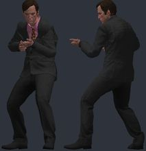</a> | `saul_goodman` | [[Breaking Bad] Saul Goodman](https://steamcommunity.com/sharedfiles/filedetails/?id=3698609418) by Azkabath | `models/breaking_bad/saul_goodman/saul_goodman.mdl` | 73719 | 1.038 | 2.6 | -2.73 | -3.7 z | 0.3/0.3 | OK | ok |
| <a href="img/poses/l4d_soldier.jpg">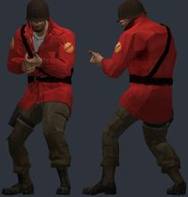</a> | `l4d_soldier` | [Left 4 Dead styled soldier (Playermodel/Ragdoll)](https://steamcommunity.com/sharedfiles/filedetails/?id=3452810040) by devious critter | `models/soldier/soldier_left4dead_pm.mdl` | 11563 | 1.015 | 1.9 | -0.66 | +0.0 z | 0.3/0.3 | OK | ok |
| <a href="img/poses/mike_ehrmantraut.jpg">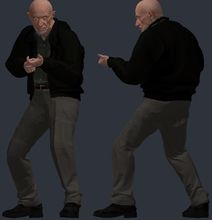</a> | `mike_ehrmantraut` | [[Breaking Bad] Mike Ehrmantraut](https://steamcommunity.com/sharedfiles/filedetails/?id=3639826393) by Azkabath | `models/brba/mike/mike_ehrmantraut.mdl` | 113415 | 1.038 | 2.5 | -1.87 | -3.5 z | 0.4/0.4 | OK | ok |
| <a href="img/poses/infiltrator.jpg">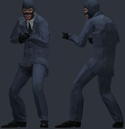</a> | `infiltrator` | [[PM/RAGDOLL] The Infiltrator](https://steamcommunity.com/sharedfiles/filedetails/?id=3505084592) by Ashbird | `models/gman_spy/spy_04.mdl` | 5627 | 1.038 | 2.5 | -2.26 | -2.8 z | 0.5/0.5 | OK | ok |
| <a href="img/poses/css_t_extended.jpg">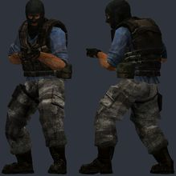</a> | `css_t_extended` | [[CSS] Extended [PM/Ragdolls]](https://steamcommunity.com/sharedfiles/filedetails/?id=3737922257) by Chaos Star | `models/player/chaos_star/css_t_extended_pm.mdl` | 5762 | 1.038 | 3.6 | 0.43 | -1.8 z | 0.6/0.6 | OK | bulky torso: chest 6.8 u further forward than a stock agent; CS2 hand poses (two-handed weapons) will clip into it; hand_R inside the torso in the CS2 preview pose (chest surface 4.7 u in front of the wrist) |
| <a href="img/poses/jules_winnfield.jpg">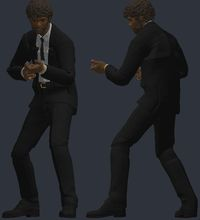</a> | `jules_winnfield` | [Pulp Fiction - Jules Winnfield & Vincent Vega [PM/NPC]](https://steamcommunity.com/sharedfiles/filedetails/?id=3637286336) by finished my contracts award | `models/furuki/pf/jules_winnfield_model.mdl` | 41000 | 1.076 | 3.0 | -2.06 | -1.5 z | 0.4/0.4 | OK | ok |
| <a href="img/poses/freddie_gibbs.jpg">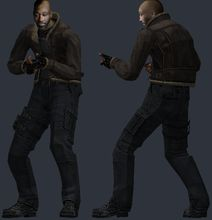</a> | `freddie_gibbs` | [Freddie Gibbs (RE4)](https://steamcommunity.com/sharedfiles/filedetails/?id=3639562227) by pvnished dej | `models/dejtriyev/freddiegibbs.mdl` | 12556 | 1.038 | 2.5 | -1.77 | -3.5 z | 0.5/0.5 | OK | ok |
| <a href="img/poses/adrian_shephard.jpg">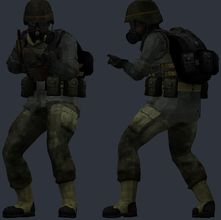</a> | `adrian_shephard` | [EP4 Adrian Shephard [PM/NPC/RAGDOLL]](https://steamcommunity.com/sharedfiles/filedetails/?id=3806163613) by PSYCH0S0C14L | `models/ep4adrian/ep4adrian.mdl` | 6164 | 1.038 | 2.5 | 2.45 | -3.2 z | 0.6/0.6 | OK | bulky torso: chest 5.5 u further forward than a stock agent; CS2 hand poses (two-handed weapons) will clip into it; hand_R inside the torso in the CS2 preview pose (chest surface 4.1 u in front of the wrist); eyeball_r: generated eye stand-in; eyeball_l: generated eye stand-in |
| <a href="img/poses/l4d_sacrifice_soldier.jpg">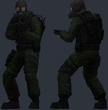</a> | `l4d_sacrifice_soldier` | [L4D The Sacrifice Comic Soldier REMASTERED](https://steamcommunity.com/sharedfiles/filedetails/?id=3690639069) by Vitaliy Puzin | `models/survivors/sacrifice_sold.mdl` | 8595 | 0.998 | 2.5 | -1.98 | -3.4 z | 0.4/0.4 | OK | ok |
| <a href="img/poses/async_researcher.jpg">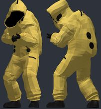</a> | `async_researcher` | [Async Hazmat Researcher [Playermodel/Ragdoll]](https://steamcommunity.com/sharedfiles/filedetails/?id=3743395000) by WatersYourMelon | `models/judah/async_researcher/async_researcher_pm.mdl` | 12376 | 1.104 | 1.3 | 3.09 | +0.6 z | 0.6/0.6 | OK | bulky torso: chest 6.4 u further forward than a stock agent; CS2 hand poses (two-handed weapons) will clip into it; hand_R inside the torso in the CS2 preview pose (chest surface 5.1 u in front of the wrist) |
| <a href="img/poses/bo1_dempsey.jpg">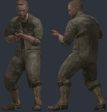</a> | `bo1_dempsey` | [CoD: BO1 - Ultimis Playermodels](https://steamcommunity.com/sharedfiles/filedetails/?id=3715032179) by Hidden | `models/player/black_ops_1/ultimis/p_dempsey.mdl` | 8450 | 1.093 | 2.4 | -3.68 | -0.5 z | 0.4/0.4 | OK | ok |
| <a href="img/poses/hlew_security.jpg">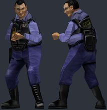</a> | `hlew_security` | [Half-Life: Extended Workforce Playermodels](https://steamcommunity.com/sharedfiles/filedetails/?id=3478625938) by Bikos77 | `models/player/hlew/security/otis_security_extended.mdl` | 813 | 1.093 | 6.4 | -2.75 | +0.0 z |  | OK | bulky torso: chest 6.6 u further forward than a stock agent; CS2 hand poses (two-handed weapons) will clip into it; hand_L not aligned to CS2 (the rig has no index finger plus an outer finger): fingers will bend about the wrong points; hand_R not aligned to CS2 (the rig has no index finger plus an outer finger): fingers will bend about the wrong points |
| <a href="img/poses/gta5_franklin.jpg">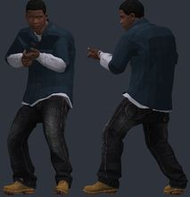</a> | `gta5_franklin` | [GTA 5 Improved Models](https://steamcommunity.com/sharedfiles/filedetails/?id=3567271959) by Mango | `models/mango/player/gta5/franklin.mdl` | 28197 | 1.038 | 2.6 | -1.42 | -3.4 z | 0.3/0.3 | OK | ok |
| <a href="img/poses/filthy_frank.jpg">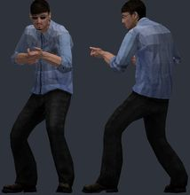</a> | `filthy_frank` | [Joji And The Filthy Frank Crew Playermodels](https://steamcommunity.com/sharedfiles/filedetails/?id=3442012037) by Gordon Freakman | `models/gfreakman/filthyfrank.mdl` | 5930 | 1.038 | 2.5 | -1.54 | -3.5 z | 0.5/0.5 | OK | ok |
| <a href="img/poses/scp_ntf.jpg">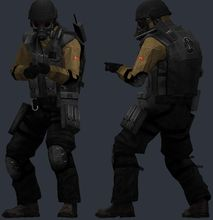</a> | `scp_ntf` | [Oldschool SCP Pack (Playermodels)](https://steamcommunity.com/sharedfiles/filedetails/?id=3591454343) by Gunslinger | `models/player/oldschool_scp/foundation_ntf.mdl` | 5484 | 1.038 | 2.5 | -2.77 | -3.3 z | 0.5/0.5 | OK | ok |
| <a href="img/poses/stilllife_mary.jpg">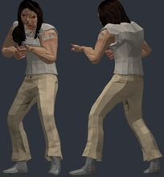</a> | `stilllife_mary` | [Still Life Playermodels](https://steamcommunity.com/sharedfiles/filedetails/?id=3750015271) by schlimbodimblo | `models/player/stilllifepm/sl_mary_pm.mdl` | 7373 | 1.103 | 3.3 | -1.88 | -4.9 z | 0.5/0.5 | OK | ok |
| <a href="img/poses/borat.jpg">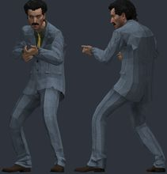</a> | `borat` | [Borat_09 PM](https://steamcommunity.com/sharedfiles/filedetails/?id=3382190351) by panman | `models/panman/borat_cosplayer_09.mdl` | 15311 | 1.038 | 2.5 | -2.32 | -2.9 z | 0.2/0.2 | OK | ok |
| <a href="img/poses/terry_davis.jpg">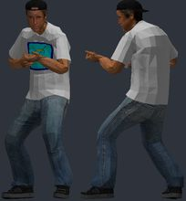</a> | `terry_davis` | [Terry A. Davis (HL2 Styled)](https://steamcommunity.com/sharedfiles/filedetails/?id=3728868335) by panman | `models/humans/panman/terry_hl2.mdl` | 8728 | 1.038 | 2.5 | -1.8 | -3.0 z | 0.4/0.4 | OK | ok |
| <a href="img/poses/vincent_vega.jpg">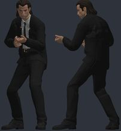</a> | `vincent_vega` | [Pulp Fiction - Jules Winnfield & Vincent Vega [PM/NPC]](https://steamcommunity.com/sharedfiles/filedetails/?id=3637286336) by finished my contracts award | `models/furuki/pf/vincent_vega_model.mdl` | 40733 | 1.096 | 3.1 | -1.73 | -1.0 z | 0.3/0.3 | OK | ok |
| <a href="img/poses/gta5_trevor.jpg">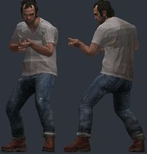</a> | `gta5_trevor` | [GTA 5 Improved Models](https://steamcommunity.com/sharedfiles/filedetails/?id=3567271959) by Mango | `models/mango/player/gta5/trevor.mdl` | 26412 | 1.038 | 2.5 | -1.8 | -3.8 z | 0.2/0.2 | OK | ok |

## Looked at, not used

| id | item | why |
|---|---|---|
| 3367031890 | [PM] H.E.V. MK-3 NEW | every model needs base-game textures (base_male face, vgui/black) beyond eyes/mouth |
| 3792550791 | [PM/RAGDOLL] The Runner | needs HL2 citizen/Odessa body sheets (base-game textures) |
| 3520329540 | [PM/RAGDOLL] The Worker | did not pass the rules after the eye/mouth stand-ins (base-game content) |
| 3671637728 | Red Dead Redemption 2 Pack [PM/Ragdoll] | not ValveBiped / models not registered as player models |
| 3728671104 | FLK Customizable Guys [PMs] | needs a base-game body sheet (Male_cheaple_sheet) |
| 3005534393 | Gasmask Girl (Playermodel/Ragdoll) | scale 1.26: smaller than CS2-sized |
| 3524933296 | 5 Finger Playermodels | not registered as player models; base-game Combine/Barney textures |

<!-- review notes: kept by batchnotes.py -->
## Review (6 Nov 2026)

Source: three spares from batch 1, the weekly list page 3 and the 90-day "playermodel" search page 1. 25 items downloaded (~1.9 GB, ~4 min),
`fetch.py --suggest` picked the candidates; 20 models from 18 items (two each from the GTA 5 and Pulp Fiction packs). Reviewed every
`_bind`, `_posed` and `_hands` picture (hands as two 10-model montages).

- **New: HL2 shared eye/mouth stand-ins.** 6 of the 12 items the rules rejected failed only because their eyes and mouth use Half-Life 2's
  shared `eyeball_l/r` and `mouth` textures, which aren't in the items (the game supplies them in GMod). The converter now generates an eye
  texture laid out like Source's iris projection and a dark mouth interior; `fetch.py --suggest` lets those through. Used by Infiltrator,
  Adrian Shephard, Filthy Frank, Borat, Terry Davis (5 eye sets, 4 mouths). Eyes read as normal eyes at preview scale.
- **Bulky torsos are common** (4 of 20 warned): CS:S T, Adrian Shephard and the Async researcher (vests/hazmat, chest 5.5-6.8 u further
  forward than an agent, right hand 3.9-5.5 u into the chest in CS2's pose), HL:EW security (stocky HL1 Barney).
- **HL:EW security** also trips the rig check (legs 6.4 u off CS2's: short HL1 legs) and is rigid-skinned (one bone per vertex, like HL1), so
  the wrist opens into separate pieces when bent hard. Bends acceptably in CS2's preview pose; kept with warnings, low priority.
- The Async researcher's black hood opening is the source design (no face inside).
- Mike Ehrmantraut is heavy (113k triangles) - fine for a test map, a decimation candidate for real use.
- Not yet tried in game.

Rejected (see the table above): base-game body textures beyond eyes/mouth (H.E.V. MK-3, The Runner, FLK guys, 5 Finger), not ValveBiped
(RDR2 pack), too small (Gasmask Girl, scale 1.26), and The Worker (rules still fail after the stand-ins).
