# Batch 5: 55 GMod player models

Generated by `batchnotes.py` from `catalog.json` and the conversion reports (`<work>/reports/<slug>.json`); review notes below the
marker are hand-written. All models: [MODELS.md](MODELS.md). Method and rules: [docs/creation/gmod-playermodels.md](../../docs/creation/gmod-playermodels.md).

55 models, 55 compiled, 18 with fit warnings.

Columns: **limb** = worst arm/leg joint distance from CS2's (u); **torso** = how far the upper torso was moved back (u); **head hb** = how far the
head hit box moved (z, u); **fingers** = finger fit L/R (u, < 1.8 fine).

| picture (click: every pose) | slug | workshop item | model | tris | scale | limb | torso | head hb | fingers | compile | notes |
|---|---|---|---|---|---|---|---|---|---|---|---|
| <a href="img/poses/iron_man.jpg">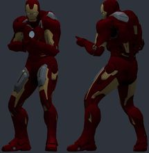</a> | `iron_man` | [Iron Man [Playermodel/NPC]](https://steamcommunity.com/sharedfiles/filedetails/?id=158326196) by Dusty | `models/avengers/iron man/mark7_player.mdl` | 7796 | 1.038 | 2.5 | -1.6 | -4.3 z | 0.8/0.5 | OK | ok |
| <a href="img/poses/gta5_michael.jpg">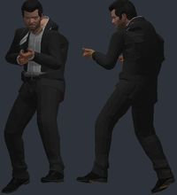</a> | `gta5_michael` | [GTA 5 Playermodels](https://steamcommunity.com/sharedfiles/filedetails/?id=216408135) by Dusty | `models/grandtheftauto5/michael.mdl` | 24868 | 1.038 | 2.6 | -2.87 | -2.5 z | 0.4/0.4 | OK | ok |
| <a href="img/poses/skyrim_daedric.jpg">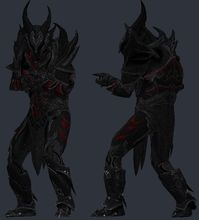</a> | `skyrim_daedric` | [The Elder Scrolls V Skyrim: Daedric Playermodel](https://steamcommunity.com/sharedfiles/filedetails/?id=175697854) by Voikanaa | `models/player/daedric.mdl` | 9394 | 1.038 | 2.7 | -1.85 | +0.0 z | 0.5/0.5 | OK | bulky torso: chest 4.9 u further forward than a stock agent; CS2 hand poses (two-handed weapons) will clip into it |
| <a href="img/poses/tron_anon.jpg">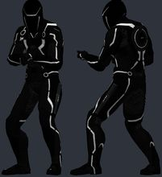</a> | `tron_anon` | [TRON Anon Playermodel](https://steamcommunity.com/sharedfiles/filedetails/?id=241187700) by Rokay | `models/player/anon/anon.mdl` | 9804 | 1.038 | 2.5 | -1.77 | -2.5 z | 0.4/0.5 | OK | ok |
| <a href="img/poses/deathstroke.jpg">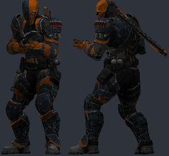</a> | `deathstroke` | [DeathStroke PlayerModel](https://steamcommunity.com/sharedfiles/filedetails/?id=204411482) by r9 | `models/norpo/arkhamorigins/assassins/deathstroke_valvebiped.mdl` | 23785 | 1.06 | 2.8 | -0.04 | -2.2 z | 0.4/0.4 | OK | bulky torso: chest 5.6 u further forward than a stock agent; CS2 hand poses (two-handed weapons) will clip into it |
| <a href="img/poses/halo4_chief.jpg">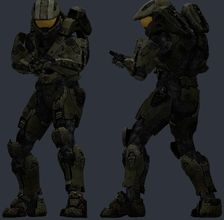</a> | `halo4_chief` | [Halo 4 - Master Chief (NPC/Playermodel/Ragdoll)](https://steamcommunity.com/sharedfiles/filedetails/?id=139247091) by Dusty | `models/halo4/spartans/masterchief_player.mdl` | 24644 | 1.038 | 2.5 | -1.77 | -3.9 z | 0.7/0.5 | OK | bulky torso: chest 4.6 u further forward than a stock agent; CS2 hand poses (two-handed weapons) will clip into it |
| <a href="img/poses/deadpool.jpg">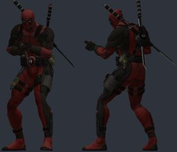</a> | `deadpool` | [Deadpool Playermodel](https://steamcommunity.com/sharedfiles/filedetails/?id=200700693) by o u t l a w | `models/pechenko_121/deadpool/chr_deadpool2.mdl` | 29364 | 1.041 | 2.2 | 0.09 | -4.5 z | 0.4/0.3 | OK | ok |
| <a href="img/poses/darth_vader.jpg">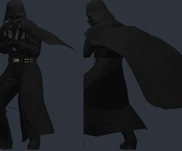</a> | `darth_vader` | [STAR WARS Darth Vader Playermodel](https://steamcommunity.com/sharedfiles/filedetails/?id=452065494) by Voikanaa | `models/player/darth_vader.mdl` | 24297 | 1.038 | 2.5 | -1.58 | -4.7 z | 0.3/0.3 | OK | ok |
| <a href="img/poses/arnold.jpg">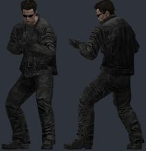</a> | `arnold` | [The Terminator: Arnold Schwarzenegger Playermodel](https://steamcommunity.com/sharedfiles/filedetails/?id=157674327) by Voikanaa | `models/player/arnold_schwarzenegger.mdl` | 3215 | 1.038 | 2.4 | -1.94 | -4.2 z | 0.4/0.4 | OK | ok |
| <a href="img/poses/kylo_ren.jpg">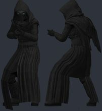</a> | `kylo_ren` | [Kylo Ren : The Force Awakens PlayerModel](https://steamcommunity.com/sharedfiles/filedetails/?id=599977698) by Acrow | `models/grealms/characters/kyloren/kyloren.mdl` | 7804 | 1.038 | 2.6 | -0.63 | -4.0 z | 0.4/0.4 | OK | ok |
| <a href="img/poses/fbi_agent.jpg">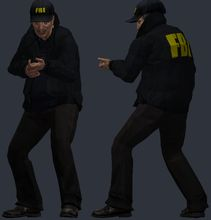</a> | `fbi_agent` | [FBI Playermodels](https://steamcommunity.com/sharedfiles/filedetails/?id=107411755) by Voikanaa | `models/fbi_pack/fbi_08.mdl` | 5886 | 1.038 | 2.6 | -2.37 | -3.1 z | 0.5/0.5 | OK | ok |
| <a href="img/poses/john_cena.jpg">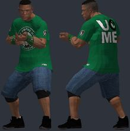</a> | `john_cena` | [John Cena Playermodel](https://steamcommunity.com/sharedfiles/filedetails/?id=546377707) by FZone96 | `models/fzone96/johncena/johncena.mdl` | 16582 | 1.044 | 2.7 | -1.9 | -3.2 z | 0.5/0.5 | OK | ok |
| <a href="img/poses/pmc_operator.jpg">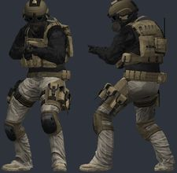</a> | `pmc_operator` | [PMC playermodels](https://steamcommunity.com/sharedfiles/filedetails/?id=232636218) by maJor | `models/player/pmc_1/pmc__07.mdl` | 16517 | 1.038 | 2.6 | -0.88 | -2.4 z | 0.5/0.5 | OK | bulky torso: chest 4.4 u further forward than a stock agent; CS2 hand poses (two-handed weapons) will clip into it; hand_R inside the torso in the CS2 preview pose (chest surface 4.5 u in front of the wrist) |
| <a href="img/poses/santa.jpg">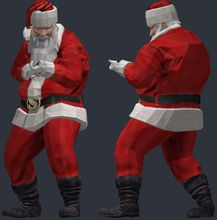</a> | `santa` | [Santa Claus Playermodel and NPC](https://steamcommunity.com/sharedfiles/filedetails/?id=572267883) by Voikanaa | `models/player/christmas/santa.mdl` | 7335 | 1.038 | 2.4 | -4.33 | -4.7 z | 0.3/0.3 | OK | bulky torso: chest 5.7 u further forward than a stock agent; CS2 hand poses (two-handed weapons) will clip into it; hand_R inside the torso in the CS2 preview pose (chest surface 5.5 u in front of the wrist) |
| <a href="img/poses/ghost_rider.jpg">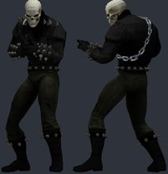</a> | `ghost_rider` | [Ghost Rider Playermodel](https://steamcommunity.com/sharedfiles/filedetails/?id=313268673) by Rokay | `models/player/ghostrider/ghostrider.mdl` | 11836 | 1.038 | 2.5 | -0.86 | -4.7 z | 0.3/0.4 | OK | ok |
| <a href="img/poses/donald_trump.jpg">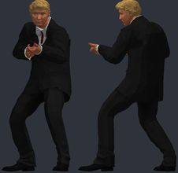</a> | `donald_trump` | [Donald Trump Playermodel](https://steamcommunity.com/sharedfiles/filedetails/?id=722374307) by Buu342 | `models/player/donald_trump.mdl` | 23723 | 1.038 | 2.5 | -2.42 | -4.4 z | 0.4/0.6 | OK | ok |
| <a href="img/poses/han_solo.jpg">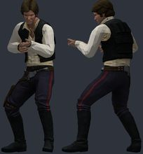</a> | `han_solo` | [STAR WARS Han Solo and Chewbacca Playermodels](https://steamcommunity.com/sharedfiles/filedetails/?id=448581592) by Voikanaa | `models/player/han_solo.mdl` | 8424 | 1.038 | 2.5 | -1.5 | -4.0 z | 0.3/0.3 | OK | ok |
| <a href="img/poses/palpatine.jpg">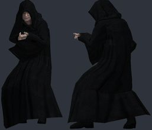</a> | `palpatine` | [STAR WARS Emperor Palpatine Playermodel](https://steamcommunity.com/sharedfiles/filedetails/?id=457212613) by Voikanaa | `models/player/emperor_palpatine.mdl` | 7372 | 1.038 | 2.5 | -1.0 | -4.8 z | 0.4/0.4 | OK | ok |
| <a href="img/poses/re_vector.jpg">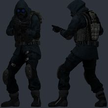</a> | `re_vector` | [Resident Evil - Vector Playermodel](https://steamcommunity.com/sharedfiles/filedetails/?id=220687225) by Vipes | `models/player/lordvipes/rerc_vector/vector_cvp.mdl` | 13077 | 1.043 | 2.8 | -1.92 | -4.8 z | 0.5/0.4 | OK | bulky torso: chest 5.9 u further forward than a stock agent; CS2 hand poses (two-handed weapons) will clip into it; hand_R inside the torso in the CS2 preview pose (chest surface 4.1 u in front of the wrist) |
| <a href="img/poses/daft_punk.jpg">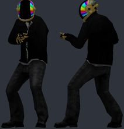</a> | `daft_punk` | [Daft Punk Player Models](https://steamcommunity.com/sharedfiles/filedetails/?id=148628139) by Wayne | `models/player/daftpunk/daft_gold.mdl` | 8844 | 1.038 | 2.5 | -1.77 | -4.0 z | 0.3/0.4 | OK | ok |
| <a href="img/poses/corvo.jpg">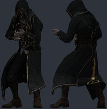</a> | `corvo` | [Corvo playermodel](https://steamcommunity.com/sharedfiles/filedetails/?id=159269477) by Alpharius | `models/player/corvo.mdl` | 13201 | 0.998 | 2.5 | -1.2 | -4.7 z | 0.4/0.3 | OK | ok |
| <a href="img/poses/genji.jpg">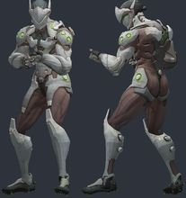</a> | `genji` | [Overwatch - Genji Playermodel/Ragdoll](https://steamcommunity.com/sharedfiles/filedetails/?id=706860888) by SeroRonin | `models/player/overwatch/genji.mdl` | 31690 | 1.038 | 3.4 | -1.26 | -1.9 z | 0.5/0.5 | OK | ok |
| <a href="img/poses/edward_kenway.jpg">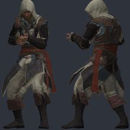</a> | `edward_kenway` | [Assassins Creed IV: Edward Kenway Playermodel](https://steamcommunity.com/sharedfiles/filedetails/?id=238213159) by Voikanaa | `models/player/edward_kenway.mdl` | 29044 | 1.038 | 2.5 | -2.42 | -4.1 z | 0.3/0.4 | OK | ok |
| <a href="img/poses/doom_slayer.jpg">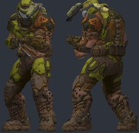</a> | `doom_slayer` | [DooM Eternal - Doom Slayer [PM]](https://steamcommunity.com/sharedfiles/filedetails/?id=2039547466) by o u t l a w | `models/outlaw/doometernal/doomslayereternal.mdl` | 40779 | 1.029 | 2.0 | -0.54 | -2.9 z | 0.5/0.5 | OK | bulky torso: chest 5.2 u further forward than a stock agent; CS2 hand poses (two-handed weapons) will clip into it |
| <a href="img/poses/luke_skywalker.jpg">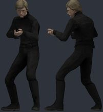</a> | `luke_skywalker` | [STAR WARS Luke Skywalker Playermodel](https://steamcommunity.com/sharedfiles/filedetails/?id=450353431) by Voikanaa | `models/player/luke_skywalker.mdl` | 7422 | 1.038 | 2.5 | -1.82 | -3.5 z | 0.4/0.3 | OK | ok |
| <a href="img/poses/ow_reaper.jpg">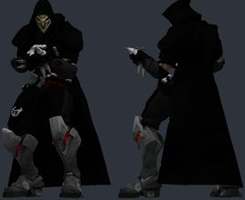</a> | `ow_reaper` | [OW- Reaper Playermodel](https://steamcommunity.com/sharedfiles/filedetails/?id=726069482) by Zynth | `models/player/tfa_ow_reaper.mdl` | 22690 | 1.057 | 9.2 | -2.03 | -3.5 z | 0.7/0.3 | OK | bulky torso: chest 4.1 u further forward than a stock agent; CS2 hand poses (two-handed weapons) will clip into it |
| <a href="img/poses/batman_mk.jpg">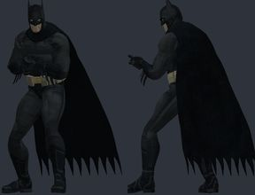</a> | `batman_mk` | [Batman Playermodel](https://steamcommunity.com/sharedfiles/filedetails/?id=141049673) by cowboy | `models/batman/slow/jamis/mkvsdcu/batman/slow_pub_v2.mdl` | 15956 | 1.0 | 2.6 | -1.63 | -0.5 z | 0.7/0.6 | OK | ok |
| <a href="img/poses/csgo_pirate.jpg">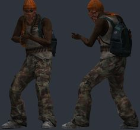</a> | `csgo_pirate` | [Counter Strike: Global Offensive T Playermodels and NPCs](https://steamcommunity.com/sharedfiles/filedetails/?id=481607813) by Professor Heavy | `models/csgopirate1pm.mdl` | 13202 | 0.998 | 2.5 | 0.89 | -4.1 z | 0.5/0.5 | OK | ok |
| <a href="img/poses/halo3_spartan.jpg">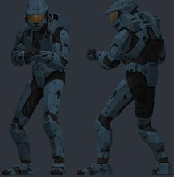</a> | `halo3_spartan` | [Halo 3 Spartan Playermodels (MPSC)](https://steamcommunity.com/sharedfiles/filedetails/?id=283815805) by Vipes | `models/player/lordvipes/h3_spartans_mps/h3spartan_mps_cvp.mdl` | 5390 | 1.038 | 2.5 | -1.24 | -2.4 z | 0.5/0.5 | OK | ok |
| <a href="img/poses/thanos.jpg">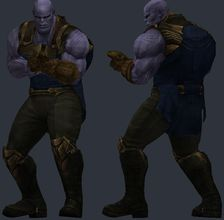</a> | `thanos` | [Thanos - Avengers: Infinity War Playermodel](https://steamcommunity.com/sharedfiles/filedetails/?id=1371823037) by Kryptonite | `models/kryptonite/inf_thanos/inf_thanos.mdl` | 6687 | 1.046 | 2.7 | -2.81 | -2.9 z | 0.9/0.6 | OK | bulky torso: chest 4.2 u further forward than a stock agent; CS2 hand poses (two-handed weapons) will clip into it |
| <a href="img/poses/nanosuit.jpg">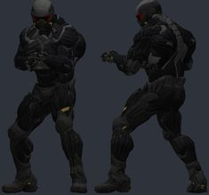</a> | `nanosuit` | [Crysis 2 - Nanosuit 2 NPC and Playermodel](https://steamcommunity.com/sharedfiles/filedetails/?id=124565516) by Nightmare Ω | `models/characters/nanosuit2/nanosuit_player.mdl` | 19454 | 1.038 | 2.4 | -1.51 | -3.1 z | 1.5/1.5 | OK | ok |
| <a href="img/poses/spiderman.jpg">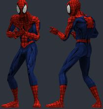</a> | `spiderman` | [Spiderman - Ultimate Playermodel Bundle](https://steamcommunity.com/sharedfiles/filedetails/?id=1418637320) by Kryptonite | `models/kryptonite/spiderman/spiderman.mdl` | 2914 | 1.046 | 2.7 | -1.94 | -3.0 z | 0.5/0.5 | OK | ok |
| <a href="img/poses/raiden.jpg">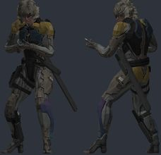</a> | `raiden` | [Metal Gear Raiden Player Model Pack](https://steamcommunity.com/sharedfiles/filedetails/?id=257102395) by KraiKKonen11 | `models/ninja/raidenmgrprologue.mdl` | 21134 | 1.046 | 2.9 | -2.01 | -4.3 z | 0.6/0.6 | OK | ok |
| <a href="img/poses/ao_joker.jpg">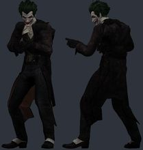</a> | `ao_joker` | [Arkham Origins Joker NPC/playermodel](https://steamcommunity.com/sharedfiles/filedetails/?id=400762901) by True | `models/player/bobert/aojoker.mdl` | 18971 | 1.038 | 2.6 | -1.57 | -3.4 z | 0.7/0.7 | OK | ok |
| <a href="img/poses/jason_savini.jpg">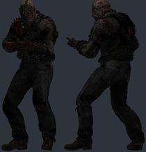</a> | `jason_savini` | [Friday the 13th - Savini Jason (PM+NPC)](https://steamcommunity.com/sharedfiles/filedetails/?id=951736106) by Konnie | `models/models/konnie/savini/savini.mdl` | 93024 | 1.038 | 2.7 | -1.61 | -3.0 z | 0.5/0.5 | OK | ok |
| <a href="img/poses/dovahkiin.jpg">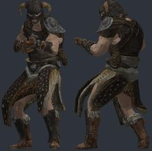</a> | `dovahkiin` | [The Elder Scrolls V Skyrim: Dovahkiin Playermodel](https://steamcommunity.com/sharedfiles/filedetails/?id=156922874) by Voikanaa | `models/player/dovahkiin.mdl` | 13910 | 1.038 | 2.5 | -2.52 | -4.0 z | 0.5/0.4 | OK | ok |
| <a href="img/poses/fo3_tesla_armor.jpg">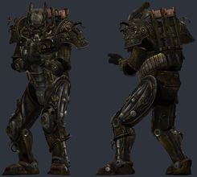</a> | `fo3_tesla_armor` | [Fallout 3 Player Models](https://steamcommunity.com/sharedfiles/filedetails/?id=133401340) by Knuckle | `models/player/fallout_3/tesla_power_armor.mdl` | 17150 | 1.002 | 2.6 | 0.36 | -1.6 z | 0.7/0.4 | OK | bulky torso: chest 8.9 u further forward than a stock agent; CS2 hand poses (two-handed weapons) will clip into it; hand_R inside the torso in the CS2 preview pose (chest surface 8.8 u in front of the wrist) |
| <a href="img/poses/csgo_st6.jpg">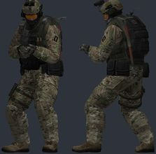</a> | `csgo_st6` | [Counter Strike: Global Offensive CT Playermodels and NPCs](https://steamcommunity.com/sharedfiles/filedetails/?id=481358078) by Professor Heavy | `models/csgost63pm.mdl` | 16388 | 1.003 | 2.7 | -1.16 | -0.7 z | 0.8/0.7 | OK | bulky torso: chest 5.7 u further forward than a stock agent; CS2 hand poses (two-handed weapons) will clip into it; hand_R inside the torso in the CS2 preview pose (chest surface 4.0 u in front of the wrist) |
| <a href="img/poses/mandalorian.jpg">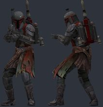</a> | `mandalorian` | [Star Wars: Mandalorian Bounty Hunter (playermodel & NPC)](https://steamcommunity.com/sharedfiles/filedetails/?id=617141518) by Porky-da-Corgi | `models/porky-da-corgi/starwars/mandalorians/bountyhunter.mdl` | 17429 | 1.038 | 2.6 | 0.26 | -3.7 z | 0.4/0.4 | OK | ok |
| <a href="img/poses/kapkan.jpg">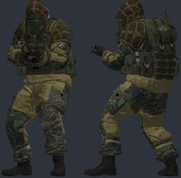</a> | `kapkan` | [R6S: Kapkan P.M. and Ragdoll](https://steamcommunity.com/sharedfiles/filedetails/?id=572447657) by Lenoax | `models/player/r6s_kapkan.mdl` | 42298 | 1.045 | 2.6 | 0.74 | -3.0 z | 0.2/0.3 | OK | bulky torso: chest 4.8 u further forward than a stock agent; CS2 hand poses (two-handed weapons) will clip into it; hand_R inside the torso in the CS2 preview pose (chest surface 3.5 u in front of the wrist) |
| <a href="img/poses/crysis_cell.jpg">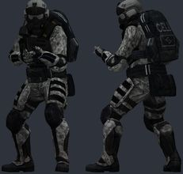</a> | `crysis_cell` | [Crysis C.E.L.L. Assault Operative NPCs and Playermodels](https://steamcommunity.com/sharedfiles/filedetails/?id=221823653) by Professor Heavy | `models/player/cellassault1player.mdl` | 14286 | 0.97 | 2.6 | 0.56 | -2.7 z | 0.7/0.7 | OK | bulky torso: chest 6.5 u further forward than a stock agent; CS2 hand poses (two-handed weapons) will clip into it; hand_R inside the torso in the CS2 preview pose (chest surface 4.9 u in front of the wrist) |
| <a href="img/poses/mace_windu.jpg">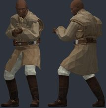</a> | `mace_windu` | [Sith & Jedi Playermodel Pack](https://steamcommunity.com/sharedfiles/filedetails/?id=518960557) by J0kingg | `models/ryan7259/mace_windu/mace_windu.mdl` | 8423 | 1.038 | 2.5 | -2.3 | -2.9 z | 0.4/0.4 | OK | ok |
| <a href="img/poses/heavy_combine.jpg">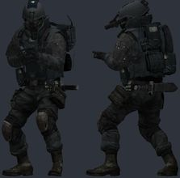</a> | `heavy_combine` | [Heavy Combine NPCs and Playermodels](https://steamcommunity.com/sharedfiles/filedetails/?id=188562859) by Professor Heavy | `models/player/combine_soldier04.mdl` | 12569 | 0.998 | 2.5 | -0.84 | -3.5 z | 0.6/0.5 | OK | bulky torso: chest 5.3 u further forward than a stock agent; CS2 hand poses (two-handed weapons) will clip into it; hand_R inside the torso in the CS2 preview pose (chest surface 3.4 u in front of the wrist) |
| <a href="img/poses/async_personnel.jpg">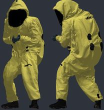</a> | `async_personnel` | [[Backrooms] A-Sync Personnel (Hazmat) [Playermodel + Ragdoll]](https://steamcommunity.com/sharedfiles/filedetails/?id=2857328584) by X Ray | `models/player/async_personnel.mdl` | 98093 | 1.038 | 2.8 | 1.52 | -3.8 z | 0.4/0.4 | OK | bulky torso: chest 6.7 u further forward than a stock agent; CS2 hand poses (two-handed weapons) will clip into it; hand_R inside the torso in the CS2 preview pose (chest surface 5.2 u in front of the wrist) |
| <a href="img/poses/mgs2_snake.jpg">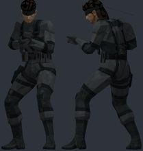</a> | `mgs2_snake` | [MGS2 Solid Snake Playermodel (Outdated)](https://steamcommunity.com/sharedfiles/filedetails/?id=471518115) by Aaron No. 893 | `models/ats/mgs2snake/mgs2snake.mdl` | 5934 | 1.038 | 2.5 | 2.29 | -3.9 z | 0.3/0.3 | OK | bulky torso: chest 5.4 u further forward than a stock agent; CS2 hand poses (two-handed weapons) will clip into it; hand_R inside the torso in the CS2 preview pose (chest surface 3.5 u in front of the wrist) |
| <a href="img/poses/raven_team_leader.jpg">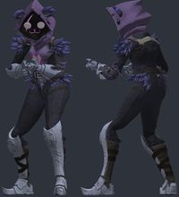</a> | `raven_team_leader` | [Fortnite: Raven Team Leader (Playermodel + Ragdoll)](https://steamcommunity.com/sharedfiles/filedetails/?id=3105637302) by keepitwilde | `models/keepitwilde/raventl/raventl_pm.mdl` | 58462 | 1.128 | 6.5 | -1.51 | -0.6 z | 0.3/0.3 | OK | ok |
| <a href="img/poses/apocalypse_citizen.jpg">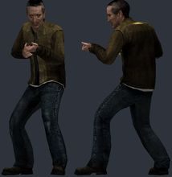</a> | `apocalypse_citizen` | [Apocalypse Citizens (Playermodels)](https://steamcommunity.com/sharedfiles/filedetails/?id=3122592785) by Gunslinger ☢ | `models/rusty/citizens/male_08.mdl` | 5580 | 1.038 | 2.5 | 0.05 | -3.3 z | 0.3/0.4 | OK | ok |
| <a href="img/poses/squid_soldier.jpg">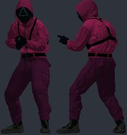</a> | `squid_soldier` | [COD:BO6 x Squid Game 2 - Worker/Soldier/Manager [Playermodels/ PM]](https://steamcommunity.com/sharedfiles/filedetails/?id=3401898295) by Artyom | `models/bo6/squadsoldier/squadsoldier_pm.mdl` | 125608 | 1.065 | 2.3 | -2.07 | -2.4 z | 0.4/0.6 | OK | ok |
| <a href="img/poses/madness_hank.jpg">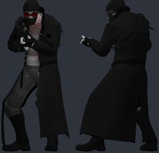</a> | `madness_hank` | [[Madness Combat] Hank - [Playermodel]](https://steamcommunity.com/sharedfiles/filedetails/?id=3051673992) by Alvaro | `models/alvaroports/hankpm.mdl` | 11686 | 1.066 | 2.0 | -1.63 | -4.5 z | 0.3/0.2 | OK | ok |
| <a href="img/poses/gtaiv_male.jpg">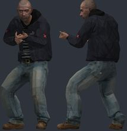</a> | `gtaiv_male` | [Grand Theft Auto IV Multiplayer Characters [PMs; NPCs; Ragdolls]](https://steamcommunity.com/sharedfiles/filedetails/?id=3660594257) by BęŁkÁ 🐿 | `models/gtaivmp/playerm/iv_male01.mdl` | 5244 | 1.038 | 2.7 | -0.53 | -3.0 z | 0.6/0.6 | OK | ok |
|  | `assassin_walter` | [Assassin Walter White Playermodel and Ragdoll](https://steamcommunity.com/sharedfiles/filedetails/?id=3677776589) by Igloo enjoyer | `models/tctwalter.mdl` | 21502 | 0.998 | 2.5 | -2.01 | -3.2 z | 0.7/0.6 | OK | ok |
|  | `clone_anakin` | [SW: Clone Wars 2003 / Playermodel Pack](https://steamcommunity.com/sharedfiles/filedetails/?id=3743556887) by Bananakin | `models/konnie/bananakin/starwars/cartoon/general_anakin.mdl` | 18782 | 1.036 | 2.5 | -1.57 | -0.5 z |  | OK | hand_L not aligned to CS2 (the rig has no index finger plus an outer finger): fingers will bend about the wrong points; hand_R not aligned to CS2 (the rig has no index finger plus an outer finger): fingers will bend about the wrong points |
|  | `green_goblin` | [Green Goblin Playermodels](https://steamcommunity.com/sharedfiles/filedetails/?id=3811516550) by FRITAS | `models/player/greengoblin_v2_2014.mdl` | 23250 | 1.038 | 2.5 | 1.99 | -3.8 z | 0.4/0.6 | OK | ok |
|  | `grim_reaper` | [(Working) Grim Reaper Playermodel](https://steamcommunity.com/sharedfiles/filedetails/?id=288629547) by ? | `models/grim.mdl` | 8927 | 1.038 | 2.5 | -1.14 | -3.3 z | 0.4/0.5 | OK | ok |
|  | `cgi_death` | [CGI Death Playermodel v 1.1](https://steamcommunity.com/sharedfiles/filedetails/?id=2822953104) by ? | `models/player/artel/death/death666.mdl` | 10999 | 1.038 | 2.5 | 0.5 | -2.6 z | 0.4/0.4 | OK | bulky torso: chest 4.5 u further forward than a stock agent; CS2 hand poses (two-handed weapons) will clip into it; hand_R inside the torso in the CS2 preview pose (chest surface 3.0 u in front of the wrist) |

## Looked at, not used

| id | item | why |
|---|---|---|
| 157854748 | GTA San Andreas: Carl "CJ" Johnson Playermodel |  |
| 237872885 | Jesus Playermodel |  |
| 546524865 | Black Rock Shooter (Digitrevx) Basic Playermodel and NPC |  |
| 726644424 | OW- Mercy Playermodel |  |
| 453235434 | JoJo's BIZARRE ADVENTURE DIO Ragdoll |  |
| 176238701 | CoD MW2 Playermodels |  |
| 154035258 | Vin Diesel Playermodel |  |
| 1222388614 | Anonymous Customizable Playermodel |  |
| 1384226325 | PUTIN PLAYERMODEL |  |
| 125456150 | Master Chief Playermodel |  |
| 475348714 | Arkham Knight Npc/Playermodel |  |
| 478664425 | Arkham Knight Red Hood NPC/Playermodel |  |
| 176540879 | The Elder Scrolls V Skyrim: Hold Guard Playermodels and NPCs |  |
| 537353521 | Cook/chef playermodels (Male and female) |  |
| 173932955 | Sci-Fi Citizens Playermodels |  |
| 3422907219 | Jamiroquai_07 (Virtual Insanity) PM |  |
| 3354435896 | Silent Hill 2 - James Sunderland [PM/NPC] |  |
| 736218548 | Counter-Strike 1.6 Playermodels |  |
| 3041864795 | _Nemez_'s and WstStranger Metropolice Force [Remaster+Playermodel] |  |
| 3815982298 | [PM / NPC / ITEM] HEV Mk V |  |
| 3311643370 | Customizable Merc Playermodel (Trepang2 B.A.M) |  |
| 3704141363 | Chuck "Sheriff" Norris - [Playermodel] |  |
| 3674738702 | Tactical Ryan Gosling Playermodel and ragdoll |  |
| 3823963482 | Paint the Town Red Playermodels & NPCs |  |
| 3819758873 | Female Suit Playermodels - Black Long Coat & Tie |  |
| 3830255424 | Archer (MW) Playermodel |  |
| 3825943322 | Modern Warfare 4 Argonaut Juggernaut Playermodel |  |
| 3826101691 | COD:MWII - Custom Velikan [Playermodels/NPCS] |  |
| 1380429026 | Death: A Grim Bundle [PMs] | the skeleton under the robe uses HL2's skeleton textures (not in the item, not on the PC): grey bones |
| 1167016682 | La muerte (Rework)(GRIM) | the same grim.mdl as 288629547 |

<!-- review notes: kept by batchnotes.py -->
## Review
## Review (6 Nov 2026, light)

Contact sheet only, plus the joint-offset and hand warnings. 57 converted, 55 kept: Lich King (stray spike) and Boba Fett (cape
sticks out) dropped. The Fallout 3 Tesla armour came back once the converter left out additive materials (its arcs were purple
slabs). Grim Reaper (288629547) and CGI Death were added for deathrun at skink52's request; OW Reaper kept with its hip warning
(the long coat hides it). The "Death: A Grim Bundle" pack needs HL2's skeleton textures: now available from the base-game folder.
