# Batch 6: 31 GMod player models

Generated by `batchnotes.py` from `catalog.json` and the conversion reports (`<work>/reports/<slug>.json`); review notes below the
marker are hand-written. All models: [MODELS.md](MODELS.md). Method and rules: [docs/creation/gmod-playermodels.md](../../docs/creation/gmod-playermodels.md).

31 models, 31 compiled, 13 with fit warnings.

Columns: **limb** = worst arm/leg joint distance from CS2's (u); **torso** = how far the upper torso was moved back (u); **head hb** = how far the
head hit box moved (z, u); **fingers** = finger fit L/R (u, < 1.8 fine).

| picture (click: every pose) | slug | workshop item | model | tris | scale | limb | torso | head hb | fingers | compile | notes |
|---|---|---|---|---|---|---|---|---|---|---|---|
| <a href="img/poses/art_clown.jpg">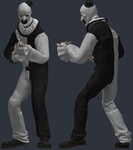</a> | `art_clown` | [Art the Clown / Playermodel](https://steamcommunity.com/sharedfiles/filedetails/?id=3829024645) by ๋ | `models/player/fortnite_horror_v9/art.mdl` | 31648 | 1.039 | 4.5 | -1.55 | +1.2 z | 1.2/1.2 | OK | ok |
| <a href="img/poses/big_dew.jpg">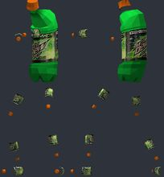</a> | `big_dew` | [DewRitos Playermodels](https://steamcommunity.com/sharedfiles/filedetails/?id=232539187) by ellie | `models/player/big_dew.mdl` | 1210 | 1.038 | 3.3 | -2.43 | -4.9 z |  | OK | hand_L not aligned to CS2 (the rig has no index finger plus an outer finger): fingers will bend about the wrong points; hand_R not aligned to CS2 (the rig has no index finger plus an outer finger): fingers will bend about the wrong points |
| <a href="img/poses/kermit.jpg">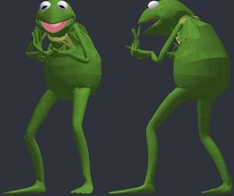</a> | `kermit` | [Kermit The Frog Player Model & NPC](https://steamcommunity.com/sharedfiles/filedetails/?id=485879458) by Lord Shoopington | `models/player/kermit.mdl` | 13446 | 1.003 | 3.8 | -0.01 | -4.6 z | 2.4/2.3 | OK | hand_L fingers sit 2.4 u from their CS2 finger bones: CS2 finger curls will distort them; hand_R fingers sit 2.3 u from their CS2 finger bones: CS2 finger curls will distort them |
| <a href="img/poses/tinky_winky.jpg">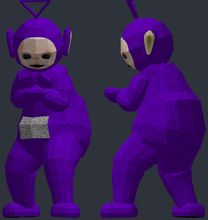</a> | `tinky_winky` | [Teletubbies Playermodel + NPC](https://steamcommunity.com/sharedfiles/filedetails/?id=356485444) by manatails | `models/player/manatails/tinkywinky/player.mdl` | 2590 | 0.998 | 2.5 | 0.0 | +2.9 z | 0.5/0.5 | OK | bulky torso: chest 4.5 u further forward than a stock agent; CS2 hand poses (two-handed weapons) will clip into it; hand_L not aligned to CS2 (the rig has no index finger plus an outer finger): fingers will bend about the wrong points; hand_R not aligned to CS2 (the rig has no index finger plus an outer finger): fingers will bend about the wrong points |
| <a href="img/poses/funny_rat.jpg">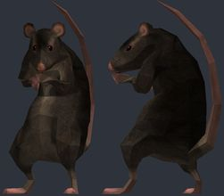</a> | `funny_rat` | [Funny Rat Playermodel](https://steamcommunity.com/sharedfiles/filedetails/?id=2793580726) by Electric Blood Mage | `models/ebmage/funnyrat.mdl` | 835 | 1.182 | 13.4 | 0.0 | -2.8 z |  | OK | bulky torso: chest 4.4 u further forward than a stock agent; CS2 hand poses (two-handed weapons) will clip into it; skeleton does not match CS2 (limb joints more than 5 u off: leg_lower_L 5.2, leg_lower_R 5.3, leg_upper_L 13.4, leg_upper_R 13.4): CS2 will bend the limbs away from the joints of the model; hand_L not aligned to CS2 (the rig has no index finger plus an outer finger): fingers will bend about the wrong points; hand_R not aligned to CS2 (the rig has no index finger plus an outer finger): fingers will bend about the wrong points |
| <a href="img/poses/meeseeks.jpg">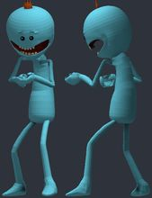</a> | `meeseeks` | [Mr. Meeseeks playermodel & NPC](https://steamcommunity.com/sharedfiles/filedetails/?id=550768935) by Hummy_Seed | `models/player/meeseeks/meeseeks.mdl` | 10244 | 1.038 | 2.5 | -1.83 | +0.3 z | 1.8/1.2 | OK | hand_L not aligned to CS2 (the rig has no index finger plus an outer finger): fingers will bend about the wrong points |
| <a href="img/poses/woody.jpg">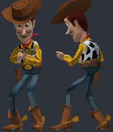</a> | `woody` | [Toy Story: Woody Playermodel](https://steamcommunity.com/sharedfiles/filedetails/?id=156924206) by Voikanaa | `models/player/woody.mdl` | 2201 | 1.038 | 2.5 | -1.33 | +4.2 z | 1.7/1.4 | OK | hand_L not aligned to CS2 (the rig has no index finger plus an outer finger): fingers will bend about the wrong points; hand_R not aligned to CS2 (the rig has no index finger plus an outer finger): fingers will bend about the wrong points |
| <a href="img/poses/trex.jpg">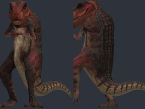</a> | `trex` | [T. Rex Playermodel](https://steamcommunity.com/sharedfiles/filedetails/?id=612053603) by 2XMM2 | `models/trex_player/trex_player.mdl` | 10438 | 1.038 | 2.6 | -2.77 | -4.6 z | 0.3/0.2 | OK | ok |
| <a href="img/poses/rick_sanchez.jpg">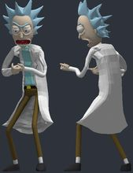</a> | `rick_sanchez` | [Rick playermodel](https://steamcommunity.com/sharedfiles/filedetails/?id=557711922) by Hummy_Seed | `models/player/rick/rick.mdl` | 16906 | 1.038 | 2.5 | -0.93 | +1.5 z | 0.8/0.5 | OK | ok |
| <a href="img/poses/tf2_engie.jpg">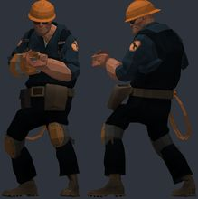</a> | `tf2_engie` | [TF2 Player Model Pack](https://steamcommunity.com/sharedfiles/filedetails/?id=352668843) by Eligia | `models/player/engieplayer/engie.mdl` | 7628 | 1.038 | 2.5 | -2.18 | -3.3 z | 1.6/1.5 | OK | ok |
| <a href="img/poses/spanish_skeleton.jpg">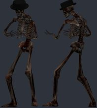</a> | `spanish_skeleton` | [Chilean Skeleton Playermodel (Esqueleto Loquendo)](https://steamcommunity.com/sharedfiles/filedetails/?id=2801750344) by гадя хренова | `models/player/spanish_skeleton.mdl` | 30617 | 1.038 | 3.4 | -1.23 | -3.7 z |  | OK | ok |
| <a href="img/poses/voldemort.jpg">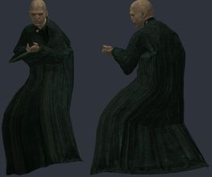</a> | `voldemort` | [Lord Voldemort](https://steamcommunity.com/sharedfiles/filedetails/?id=659329169) by Voikanaa | `models/player/lord_voldemort.mdl` | 9899 | 1.038 | 2.6 | -1.69 | -3.5 z | 0.4/0.3 | OK | ok |
| <a href="img/poses/troll_face.jpg">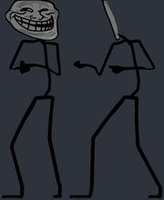</a> | `troll_face` | [Rage Faces / Troll Face Playermodels and NPCs](https://steamcommunity.com/sharedfiles/filedetails/?id=2251043099) by Petaly | `models/petaly/rage/body.mdl` | 5368 | 1.038 | 2.5 | 0.75 | -2.2 z | 0.3/0.3 | OK | ok |
| <a href="img/poses/ena.jpg">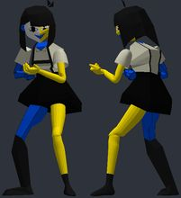</a> | `ena` | [ENA[Joel G] Playermodel](https://steamcommunity.com/sharedfiles/filedetails/?id=2242241647) by 엽떡 시켰는데 안 엽기적이라고 환불한 엔냥이 | `models/player/ena/ena.mdl` | 11416 | 1.097 | 4.0 | -0.73 | -4.8 z | 0.5/0.8 | OK | ok |
| <a href="img/poses/homer.jpg">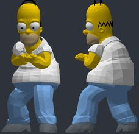</a> | `homer` | [Homer Simpson [High Quality Model] (The Simpsons) Playermodel & NPC](https://steamcommunity.com/sharedfiles/filedetails/?id=2599659126) by Hell Inspector | `models/hellinspector/homerharm/homerfm_pm.mdl` | 24574 | 0.965 | 6.4 | -2.05 | +3.4 z | 1.1/0.8 | OK | bulky torso: chest 4.4 u further forward than a stock agent; CS2 hand poses (two-handed weapons) will clip into it; skeleton does not match CS2 (limb joints more than 5 u off: leg_upper_L 6.4, leg_upper_R 6.4): CS2 will bend the limbs away from the joints of the model |
| <a href="img/poses/old_wizard.jpg">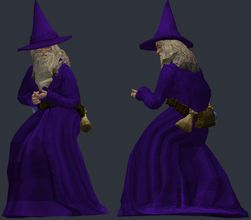</a> | `old_wizard` | [The Wizard (Playermodel/NPCs)](https://steamcommunity.com/sharedfiles/filedetails/?id=3375440207) by Electric Kool-Aid | `models/electric/old_wizard/old_wizard.mdl` | 10185 | 1.103 | 11.7 | -1.71 | +1.9 z | 0.6/0.2 | OK | bulky torso: chest 5.2 u further forward than a stock agent; CS2 hand poses (two-handed weapons) will clip into it; hand_R inside the torso in the CS2 preview pose (chest surface 3.3 u in front of the wrist); skeleton does not match CS2 (limb joints more than 5 u off: leg_lower_L 11.7, leg_lower_R 11.6, leg_upper_L 9.6, leg_upper_R 9.5): CS2 will bend the limbs away from the joints of the model |
| <a href="img/poses/skull_trumpet.jpg">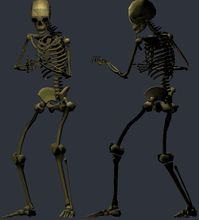</a> | `skull_trumpet` | [Authentic Skull Trumpet (Playermodel)](https://steamcommunity.com/sharedfiles/filedetails/?id=3144011868) by xinus22 | `models/xinus22/doot_skelly.mdl` | 9096 | 1.038 | 2.4 | -1.6 | -3.9 z | 0.4/0.4 | OK | eyeball_r: generated eye stand-in; eyeball_l: generated eye stand-in |
| <a href="img/poses/peashooter.jpg">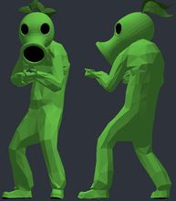</a> | `peashooter` | [Peashooter Dancer Playermodel](https://steamcommunity.com/sharedfiles/filedetails/?id=3129140947) by Electric Blood Mage | `models/akuld/funnypeashooter/peashooter_dancer.mdl` | 5615 | 1.038 | 2.5 | -5.97 | -2.6 z | 0.5/0.5 | OK | ok |
| <a href="img/poses/jonkler.jpg">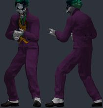</a> | `jonkler` | [Jonkler playermodel](https://steamcommunity.com/sharedfiles/filedetails/?id=3743617033) by Pirata Manhattan | `models/player/jonkler.mdl` | 19113 | 1.0 | 2.5 | -1.57 | -2.2 z | 0.4/0.4 | OK | ok |
| <a href="img/poses/gmod_chan.jpg">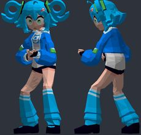</a> | `gmod_chan` | [Gmod-Chan Playermodel (PM)](https://steamcommunity.com/sharedfiles/filedetails/?id=3759475080) by TopWay | `models/torradinha214/gmod_chan/gmod_chan_pm.mdl` | 6193 | 1.22 | 8.2 | -2.31 | +2.0 z | 0.7/0.6 | OK | skeleton does not match CS2 (limb joints more than 5 u off: leg_lower_L 7.5, leg_lower_R 7.5, leg_upper_L 8.2, leg_upper_R 8.2): CS2 will bend the limbs away from the joints of the model |
| <a href="img/poses/msn_stickman.jpg">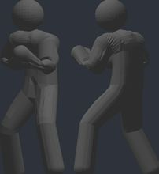</a> | `msn_stickman` | [MSN Stick Figure [Playermodel+Sounds]](https://steamcommunity.com/sharedfiles/filedetails/?id=3566617779) by Davy | `models/player/ndord/msn/figure_01.mdl` | 6854 | 1.038 | 2.5 | -2.14 | -2.4 z |  | OK | ok |
| <a href="img/poses/low_tier_god.jpg">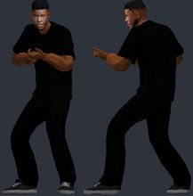</a> | `low_tier_god` | [Low Tier God (HL2 Style) Playermodel](https://steamcommunity.com/sharedfiles/filedetails/?id=3677358615) by panman | `models/humans/ltg_hl_style.mdl` | 4923 | 1.038 | 2.5 | -1.6 | -3.0 z | 0.4/0.4 | OK | ok |
| <a href="img/poses/scary_man.jpg">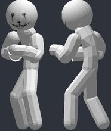</a> | `scary_man` | [Scary Man Playermodel + NPCS](https://steamcommunity.com/sharedfiles/filedetails/?id=3827997124) by Brendan Makes | `models/brendan/scarymanpm.mdl` | 4084 | 1.27 | 5.2 | -0.43 | -0.2 z |  | OK | skeleton does not match CS2 (limb joints more than 5 u off: arm_lower_L 5.2, arm_lower_R 5.2): CS2 will bend the limbs away from the joints of the model |
| <a href="img/poses/saxton_hale.jpg">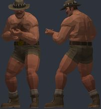</a> | `saxton_hale` | [[TF2] Saxton Hale Playermodel (VSH)](https://steamcommunity.com/sharedfiles/filedetails/?id=3822321444) by danishevsky | `models/player/saxton_hale/standard/saxton_hale.mdl` | 19094 | 1.007 | 3.7 | -0.34 | -1.8 z | 0.6/0.6 | OK | ok |
| <a href="img/poses/banana_combine.jpg">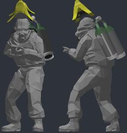</a> | `banana_combine` | [Banana Combine Playermodel](https://steamcommunity.com/sharedfiles/filedetails/?id=3824585333) by bucketofdrums | `models/bucket/combine_banana.mdl` | 7350 | 1.038 | 2.5 | 1.23 | +0.0 z | 0.5/0.6 | OK | bulky torso: chest 6.8 u further forward than a stock agent; CS2 hand poses (two-handed weapons) will clip into it; hand_R inside the torso in the CS2 preview pose (chest surface 5.3 u in front of the wrist); combinesoldiersheet: FLAT GREY (texture missing) |
| <a href="img/poses/chicken_dude.jpg">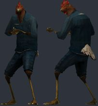</a> | `chicken_dude` | [Bird Citizen Playermodels + NPCs](https://steamcommunity.com/sharedfiles/filedetails/?id=3062759591) by Serika | `models/zekkriel/chickendude.mdl` | 6030 | 1.038 | 2.5 | -1.84 | -3.0 z | 0.3/0.3 | OK | ok |
| <a href="img/poses/tf2_heavy.jpg">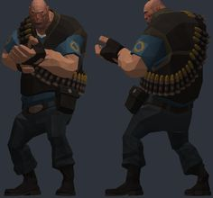</a> | `tf2_heavy` | [TF2 Player Model Pack](https://steamcommunity.com/sharedfiles/filedetails/?id=352668843) by Eligia | `models/player/heavyplayer/heavy.mdl` | 7346 | 1.038 | 2.5 | -0.47 | -2.6 z |  | OK | bulky torso: chest 5.4 u further forward than a stock agent; CS2 hand poses (two-handed weapons) will clip into it; hand_L not aligned to CS2 (the rig has no index finger plus an outer finger): fingers will bend about the wrong points; hand_R not aligned to CS2 (the rig has no index finger plus an outer finger): fingers will bend about the wrong points |
| <a href="img/poses/tf2_sniper.jpg">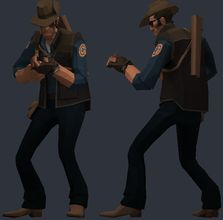</a> | `tf2_sniper` | [TF2 Player Model Pack](https://steamcommunity.com/sharedfiles/filedetails/?id=352668843) by Eligia | `models/player/sniperplayer/sniper.mdl` | 6710 | 1.038 | 2.5 | 1.55 | -2.9 z | 1.5/0.7 | OK | ok |
| <a href="img/poses/pigeon_dude.jpg">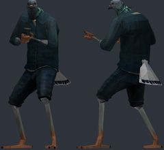</a> | `pigeon_dude` | [Bird Citizen Playermodels + NPCs](https://steamcommunity.com/sharedfiles/filedetails/?id=3062759591) by Serika | `models/zekkriel/pigeondude.mdl` | 3576 | 1.038 | 2.4 | -1.84 | -3.8 z | 0.3/0.3 | OK | ok |
| <a href="img/poses/crow_dude.jpg">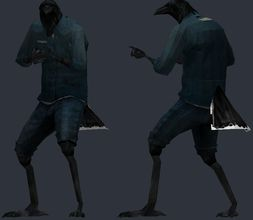</a> | `crow_dude` | [Bird Citizen Playermodels + NPCs](https://steamcommunity.com/sharedfiles/filedetails/?id=3062759591) by Serika | `models/zekkriel/crowdude.mdl` | 2552 | 1.038 | 2.5 | -1.84 | -4.1 z | 0.3/0.3 | OK | ok |
| <a href="img/poses/po.jpg">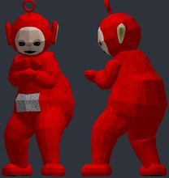</a> | `po` | [Teletubbies Playermodel + NPC](https://steamcommunity.com/sharedfiles/filedetails/?id=356485444) by manatails | `models/player/manatails/po/player.mdl` | 2650 | 0.998 | 2.5 | 0.0 | +3.1 z | 0.5/0.5 | OK | bulky torso: chest 4.5 u further forward than a stock agent; CS2 hand poses (two-handed weapons) will clip into it; hand_L not aligned to CS2 (the rig has no index finger plus an outer finger): fingers will bend about the wrong points; hand_R not aligned to CS2 (the rig has no index finger plus an outer finger): fingers will bend about the wrong points |

## Looked at, not used

| id | item | why |
|---|---|---|
| 656834283 | Doge Playermodel |  |
| 2789509655 | Monke (Playermodel┃Ragdoll) |  |
| 380745554 | Homer Player model |  |
| 2227901495 | SUIT GUY [PLAYERMODEL] // AMONG US |  |
| 158351769 | Teenage Mutant Ninja Turtle Playermodels |  |
| 671023795 | Sans the skeleton (Playermodel+Ragdoll) |  |
| 2649762189 | Spy Melon (playermodel) |  |
| 3377934709 | ROBLOX 2007 Player Model |  |
| 2688722405 | Cat Wearing Pants Playermodel |  |
| 3011662501 | Selbyen Seal Playermodel *AND RAGDOLL* ! [Silvia - TF2] |  |
| 3313894749 | Piss Baby PM (Colourable) |  |
| 3338190313 | Smoking Caterpillar Playermodel |  |
| 3503944873 | Glorp PM |  |
| 3488469457 | Funny Frogs Playermodel |  |
| 3350265405 | TF2 - Gabe Newell |  |
| 3825268476 | HL2 Styled Randy Marsh Playermodel |  |
| 3513739317 | Minecraft Playermodels With Sharp Limbs |  |

<!-- review notes: kept by batchnotes.py -->
## Review
## Review (6 Nov 2026, fun skins)

Picked from `browse.py` candidates with fun keywords; `--suggest --scale 0.8,1.6`. 34 converted, 30 kept after 4 replacements.
Dropped: Peter Griffin, Shrek, Grug, Weegee (cartoon proportions put their hands in their faces in CS2's weapon pose); Big Dew
(chips scatter; brought back by skink52: looks only), and three that aren't ValveBiped (Minecraft Steve, Domo, Left Shark). Replacements: TF2 Sniper, pigeon and crow
citizens, Po. Several rigs have no finger chains (hands not aligned): fine for mitten-handed characters.
