# Batch 7: 40 GMod player models

Generated by `batchnotes.py` from `catalog.json` and the conversion reports (`<work>/reports/<slug>.json`); review notes below the
marker are hand-written. All models: [MODELS.md](MODELS.md). Method and rules: [docs/creation/gmod-playermodels.md](../../docs/creation/gmod-playermodels.md).

40 models, 40 compiled, 20 with fit warnings.

Columns: **limb** = worst arm/leg joint distance from CS2's (u); **torso** = how far the upper torso was moved back (u); **head hb** = how far the
head hit box moved (z, u); **fingers** = finger fit L/R (u, < 1.8 fine).

| picture (click: every pose) | slug | workshop item | model | tris | scale | limb | torso | head hb | fingers | compile | notes |
|---|---|---|---|---|---|---|---|---|---|---|---|
| <a href="img/poses/tf2_pyro.jpg">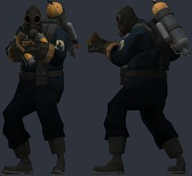</a> | `tf2_pyro` | [TF2 Player Model Pack](https://steamcommunity.com/sharedfiles/filedetails/?id=352668843) by Eligia | `models/player/pyroplayer/pyro.mdl` | 4267 | 1.038 | 2.5 | -0.38 | -3.8 z | 3.9/4.0 | OK | bulky torso: chest 7.7 u further forward than a stock agent; CS2 hand poses (two-handed weapons) will clip into it; hand_R inside the torso in the CS2 preview pose (chest surface 5.7 u in front of the wrist); hand_L fingers sit 3.9 u from their CS2 finger bones: CS2 finger curls will distort them; hand_R fingers sit 4.0 u from their CS2 finger bones: CS2 finger curls will distort them |
| <a href="img/poses/tf2_spy.jpg">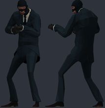</a> | `tf2_spy` | [TF2 Player Model Pack](https://steamcommunity.com/sharedfiles/filedetails/?id=352668843) by Eligia | `models/player/spyplayer/spy.mdl` | 5480 | 1.038 | 2.5 | -1.25 | -4.4 z | 1.1/0.8 | OK | ok |
| <a href="img/poses/dipsy.jpg">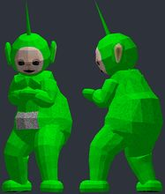</a> | `dipsy` | [Teletubbies Playermodel + NPC](https://steamcommunity.com/sharedfiles/filedetails/?id=356485444) by manatails | `models/player/manatails/dipsy/player.mdl` | 2542 | 0.998 | 2.5 | 0.0 | +2.4 z | 0.5/0.5 | OK | bulky torso: chest 4.5 u further forward than a stock agent; CS2 hand poses (two-handed weapons) will clip into it; hand_L not aligned to CS2 (the rig has no index finger plus an outer finger): fingers will bend about the wrong points; hand_R not aligned to CS2 (the rig has no index finger plus an outer finger): fingers will bend about the wrong points |
| <a href="img/poses/laa_laa.jpg">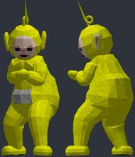</a> | `laa_laa` | [Teletubbies Playermodel + NPC](https://steamcommunity.com/sharedfiles/filedetails/?id=356485444) by manatails | `models/player/manatails/laalaa/player.mdl` | 2854 | 0.998 | 2.5 | 0.0 | +4.8 z | 0.5/0.5 | OK | bulky torso: chest 4.5 u further forward than a stock agent; CS2 hand poses (two-handed weapons) will clip into it; hand_L not aligned to CS2 (the rig has no index finger plus an outer finger): fingers will bend about the wrong points; hand_R not aligned to CS2 (the rig has no index finger plus an outer finger): fingers will bend about the wrong points |
| <a href="img/poses/duck_dude.jpg">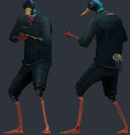</a> | `duck_dude` | [Bird Citizen Playermodels + NPCs](https://steamcommunity.com/sharedfiles/filedetails/?id=3062759591) by Serika | `models/zekkriel/duckdude.mdl` | 2814 | 1.038 | 2.4 | -1.84 | -3.5 z | 0.3/0.3 | OK | ok |
| <a href="img/poses/seagull_dude.jpg">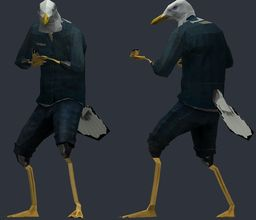</a> | `seagull_dude` | [Bird Citizen Playermodels + NPCs](https://steamcommunity.com/sharedfiles/filedetails/?id=3062759591) by Serika | `models/zekkriel/friendly/seagulldude_a.mdl` | 2358 | 1.038 | 2.4 | -1.84 | -4.4 z | 0.3/0.3 | OK | ok |
| <a href="img/poses/daft_punk_silver.jpg">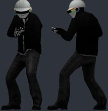</a> | `daft_punk_silver` | [Daft Punk Player Models](https://steamcommunity.com/sharedfiles/filedetails/?id=148628139) by Wayne | `models/player/daftpunk/daft_silver.mdl` | 7109 | 1.038 | 2.5 | -1.77 | -4.0 z | 0.3/0.4 | OK | ok |
| <a href="img/poses/santa_hale.jpg">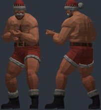</a> | `santa_hale` | [[TF2] Saxton Hale Playermodel (VSH)](https://steamcommunity.com/sharedfiles/filedetails/?id=3822321444) by danishevsky | `models/player/saxton_hale/maul/santa_hale.mdl` | 18160 | 1.007 | 3.7 | -0.34 | -1.8 z | 0.6/0.6 | OK | ok |
| <a href="img/poses/hell_hale.jpg">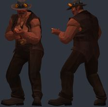</a> | `hell_hale` | [[TF2] Saxton Hale Playermodel (VSH)](https://steamcommunity.com/sharedfiles/filedetails/?id=3822321444) by danishevsky | `models/player/saxton_hale/outburst/hell_hale.mdl` | 17038 | 1.007 | 3.8 | -0.53 | +2.9 z | 0.6/0.6 | OK | bulky torso: chest 4.2 u further forward than a stock agent; CS2 hand poses (two-handed weapons) will clip into it |
| <a href="img/poses/wizard_hooded.jpg">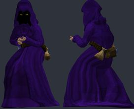</a> | `wizard_hooded` | [The Wizard (Playermodel/NPCs)](https://steamcommunity.com/sharedfiles/filedetails/?id=3375440207) by Electric Kool-Aid | `models/electric/old_wizard/old_wizard_hooded.mdl` | 8419 | 1.103 | 11.7 | -1.8 | -0.8 z | 0.6/0.2 | OK | bulky torso: chest 4.5 u further forward than a stock agent; CS2 hand poses (two-handed weapons) will clip into it; hand_R inside the torso in the CS2 preview pose (chest surface 3.3 u in front of the wrist); skeleton does not match CS2 (limb joints more than 5 u off: leg_lower_L 11.7, leg_lower_R 11.6, leg_upper_L 9.6, leg_upper_R 9.5): CS2 will bend the limbs away from the joints of the model |
| <a href="img/poses/fo3_ghoul.jpg">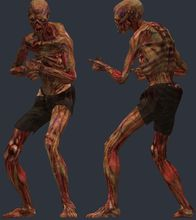</a> | `fo3_ghoul` | [Fallout 3 Player Models](https://steamcommunity.com/sharedfiles/filedetails/?id=133401340) by Knuckle | `models/fallout_3/ghoul.mdl` | 7571 | 1.005 | 2.8 | -1.85 | -0.5 z | 0.7/1.4 | OK | ok |
| <a href="img/poses/fo3_glowing_one.jpg">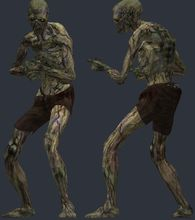</a> | `fo3_glowing_one` | [Fallout 3 Player Models](https://steamcommunity.com/sharedfiles/filedetails/?id=133401340) by Knuckle | `models/fallout_3/glowing_one.mdl` | 7571 | 1.005 | 2.8 | -1.85 | -0.5 z | 0.7/1.4 | OK | ok |
| <a href="img/poses/b2_droid.jpg">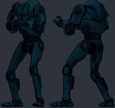</a> | `b2_droid` | [SW: Clone Wars 2003 / Playermodel Pack](https://steamcommunity.com/sharedfiles/filedetails/?id=3743556887) by Bananakin | `models/konnie/bananakin/starwars/cartoon/b2_battledroid.mdl` | 11080 | 0.823 | 2.6 | -1.76 | -10.9 z |  | OK | hand_L not aligned to CS2 (the rig has no index finger plus an outer finger): fingers will bend about the wrong points; hand_R not aligned to CS2 (the rig has no index finger plus an outer finger): fingers will bend about the wrong points |
| <a href="img/poses/bossk.jpg">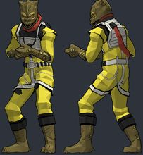</a> | `bossk` | [SW: Clone Wars 2003 / Playermodel Pack](https://steamcommunity.com/sharedfiles/filedetails/?id=3743556887) by Bananakin | `models/konnie/bananakin/starwars/cartoon/bossk.mdl` | 5734 | 1.035 | 2.6 | -1.53 | -1.4 z |  | OK | hand_L not aligned to CS2 (the rig has no index finger plus an outer finger): fingers will bend about the wrong points; hand_R not aligned to CS2 (the rig has no index finger plus an outer finger): fingers will bend about the wrong points |
| <a href="img/poses/rodian.jpg">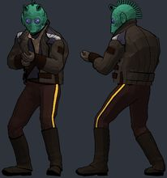</a> | `rodian` | [SW: Clone Wars 2003 / Playermodel Pack](https://steamcommunity.com/sharedfiles/filedetails/?id=3743556887) by Bananakin | `models/konnie/bananakin/starwars/cartoon/cantinapatron_rodian.mdl` | 12816 | 1.043 | 2.6 | -2.25 | -1.7 z |  | OK | hand_L not aligned to CS2 (the rig has no index finger plus an outer finger): fingers will bend about the wrong points; hand_R not aligned to CS2 (the rig has no index finger plus an outer finger): fingers will bend about the wrong points |
| <a href="img/poses/yoda.jpg">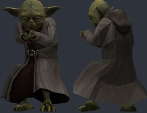</a> | `yoda` | [Sith & Jedi Playermodel Pack](https://steamcommunity.com/sharedfiles/filedetails/?id=518960557) by J0kingg | `models/player/b4p/b4p_yoda.mdl` | 3518 | 1.0 | 2.6 | 0.73 | -4.3 z | 0.4/0.4 | OK | bulky torso: chest 4.5 u further forward than a stock agent; CS2 hand poses (two-handed weapons) will clip into it |
| <a href="img/poses/chewbacca.jpg">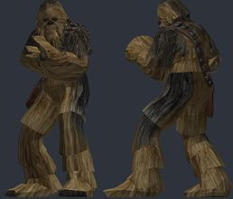</a> | `chewbacca` | [STAR WARS Han Solo and Chewbacca Playermodels](https://steamcommunity.com/sharedfiles/filedetails/?id=448581592) by Voikanaa | `models/player/chewie.mdl` | 7650 | 1.038 | 2.5 | -1.88 | -5.0 z | 0.4/0.4 | OK | bulky torso: chest 4.3 u further forward than a stock agent; CS2 hand poses (two-handed weapons) will clip into it |
| <a href="img/poses/gus_pollos.jpg">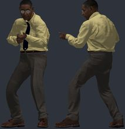</a> | `gus_pollos` | [[Breaking Bad] Gustavo Fring](https://steamcommunity.com/sharedfiles/filedetails/?id=3412497213) by Azkabath | `models/gustavo_fring/gustavo_los_pollos.mdl` | 56704 | 1.038 | 2.6 | -2.57 | -2.9 z | 0.5/0.4 | OK | ok |
| <a href="img/poses/walter_hazmat.jpg">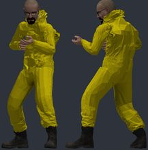</a> | `walter_hazmat` | [Walter White Playermodel](https://steamcommunity.com/sharedfiles/filedetails/?id=2787370699) by HarryA | `models/walterwhite/playermodels/walterwhitechem.mdl` | 26609 | 1.039 | 2.5 | -3.33 | -4.6 z |  | OK | hand_L not aligned to CS2 (the rig has no index finger plus an outer finger): fingers will bend about the wrong points; hand_R not aligned to CS2 (the rig has no index finger plus an outer finger): fingers will bend about the wrong points |
| <a href="img/poses/deadpool_classic.jpg">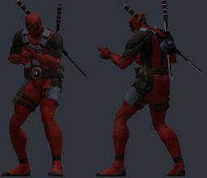</a> | `deadpool_classic` | [Deadpool Playermodel](https://steamcommunity.com/sharedfiles/filedetails/?id=200700693) by o u t l a w | `models/pechenko_121/deadpool/chr_deadpoolclassic.mdl` | 25582 | 1.041 | 2.2 | -0.52 | -5.0 z | 0.4/0.3 | OK | ok |
| <a href="img/poses/csgo_fbi.jpg">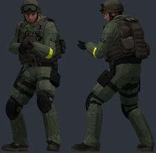</a> | `csgo_fbi` | [Counter Strike: Global Offensive CT Playermodels and NPCs](https://steamcommunity.com/sharedfiles/filedetails/?id=481358078) by Professor Heavy | `models/csgofbi1pm.mdl` | 15487 | 0.97 | 2.5 | -1.37 | -3.1 z | 0.6/0.7 | OK | bulky torso: chest 5.3 u further forward than a stock agent; CS2 hand poses (two-handed weapons) will clip into it; hand_R inside the torso in the CS2 preview pose (chest surface 3.2 u in front of the wrist) |
| <a href="img/poses/csgo_gign.jpg">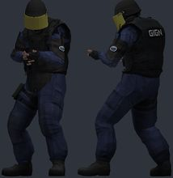</a> | `csgo_gign` | [Counter Strike: Global Offensive CT Playermodels and NPCs](https://steamcommunity.com/sharedfiles/filedetails/?id=481358078) by Professor Heavy | `models/csgogign1pm.mdl` | 12310 | 1.003 | 2.7 | -2.83 | -2.0 z | 0.5/0.5 | OK | bulky torso: chest 5.1 u further forward than a stock agent; CS2 hand poses (two-handed weapons) will clip into it |
| <a href="img/poses/csgo_anarchist.jpg">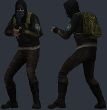</a> | `csgo_anarchist` | [Counter Strike: Global Offensive T Playermodels and NPCs](https://steamcommunity.com/sharedfiles/filedetails/?id=481607813) by Professor Heavy | `models/csgoanarchist1pm.mdl` | 13180 | 0.998 | 2.5 | 2.73 | -3.0 z | 0.4/0.5 | OK | ok |
| <a href="img/poses/csgo_balkan.jpg">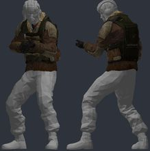</a> | `csgo_balkan` | [Counter Strike: Global Offensive T Playermodels and NPCs](https://steamcommunity.com/sharedfiles/filedetails/?id=481607813) by Professor Heavy | `models/csgobalkan1pm.mdl` | 13592 | 0.998 | 2.5 | -1.72 | -3.4 z | 0.5/0.6 | OK | balkanterroristlowerbody_d1: FLAT GREY (texture missing); tm_balkan_head_varianta: FLAT GREY (texture missing) |
| <a href="img/poses/pmc_operator2.jpg">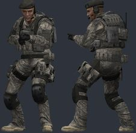</a> | `pmc_operator2` | [PMC playermodels](https://steamcommunity.com/sharedfiles/filedetails/?id=232636218) by maJor | `models/player/pmc_2/pmc__01.mdl` | 15016 | 1.038 | 2.6 | -0.88 | -2.4 z | 0.5/0.5 | OK | bulky torso: chest 4.4 u further forward than a stock agent; CS2 hand poses (two-handed weapons) will clip into it; hand_R inside the torso in the CS2 preview pose (chest surface 4.5 u in front of the wrist) |
| <a href="img/poses/heavy_combine2.jpg">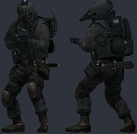</a> | `heavy_combine2` | [Heavy Combine NPCs and Playermodels](https://steamcommunity.com/sharedfiles/filedetails/?id=188562859) by Professor Heavy | `models/player/01ar_combine_soldier01.mdl` | 12345 | 0.998 | 2.5 | -0.84 | -3.5 z | 0.6/0.6 | OK | bulky torso: chest 5.3 u further forward than a stock agent; CS2 hand poses (two-handed weapons) will clip into it; hand_R inside the torso in the CS2 preview pose (chest surface 3.4 u in front of the wrist) |
| <a href="img/poses/crysis_cell2.jpg">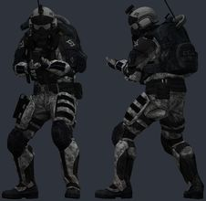</a> | `crysis_cell2` | [Crysis C.E.L.L. Assault Operative NPCs and Playermodels](https://steamcommunity.com/sharedfiles/filedetails/?id=221823653) by Professor Heavy | `models/player/cellassault2player.mdl` | 16586 | 0.97 | 2.5 | 1.14 | -2.2 z | 0.9/0.7 | OK | bulky torso: chest 7.1 u further forward than a stock agent; CS2 hand poses (two-handed weapons) will clip into it; hand_R inside the torso in the CS2 preview pose (chest surface 6.8 u in front of the wrist) |
| <a href="img/poses/apoc_female.jpg">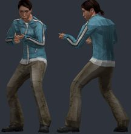</a> | `apoc_female` | [Apocalypse Citizens (Playermodels)](https://steamcommunity.com/sharedfiles/filedetails/?id=3122592785) by Gunslinger ☢ | `models/rusty/citizens/female_01.mdl` | 4282 | 1.097 | 3.5 | -1.82 | -1.8 z | 0.6/0.5 | OK | ok |
| <a href="img/poses/black_enforcer.jpg">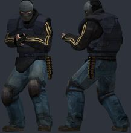</a> | `black_enforcer` | [BLACK (2006) Goons & Operators (Playermodels & NPCs)](https://steamcommunity.com/sharedfiles/filedetails/?id=3215765831) by Kapitano Krunchyman | `models/bl_player/bl_enforcer.mdl` | 2948 | 0.979 | 2.5 | -2.87 | -3.9 z | 0.6/0.7 | OK | ok |
| <a href="img/poses/black_riot.jpg">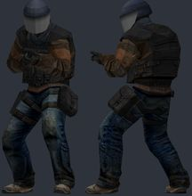</a> | `black_riot` | [BLACK (2006) Goons & Operators (Playermodels & NPCs)](https://steamcommunity.com/sharedfiles/filedetails/?id=3215765831) by Kapitano Krunchyman | `models/bl_player/bl_riotgrunt.mdl` | 2743 | 0.97 | 2.6 | -2.79 | -3.1 z | 0.7/0.7 | OK | ok |
| <a href="img/poses/combine_elite_pm.jpg">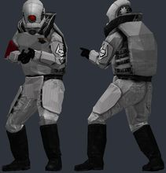</a> | `combine_elite_pm` | [[PM] Combine Unit Playermodels (w/accurate c_hands)](https://steamcommunity.com/sharedfiles/filedetails/?id=3411853782) by salvare000 | `models/player/combines/combine_elite.mdl` | 5395 | 1.038 | 2.6 | -1.79 | -3.0 z | 0.5/0.5 | OK | bulky torso: chest 4.4 u further forward than a stock agent; CS2 hand poses (two-handed weapons) will clip into it |
| <a href="img/poses/thing_burrows.jpg">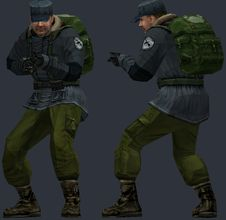</a> | `thing_burrows` | [The Thing (2002) Humans (Playermodels & Ragdolls)](https://steamcommunity.com/sharedfiles/filedetails/?id=3456405055) by Kapitano Krunchyman | `models/thething2002/pm_burrows.mdl` | 2210 | 1.038 | 2.7 | 2.43 | -4.2 z | 0.5/0.4 | OK | bulky torso: chest 4.7 u further forward than a stock agent; CS2 hand poses (two-handed weapons) will clip into it |
| <a href="img/poses/thing_cohen.jpg">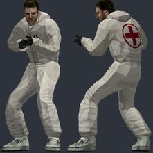</a> | `thing_cohen` | [The Thing (2002) Humans (Playermodels & Ragdolls)](https://steamcommunity.com/sharedfiles/filedetails/?id=3456405055) by Kapitano Krunchyman | `models/thething2002/pm_cohen.mdl` | 1706 | 1.038 | 2.7 | 2.43 | -4.7 z | 0.5/0.4 | OK | ok |
| <a href="img/poses/f76_enclave.jpg">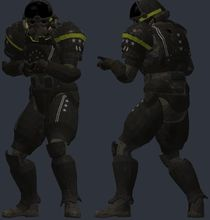</a> | `f76_enclave` | [[F76] Secret Service Soldiers [Playermodel+Ragdoll]](https://steamcommunity.com/sharedfiles/filedetails/?id=3568561943) by Davy | `models/ndord/fallout/secretservice_enclave.mdl` | 24268 | 1.042 | 1.6 | -1.24 | -3.8 z | 0.4/0.4 | OK | ok |
| <a href="img/poses/scp_chaos.jpg">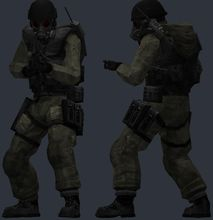</a> | `scp_chaos` | [Oldschool SCP Pack (Playermodels)](https://steamcommunity.com/sharedfiles/filedetails/?id=3591454343) by Gunslinger | `models/player/oldschool_scp/chaos_insurgent.mdl` | 5334 | 1.038 | 2.5 | -1.52 | -2.8 z | 0.6/0.6 | OK | bulky torso: chest 5.7 u further forward than a stock agent; CS2 hand poses (two-handed weapons) will clip into it |
| <a href="img/poses/gtaiv_female.jpg">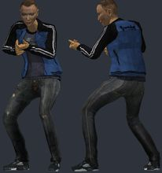</a> | `gtaiv_female` | [Grand Theft Auto IV Multiplayer Characters [PMs; NPCs; Ragdolls]](https://steamcommunity.com/sharedfiles/filedetails/?id=3660594257) by BęŁkÁ 🐿 | `models/gtaivmp/playerm/iv_female01.mdl` | 5122 | 1.097 | 3.3 | 0.21 | -1.9 z | 0.5/0.6 | OK | ok |
| <a href="img/poses/bo1_nikolai.jpg">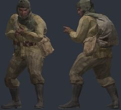</a> | `bo1_nikolai` | [CoD: BO1 - Ultimis Playermodels](https://steamcommunity.com/sharedfiles/filedetails/?id=3715032179) by Hidden | `models/player/black_ops_1/ultimis/p_nikolai.mdl` | 8175 | 1.096 | 2.1 | -1.07 | -0.7 z | 0.3/0.4 | OK | bulky torso: chest 7.0 u further forward than a stock agent; CS2 hand poses (two-handed weapons) will clip into it; hand_R inside the torso in the CS2 preview pose (chest surface 5.2 u in front of the wrist) |
| <a href="img/poses/bo1_richtofen.jpg">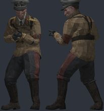</a> | `bo1_richtofen` | [CoD: BO1 - Ultimis Playermodels](https://steamcommunity.com/sharedfiles/filedetails/?id=3715032179) by Hidden | `models/player/black_ops_1/ultimis/p_richtofen.mdl` | 7426 | 1.095 | 2.4 | -2.97 | +0.0 z | 0.3/0.4 | OK | ok |
| <a href="img/poses/raiden_mgs4.jpg">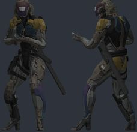</a> | `raiden_mgs4` | [Metal Gear Raiden Player Model Pack](https://steamcommunity.com/sharedfiles/filedetails/?id=257102395) by KraiKKonen11 | `models/ninja/raidenmgs4.mdl` | 21159 | 1.046 | 2.9 | -2.01 | -4.0 z | 0.6/0.6 | OK | ok |
| <a href="img/poses/ua_rangemaster.jpg">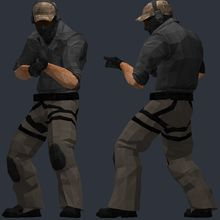</a> | `ua_rangemaster` | [Urban Assault Playermodels (WIP)](https://steamcommunity.com/sharedfiles/filedetails/?id=3772745299) by TalonSolid | `models/urbanassault/ua_rangemaster.mdl` | 6280 | 1.038 | 2.6 | -3.86 | -4.0 z | 1.1/1.0 | OK | ok |

<!-- review notes: kept by batchnotes.py -->
## Review
## Review (6 Nov 2026, light)

Picked from packs already converted cleanly (other characters, same rig): 20 fun (TF2 Pyro/Spy, Teletubbies, bird citizens, Saxton
Hale variants, Yoda, Chewbacca, B2 droid...) and 20 plain (CS:GO factions, PMC, BLACK, The Thing, SCP, GTA IV...). 16 failed to
download the first time (SteamCMD's workshop state still listed the items cleanup.py had deleted: see the guide) and were rerun. The
B2 droid has no head mesh: its head hit box now sits on the top of its chest. The TF2 Pyro and Spy came out grey until the converter
baked in GMod's player colour.
