# Batch 9: 291 GMod player models

Generated by `batchnotes.py` from `catalog.json` and the conversion reports (`<work>/reports/<slug>.json`); review notes below the
marker are hand-written. All models: [MODELS.md](MODELS.md). Method and rules: [docs/creation/gmod-playermodels.md](../../docs/creation/gmod-playermodels.md).

291 models, 291 compiled, 103 with fit warnings.

Columns: **limb** = worst arm/leg joint distance from CS2's (u); **torso** = how far the upper torso was moved back (u); **head hb** = how far the
head hit box moved (z, u); **fingers** = finger fit L/R (u, < 1.8 fine).

| picture (click: every pose) | slug | workshop item | model | tris | scale | limb | torso | head hb | fingers | compile | notes |
|---|---|---|---|---|---|---|---|---|---|---|---|
| <a href="img/poses/mystique_fox_x_men.jpg">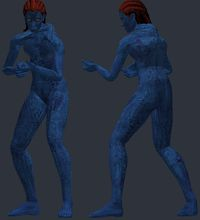</a> | `mystique_fox_x_men` | [X-Men (FOX) - Wolverine & Mystique (PMs & Ragdolls)](https://steamcommunity.com/sharedfiles/filedetails/?id=3479012296) by ? | `models/player/purpl/foxmen/mystique.mdl` | 22363 | 1.155 | 6.3 | -2.14 | +0.6 z | 0.5/0.5 | OK | ok |
| <a href="img/poses/magneto_jim_lee.jpg">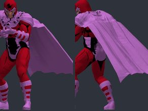</a> | `magneto_jim_lee` | [X-Men (Marvel Comics) - Magneto (PM/Ragdoll)
](https://steamcommunity.com/sharedfiles/filedetails/?id=3512651104) by ? | `models/player/purpl/comic/magneto.mdl` | 44334 | 0.983 | 1.7 | 0.24 | -4.2 z | 0.5/0.5 | OK | hand_R inside the torso in the CS2 preview pose (chest surface 3.2 u in front of the wrist) |
| <a href="img/poses/wolverine_fox_x_men.jpg">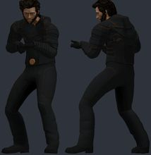</a> | `wolverine_fox_x_men` | [X-Men (FOX) - Wolverine & Mystique (PMs & Ragdolls)](https://steamcommunity.com/sharedfiles/filedetails/?id=3479012296) by ? | `models/player/purpl/foxmen/wolverine.mdl` | 45461 | 1.046 | 3.1 | -1.82 | -2.5 z | 0.4/0.4 | OK | ok |
| <a href="img/poses/x_men_bishop.jpg">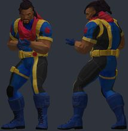</a> | `x_men_bishop` | [[PM] Bishop / X-Men](https://steamcommunity.com/sharedfiles/filedetails/?id=3071218515) by ? | `models/xmen/bishop/xmen_bishop.mdl` | 17181 | 1.041 | 2.4 | -1.09 | -3.8 z | 0.2/0.2 | OK | bulky torso: chest 4.3 u further forward than a stock agent; CS2 hand poses (two-handed weapons) will clip into it |
|  | `jean_grey_x2` | [Jean Grey (X-Men 2) PMs](https://steamcommunity.com/sharedfiles/filedetails/?id=3782746994) by ? | `models/mario8251_pm/jeangreyxm2_pm.mdl` | 4067 | 1.087 | 5.2 | -0.24 | -4.3 z | 0.3/0.3 | OK | ok |
| <a href="img/poses/jean_grey_x2_vessie_anim.jpg">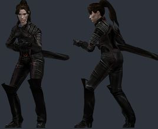</a> | `jean_grey_x2_vessie_anim` | [Jean Grey (X-Men 2) PMs](https://steamcommunity.com/sharedfiles/filedetails/?id=3782746994) by ? | `models/mario8251_pm/jeangreyxm2vessie_pm.mdl` | 4067 | 1.087 | 5.2 | -0.24 | -4.3 z | 0.3/0.3 | OK | ok |
| <a href="img/poses/ddlc_yuri.jpg">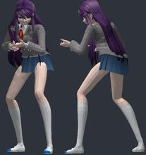</a> | `ddlc_yuri` | [Doki Doki Literature Club Playermodels & NPC](https://steamcommunity.com/sharedfiles/filedetails/?id=1596883781) by Goonya | `models/player/ddlc__yuri.mdl` | 55697 | 1.168 | 9.9 | 2.37 | -5.0 z | 0.3/0.3 | OK | bulky torso: chest 4.2 u further forward than a stock agent; CS2 hand poses (two-handed weapons) will clip into it |
| <a href="img/poses/vessel.jpg">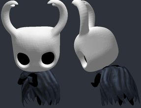</a> | `vessel` | [Hollow Knight - Main Characters [PM]](https://steamcommunity.com/sharedfiles/filedetails/?id=2253679214) by Kermit the Frog | `models/hollowknight/vessel/vessel.mdl` | 17036 | 1.985 | 56.4 | 1.05 | +5.0 z |  | OK | hand_L not aligned to CS2 (the rig has no index finger plus an outer finger): fingers will bend about the wrong points; hand_R not aligned to CS2 (the rig has no index finger plus an outer finger): fingers will bend about the wrong points |
| <a href="img/poses/hollow_knight.jpg">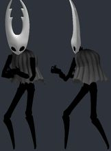</a> | `hollow_knight` | [Hollow Knight - Main Characters [PM]](https://steamcommunity.com/sharedfiles/filedetails/?id=2253679214) by Kermit the Frog | `models/hollowknight/hollowknight/hollowknight.mdl` | 49744 | 1.176 | 4.9 | 0.35 | +4.8 z | 0.8/0.8 | OK | ok |
| <a href="img/poses/ddlc_sayori.jpg">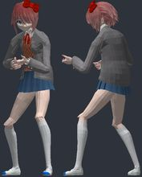</a> | `ddlc_sayori` | [Doki Doki Literature Club Playermodels & NPC](https://steamcommunity.com/sharedfiles/filedetails/?id=1596883781) by Goonya | `models/player/ddlc__sayori.mdl` | 71528 | 1.219 | 7.6 | -1.98 | -0.8 z | 0.2/0.3 | OK | ok |
| <a href="img/poses/re_zero_ram.jpg">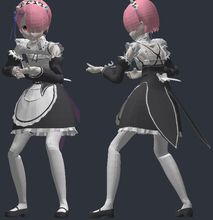</a> | `re_zero_ram` | [Re:Zero - Rem & Ram (Ragdoll & Playermodel)](https://steamcommunity.com/sharedfiles/filedetails/?id=783254539) by Kitsumy ✦ | `models/maximo/rezero/ram_playermodel.mdl` | 80548 | 1.186 | 4.7 | -1.98 | -1.5 z | 0.5/0.5 | OK | ok |
| <a href="img/poses/re_zero_rem.jpg">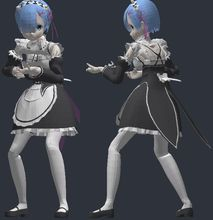</a> | `re_zero_rem` | [Re:Zero - Rem & Ram (Ragdoll & Playermodel)](https://steamcommunity.com/sharedfiles/filedetails/?id=783254539) by Kitsumy ✦ | `models/maximo/rezero/rem_playermodel.mdl` | 80542 | 1.186 | 4.7 | -2.16 | -1.5 z | 0.5/0.5 | OK | ok |
| <a href="img/poses/call_of_duty_modern_warf.jpg">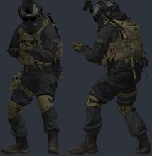</a> | `call_of_duty_modern_warf` | [CoD: Modern Warfare - Shadow Company Mil-Sim (V2) [PM/NPC]](https://steamcommunity.com/sharedfiles/filedetails/?id=2859700228) by Bread | `models/bread/cod/characters/milsim/shadow_company.mdl` | 91583 | 1.06 | 2.2 | -0.89 | -1.4 z | 0.4/0.3 | OK | bulky torso: chest 6.2 u further forward than a stock agent; CS2 hand poses (two-handed weapons) will clip into it; hand_R inside the torso in the CS2 preview pose (chest surface 5.2 u in front of the wrist) |
| <a href="img/poses/astolfo.jpg">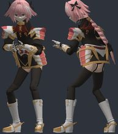</a> | `astolfo` | [[Fate/Apocrypha] - Astolfo. Player Model / NPC](https://steamcommunity.com/sharedfiles/filedetails/?id=1173213662) by CyanBlue | `models/cyanblue/fate/astolfo/astolfo.mdl` | 84625 | 1.197 | 5.0 | 1.63 | -4.9 z | 0.3/0.3 | OK | ok |
| <a href="img/poses/white_rock_shooter.jpg">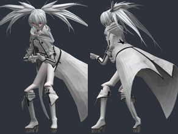</a> | `white_rock_shooter` | [White Rock Shooter (Digitrevx) Playermodel and NPC](https://steamcommunity.com/sharedfiles/filedetails/?id=638229249) by JazzMcNade | `models/jazzmcfly/wrs/wrs.mdl` | 40545 | 1.327 | 12.0 | -0.65 | +4.2 z | 0.4/0.4 | OK | ok |
| <a href="img/poses/nier_automata_2b_kaine.jpg">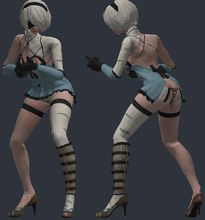</a> | `nier_automata_2b_kaine` | [NieR:Automata - 2B [PM/NPC & Ragdoll]](https://steamcommunity.com/sharedfiles/filedetails/?id=1473577388) by ArachnitCZ | `models/arachnit/nier_automata/2b/2b_kaine_player.mdl` | 65151 | 1.178 | 9.1 | 3.43 | +4.3 z | 0.3/0.3 | OK | bulky torso: chest 5.1 u further forward than a stock agent; CS2 hand poses (two-handed weapons) will clip into it; hand_R inside the torso in the CS2 preview pose (chest surface 3.3 u in front of the wrist) |
| <a href="img/poses/nier_automata_2b.jpg">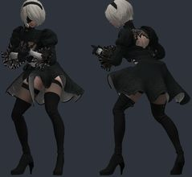</a> | `nier_automata_2b` | [NieR:Automata - 2B [PM/NPC & Ragdoll]](https://steamcommunity.com/sharedfiles/filedetails/?id=1473577388) by ArachnitCZ | `models/arachnit/nier_automata/2b/2b_player.mdl` | 61036 | 1.178 | 9.1 | 3.58 | +4.2 z | 0.3/0.3 | OK | bulky torso: chest 4.5 u further forward than a stock agent; CS2 hand poses (two-handed weapons) will clip into it; hand_R inside the torso in the CS2 preview pose (chest surface 3.9 u in front of the wrist) |
| <a href="img/poses/rust_arctic_hazmat.jpg">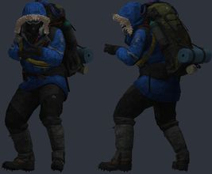</a> | `rust_arctic_hazmat` | [Rust Arctic Suit PM/Ragdoll](https://steamcommunity.com/sharedfiles/filedetails/?id=2743974910) by Darsu | `models/player/darky_m/rust/arctic_hazmat.mdl` | 38501 | 1.038 | 3.8 | 2.94 | -3.2 z | 0.4/0.3 | OK | bulky torso: chest 7.8 u further forward than a stock agent; CS2 hand poses (two-handed weapons) will clip into it; hand_R inside the torso in the CS2 preview pose (chest surface 4.6 u in front of the wrist) |
| <a href="img/poses/detroit_connor.jpg">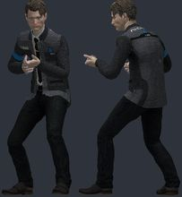</a> | `detroit_connor` | [Detroit: Become Human - Connor (PM+NPC)](https://steamcommunity.com/sharedfiles/filedetails/?id=1697736161) by Konnie | `models/konnie/isa/detroit/connor.mdl` | 52685 | 1.024 | 1.9 | -1.3 | +0.0 z | 0.2/0.2 | OK | ok |
| <a href="img/poses/ruby_rose.jpg">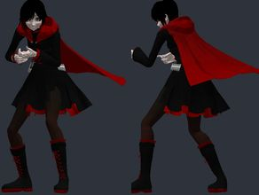</a> | `ruby_rose` | [Ruby Rose Playermodel](https://steamcommunity.com/sharedfiles/filedetails/?id=465761506) by JazzMcNade | `models/jazzmcfly/rwby/ruby_rose.mdl` | 50792 | 1.204 | 6.5 | 0.74 | -2.8 z | 0.3/0.3 | OK | ok |
| <a href="img/poses/bf4_us_assaultpm.jpg">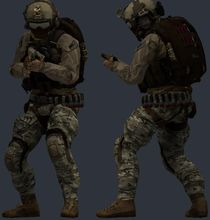</a> | `bf4_us_assaultpm` | [Battlefield 4 Bodygrouped MP US [PM/NPCS]](https://steamcommunity.com/sharedfiles/filedetails/?id=1408804905) by Styrofoam.Mendoza | `models/styrofoam/bf4/us_assaultpm.mdl` | 21079 | 1.047 | 2.4 | 0.71 | -2.2 z | 1.0/1.0 | OK | bulky torso: chest 6.8 u further forward than a stock agent; CS2 hand poses (two-handed weapons) will clip into it; hand_R inside the torso in the CS2 preview pose (chest surface 6.0 u in front of the wrist); eyeball_assault_l: generated eye stand-in; eyeball_assault_r: generated eye stand-in |
| <a href="img/poses/stalker_merc_exo.jpg">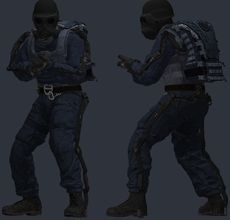</a> | `stalker_merc_exo` | [S.T.A.L.K.E.R. - Mercenaries Redux [PMs](https://steamcommunity.com/sharedfiles/filedetails/?id=1282510299) by jolly ol' chap | `models/auditor/mercs_redux/mercs_light/mercenary_hvy_exosuit.mdl` | 51092 | 1.049 | 3.4 | 1.86 | -1.8 z | 0.3/0.4 | OK | bulky torso: chest 5.3 u further forward than a stock agent; CS2 hand poses (two-handed weapons) will clip into it; hand_R inside the torso in the CS2 preview pose (chest surface 3.4 u in front of the wrist) |
| <a href="img/poses/glados_humanoid_rw22.jpg">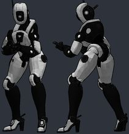</a> | `glados_humanoid_rw22` | [GLaDOS Humanoid - PM/NPC [Ruffleswinner22]](https://steamcommunity.com/sharedfiles/filedetails/?id=3359505040) by MeerCat | `models/meercat/glados_humanoid_rw22/glados_humanoid_rw22.mdl` | 86728 | 1.123 | 10.6 | -4.01 | +3.0 z | 0.4/0.4 | OK | ok |
| <a href="img/poses/black_gold_saw.jpg">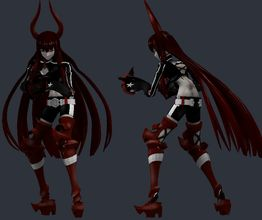</a> | `black_gold_saw` | [Black Gold Saw (Digitrevx) Playermodel and NPC](https://steamcommunity.com/sharedfiles/filedetails/?id=491162829) by JazzMcNade | `models/jazzmcfly/bgs/bgs.mdl` | 59733 | 1.171 | 9.0 | 2.38 | +0.0 z | 2.4/2.0 | OK | hand_L fingers sit 2.4 u from their CS2 finger bones: CS2 finger curls will distort them; hand_R fingers sit 2.0 u from their CS2 finger bones: CS2 finger curls will distort them |
| <a href="img/poses/titanfall_jack_cooper.jpg">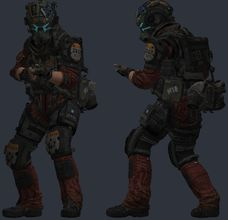</a> | `titanfall_jack_cooper` | [Titanfall 2 - Jack Cooper [PM](https://steamcommunity.com/sharedfiles/filedetails/?id=1236181176) by jolly ol' chap | `models/auditor/titanfall2/cooper/chr_jackcooper.mdl` | 41867 | 1.083 | 3.8 | -1.03 | +0.0 z | 0.6/0.5 | OK | bulky torso: chest 5.3 u further forward than a stock agent; CS2 hand poses (two-handed weapons) will clip into it |
| <a href="img/poses/joker.jpg">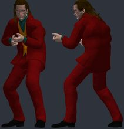</a> | `joker` | [Joker (Joaquin Phoenix) [ PM / NPC / Ragdoll ]](https://steamcommunity.com/sharedfiles/filedetails/?id=1899345304) by Kemot44 | `models/kemot44/models/joker_pm.mdl` | 58473 | 1.091 | 5.2 | -1.16 | -0.3 z | 0.4/0.3 | OK | ok |
| <a href="img/poses/deadpool_2.jpg">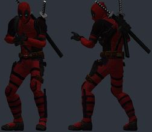</a> | `deadpool_2` | [Deadpool - Movie Playermodel +7 Others](https://steamcommunity.com/sharedfiles/filedetails/?id=1389809127) by Kryptonite | `models/kryptonite/deadpool/deadpool.mdl` | 50008 | 1.046 | 2.7 | 0.01 | -4.4 z | 0.3/0.3 | OK | ok |
| <a href="img/poses/rainbow_six_siege_ela.jpg">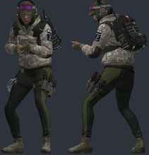</a> | `rainbow_six_siege_ela` | [Rainbow Six Siege - Ela [PM](https://steamcommunity.com/sharedfiles/filedetails/?id=1178217926) by jolly ol' chap | `models/auditor/r6s/grom/ela/chr_grom_ela.mdl` | 42512 | 1.078 | 2.5 | 1.18 | -1.9 z | 0.4/0.4 | OK | bulky torso: chest 4.2 u further forward than a stock agent; CS2 hand poses (two-handed weapons) will clip into it |
| <a href="img/poses/stalker_merca.jpg">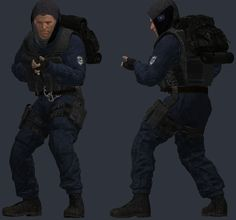</a> | `stalker_merca` | [S.T.A.L.K.E.R. - Mercenaries Redux [PMs](https://steamcommunity.com/sharedfiles/filedetails/?id=1282510299) by jolly ol' chap | `models/auditor/mercs_redux/mercs_light/mercenary_lightarmored_alpha.mdl` | 37789 | 1.049 | 3.2 | 1.42 | -2.2 z | 0.3/0.4 | OK | bulky torso: chest 7.0 u further forward than a stock agent; CS2 hand poses (two-handed weapons) will clip into it; hand_R inside the torso in the CS2 preview pose (chest surface 4.9 u in front of the wrist) |
| <a href="img/poses/talos.jpg">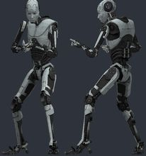</a> | `talos` | [The Talos Principle playermodel](https://steamcommunity.com/sharedfiles/filedetails/?id=385866957) by Wellson | `models/child.mdl` | 64720 | 1.038 | 2.6 | -1.8 | -3.1 z | 0.3/0.5 | OK | ok |
| <a href="img/poses/r6s_tachanka.jpg">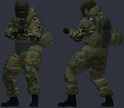</a> | `r6s_tachanka` | [Rainbow Six Siege - Enhanced Tachanka [PM](https://steamcommunity.com/sharedfiles/filedetails/?id=1105240468) by jolly ol' chap | `models/auditor/r6s/spetsnaz/tachanka/chr_spetsnaz_turret3.mdl` | 54076 | 1.04 | 3.1 | -1.82 | -4.8 z | 0.4/0.5 | OK | ok |
| <a href="img/poses/mesmerizer_hatsune_miku.jpg">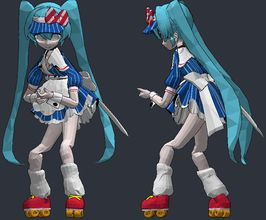</a> | `mesmerizer_hatsune_miku` | [Mesmerizer - Hatsune Miku/Kasane Teto [PM/Ragdoll]](https://steamcommunity.com/sharedfiles/filedetails/?id=3431027230) by Сонный Гэри | `models/gamespy/mesmerizer/msmikuhatsune.mdl` | 100083 | 1.301 | 11.4 | -1.46 | -4.8 z | 0.6/0.6 | OK | ok |
| <a href="img/poses/lc_don_quixote.jpg">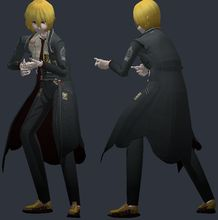</a> | `lc_don_quixote` | [Limbus Company - Don Quixote [PM/NPC] 돈키호테](https://steamcommunity.com/sharedfiles/filedetails/?id=3271190159) by finished my contracts award | `models/furuki/don/don_quixote_model.mdl` | 63422 | 1.274 | 9.9 | -1.68 | +1.1 z | 0.3/0.3 | OK | ok |
| <a href="img/poses/w3_geralt_default.jpg">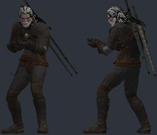</a> | `w3_geralt_default` | [The Witcher 3 - Viper School Geralt [PM/NPC]](https://steamcommunity.com/sharedfiles/filedetails/?id=904208280) by TFNeraZe | `models/player/tfa_w3_geralt_default.mdl` | 74175 | 1.025 | 2.4 | -0.45 | -3.5 z | 0.5/0.5 | OK | mouth: generated mouth stand-in |
| <a href="img/poses/insane_black_rock_shoote.jpg">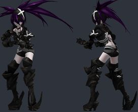</a> | `insane_black_rock_shoote` | [Insane Black Rock Shooter (Digitrevx) Playermodel and NPC](https://steamcommunity.com/sharedfiles/filedetails/?id=569813346) by JazzMcNade | `models/jazzmcfly/ibrs/ibrs.mdl` | 35910 | 1.356 | 11.8 | -1.47 | +4.6 z | 0.5/0.2 | OK | ok |
| <a href="img/poses/gpd_sheriff_female_gta.jpg">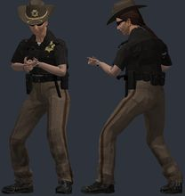</a> | `gpd_sheriff_female_gta` | [Ancient GPD Sheriff (PM)](https://steamcommunity.com/sharedfiles/filedetails/?id=1593325443) by Ceiling★Spiders | `models/player/gpd/sheriff_ancient/female_gta_01.mdl` | 22515 | 1.097 | 3.9 | -0.78 | -2.1 z | 0.5/0.5 | OK | ok |
| <a href="img/poses/gpd_sheriff_male_gta.jpg">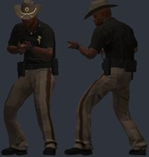</a> | `gpd_sheriff_male_gta` | [Ancient GPD Sheriff (PM)](https://steamcommunity.com/sharedfiles/filedetails/?id=1593325443) by Ceiling★Spiders | `models/player/gpd/sheriff_ancient/male_gta_01.mdl` | 16905 | 1.038 | 2.5 | -1.33 | -3.6 z | 0.4/0.4 | OK | ok |
| <a href="img/poses/kasane_teto.jpg">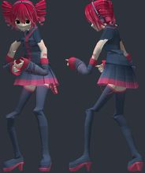</a> | `kasane_teto` | [Kasane Teto V1.0.2 - [PM & NPC]](https://steamcommunity.com/sharedfiles/filedetails/?id=1546962892) by RKiRra | `models/vocaloid/kasane_teto_v1.02/kasane_teto_v1_02_player.mdl` | 37594 | 1.282 | 9.5 | -1.45 | +3.7 z | 0.4/0.4 | OK | ok |
| <a href="img/poses/mw3_us_ranger.jpg">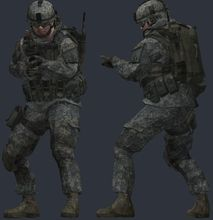</a> | `mw3_us_ranger` | [Modern Warfare 3 Rangers Player Models](https://steamcommunity.com/sharedfiles/filedetails/?id=206927994) by Blue_Skies | `models/player/mw3rangers/us_ranger_01.mdl` | 13716 | 1.038 | 2.6 | -2.39 | -3.8 z | 0.5/0.4 | OK | ok |
| <a href="img/poses/doctor_strange.jpg">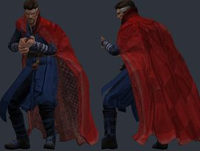</a> | `doctor_strange` | [Doctor Strange Playermodel](https://steamcommunity.com/sharedfiles/filedetails/?id=1144912321) by Kryptonite | `models/kryptonite/strange/strange.mdl` | 58332 | 1.047 | 2.6 | 0.72 | -3.0 z | 0.5/0.6 | OK | ok |
| <a href="img/poses/hello_neighbor.jpg">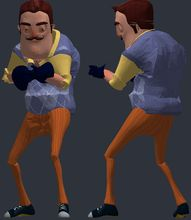</a> | `hello_neighbor` | [Hello Neighbor [PM/NPC/Ragdoll]](https://steamcommunity.com/sharedfiles/filedetails/?id=904226911) by EnergyFlamer [COMM CLOSED] | `models/player/neighborplayer.mdl` | 38849 | 1.038 | 2.5 | -2.47 | -4.8 z | 0.3/0.4 | OK | ok |
| <a href="img/poses/television_head.jpg">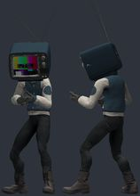</a> | `television_head` | [TV-Head Playermodel](https://steamcommunity.com/sharedfiles/filedetails/?id=1580359640) by Hog Cranker | `models/player/stanmcg/tvhead/tvhead_playermodel.mdl` | 25246 | 1.001 | 2.5 | -1.37 | +4.8 z | 0.4/0.5 | OK | ok |
| <a href="img/poses/rust_nomad_suit.jpg">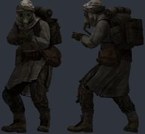</a> | `rust_nomad_suit` | [Rust Nomad Suit PM/Ragdoll](https://steamcommunity.com/sharedfiles/filedetails/?id=2659607667) by Darsu | `models/player/darky_m/rust/nomad.mdl` | 18939 | 1.038 | 3.0 | 2.79 | -3.2 z | 0.4/0.4 | OK | bulky torso: chest 10.4 u further forward than a stock agent; CS2 hand poses (two-handed weapons) will clip into it; hand_R inside the torso in the CS2 preview pose (chest surface 9.1 u in front of the wrist) |
| <a href="img/poses/akdemonbatman.jpg">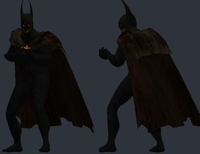</a> | `akdemonbatman` | [Batman Arkham Knight Demon Batman Playermodel/Npc](https://steamcommunity.com/sharedfiles/filedetails/?id=518803939) by ImReallyJ5 | `models/player/pizzaroll/akdemonbatman.mdl` | 53191 | 1.045 | 2.6 | -0.38 | -1.1 z | 0.9/0.5 | OK | ok |
| <a href="img/poses/mw3_zombie_ranger.jpg">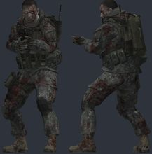</a> | `mw3_zombie_ranger` | [Modern Warfare 3 Rangers Player Models](https://steamcommunity.com/sharedfiles/filedetails/?id=206927994) by Blue_Skies | `models/player/mw3rangers/zom_ranger_01.mdl` | 12268 | 1.038 | 2.6 | -2.39 | -4.5 z | 0.5/0.4 | OK | ok |
| <a href="img/poses/mei_sakurajima.jpg">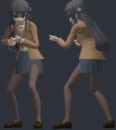</a> | `mei_sakurajima` | [Seishun Buta Yarou wa Bunny Girl Senpai no Yume wo Minai - Mai Sakurajima - (School and Bunny Outfit) [PM & NPC]](https://steamcommunity.com/sharedfiles/filedetails/?id=1757257613) by RKiRra | `models/pacagma/seishun_buta_yarou_wa_bunny_girl_senpai_no_yume_wo_minai/mai_sakurajima_school/mai_sakurajima_school_player.mdl` | 34001 | 1.188 | 2.6 | 1.3 | -4.9 z | 0.4/0.4 | OK | ok |
| <a href="img/poses/night_owl.jpg">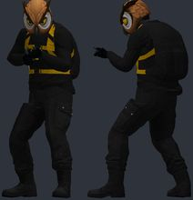</a> | `night_owl` | [Bat Owl Player Model](https://steamcommunity.com/sharedfiles/filedetails/?id=487458984) by Super Chief | `models/player/owl/night_owl.mdl` | 19457 | 1.031 | 3.0 | -0.14 | -4.8 z | 0.3/0.4 | OK | ok |
| <a href="img/poses/hatsune_miku.jpg">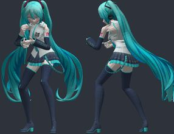</a> | `hatsune_miku` | [Hatsune Miku V3 - [PM & NPC]](https://steamcommunity.com/sharedfiles/filedetails/?id=1529164892) by RKiRra | `models/vocaloid/hatsune_miku_v3/hatsune_miku_v3_player.mdl` | 37526 | 1.232 | 8.4 | 0.13 | -4.7 z | 0.4/0.4 | OK | ok |
| <a href="img/poses/mesmerizer_kasane_teto.jpg">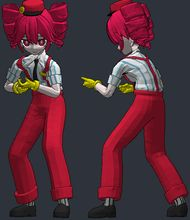</a> | `mesmerizer_kasane_teto` | [Mesmerizer - Hatsune Miku/Kasane Teto [PM/Ragdoll]](https://steamcommunity.com/sharedfiles/filedetails/?id=3431027230) by Сонный Гэри | `models/gamespy/mesmerizer/mskasaneteto.mdl` | 51870 | 1.299 | 8.8 | -2.31 | +4.1 z | 0.6/0.6 | OK | ok |
| <a href="img/poses/czech_civilian_male08.jpg">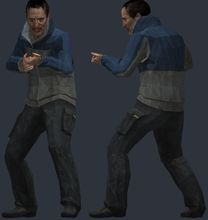</a> | `czech_civilian_male08` | [Czech Civilians (PlayerModels and NPCs)](https://steamcommunity.com/sharedfiles/filedetails/?id=842630939) by Drem • DeBoKah | `models/drem/cch/male_08.mdl` | 5974 | 1.038 | 2.5 | 0.37 | -3.2 z | 0.3/0.4 | OK | ok |
| <a href="img/poses/genshin_impact_kaeya_sai.jpg">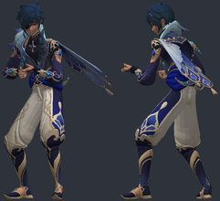</a> | `genshin_impact_kaeya_sai` | [Genshin Impact Character Outfit Alternatives - PMs and NPCs](https://steamcommunity.com/sharedfiles/filedetails/?id=2514139627) by 8sianDude | `models/player/genshin_impact_kaeya_sailwind_shadow.mdl` | 30055 | 1.017 | 3.7 | -1.13 | -0.5 z | 0.5/0.6 | OK | ok |
|  | `genshin_impact_fischl_ei` | [Genshin Impact Character Outfit Alternatives - PMs and NPCs](https://steamcommunity.com/sharedfiles/filedetails/?id=2514139627) by 8sianDude | `models/player/genshin_impact_fischl_ein_immernachtstraum.mdl` | 28215 | 1.279 | 7.7 | 0.79 | -3.1 z | 0.4/0.5 | OK | ok |
|  | `vaas_montenegro` | [Fully Functional Vaas Montenegro Player Model and Ragdoll](https://steamcommunity.com/sharedfiles/filedetails/?id=113834524) by idie970 | `models/ninja/vaas.mdl` | 24070 | 1.05 | 2.5 | -2.55 | -3.8 z | 0.9/0.4 | OK | ok |
|  | `blake_belladonna` | [Blake Belladonna Playermodel](https://steamcommunity.com/sharedfiles/filedetails/?id=503472222) by JazzMcNade | `models/jazzmcfly/rwby/blake_belladonna.mdl` | 30447 | 1.21 | 7.4 | 1.82 | +0.0 z | 0.4/0.4 | OK | ok |
|  | `hatsune_miku_no_transpar` | [Hatsune Miku V3 - [PM & NPC]](https://steamcommunity.com/sharedfiles/filedetails/?id=1529164892) by RKiRra | `models/vocaloid/hatsune_miku_v3/hatsune_miku_v3_player_no_transparent.mdl` | 37526 | 1.232 | 8.4 | 0.13 | -4.7 z | 0.4/0.4 | OK | ok |
|  | `zenless_zone_zero_hoshim` | [Zenless Zone Zero Hoshimi Miyabi [PM&NPCs]](https://steamcommunity.com/sharedfiles/filedetails/?id=3431637057) by R. Star? | `models/hoshimi_miyabi/zzz/rstar/hoshimi_miyabi/hoshimi_miyabi.mdl` | 33654 | 1.214 | 7.4 | 3.39 | -4.9 z | 0.3/0.4 | OK | bulky torso: chest 5.6 u further forward than a stock agent; CS2 hand poses (two-handed weapons) will clip into it |
|  | `siren_head_jq` | [Siren Head (Ragdoll/PM)](https://steamcommunity.com/sharedfiles/filedetails/?id=1865137680) by jQueary | `models/siren_head_player_jq1991.mdl` | 30046 | 1.038 | 2.5 | -0.66 | +5.8 z |  | OK | hand_L not aligned to CS2 (the rig has no index finger plus an outer finger): fingers will bend about the wrong points; hand_R not aligned to CS2 (the rig has no index finger plus an outer finger): fingers will bend about the wrong points |
|  | `mei_sakurajima_2` | [Seishun Buta Yarou wa Bunny Girl Senpai no Yume wo Minai - Mai Sakurajima - (School and Bunny Outfit) [PM & NPC]](https://steamcommunity.com/sharedfiles/filedetails/?id=1757257613) by RKiRra | `models/pacagma/seishun_buta_yarou_wa_bunny_girl_senpai_no_yume_wo_minai/mai_sakurajima_bunny/mai_sakurajima_bunny_player.mdl` | 29965 | 1.239 | 5.2 | 0.61 | -4.5 z | 0.2/0.2 | OK | ok |
|  | `weiss_schnee` | [Weiss Schnee (RWBY) Playermodel and NPC](https://steamcommunity.com/sharedfiles/filedetails/?id=527188346) by JazzMcNade | `models/jazzmcfly/rwby/weiss_schnee.mdl` | 34849 | 1.248 | 6.6 | 2.03 | +2.2 z | 0.3/0.4 | OK | ok |
|  | `zenless_zone_zero_ellen` | [Zenless Zone Zero Ellen Joe [PM&NPCs]](https://steamcommunity.com/sharedfiles/filedetails/?id=3289335684) by R. Star? | `models/ellen_joe/zzz/rstar/ellen_joe/ellen_joe.mdl` | 24493 | 1.218 | 7.6 | 28.21 | +0.7 z | 0.3/0.3 | OK | bulky torso: chest 30.0 u further forward than a stock agent; CS2 hand poses (two-handed weapons) will clip into it; hand_R inside the torso in the CS2 preview pose (chest surface 17.2 u in front of the wrist) |
|  | `leon_s_kennedy_re4` | [Leon S. Kennedy (HD) - Resident Evil 4 - [Ragdoll/NPC/PM]](https://steamcommunity.com/sharedfiles/filedetails/?id=1428613972) by cassius | `models/players/mj_re4_leon.mdl` | 12966 | 1.074 | 3.7 | -2.03 | -0.1 z | 0.2/0.5 | OK | ok |
|  | `agent` | [(Official Pack) Police Agents { Playermodels](https://steamcommunity.com/sharedfiles/filedetails/?id=610419332) by [CZ] Colonel Clanny | `models/player/police_agent/male_09_agent.mdl` | 8368 | 1.038 | 2.5 | -3.02 | -2.9 z | 0.4/0.4 | OK | ok |
|  | `walter_white_2` | [Walter White (PM](https://steamcommunity.com/sharedfiles/filedetails/?id=3163908850) by Rob Black | `models/player/walterv2.mdl` | 29756 | 1.038 | 2.5 | -1.78 | -4.6 z | 0.5/0.5 | OK | ok |
|  | `operator1` | [(Ready Or Not) Swat Operator PM/Ragdoll](https://steamcommunity.com/sharedfiles/filedetails/?id=1195774784) by Tech | `models/omgwtfbbq/quantum_break/characters/operators/monarchoperator01playermodel.mdl` | 34519 | 1.038 | 2.9 | -3.17 | -3.0 z | 0.4/0.3 | OK | bulky torso: chest 4.2 u further forward than a stock agent; CS2 hand poses (two-handed weapons) will clip into it |
|  | `chains` | [Payday 2 NPCs and Player Models](https://steamcommunity.com/sharedfiles/filedetails/?id=184396116) by Shaklin | `models/player/pd2_chains_p.mdl` | 11830 | 1.037 | 2.5 | -2.06 | -2.8 z | 0.9/0.6 | OK | ok |
|  | `hoxton` | [Payday 2 NPCs and Player Models](https://steamcommunity.com/sharedfiles/filedetails/?id=184396116) by Shaklin | `models/player/pd2_hoxton_p.mdl` | 11558 | 1.037 | 2.5 | -2.06 | -3.0 z | 0.9/0.6 | OK | ok |
|  | `puggamaximus` | [PuggaMaximus Playermodel](https://steamcommunity.com/sharedfiles/filedetails/?id=635658981) by MonkeysInRavenholm | `models/player/puggamaximus.mdl` | 25209 | 1.038 | 2.5 | -2.45 | -5.0 z | 0.4/0.6 | OK | ok |
|  | `tiger` | [Anthro Tiger Playermodel](https://steamcommunity.com/sharedfiles/filedetails/?id=351358461) by Reoxur | `models/player/tiger/tiger.mdl` | 43666 | 1.038 | 2.5 | -0.77 | -4.2 z | 0.7/0.7 | OK | ok |
|  | `mortal_kombat_noob` | [MK Noob Npc/playermodel](https://steamcommunity.com/sharedfiles/filedetails/?id=464136465) by True | `models/player/bobert/mknoob.mdl` | 23435 | 1.044 | 2.7 | -2.32 | -3.0 z | 1.0/1.3 | OK | ok |
|  | `dark_world_susie_low_pol` | [[PM/RAGDOLL] DELTARUNE: HEROES OF LIGHT: V2](https://steamcommunity.com/sharedfiles/filedetails/?id=3509456728) by mochi | `models/player/deltarune_lp/susie_lp_darkworld.mdl` | 2359 | 1.202 | 9.1 | 5.95 | -3.8 z | 0.5/0.5 | OK | bulky torso: chest 8.7 u further forward than a stock agent; CS2 hand poses (two-handed weapons) will clip into it; hand_R inside the torso in the CS2 preview pose (chest surface 6.8 u in front of the wrist) |
|  | `scp` | [SCP 049 PM and NPC model](https://steamcommunity.com/sharedfiles/filedetails/?id=183901628) by Vinrax | `models/vinrax/player/scp049_player.mdl` | 19192 | 1.038 | 2.5 | -0.66 | -3.9 z | 0.5/0.5 | OK | ok |
|  | `gray_wolf` | [Kemono Friends - Gray Wolf [PM & NPC]](https://steamcommunity.com/sharedfiles/filedetails/?id=1448349187) by RKiRra | `models/kemono_friends/gray_wolf/gray_wolf_player.mdl` | 25885 | 1.152 | 5.2 | 0.74 | -1.2 z | 0.4/0.4 | OK | ok |
|  | `chuck_chica` | [Chuck Chica Playermodel](https://steamcommunity.com/sharedfiles/filedetails/?id=3631545841) by A_Thing | `models/a_thing/memes/chuck_chica.mdl` | 24102 | 1.003 | 5.7 | -2.2 | -2.5 z | 1.4/1.5 | OK | bulky torso: chest 5.3 u further forward than a stock agent; CS2 hand poses (two-handed weapons) will clip into it |
|  | `creeper_girl` | [Creeper Girl - Player Model / NPC](https://steamcommunity.com/sharedfiles/filedetails/?id=609478456) by Loyalists™ | `models/player/creepergirl/sour_creepergirl_player.mdl` | 21340 | 1.216 | 9.7 | -1.73 | +0.7 z | 0.4/0.5 | OK | ok |
|  | `sinister_invincible` | [Invincible - Playermodels](https://steamcommunity.com/sharedfiles/filedetails/?id=3484606425) by Mario | `models/invinciblembn/s2invincible.mdl` | 21660 | 1.054 | 3.3 | -0.16 | +0.0 z |  | OK | ok |
|  | `tfa_sw_grievous_nocloak` | [CGI General Grievous PlayerModel](https://steamcommunity.com/sharedfiles/filedetails/?id=705124288) by Stooge | `models/tfa/comm/gg/pm_sw_grievous_nocloak.mdl` | 16572 | 0.838 | 9.1 | 0.22 | -3.0 z | 0.7/0.5 | OK | ok |
|  | `dj_sona_kinetic` | [DJ Sona Playermodel & NPC](https://steamcommunity.com/sharedfiles/filedetails/?id=409305648) by ❤Yuki❤ | `models/player_djsonakinetic.mdl` | 24172 | 1.097 | 3.5 | -1.97 | +1.9 z | 0.3/0.3 | OK | ok |
|  | `dj_sona_ethereal` | [DJ Sona Playermodel & NPC](https://steamcommunity.com/sharedfiles/filedetails/?id=409305648) by ❤Yuki❤ | `models/player_djsonaethereal.mdl` | 24136 | 1.097 | 3.5 | -1.97 | +1.9 z | 0.3/0.3 | OK | ok |
|  | `deliriousold` | [H2O Delirious Player Model](https://steamcommunity.com/sharedfiles/filedetails/?id=282455774) by Super Chief | `models/player/h2o/deliriousold.mdl` | 18474 | 1.039 | 2.9 | 1.16 | -2.6 z | 0.5/0.4 | OK | ok |
|  | `defalt` | [Watch Dogs - Defalt Playermodel](https://steamcommunity.com/sharedfiles/filedetails/?id=403874382) by Katazuro | `models/katazuro/defalt_playermodel.mdl` | 21571 | 1.05 | 2.9 | -4.43 | -3.6 z | 0.5/0.6 | OK | ok |
|  | `11thdoctor` | [11th Doctor Player Model](https://steamcommunity.com/sharedfiles/filedetails/?id=361952720) by BlueCube | `models/11thdoctor/thedoctor.mdl` | 17027 | 1.072 | 2.6 | -2.28 | -1.7 z | 0.5/0.5 | OK | ok |
|  | `aaaa` | [SCP 096 Player Model](https://steamcommunity.com/sharedfiles/filedetails/?id=426985804) by Magic Bacon | `models/player/scp096.mdl` | 22890 | 1.038 | 2.4 | -2.17 | -5.0 z |  | OK | hand_L not aligned to CS2 (the rig has no index finger plus an outer finger): fingers will bend about the wrong points; hand_R not aligned to CS2 (the rig has no index finger plus an outer finger): fingers will bend about the wrong points |
|  | `forceawakens_rey` | [Star Wars: The Force Awakens - Rey (Playermodel & NPC) *BETA*](https://steamcommunity.com/sharedfiles/filedetails/?id=600129142) by //RatedR4Ryan// | `models/player/ratedr4ryan/forceawakens_rey.mdl` | 24134 | 1.097 | 4.4 | 0.08 | -2.7 z | 0.6/0.6 | OK | ok |
|  | `yahtzee` | [Zero Punctuation / Player Model](https://steamcommunity.com/sharedfiles/filedetails/?id=105292871) by B.Bud | `models/player/yahtzee.mdl` | 5156 | 1.053 | 2.9 | -4.37 | +4.2 z |  | OK | bulky torso: chest 5.2 u further forward than a stock agent; CS2 hand poses (two-handed weapons) will clip into it; hand_L not aligned to CS2 (the rig has no index finger plus an outer finger): fingers will bend about the wrong points; hand_R not aligned to CS2 (the rig has no index finger plus an outer finger): fingers will bend about the wrong points |
|  | `dark_world_kris_low_poly` | [[PM/RAGDOLL] DELTARUNE: HEROES OF LIGHT: V2](https://steamcommunity.com/sharedfiles/filedetails/?id=3509456728) by mochi | `models/player/deltarune_lp/kris_lp_darkworld.mdl` | 1860 | 1.313 | 7.7 | -1.6 | +4.8 z | 0.6/0.6 | OK | ok |
|  | `creepy_mita` | [MiSide Playermodel Pack](https://steamcommunity.com/sharedfiles/filedetails/?id=3388072848) by sharaj00 | `models/miside/creepymita.mdl` | 16503 | 1.157 | 3.7 | -1.98 | -4.0 z | 0.4/0.4 | OK | ok |
|  | `scp_unity` | [SCP: Containment Breach - Unity: SCP-106 PM & NPC](https://steamcommunity.com/sharedfiles/filedetails/?id=1267850660) by jQueary | `models/scp/106/unity/unity_scp_106_player.mdl` | 19331 | 1.038 | 2.5 | -0.33 | -3.9 z | 0.4/0.5 | OK | ok |
|  | `noire` | [Noire Playermodel & NPC](https://steamcommunity.com/sharedfiles/filedetails/?id=453678096) by ❤Yuki❤ | `models/player_noire.mdl` | 11389 | 1.097 | 3.4 | -1.59 | -4.2 z | 0.8/0.9 | OK | ok |
|  | `loki` | [Loki (Tom Hiddleston) Playermodel](https://steamcommunity.com/sharedfiles/filedetails/?id=431439524) by Voikanaa | `models/player/loki.mdl` | 25280 | 1.038 | 2.5 | -2.42 | -4.8 z | 0.3/0.3 | OK | ok |
|  | `pd2_swatshield_zeal` | [SWAT/Shield Zeal Team [PayDay 2] [pm/npc]](https://steamcommunity.com/sharedfiles/filedetails/?id=817439512) by MARK2580 | `models/mark2580/payday2/pd2_swat_shield_zeal_player.mdl` | 12137 | 1.038 | 2.5 | -1.26 | -4.4 z | 0.2/0.3 | OK | ok |
|  | `gustavo_fring_suit` | [Gustavo Fring (Ragdoll + PM)](https://steamcommunity.com/sharedfiles/filedetails/?id=2859255554) by Alpaca | `models/player/fring/gus_suit.mdl` | 21292 | 1.038 | 2.5 | -2.32 | -4.9 z | 0.4/0.6 | OK | ok |
|  | `maneken` | [MiSide Playermodel Pack](https://steamcommunity.com/sharedfiles/filedetails/?id=3388072848) by sharaj00 | `models/miside/maneken.mdl` | 13460 | 1.22 | 5.4 | -0.74 | +1.5 z | 0.8/0.8 | OK | ok |
|  | `gustavo_fring` | [Gustavo Fring (Ragdoll + PM)](https://steamcommunity.com/sharedfiles/filedetails/?id=2859255554) by Alpaca | `models/player/fring/gus.mdl` | 20346 | 1.038 | 2.5 | -2.42 | -4.3 z | 0.4/0.4 | OK | ok |
|  | `ghillie_forest` | [Ghillie Suit [Forest] Player Model](https://steamcommunity.com/sharedfiles/filedetails/?id=428102413) by Joheskeller | `models/player/joheskiller/ghilliesuit_forest.mdl` | 11196 | 1.038 | 2.6 | 1.16 | -5.0 z | 0.9/0.5 | OK | bulky torso: chest 4.4 u further forward than a stock agent; CS2 hand poses (two-handed weapons) will clip into it |
|  | `delirious` | [H2O Delirious Player Model](https://steamcommunity.com/sharedfiles/filedetails/?id=282455774) by Super Chief | `models/player/h2o/delirious.mdl` | 12782 | 1.041 | 2.6 | -1.66 | -3.8 z | 0.3/0.5 | OK | ok |
|  | `czech_civilian_female04` | [Czech Civilians (PlayerModels and NPCs)](https://steamcommunity.com/sharedfiles/filedetails/?id=842630939) by Drem • DeBoKah | `models/drem/cch/female_04.mdl` | 5321 | 1.097 | 3.9 | -1.11 | -1.3 z | 0.6/0.5 | OK | ok |
|  | `compa` | [Compa Playermodel & NPC](https://steamcommunity.com/sharedfiles/filedetails/?id=451142486) by ❤Yuki❤ | `models/player_compa.mdl` | 8389 | 1.097 | 3.4 | 0.92 | -2.2 z |  | OK | hand_L not aligned to CS2 (the rig has no index finger plus an outer finger): fingers will bend about the wrong points; hand_R not aligned to CS2 (the rig has no index finger plus an outer finger): fingers will bend about the wrong points |
|  | `thresh` | [Thresh Playermodel](https://steamcommunity.com/sharedfiles/filedetails/?id=272249278) by Trane210 | `models/thresh/thresh.mdl` | 9066 | 1.022 | 2.8 | -1.09 | +7.3 z |  | OK | bulky torso: chest 6.6 u further forward than a stock agent; CS2 hand poses (two-handed weapons) will clip into it; hand_R inside the torso in the CS2 preview pose (chest surface 6.9 u in front of the wrist); hand_L not aligned to CS2 (the rig has no index finger plus an outer finger): fingers will bend about the wrong points; hand_R not aligned to CS2 (the rig has no index finger plus an outer finger): fingers will bend about the wrong points |
|  | `hunk_cvp` | [Resident Evil - HUNK Playermodel](https://steamcommunity.com/sharedfiles/filedetails/?id=166239934) by Vipes | `models/player/lordvipes/rerc_hunk/hunk_cvp.mdl` | 11346 | 1.043 | 2.6 | -1.1 | -3.5 z | 0.3/0.3 | OK | bulky torso: chest 4.7 u further forward than a stock agent; CS2 hand poses (two-handed weapons) will clip into it; hand_R inside the torso in the CS2 preview pose (chest surface 3.0 u in front of the wrist) |
|  | `snopp_dogg` | [Snoop Dogg Playermodel](https://steamcommunity.com/sharedfiles/filedetails/?id=348376962) by big titty bitch | `models/snoopdogg.mdl` | 5459 | 1.038 | 2.5 | -2.39 | -5.0 z | 0.8/0.9 | OK | ok |
|  | `aeon` | [Aeon Playermodel](https://steamcommunity.com/sharedfiles/filedetails/?id=703704383) by 2XMM2 | `models/aeonpm/aeon.mdl` | 8918 | 1.063 | 3.1 | 4.92 | -0.1 z | 0.9/0.9 | OK | bulky torso: chest 7.1 u further forward than a stock agent; CS2 hand poses (two-handed weapons) will clip into it; hand_R inside the torso in the CS2 preview pose (chest surface 5.4 u in front of the wrist) |
|  | `marvel_hereos_winter_sol` | [Marvel Heroes Winter Soldier Movie Costume NPC/Playermodel](https://steamcommunity.com/sharedfiles/filedetails/?id=500564086) by True | `models/player/bobert/mhwsmc.mdl` | 20802 | 1.04 | 2.7 | -1.71 | -2.1 z | 0.9/0.8 | OK | ok |
|  | `asuna` | [Asuna Ragdoll Playermodel NPC](https://steamcommunity.com/sharedfiles/filedetails/?id=309011389) by Akumetsu | `models/player/sao/asunav2.mdl` | 12103 | 1.053 | 4.1 | 0.13 | -4.8 z | 0.5/0.5 | OK | ok |
|  | `evan` | [Vanoss Player Model](https://steamcommunity.com/sharedfiles/filedetails/?id=398410749) by Super Chief | `models/player/vanoss/evan.mdl` | 10926 | 1.041 | 2.5 | -2.31 | -3.2 z | 0.4/0.4 | OK | ok |
|  | `wildcat` | [I AM WILDCAT Player Model](https://steamcommunity.com/sharedfiles/filedetails/?id=289776822) by Super Chief | `models/player/wildcat/tyler.mdl` | 12352 | 1.041 | 2.6 | -1.91 | -2.8 z | 0.6/0.6 | OK | ok |
|  | `wick` | [John Wick (Player Model & NPC)](https://steamcommunity.com/sharedfiles/filedetails/?id=407143697) by korka007 | `models/player/korka007/wick.mdl` | 15679 | 1.044 | 2.6 | -1.35 | -3.4 z | 0.5/0.6 | OK | ok |
|  | `donald_trump_2` | [[The Ship] Donald Trump [Ragdoll/PM]](https://steamcommunity.com/sharedfiles/filedetails/?id=725320580) by omgw1fbbq | `models/omgwtfbbq/the_ship/characters/trump_playermodel.mdl` | 17372 | 1.007 | 3.3 | -3.21 | -3.8 z | 0.8/0.7 | OK | ok |
|  | `captain_phasma` | [The Force Awakens - Captain Phasma Playermodel & NPC](https://steamcommunity.com/sharedfiles/filedetails/?id=599525295) by Dusty | `models/dusty/playermodels/theforceawakens/phasma/phasma_playermodel.mdl` | 12233 | 1.038 | 2.7 | 0.02 | -3.3 z | 0.7/0.5 | OK | ok |
|  | `eg_jedi_hunter_droid` | [Star Wars: EG-5 Jedi Hunter Droid [PM/NPC/RAG]](https://steamcommunity.com/sharedfiles/filedetails/?id=668821867) by Echo | `models/jazzmcfly/jka/eg5/jka_eg5.mdl` | 10636 | 1.015 | 2.1 | -1.25 | -4.8 z | 1.2/1.2 | OK | ok |
|  | `v` | [ULTRAKILL'S V1 PLAYERMODEL](https://steamcommunity.com/sharedfiles/filedetails/?id=2144838742) by mav | `models/ultrakill/v1_pm.mdl` | 2942 | 1.031 | 2.0 | -1.34 | -2.5 z | 1.2/1.1 | OK | hand_L not aligned to CS2 (the rig has no index finger plus an outer finger): fingers will bend about the wrong points; hand_R not aligned to CS2 (the rig has no index finger plus an outer finger): fingers will bend about the wrong points |
|  | `monster_boy` | [Monster Boys (PM & NPC)](https://steamcommunity.com/sharedfiles/filedetails/?id=1720614156) by Spooky Bala | `models/bala/monsterboys_pm.mdl` | 10219 | 1.038 | 2.9 | -2.72 | -0.4 z | 0.3/0.4 | OK | ok |
|  | `police` | [USA Police officers Playermodel](https://steamcommunity.com/sharedfiles/filedetails/?id=1438376108) by Firyo | `models/kerry/player/police_usa/male_08.mdl` | 12309 | 1.038 | 2.5 | -3.75 | -3.4 z | 0.3/0.3 | OK | ok |
|  | `deadpool_torbjorn` | [Deadpool - Movie Playermodel +7 Others](https://steamcommunity.com/sharedfiles/filedetails/?id=1389809127) by Kryptonite | `models/kryptonite/deadpool_pirate/deadpool_pirate.mdl` | 11693 | 1.046 | 2.7 | -0.55 | -0.2 z | 0.3/0.5 | OK | bulky torso: chest 4.5 u further forward than a stock agent; CS2 hand poses (two-handed weapons) will clip into it |
|  | `c_3po` | [STAR WARS R2-D2 and C-3PO Playermodels](https://steamcommunity.com/sharedfiles/filedetails/?id=452796046) by Voikanaa | `models/player/c3po.mdl` | 9420 | 1.038 | 2.6 | -1.74 | -4.0 z | 0.3/0.3 | OK | ok |
|  | `spiderman_civil_war` | [Spiderman Playermodel](https://steamcommunity.com/sharedfiles/filedetails/?id=1154384700) by Kryptonite | `models/kryptonite/spiderman_2/spiderman_2.mdl` | 9445 | 1.054 | 2.7 | -1.67 | -1.5 z | 0.5/0.5 | OK | ok |
|  | `hitman_agent_classic_sui` | [Hitman Absolution Agent 47 Classic Playermodel & NPC](https://steamcommunity.com/sharedfiles/filedetails/?id=1286986406) by 8sianDude | `models/player/hitman_absolution_47_classic.mdl` | 16714 | 1.033 | 2.3 | -0.79 | -2.2 z | 0.6/0.6 | OK | ok |
|  | `leon_s_kennedy_re4_mafia` | [Leon S. Kennedy (HD) - Resident Evil 4 - [Ragdoll/NPC/PM]](https://steamcommunity.com/sharedfiles/filedetails/?id=1428613972) by cassius | `models/players/mj_re4_leon_mafia.mdl` | 10545 | 1.074 | 3.6 | -2.66 | -0.1 z | 0.2/0.5 | OK | ok |
|  | `kim_jong_un` | [North Korea Kim Jong Un NPC & Player model](https://steamcommunity.com/sharedfiles/filedetails/?id=667678266) by 울트라홍 | `models/player/hhp227/kim_jong_un.mdl` | 9924 | 1.038 | 2.5 | -1.8 | -2.7 z | 0.4/0.4 | OK | ok |
|  | `pd2_heavyswat_zeal` | [SWAT Heavy Zeal Team (Payday 2) [pm/npc]](https://steamcommunity.com/sharedfiles/filedetails/?id=814233342) by MARK2580 | `models/mark2580/payday2/pd2_swat_heavy_zeal_player.mdl` | 8774 | 1.038 | 2.7 | -0.4 | -3.6 z | 0.3/0.4 | OK | ok |
|  | `gign` | [RAID Playermodels - POLICE NATIONALE](https://steamcommunity.com/sharedfiles/filedetails/?id=850046180) by MatraIgn | `models/player/raid/raid_05.mdl` | 16071 | 1.038 | 2.6 | -0.88 | -2.4 z | 0.5/0.5 | OK | bulky torso: chest 4.4 u further forward than a stock agent; CS2 hand poses (two-handed weapons) will clip into it; hand_R inside the torso in the CS2 preview pose (chest surface 4.5 u in front of the wrist) |
|  | `pd2_bulldozer_zeal` | [Bulldozer Zeal Team (Payday 2) [pm/npc]](https://steamcommunity.com/sharedfiles/filedetails/?id=813261576) by MARK2580 | `models/mark2580/payday2/pd2_bulldozer_zeal_player.mdl` | 9096 | 1.038 | 2.5 | 0.28 | -4.9 z | 0.4/0.3 | OK | bulky torso: chest 6.6 u further forward than a stock agent; CS2 hand poses (two-handed weapons) will clip into it; hand_R inside the torso in the CS2 preview pose (chest surface 5.8 u in front of the wrist) |
|  | `scp_2` | [SCP 106 PM and NPC](https://steamcommunity.com/sharedfiles/filedetails/?id=280961678) by Vinrax | `models/vinrax/player/scp106_player.mdl` | 5802 | 1.038 | 2.5 | -0.43 | -3.5 z |  | OK | hand_L not aligned to CS2 (the rig has no index finger plus an outer finger): fingers will bend about the wrong points; hand_R not aligned to CS2 (the rig has no index finger plus an outer finger): fingers will bend about the wrong points |
|  | `marvel_hereos_ant_man_mo` | [Marvel Heroes Ant-Man Movie Costume NPC/Playermodel](https://steamcommunity.com/sharedfiles/filedetails/?id=495990009) by True | `models/player/bobert/mhammc.mdl` | 15256 | 1.039 | 2.5 | -1.65 | -3.5 z | 0.9/0.7 | OK | ok |
|  | `tfa_sw_ima_gundi` | [[GG] Starwars Clonewars Playermodels ( Jedi / Clonetroopers / Random )](https://steamcommunity.com/sharedfiles/filedetails/?id=700780874) by Stooge | `models/tfa/comm/gg/pm_sw_imagundi.mdl` | 9814 | 1.043 | 2.7 | -1.46 | -3.6 z | 0.5/0.6 | OK | ok |
|  | `combineheavy` | [Combine Armored PMs and NPCs](https://steamcommunity.com/sharedfiles/filedetails/?id=1357960725) by FaZale | `models/player/combine_heavy.mdl` | 8279 | 1.038 | 2.6 | -1.56 | -3.4 z | 0.5/0.4 | OK | bulky torso: chest 5.0 u further forward than a stock agent; CS2 hand poses (two-handed weapons) will clip into it; hand_R inside the torso in the CS2 preview pose (chest surface 3.2 u in front of the wrist) |
|  | `tfa_sw_cyber_darth_maul` | [[GG] Starwars Clonewars Playermodels ( Jedi / Clonetroopers / Random )](https://steamcommunity.com/sharedfiles/filedetails/?id=700780874) by Stooge | `models/tfa/comm/gg/pm_sw_cyberdarthmaul.mdl` | 6940 | 1.068 | 6.0 | -2.19 | -1.8 z | 0.4/0.5 | OK | ok |
|  | `deathclaw` | [Deathclaw Playermodel v2](https://steamcommunity.com/sharedfiles/filedetails/?id=616973356) by 2XMM2 | `models/deathclaw_player/deathclaw_player.mdl` | 8490 | 1.038 | 2.7 | 4.55 | -2.4 z | 0.6/0.6 | OK | bulky torso: chest 7.9 u further forward than a stock agent; CS2 hand poses (two-handed weapons) will clip into it; hand_R inside the torso in the CS2 preview pose (chest surface 5.5 u in front of the wrist) |
|  | `deathclaw_albino` | [Deathclaw Playermodel v2](https://steamcommunity.com/sharedfiles/filedetails/?id=616973356) by 2XMM2 | `models/deathclaw_player/deathclaw_player_albino.mdl` | 8490 | 1.038 | 2.7 | 4.55 | -2.4 z | 0.6/0.6 | OK | bulky torso: chest 7.9 u further forward than a stock agent; CS2 hand poses (two-handed weapons) will clip into it; hand_R inside the torso in the CS2 preview pose (chest surface 5.5 u in front of the wrist) |
|  | `zed` | [Zed Playermodel](https://steamcommunity.com/sharedfiles/filedetails/?id=284505901) by Trane210 | `models/zed/zed.mdl` | 7177 | 1.041 | 2.3 | 1.72 | -5.0 z |  | OK | bulky torso: chest 4.3 u further forward than a stock agent; CS2 hand poses (two-handed weapons) will clip into it; hand_R inside the torso in the CS2 preview pose (chest surface 3.6 u in front of the wrist); hand_L not aligned to CS2 (the rig has no index finger plus an outer finger): fingers will bend about the wrong points; hand_R not aligned to CS2 (the rig has no index finger plus an outer finger): fingers will bend about the wrong points |
|  | `v_2` | [ULTRAKILL - V1 & V2 Playermodels](https://steamcommunity.com/sharedfiles/filedetails/?id=2764584473) by 22050hz | `models/ultrakill/v1_pm.mdl` | 2942 | 1.031 | 2.0 | -1.34 | -2.5 z | 1.2/1.1 | OK | hand_L not aligned to CS2 (the rig has no index finger plus an outer finger): fingers will bend about the wrong points; hand_R not aligned to CS2 (the rig has no index finger plus an outer finger): fingers will bend about the wrong points |
|  | `roaring_knight_low_poly` | [(PINK) [PM/RAGDOLL] DELTARUNE: SHADOWCRYSTAL](https://steamcommunity.com/sharedfiles/filedetails/?id=3516647029) by mochi | `models/player/deltarune_lp/roaring_knight_lp.mdl` | 3076 | 1.195 | 16.1 | -5.62 | +4.9 z | 0.7/0.7 | OK | ok |
|  | `policeelitearmored` | [Combine Armored PMs and NPCs](https://steamcommunity.com/sharedfiles/filedetails/?id=1357960725) by FaZale | `models/player/police_elite_armored.mdl` | 5772 | 1.038 | 2.5 | -0.74 | -4.2 z | 0.6/0.6 | OK | bulky torso: chest 5.5 u further forward than a stock agent; CS2 hand poses (two-handed weapons) will clip into it; hand_R inside the torso in the CS2 preview pose (chest surface 4.8 u in front of the wrist) |
|  | `datboi` | [dat boi Player Model and Npc](https://steamcommunity.com/sharedfiles/filedetails/?id=727825760) by KittyHawk | `models/datboi/datboi_reference.mdl` | 9402 | 1.038 | 2.8 | 1.98 | -3.9 z | 0.5/0.5 | OK | ok |
|  | `blockhead_bot` | [Blockhead Robot Playermodel](https://steamcommunity.com/sharedfiles/filedetails/?id=1636700119) by Hog Cranker | `models/player/stanmcg/blockhead_bot/blockhead_bot_playermodel.mdl` | 8828 | 1.001 | 2.5 | -1.16 | -2.1 z | 0.6/0.6 | OK | bulky torso: chest 5.6 u further forward than a stock agent; CS2 hand poses (two-handed weapons) will clip into it |
|  | `gru` | [Metal Gear Solid 3: Soldier Playermodels and NPCs](https://steamcommunity.com/sharedfiles/filedetails/?id=191065709) by Voikanaa | `models/player/gru.mdl` | 5706 | 1.038 | 2.5 | -1.67 | -4.3 z | 0.7/0.6 | OK | ok |
|  | `scp_3` | [SCP-966 Playermodel & Ragdoll](https://steamcommunity.com/sharedfiles/filedetails/?id=910206946) by fentanylenjoyer96 | `models/player/mishka/966_new.mdl` | 10412 | 0.957 | 10.0 | -1.75 | -4.8 z |  | OK | hand_L not aligned to CS2 (the rig has no index finger plus an outer finger): fingers will bend about the wrong points; hand_R not aligned to CS2 (the rig has no index finger plus an outer finger): fingers will bend about the wrong points |
|  | `shrek_2` | [Shrek Playermodel](https://steamcommunity.com/sharedfiles/filedetails/?id=314261589) by Gnarsupial | `models/player/pyroteknik/shrek.mdl` | 3536 | 1.038 | 2.5 | -3.13 | -4.7 z |  | OK | bulky torso: chest 5.9 u further forward than a stock agent; CS2 hand poses (two-handed weapons) will clip into it; hand_R inside the torso in the CS2 preview pose (chest surface 5.3 u in front of the wrist); hand_L not aligned to CS2 (the rig has no index finger plus an outer finger): fingers will bend about the wrong points; hand_R not aligned to CS2 (the rig has no index finger plus an outer finger): fingers will bend about the wrong points |
|  | `london_cop` | [United Kingdom Police Playermodels and NPCs](https://steamcommunity.com/sharedfiles/filedetails/?id=562486594) by Voikanaa | `models/player/londoncop/londoncop_06.mdl` | 5189 | 1.038 | 2.5 | -1.61 | -3.0 z | 0.5/0.5 | OK | ok |
|  | `mtf_guard` | [MTF Guard PM and NPC](https://steamcommunity.com/sharedfiles/filedetails/?id=181917561) by Vinrax | `models/vinrax/player/mtf_guard_player.mdl` | 7724 | 1.038 | 2.5 | -0.82 | -3.0 z | 0.7/0.7 | OK | ok |
|  | `mad_mew_mew_pink_low_pol` | [(PINK) [PM/RAGDOLL] DELTARUNE: SHADOWCRYSTAL](https://steamcommunity.com/sharedfiles/filedetails/?id=3516647029) by mochi | `models/player/deltarune_lp/mad_mew_mew_lp.mdl` | 2402 | 1.296 | 7.6 | 10.51 | +3.6 z | 0.5/0.5 | OK | bulky torso: chest 11.5 u further forward than a stock agent; CS2 hand poses (two-handed weapons) will clip into it; hand_R inside the torso in the CS2 preview pose (chest surface 9.0 u in front of the wrist) |
|  | `tfa_sw_magna_guard_combi` | [CGI Magna Guards Playermodel / NPC](https://steamcommunity.com/sharedfiles/filedetails/?id=722174342) by Stooge | `models/tfa/comm/gg/pm_sw_magna_guard_combined.mdl` | 4355 | 0.953 | 3.6 | -1.3 | -2.5 z | 0.6/0.7 | OK | bulky torso: chest 4.2 u further forward than a stock agent; CS2 hand poses (two-handed weapons) will clip into it |
|  | `dr_doofenshmirtz` | [Dr. Doofenshmirtz Player Model & NPC](https://steamcommunity.com/sharedfiles/filedetails/?id=2099414290) by Hell Inspector | `models/hellinspector/dr_doofenshmirtz/dr_doofenshmirtz_player.mdl` | 5446 | 0.944 | 9.6 | 0.79 | -1.9 z | 2.4/2.3 | OK | bulky torso: chest 18.4 u further forward than a stock agent; CS2 hand poses (two-handed weapons) will clip into it; hand_L fingers sit 2.4 u from their CS2 finger bones: CS2 finger curls will distort them; hand_R fingers sit 2.3 u from their CS2 finger bones: CS2 finger curls will distort them |
|  | `weequay` | [STAR WARS Alien Playermodels](https://steamcommunity.com/sharedfiles/filedetails/?id=505272513) by Jellik | `models/gyan7259/geequay_player/geequay_regular_player.mdl` | 8321 | 1.038 | 2.5 | -1.52 | -4.9 z | 0.8/0.6 | OK | ok |
|  | `ironman_mk48` | [Ironman Mark 50 - Avengers: Infinity War Playermodel](https://steamcommunity.com/sharedfiles/filedetails/?id=1371645567) by Kryptonite | `models/kryptonite/inf_ironman/inf_ironman.mdl` | 10908 | 1.046 | 2.5 | 0.86 | -3.6 z | 0.7/0.6 | OK | bulky torso: chest 5.0 u further forward than a stock agent; CS2 hand poses (two-handed weapons) will clip into it |
|  | `ocelot_unit` | [Metal Gear Solid 3: Soldier Playermodels and NPCs](https://steamcommunity.com/sharedfiles/filedetails/?id=191065709) by Voikanaa | `models/player/ocelot.mdl` | 5056 | 1.038 | 2.5 | -1.68 | -4.2 z | 0.4/0.4 | OK | ok |
|  | `agent_smith_2` | [Agent Smith Playermodel & NPC](https://steamcommunity.com/sharedfiles/filedetails/?id=119222908) by Rain | `models/player/smith.mdl` | 3253 | 1.038 | 2.6 | -0.51 | -1.8 z |  | OK | hand_L not aligned to CS2 (the rig has no index finger plus an outer finger): fingers will bend about the wrong points; hand_R not aligned to CS2 (the rig has no index finger plus an outer finger): fingers will bend about the wrong points |
|  | `scp_4` | [SCP 035 PM and NPC](https://steamcommunity.com/sharedfiles/filedetails/?id=268195264) by Vinrax | `models/vinrax/player/035_player.mdl` | 3448 | 1.038 | 2.7 | -1.09 | -4.2 z | 0.4/0.8 | OK | hand_L not aligned to CS2 (the rig has no index finger plus an outer finger): fingers will bend about the wrong points; hand_R not aligned to CS2 (the rig has no index finger plus an outer finger): fingers will bend about the wrong points |
|  | `tfa_sw_magna_guard_seaso` | [CGI Magna Guards Playermodel / NPC](https://steamcommunity.com/sharedfiles/filedetails/?id=722174342) by Stooge | `models/tfa/comm/gg/pm_sw_magna_guard_season4.mdl` | 3483 | 0.953 | 3.6 | -2.57 | -2.5 z | 0.6/0.7 | OK | ok |
|  | `tusken_raider` | [STAR WARS Alien Playermodels](https://steamcommunity.com/sharedfiles/filedetails/?id=505272513) by Jellik | `models/zyan7259/zusken_raider_player/zusken_raider_player.mdl` | 7413 | 1.038 | 2.5 | -2.4 | -3.6 z | 1.2/0.5 | OK | ok |
|  | `princess_anna` | [Elsa & Anna Playermodel & NPC](https://steamcommunity.com/sharedfiles/filedetails/?id=308133794) by ❤Yuki❤ | `models/player_anna.mdl` | 4280 | 1.097 | 3.3 | -1.63 | -0.2 z | 0.5/0.6 | OK | ok |
|  | `spinosaurus` | [Spinosaurus Playermodel](https://steamcommunity.com/sharedfiles/filedetails/?id=609224166) by 2XMM2 | `models/spino_player/spino_player.mdl` | 12340 | 1.038 | 2.5 | 1.45 | -1.7 z | 0.6/0.3 | OK | bulky torso: chest 6.9 u further forward than a stock agent; CS2 hand poses (two-handed weapons) will clip into it; hand_R inside the torso in the CS2 preview pose (chest surface 5.7 u in front of the wrist) |
|  | `ultrakill_gabriel_judge` | [Ultrakill: Gabriel (PM&NPC + Ragdoll)](https://steamcommunity.com/sharedfiles/filedetails/?id=2570511669) by Kerosenn | `models/kerosenn/ultrakill/angel/gabriel/playermodel/gabriel_pm.mdl` | 4962 | 1.061 | 4.5 | 0.85 | -4.2 z | 0.9/0.8 | OK | ok |
|  | `endgame_iron_man` | [Iron Man - Avengers: Endgame Playermodel](https://steamcommunity.com/sharedfiles/filedetails/?id=1723842951) by Kryptonite | `models/kryptonite/ironman_endgame/ironman_endgame.mdl` | 8701 | 1.046 | 2.8 | -2.18 | -2.9 z | 0.4/0.4 | OK | ok |
|  | `iron_spiderman` | [Iron Spiderman - Avengers: Infinity War Playermodel](https://steamcommunity.com/sharedfiles/filedetails/?id=1371696069) by Kryptonite | `models/kryptonite/inf_spiderman/inf_spiderman.mdl` | 5203 | 1.046 | 2.7 | 9.61 | -0.9 z | 0.6/0.5 | OK | bulky torso: chest 11.8 u further forward than a stock agent; CS2 hand poses (two-handed weapons) will clip into it; hand_R inside the torso in the CS2 preview pose (chest surface 9.0 u in front of the wrist) |
|  | `giga_queen_low_poly` | [(FLOWERY!) [PM/RAGDOLL] DELTARUNE: RULERS OF DARK](https://steamcommunity.com/sharedfiles/filedetails/?id=3594171888) by mochi | `models/player/deltarune_lp/giga_queen_lp.mdl` | 1634 | 1.136 | 9.2 | -1.74 | +4.4 z | 0.4/0.4 | OK | ok |
|  | `ronald_mcdonald` | [Ronald McDonald PM](https://steamcommunity.com/sharedfiles/filedetails/?id=692342876) by Saint Jordan | `models/ronald_mcdonald.mdl` | 5698 | 1.038 | 2.4 | -1.83 | -4.6 z |  | OK | ok |
|  | `tfa_sw_trandoshan_bounty` | [CGI Trandoshan NPC/Playermodels](https://steamcommunity.com/sharedfiles/filedetails/?id=719263502) by Stooge | `models/tfa/comm/gg/pm_sw_trandoshan_bounty_hunter_v1.mdl` | 5180 | 1.069 | 4.7 | -1.94 | -1.3 z | 1.0/1.7 | OK | ok |
|  | `tfa_sw_trandoshan_bounty_2` | [CGI Trandoshan NPC/Playermodels](https://steamcommunity.com/sharedfiles/filedetails/?id=719263502) by Stooge | `models/tfa/comm/gg/pm_sw_trandoshan_bounty_hunter_v1_skin2.mdl` | 5180 | 1.069 | 4.7 | -1.94 | -1.3 z | 1.0/1.7 | OK | ok |
|  | `matrix_neo` | [Matrix Neo Playermodel](https://steamcommunity.com/sharedfiles/filedetails/?id=864602663) by 2XMM2 | `models/matrix/neo_player.mdl` | 9863 | 1.058 | 2.9 | -2.24 | -2.5 z | 0.4/0.4 | OK | ok |
|  | `raptor` | [Raptor Playermodel](https://steamcommunity.com/sharedfiles/filedetails/?id=609850164) by 2XMM2 | `models/raptor_player/raptor_player.mdl` | 9468 | 1.038 | 2.5 | -1.86 | -4.3 z | 0.7/0.8 | OK | ok |
|  | `raptor_red` | [Raptor Playermodel](https://steamcommunity.com/sharedfiles/filedetails/?id=609850164) by 2XMM2 | `models/raptor_player/raptor_player_red.mdl` | 9468 | 1.038 | 2.5 | -1.86 | -4.3 z | 0.7/0.8 | OK | ok |
|  | `anakin_skywalker_episode` | [Star Wars: Episode III RoTS Anakin Skywalker [Playermodel/Ragdoll]](https://steamcommunity.com/sharedfiles/filedetails/?id=607317947) by calmoon | `models/kriegsyntax/sw_752/anakin_est.mdl` | 9593 | 1.038 | 2.6 | -1.91 | -4.4 z | 0.6/0.8 | OK | ok |
|  | `forceawakens_finn` | [Star Wars: The Force Awakens - Finn (Playermodel & NPC)](https://steamcommunity.com/sharedfiles/filedetails/?id=601714920) by //RatedR4Ryan// | `models/player/ratedr4ryan/forceawakens_finn.mdl` | 9330 | 1.038 | 2.5 | -1.98 | -3.3 z | 0.4/0.5 | OK | ok |
|  | `tuxmale` | [Mafia II DLC Made man: Tuxedos Citizens NPCs and Playermodels](https://steamcommunity.com/sharedfiles/filedetails/?id=204120003) by Professor Heavy | `models/player/tuxmale_08player.mdl` | 8461 | 1.038 | 2.5 | -2.35 | -3.2 z | 0.4/0.4 | OK | ok |
|  | `omega_flowery_low_poly` | [(FLOWERY!) [PM/RAGDOLL] DELTARUNE: RULERS OF DARK](https://steamcommunity.com/sharedfiles/filedetails/?id=3594171888) by mochi | `models/player/deltarune_lp/omega_flowery_lp.mdl` | 3788 | 1.119 | 8.1 | -1.22 | +4.6 z | 0.4/0.4 | OK | ok |
|  | `thor` | [Thor - Avengers: Infinity War Playermodel](https://steamcommunity.com/sharedfiles/filedetails/?id=1372622824) by Kryptonite | `models/kryptonite/inf_thor/inf_thor.mdl` | 6344 | 1.046 | 2.8 | -1.34 | -3.2 z | 0.5/0.5 | OK | ok |
|  | `hl1_kasane_teto` | [Kasane Teto (Playermodel/Ragdoll) (Half Life)](https://steamcommunity.com/sharedfiles/filedetails/?id=3494100922) by FarboД | `models/xinus22/tetohl1.mdl` | 1481 | 1.26 | 13.5 | -0.34 | +4.7 z | 3.1/3.1 | OK | hand_L fingers sit 3.1 u from their CS2 finger bones: CS2 finger curls will distort them; hand_R fingers sit 3.1 u from their CS2 finger bones: CS2 finger curls will distort them; hand_L not aligned to CS2 (the rig has no index finger plus an outer finger): fingers will bend about the wrong points; hand_R not aligned to CS2 (the rig has no index finger plus an outer finger): fingers will bend about the wrong points |
|  | `stonksman` | [Stonks playermodel](https://steamcommunity.com/sharedfiles/filedetails/?id=1826106073) by Harr_Hoodi | `models/stonks/stonksplayermodel.mdl` | 6532 | 1.006 | 4.3 | -1.52 | -4.9 z | 0.9/0.9 | OK | ok |
|  | `humanhuntr` | ["Hobo" Player Model](https://steamcommunity.com/sharedfiles/filedetails/?id=943530315) by DrKnaw | `models/jessev92/player/l4d/m9-hunter.mdl` | 6211 | 1.065 | 1.6 | -0.07 | -1.1 z | 0.3/0.2 | OK | ok |
|  | `mechanic` | [Mechanic Playermodel](https://steamcommunity.com/sharedfiles/filedetails/?id=734781319) by Konnie | `models/player/mechanic.mdl` | 6334 | 1.038 | 2.5 | -3.28 | -2.6 z |  | OK | hand_L not aligned to CS2 (the rig has no index finger plus an outer finger): fingers will bend about the wrong points; hand_R not aligned to CS2 (the rig has no index finger plus an outer finger): fingers will bend about the wrong points |
|  | `nosacz` | [Proboscis Monkey Playermodel](https://steamcommunity.com/sharedfiles/filedetails/?id=1286716330) by Tuscan37 | `models/player/nosaczt37/nosacz.mdl` | 3838 | 1.039 | 2.5 | 1.96 | -1.4 z | 0.7/0.6 | OK | bulky torso: chest 4.7 u further forward than a stock agent; CS2 hand poses (two-handed weapons) will clip into it |
|  | `obi_wan_kenobi_episode_i` | [Star Wars: Episode III RoTS Obi-Wan Kenobi [Playermodel/Ragdoll]](https://steamcommunity.com/sharedfiles/filedetails/?id=608308050) by calmoon | `models/player/obiwan/obiwan_est.mdl` | 8140 | 1.038 | 2.7 | -2.27 | -3.8 z | 0.7/0.6 | OK | ok |
|  | `harley_quinn` | [Harley Quinn - Suicide Squad (Player Model)](https://steamcommunity.com/sharedfiles/filedetails/?id=739308623) by Ratlysh | `models/player/harleyq/harleyq.mdl` | 6481 | 1.038 | 2.8 | -1.18 | -4.8 z | 0.5/0.5 | OK | ok |
|  | `rouxls_kaard_low_poly` | [[PM/RAGDOLL] DELTARUNE: CARD KINGDOM](https://steamcommunity.com/sharedfiles/filedetails/?id=3766756024) by mochi | `models/player/deltarune_lp/rouxls_lp.mdl` | 3444 | 1.184 | 8.9 | -1.64 | +4.4 z | 0.6/0.6 | OK | ok |
|  | `laalaa_colour` | [Colourable Teletubbies PMs & NPCs](https://steamcommunity.com/sharedfiles/filedetails/?id=271424414) by Saint Baron | `models/player/colourtubbies/laalaa_colour_player.mdl` | 2672 | 0.998 | 2.5 | 0.0 | +4.8 z | 0.5/0.5 | OK | bulky torso: chest 4.5 u further forward than a stock agent; CS2 hand poses (two-handed weapons) will clip into it; hand_R inside the torso in the CS2 preview pose (chest surface 4.8 u in front of the wrist); hand_L not aligned to CS2 (the rig has no index finger plus an outer finger): fingers will bend about the wrong points; hand_R not aligned to CS2 (the rig has no index finger plus an outer finger): fingers will bend about the wrong points |
|  | `cj` | [CJ Playermodel](https://steamcommunity.com/sharedfiles/filedetails/?id=2866162190) by Masya | `models/player/cj.mdl` | 2450 | 1.038 | 2.5 | -2.59 | -4.7 z | 0.6/0.7 | OK | hand_R not aligned to CS2 (the rig has no index finger plus an outer finger): fingers will bend about the wrong points |
|  | `gign_2` | [R.A.I.D. Police Nationale Player Model](https://steamcommunity.com/sharedfiles/filedetails/?id=689650521) by mehdi | `models/gign remasteredhd.mdl` | 5195 | 0.998 | 2.5 | -1.98 | -2.4 z | 0.4/0.4 | OK | ok |
|  | `clover_low_poly` | [[PM/RAGDOLL] DELTARUNE: CARD KINGDOM](https://steamcommunity.com/sharedfiles/filedetails/?id=3766756024) by mochi | `models/player/deltarune_lp/clover_lp.mdl` | 2226 | 1.074 | 6.3 | 0.0 | +4.3 z | 1.3/1.3 | OK | ok |
|  | `akita_neru_psp` | [TRIPLE BAKA PLAYERMODEL PACK (Akita Neru](https://steamcommunity.com/sharedfiles/filedetails/?id=3199830438) by Electric Blood Mage | `models/akuld/triplebakapack/akitaneru.mdl` | 3651 | 1.128 | 9.2 | -2.26 | -4.7 z | 0.6/0.8 | OK | ok |
|  | `kasane_teto_psp` | [TRIPLE BAKA PLAYERMODEL PACK (Akita Neru](https://steamcommunity.com/sharedfiles/filedetails/?id=3199830438) by Electric Blood Mage | `models/akuld/triplebakapack/kasaneteto.mdl` | 3727 | 1.134 | 9.2 | -2.1 | +2.7 z | 0.4/0.5 | OK | ok |
|  | `rogue_xmen97` | [Rogue (Marvel Rivals) PM + Ragdolls](https://steamcommunity.com/sharedfiles/filedetails/?id=3823986694) by Foolio | `models/foolio/marvelrivals/rogue/rogue_x_men_97_season_2.mdl` | 95911 | 1.055 | 9.0 | 0.49 | -4.3 z | 0.5/0.5 | OK | bulky torso: chest 4.7 u further forward than a stock agent; CS2 hand poses (two-handed weapons) will clip into it |
|  | `rogue_mrs_x` | [Rogue (Marvel Rivals) PM + Ragdolls](https://steamcommunity.com/sharedfiles/filedetails/?id=3823986694) by Foolio | `models/foolio/marvelrivals/rogue/rogue_mrs_x.mdl` | 128095 | 1.055 | 8.7 | 3.49 | -4.5 z | 0.4/0.4 | OK | bulky torso: chest 8.0 u further forward than a stock agent; CS2 hand poses (two-handed weapons) will clip into it; hand_R inside the torso in the CS2 preview pose (chest surface 5.3 u in front of the wrist) |
|  | `georgian_riot_police` | [Georgian Riot Police - PM](https://steamcommunity.com/sharedfiles/filedetails/?id=1379568172) by ArachnitCZ | `models/arachnit/random/georgian_riot_police/georgian_riot_police_player.mdl` | 37877 | 1.043 | 3.0 | -2.65 | -2.0 z | 0.4/0.4 | OK | bulky torso: chest 4.1 u further forward than a stock agent; CS2 hand poses (two-handed weapons) will clip into it |
|  | `scp_5` | [SCP 1471 by Dead_Unicorns [PM/NPC/Ragdoll]](https://steamcommunity.com/sharedfiles/filedetails/?id=3492034006) by blop | `models/blop/scp_1471/scp_1471.mdl` | 33074 | 1.391 | 10.4 | 2.8 | -4.9 z |  | OK | hand_L not aligned to CS2 (the rig has no index finger plus an outer finger): fingers will bend about the wrong points; hand_R not aligned to CS2 (the rig has no index finger plus an outer finger): fingers will bend about the wrong points |
|  | `c6_t1_0ca` | [Cod IW C6 Robot Playermodel](https://steamcommunity.com/sharedfiles/filedetails/?id=2887756524) by barrett | `models/codiw_mechs/c6/c6_t1_0capm.mdl` | 54093 | 0.943 | 3.5 | -1.13 | -4.9 z | 0.4/0.3 | OK | ok |
|  | `reaper` | [[DIZ] Black Ops 3: The Reaper [PM]](https://steamcommunity.com/sharedfiles/filedetails/?id=1397646470) by TheDizcordumSeventh | `models/dizcordum/reaper.mdl` | 67432 | 1.038 | 2.5 | -0.56 | -4.1 z | 0.4/0.4 | OK | ok |
|  | `miku_tactical` | [Tactical Hatsune Miku [PM+NPC]](https://steamcommunity.com/sharedfiles/filedetails/?id=3447350407) by bababooey | `models/captainbigbutt/b21/miku_tactical.mdl` | 66460 | 1.245 | 9.8 | -1.49 | -4.7 z | 0.3/0.3 | OK | bulky torso: chest 4.0 u further forward than a stock agent; CS2 hand poses (two-handed weapons) will clip into it |
|  | `girlfrontline_negev` | [GirlsFrontline Negev[Playermodel&NPC]](https://steamcommunity.com/sharedfiles/filedetails/?id=1949744684) by John Clamcy | `models/negev/girls_frontline/clancy/negev.mdl` | 70143 | 1.228 | 4.6 | 0.36 | -5.0 z | 0.7/0.7 | OK | ok |
|  | `sebastian_castellanos` | [Sebastian Castellanos - The Evil Within - [Ragdoll/NPC/PM]](https://steamcommunity.com/sharedfiles/filedetails/?id=1121741396) by cassius | `models/players/mj_tew_seb.mdl` | 42194 | 1.038 | 2.5 | -1.71 | -2.6 z | 0.5/0.3 | OK | ok |
|  | `sebastian_castellanos_al` | [Sebastian Castellanos - The Evil Within - [Ragdoll/NPC/PM]](https://steamcommunity.com/sharedfiles/filedetails/?id=1121741396) by cassius | `models/players/mj_tew_seb_y.mdl` | 38620 | 1.038 | 2.5 | -1.71 | -2.6 z | 0.5/0.3 | OK | ok |
|  | `lady_maria` | [Lady Maria of the Astral Clocktower (Bloodborne) [PM/NPC]](https://steamcommunity.com/sharedfiles/filedetails/?id=1402257343) by kuma7 | `models/kuma96/ladymaria/ladymaria_pm.mdl` | 85289 | 0.943 | 6.5 | 1.72 | +0.0 z | 0.3/0.3 | OK | bulky torso: chest 4.7 u further forward than a stock agent; CS2 hand poses (two-handed weapons) will clip into it |
|  | `lady_maria_resized` | [Lady Maria of the Astral Clocktower (Bloodborne) [PM/NPC]](https://steamcommunity.com/sharedfiles/filedetails/?id=1402257343) by kuma7 | `models/kuma96/ladymaria/ladymaria_resized_pm.mdl` | 85289 | 1.088 | 6.5 | 1.72 | +0.0 z | 0.3/0.3 | OK | bulky torso: chest 4.7 u further forward than a stock agent; CS2 hand poses (two-handed weapons) will clip into it |
|  | `bonez_vrchat` | [[VRChat] Bonez & kitty - [Playermodel]](https://steamcommunity.com/sharedfiles/filedetails/?id=3691794008) by Alvaro | `models/alvaroports/bonezpm.mdl` | 110566 | 1.133 | 11.1 | -0.08 | +2.1 z | 0.5/0.4 | OK | bulky torso: chest 6.4 u further forward than a stock agent; CS2 hand poses (two-handed weapons) will clip into it |
|  | `kitty_vrchat` | [[VRChat] Bonez & kitty - [Playermodel]](https://steamcommunity.com/sharedfiles/filedetails/?id=3691794008) by Alvaro | `models/alvaroports/kittyvrpm.mdl` | 92543 | 1.121 | 11.5 | -0.08 | +1.8 z | 0.5/0.4 | OK | bulky torso: chest 6.4 u further forward than a stock agent; CS2 hand poses (two-handed weapons) will clip into it |
|  | `stylized_miku` | [( STYLIZED MIKU ) PM NPC and RAGDOLL](https://steamcommunity.com/sharedfiles/filedetails/?id=3751197143) by anasjam (José Anás) | `models/modelanascreation/stylizedmiku/stylizedmiku_pm.mdl` | 71808 | 1.216 | 5.4 | 0.5 | -4.9 z | 0.3/0.3 | OK | bulky torso: chest 4.3 u further forward than a stock agent; CS2 hand poses (two-handed weapons) will clip into it |
|  | `stylized_miku_casual` | [( STYLIZED MIKU ) PM NPC and RAGDOLL](https://steamcommunity.com/sharedfiles/filedetails/?id=3751197143) by anasjam (José Anás) | `models/modelanascreation/stylizedmiku/stylizedmikucasual_pm.mdl` | 62510 | 1.216 | 5.4 | 1.13 | -4.9 z | 0.4/0.4 | OK | bulky torso: chest 4.3 u further forward than a stock agent; CS2 hand poses (two-handed weapons) will clip into it |
|  | `kasane_teto_synth` | [Vocaloid - Kasane Teto Synth V - V2 [PM & NPC]](https://steamcommunity.com/sharedfiles/filedetails/?id=3017162326) by RKiRra | `models/pacagma/vocaloid/teto/teto_synth_v2_player.mdl` | 106058 | 1.259 | 8.3 | -1.81 | +3.6 z | 0.6/0.7 | OK | ok |
|  | `troupe_master_grimm` | [Hollow Knight - Grimm Troupe Characters [PM]](https://steamcommunity.com/sharedfiles/filedetails/?id=2407614970) by Kermit the Frog | `models/hollowknight/dlc/grimm/grimm.mdl` | 64064 | 1.15 | 9.0 | -0.67 | -1.0 z | 1.4/1.4 | OK | ok |
|  | `soldier_boy` | [[PM] Soldier Boy](https://steamcommunity.com/sharedfiles/filedetails/?id=2866385867) by gus | `models/theboys/soldierboy.mdl` | 100264 | 1.049 | 2.5 | -1.04 | -3.6 z | 0.4/0.5 | OK | ok |
|  | `viper` | [Valorant: Viper [PM]](https://steamcommunity.com/sharedfiles/filedetails/?id=2832523601) by Riden1014 | `models/tnrp/player/viper/viper.mdl` | 50426 | 1.138 | 5.3 | 0.88 | +0.0 z | 0.5/0.5 | OK | ok |
|  | `meme_chan` | [Meme Chan [PM & NPC]](https://steamcommunity.com/sharedfiles/filedetails/?id=2306466848) by RKiRra | `models/pacagma/mmd/meme_chan/meme_chan_player.mdl` | 61467 | 1.231 | 7.6 | 0.0 | -4.8 z | 0.1/0.1 | OK | ok |
|  | `jump_force_gaara` | [Jump Force - Gaara (PM+NPC)](https://steamcommunity.com/sharedfiles/filedetails/?id=1662667687) by Konnie | `models/konnie/jumpforce/gaara.mdl` | 55942 | 1.078 | 3.7 | 9.32 | +1.0 z | 0.3/0.3 | OK | bulky torso: chest 9.5 u further forward than a stock agent; CS2 hand poses (two-handed weapons) will clip into it; hand_R inside the torso in the CS2 preview pose (chest surface 5.7 u in front of the wrist) |
|  | `doomguy` | [DOOM - Doomguy Playermodel - Quake Champions](https://steamcommunity.com/sharedfiles/filedetails/?id=1168176632) by Kryptonite | `models/kryptonite/doomguy/doomguy_pm.mdl` | 55993 | 1.047 | 2.7 | -0.99 | -2.8 z | 0.4/0.3 | OK | bulky torso: chest 4.2 u further forward than a stock agent; CS2 hand poses (two-handed weapons) will clip into it |
|  | `shoto_todoroki` | [Shoto Todoroki Playermodel - My Hero One's Justice [Skins]](https://steamcommunity.com/sharedfiles/filedetails/?id=1846439340) by Kryptonite | `models/kryptonite/shoto_todoroki/shoto_todoroki.mdl` | 34410 | 1.054 | 3.0 | -0.63 | -0.7 z | 0.5/0.3 | OK | ok |
|  | `loona_vrchat` | [[VRChat] Loona - [Playermodel]](https://steamcommunity.com/sharedfiles/filedetails/?id=3402225742) by Alvaro | `models/alvaroports/loonavrc2024pm.mdl` | 25311 | 1.12 | 4.7 | 2.78 | +3.1 z | 0.3/0.3 | OK | bulky torso: chest 7.7 u further forward than a stock agent; CS2 hand poses (two-handed weapons) will clip into it |
|  | `tamamo_no_mae_magical_ta` | [Fate/Extella Link - Tamamo no Mae Pack [PM & NPC]](https://steamcommunity.com/sharedfiles/filedetails/?id=1901381017) by RKiRra | `models/pacagma/fate_extella/tamamo_no_mae_magical_tamamo/tamamo_no_mae_magical_tamamo_player.mdl` | 44463 | 1.287 | 9.0 | 13.77 | +2.6 z | 0.5/0.5 | OK | bulky torso: chest 11.6 u further forward than a stock agent; CS2 hand poses (two-handed weapons) will clip into it; hand_R inside the torso in the CS2 preview pose (chest surface 13.7 u in front of the wrist) |
|  | `detroit_swat_soldier` | [Detroit: Become Human - SWAT (PM)](https://steamcommunity.com/sharedfiles/filedetails/?id=1898375881) by Konnie | `models/konnie/isa/detroit/swat_soldier.mdl` | 46615 | 1.049 | 2.1 | -2.7 | +0.0 z | 0.5/0.5 | OK | ok |
|  | `seu_madruga` | [Seu Madruga/Don Ramon - Playermodel](https://steamcommunity.com/sharedfiles/filedetails/?id=3431254772) by seu madrugaYTPbr | `models/seumadruga/seu_madruga/seu_madruga_pm.mdl` | 55382 | 1.073 | 2.0 | -1.5 | -1.2 z | 0.3/0.2 | OK | AvatarTeethUpper: dark see-through glass (no texture in the item); AvatarTeethLower: dark see-through glass (no texture in the item) |
|  | `tamamo_no_mae_blue_magic` | [Fate/Extella Link - Tamamo no Mae Pack [PM & NPC]](https://steamcommunity.com/sharedfiles/filedetails/?id=1901381017) by RKiRra | `models/pacagma/fate_extella/tamamo_no_mae_blue_magician_wear/tamamo_no_mae_blue_magician_wear_player.mdl` | 46741 | 1.287 | 9.0 | 13.77 | +2.7 z | 0.5/0.5 | OK | bulky torso: chest 5.7 u further forward than a stock agent; CS2 hand poses (two-handed weapons) will clip into it; hand_R inside the torso in the CS2 preview pose (chest surface 13.5 u in front of the wrist) |
|  | `ben_swolo` | [Ben Swolo - The Meme Of The Year Playermodel](https://steamcommunity.com/sharedfiles/filedetails/?id=1269812661) by Kryptonite | `models/kryptonite/ben_swolo/ben_swolo.mdl` | 52585 | 1.052 | 3.6 | -1.06 | -3.6 z | 0.4/0.4 | OK | ok |
|  | `jump_force_dark_magician` | [Jump Force - Dark Magician Girl (PM+NPC)](https://steamcommunity.com/sharedfiles/filedetails/?id=1672095587) by Konnie | `models/konnie/jumpforce/darkmagiciangirl.mdl` | 52973 | 1.21 | 18.3 | 3.57 | +5.0 z | 0.3/0.2 | OK | ok |
|  | `tda_monster_miku` | [TDA Monster Miku Playermodel](https://steamcommunity.com/sharedfiles/filedetails/?id=730995670) by Haifisch | `models/captainbigbutt/vocaloid/mikuchan.mdl` | 26977 | 1.245 | 9.8 | -2.24 | -4.6 z | 0.3/0.3 | OK | ok |
|  | `markgrayson` | [[PM] Invincible](https://steamcommunity.com/sharedfiles/filedetails/?id=2926129386) by gus | `models/invincible/mark/mark.mdl` | 19914 | 1.063 | 1.7 | -1.24 | -1.9 z | 0.5/0.5 | OK | ok |
|  | `sar_shirt_male1` | [Suits and Robbers + Hats Playermodel Pack](https://steamcommunity.com/sharedfiles/filedetails/?id=2538658790) by Sentryandreas | `models/sentry/suanro/male_01_shirtpm.mdl` | 7279 | 1.038 | 2.5 | -2.26 | -3.1 z | 0.4/0.4 | OK | ok |
|  | `stanmcgcorp_enforcer_b` | [Enforcer Robot Playermodel](https://steamcommunity.com/sharedfiles/filedetails/?id=1607872004) by Hog Cranker | `models/player/stanmcg/enforcer/enforcer_blue_playermodel.mdl` | 36326 | 1.001 | 2.8 | 0.49 | -2.1 z | 0.6/0.4 | OK | bulky torso: chest 5.3 u further forward than a stock agent; CS2 hand poses (two-handed weapons) will clip into it; hand_R inside the torso in the CS2 preview pose (chest surface 4.1 u in front of the wrist) |
|  | `stanmcgcorp_enforcer_cle` | [Enforcer Robot Playermodel](https://steamcommunity.com/sharedfiles/filedetails/?id=1607872004) by Hog Cranker | `models/player/stanmcg/enforcer/enforcer_custom_clean_playermodel.mdl` | 36326 | 1.001 | 2.8 | 0.49 | -2.1 z | 0.6/0.4 | OK | bulky torso: chest 5.3 u further forward than a stock agent; CS2 hand poses (two-handed weapons) will clip into it; hand_R inside the torso in the CS2 preview pose (chest surface 4.1 u in front of the wrist) |
|  | `alucard_los2` | [Alucard Playermodel](https://steamcommunity.com/sharedfiles/filedetails/?id=672009017) by 2XMM2 | `models/alucard_cvlos2_player/alucard.mdl` | 22439 | 1.038 | 2.5 | -0.92 | -2.5 z | 0.5/0.4 | OK | ok |
|  | `superman` | [Superman - Henry Cavill Playermodel (Injustice 2 IOS)](https://steamcommunity.com/sharedfiles/filedetails/?id=1206982557) by Kryptonite | `models/kryptonite/bvs_superman/inj_superman.mdl` | 47545 | 1.046 | 2.7 | 0.19 | -2.6 z | 0.3/0.3 | OK | ok |
|  | `dr_gordon_freeman` | [Gordon Freeman (Gorgeous Freeman) Playermodel](https://steamcommunity.com/sharedfiles/filedetails/?id=1344177917) by Dopey | `models/lazlo/gordon_freeman.mdl` | 20599 | 1.038 | 2.6 | -0.36 | -2.8 z | 0.4/0.4 | OK | ok |
|  | `bon_burger_jig` | [Bon The Rabbit [PM] {VB](https://steamcommunity.com/sharedfiles/filedetails/?id=3553717033) by Gapster !!! | `models/player/waltener/bon_burger_jig_pm.mdl` | 25666 | 0.891 | 17.9 | -3.47 | -5.0 z | 0.4/0.4 | OK | hand_R inside the torso in the CS2 preview pose (chest surface 12.4 u in front of the wrist) |
|  | `bon_burger` | [Bon The Rabbit [PM] {VB](https://steamcommunity.com/sharedfiles/filedetails/?id=3553717033) by Gapster !!! | `models/player/waltener/bon_burger_pm.mdl` | 25666 | 0.891 | 17.9 | -3.47 | -5.0 z | 0.4/0.4 | OK | hand_R inside the torso in the CS2 preview pose (chest surface 12.4 u in front of the wrist) |
|  | `azumanga_daioh_osaka` | [Azumanga Daioh (PM & Ragdolls)](https://steamcommunity.com/sharedfiles/filedetails/?id=3306078032) by bootybutt™ | `models/asphomako/osaka/osaka.mdl` | 35300 | 1.311 | 6.1 | 0.03 | -2.5 z | 0.3/0.3 | OK | ok |
|  | `azumanga_daioh_sakaki` | [Azumanga Daioh (PM & Ragdolls)](https://steamcommunity.com/sharedfiles/filedetails/?id=3306078032) by bootybutt™ | `models/asphomako/sakaki/sakaki.mdl` | 35815 | 1.138 | 6.9 | -0.85 | -4.7 z | 0.3/0.3 | OK | ok |
|  | `assaultron` | [Assaultron (Fallout 4) Playermodel & NPC](https://steamcommunity.com/sharedfiles/filedetails/?id=1428235294) by kuma7 | `models/kuma96/assaultron/assaultron_pm.mdl` | 17570 | 1.023 | 2.5 | -0.56 | -3.9 z |  | OK | hand_L not aligned to CS2 (the rig has no index finger plus an outer finger): fingers will bend about the wrong points; hand_R not aligned to CS2 (the rig has no index finger plus an outer finger): fingers will bend about the wrong points |
|  | `ow_sombra_rares` | [Overwatch / Sombra / NPC + Playermodel + Vox Pack](https://steamcommunity.com/sharedfiles/filedetails/?id=862820888) by Sneglen | `models/player/aileri_sombra.mdl` | 31524 | 1.124 | 8.0 | -2.94 | +0.5 z | 0.5/0.5 | OK | ok |
|  | `ow_sombra_epics` | [Overwatch / Sombra / NPC + Playermodel + Vox Pack](https://steamcommunity.com/sharedfiles/filedetails/?id=862820888) by Sneglen | `models/player/aileri_sombra_epics.mdl` | 31524 | 1.124 | 8.0 | -2.94 | +0.5 z | 0.5/0.5 | OK | ok |
|  | `jenny` | [Jenny XJ9 - My life as a teenage robot (Playermodel + Ragdoll)](https://steamcommunity.com/sharedfiles/filedetails/?id=1146101164) by Estefanoida™ | `models/nia/jenny/jenny_pm.mdl` | 31934 | 1.374 | 13.7 | -1.29 | +4.9 z | 1.6/1.6 | OK | ok |
|  | `karin_asuka` | [Karin Asuka (PM/NPC)](https://steamcommunity.com/sharedfiles/filedetails/?id=1430089152) by Ceiling★Spiders | `models/player/gpd/karin/female_01.mdl` | 22230 | 1.097 | 3.7 | -3.36 | -2.1 z | 0.6/0.6 | OK | ok |
|  | `still_life` | [FF3 Still Life (Playermodel) - (Backrooms)](https://steamcommunity.com/sharedfiles/filedetails/?id=3730029277) by DocoDummy | `models/rooms/playerm/stilllife.mdl` | 27399 | 1.038 | 2.5 | -0.87 | -5.0 z | 0.8/0.8 | OK | ok |
|  | `msn_buddy` | [MSN Buddy PM](https://steamcommunity.com/sharedfiles/filedetails/?id=3425707194) by CharD | `models/player/msnbuddy/msnplayer.mdl` | 7772 | 1.038 | 2.5 | -2.8 | -2.4 z | 2.9/3.5 | OK | hand_L fingers sit 2.9 u from their CS2 finger bones: CS2 finger curls will distort them; hand_R fingers sit 3.5 u from their CS2 finger bones: CS2 finger curls will distort them |
|  | `sar_shirt_tie_male1` | [Suits and Robbers + Hats Playermodel Pack](https://steamcommunity.com/sharedfiles/filedetails/?id=2538658790) by Sentryandreas | `models/sentry/suanro/male_01_shirt_tiepm.mdl` | 7399 | 1.038 | 2.5 | -2.42 | -3.1 z | 0.4/0.4 | OK | ok |
|  | `german_male02` | [WW1 NPCs and playermodels](https://steamcommunity.com/sharedfiles/filedetails/?id=194172212) by Professor Heavy | `models/player/germany/german_male_02.mdl` | 7149 | 1.038 | 3.4 | -0.56 | -1.7 z | 0.3/0.4 | OK | ok |
|  | `closers_tina` | [Closers - Tina 5 Pack Playermodels & NPCs](https://steamcommunity.com/sharedfiles/filedetails/?id=1366202060) by 8sianDude | `models/player/closers_tina.mdl` | 16698 | 1.26 | 5.6 | 3.57 | -4.9 z | 0.4/0.3 | OK | bulky torso: chest 4.5 u further forward than a stock agent; CS2 hand poses (two-handed weapons) will clip into it |
|  | `marine_combat_armor_fema` | [Marine Combat Armors (Fallout 4) Playermodel & NPC](https://steamcommunity.com/sharedfiles/filedetails/?id=1478903778) by kuma7 | `models/kuma96/marinecombatarmor_female/marinecombatarmor_female_pm.mdl` | 22355 | 1.042 | 1.4 | -0.46 | -4.2 z | 0.4/0.4 | OK | bulky torso: chest 4.4 u further forward than a stock agent; CS2 hand poses (two-handed weapons) will clip into it |
|  | `shrek_3` | [Shrek & Donkey (Playermodel/Ragdolls)](https://steamcommunity.com/sharedfiles/filedetails/?id=3594437625) by Mr. P Gremlin | `models/player/mrp/shrek.mdl` | 29572 | 0.858 | 14.9 | -1.64 | -4.9 z | 1.1/1.1 | OK | bulky torso: chest 8.7 u further forward than a stock agent; CS2 hand poses (two-handed weapons) will clip into it; hand_R inside the torso in the CS2 preview pose (chest surface 12.1 u in front of the wrist) |
|  | `marine_combat_armor_male` | [Marine Combat Armors (Fallout 4) Playermodel & NPC](https://steamcommunity.com/sharedfiles/filedetails/?id=1478903778) by kuma7 | `models/kuma96/marinecombatarmor_male/marinecombatarmor_male_pm.mdl` | 22111 | 1.042 | 1.9 | -0.47 | -5.0 z | 0.2/0.2 | OK | bulky torso: chest 5.0 u further forward than a stock agent; CS2 hand poses (two-handed weapons) will clip into it; hand_R inside the torso in the CS2 preview pose (chest surface 3.1 u in front of the wrist) |
|  | `ow_symmetra` | [Overwatch / Symmetra / NPC + Playermodel](https://steamcommunity.com/sharedfiles/filedetails/?id=832951483) by Sneglen | `models/player/aileri_symmetra.mdl` | 25385 | 1.127 | 8.2 | 1.07 | +0.5 z | 0.4/0.3 | OK | bulky torso: chest 4.2 u further forward than a stock agent; CS2 hand poses (two-handed weapons) will clip into it |
|  | `marine_aviator` | [United States Marine Corps: Playermodels and NPCS](https://steamcommunity.com/sharedfiles/filedetails/?id=563049398) by Sanikku | `models/player/sanic/marineap.mdl` | 13259 | 1.038 | 2.5 | -3.86 | -3.5 z | 0.4/0.4 | OK | bulky torso: chest 5.7 u further forward than a stock agent; CS2 hand poses (two-handed weapons) will clip into it |
|  | `bubble_nurse` | [Silent Hill Nurse [ Playermodel PM Ragdoll & NPC ]](https://steamcommunity.com/sharedfiles/filedetails/?id=1875540126) by PsycedeliMuc | `models/psychedelicum/silent_hill/bubble_nurse/bubble_nurse_pm.mdl` | 5014 | 1.093 | 6.3 | -5.85 | -0.1 z |  | OK | hand_L not aligned to CS2 (the rig has no index finger plus an outer finger): fingers will bend about the wrong points; hand_R not aligned to CS2 (the rig has no index finger plus an outer finger): fingers will bend about the wrong points |
|  | `ghostface` | [Ghostface [PM/NPC/VOX]](https://steamcommunity.com/sharedfiles/filedetails/?id=1883593157) by Pars | `models/error/ghostface/the_ghost006_pm.mdl` | 22972 | 0.997 | 2.4 | -0.51 | -2.7 z | 0.2/0.3 | OK | ok |
|  | `workingjoe` | [Alien: Isolation - Working Joe Player Model](https://steamcommunity.com/sharedfiles/filedetails/?id=514192579) by Sire | `models/sire/workingjoe.mdl` | 16980 | 1.038 | 2.7 | -1.87 | -2.9 z | 0.3/0.3 | OK | ok |
|  | `ghostface_red_devil` | [Ghostface [PM/NPC/VOX]](https://steamcommunity.com/sharedfiles/filedetails/?id=1883593157) by Pars | `models/error/ghostface/the_ghost_reddevil_pm.mdl` | 22030 | 0.997 | 1.9 | -1.81 | -3.5 z | 0.3/0.3 | OK | ok |
|  | `captain_kirk` | [Star Trek - Captain Kirk Playermodel and NPC's [ALPHA 3]](https://steamcommunity.com/sharedfiles/filedetails/?id=468263788) by OtisCampbell | `models/startrek/player/kirk/kirk.mdl` | 22002 | 1.038 | 2.5 | -1.8 | -3.1 z | 0.4/0.4 | OK | ok |
|  | `death_puss_in_boots` | [[Puss in Boots] Death - [Playermodel]](https://steamcommunity.com/sharedfiles/filedetails/?id=3135841842) by Alvaro | `models/alvaroports/deathpussypm.mdl` | 23411 | 0.989 | 10.7 | -1.07 | -3.9 z | 0.6/0.5 | OK | bulky torso: chest 5.0 u further forward than a stock agent; CS2 hand poses (two-handed weapons) will clip into it; hand_R inside the torso in the CS2 preview pose (chest surface 5.9 u in front of the wrist) |
|  | `jonesy` | [Jonesy Playermodel](https://steamcommunity.com/sharedfiles/filedetails/?id=1508368791) by IntrepidNeon | `models/fort/nite/jonesy.mdl` | 19241 | 1.038 | 3.1 | -1.07 | -2.6 z | 0.4/0.3 | OK | ok |
|  | `nanosuit_2` | [Nanosuit Playermodel and NPC](https://steamcommunity.com/sharedfiles/filedetails/?id=490907525) by Zackyo | `models/player/nanosuit/slow_nanosuit.mdl` | 15971 | 1.038 | 2.5 | -1.68 | -4.6 z | 0.7/0.6 | OK | ok |
|  | `taski` | [Taski Maiden Playermodel (Ena Dream BBQ)](https://steamcommunity.com/sharedfiles/filedetails/?id=3576787378) by Corrupt Corrupt (Water Bobtle) | `models/jslgr/taski_maiden/taski_pm.mdl` | 14212 | 0.984 | 5.9 | 6.92 | -1.5 z | 1.8/1.3 | OK | bulky torso: chest 9.5 u further forward than a stock agent; CS2 hand poses (two-handed weapons) will clip into it; hand_R inside the torso in the CS2 preview pose (chest surface 10.7 u in front of the wrist) |
|  | `brit_scotsman` | [WW1 NPCs and playermodels](https://steamcommunity.com/sharedfiles/filedetails/?id=194172212) by Professor Heavy | `models/player/brit_scotsman.mdl` | 6053 | 1.038 | 2.5 | 0.12 | -4.9 z | 0.3/0.4 | OK | ok |
|  | `closers_tina_wedding_dre` | [Closers - Tina 5 Pack Playermodels & NPCs](https://steamcommunity.com/sharedfiles/filedetails/?id=1366202060) by 8sianDude | `models/player/closers_tina_wedding_dress.mdl` | 9526 | 1.243 | 6.2 | 2.91 | -4.8 z | 0.4/0.5 | OK | bulky torso: chest 4.2 u further forward than a stock agent; CS2 hand poses (two-handed weapons) will clip into it |
|  | `iron_man_mk50` | [Ironman Mark 50 - Avengers: Infinity War Playermodel](https://steamcommunity.com/sharedfiles/filedetails/?id=1424378548) by Kryptonite | `models/kryptonite/inf_iron_man_50/inf_iron_man_50.mdl` | 6270 | 1.046 | 2.6 | -0.35 | -4.1 z | 0.4/0.3 | OK | ok |
|  | `ow_officer_dva` | [Overwatch / Officer D.va / NPC + Playermodel](https://steamcommunity.com/sharedfiles/filedetails/?id=928188218) by Sneglen | `models/aileri/officer_dva/officer_dva.mdl` | 15564 | 1.232 | 7.2 | -2.33 | +1.1 z | 0.3/0.4 | OK | bulky torso: chest 5.4 u further forward than a stock agent; CS2 hand poses (two-handed weapons) will clip into it |
|  | `scavenger` | [Lethal Company Scavenger Playermodel (+ NPCs)](https://steamcommunity.com/sharedfiles/filedetails/?id=3091530697) by Electric Blood Mage | `models/akuld/lcscavenger/scavenger_pm.mdl` | 8758 | 1.079 | 2.1 | 1.5 | -2.5 z | 0.4/0.6 | OK | bulky torso: chest 4.7 u further forward than a stock agent; CS2 hand poses (two-handed weapons) will clip into it |
|  | `polish_soldier` | [Polish Soldier (PM+NPC)](https://steamcommunity.com/sharedfiles/filedetails/?id=928947918) by Konnie | `models/models/konnie/polishsoldier/polishsoldier.mdl` | 12300 | 1.038 | 2.6 | -3.64 | -3.1 z | 0.4/0.6 | OK | ok |
|  | `deadshot` | [Deadshot - Playermodel (Injustice 2 IOS)](https://steamcommunity.com/sharedfiles/filedetails/?id=1253717208) by Kryptonite | `models/kryptonite/inj2_ios_deadshot/inj2_ios_deadshot.mdl` | 15071 | 1.042 | 2.7 | -0.8 | -3.1 z | 0.2/0.5 | OK | ok |
|  | `l4dhunter` | [Left 4 Dead 2 Hunter Playermodel/Npc](https://steamcommunity.com/sharedfiles/filedetails/?id=753353801) by ImReallyJ5 | `models/player/pizzaroll/l4dhunter.mdl` | 11701 | 1.038 | 2.7 | -1.45 | -4.2 z | 0.4/0.6 | OK | ok |
|  | `postal_dude_2` | [[POSTAL Redux] Postal Dude - [Playermodel]](https://steamcommunity.com/sharedfiles/filedetails/?id=3112603293) by Alvaro | `models/postal1_dude.mdl` | 15938 | 1.066 | 2.9 | 1.7 | -1.3 z | 0.7/0.5 | OK | bulky torso: chest 4.1 u further forward than a stock agent; CS2 hand poses (two-handed weapons) will clip into it |
|  | `l4d2riotofficer8` | [L4D2 Human Riot Police Playermodels](https://steamcommunity.com/sharedfiles/filedetails/?id=726207884) by bug crusher | `models/bloocobalt/player/l4d/riot_08.mdl` | 7005 | 1.038 | 2.6 | -2.32 | -3.1 z | 0.4/0.4 | OK | ok |
|  | `spinel` | [Spinel - Steven Universe The Movie (Playermodels and Ragdolls)](https://steamcommunity.com/sharedfiles/filedetails/?id=1861614878) by Estefanoida™ | `models/estefanoida/steven_universe/spinel/spinel_pm.mdl` | 15688 | 1.372 | 10.3 | -1.01 | +4.6 z | 1.5/1.4 | OK | ok |
|  | `chinese_soldier` | [Fallout 3 Chinese Soldier [PM/NPC]](https://steamcommunity.com/sharedfiles/filedetails/?id=1120572784) by kuma7 | `models/kuma96/chinesesoldier/chinesesoldier_pm.mdl` | 9373 | 1.053 | 1.9 | -1.25 | -2.1 z | 0.4/0.4 | OK | ok |
|  | `marvel_hereos_star_lord` | [Marvel Heroes Star-Lord Gaurdians Movie costume NPC/Playermodel](https://steamcommunity.com/sharedfiles/filedetails/?id=497718395) by True | `models/player/bobert/mhslgog.mdl` | 14804 | 1.041 | 2.6 | -2.49 | -3.1 z | 0.5/0.5 | OK | ok |
|  | `helghast` | [Killzone 3: Helghast Player Model](https://steamcommunity.com/sharedfiles/filedetails/?id=410461946) by Quandale Dingle | `models/player/killzone3/helghast.mdl` | 11285 | 1.047 | 2.7 | -1.34 | -4.9 z | 0.4/0.4 | OK | bulky torso: chest 8.0 u further forward than a stock agent; CS2 hand poses (two-handed weapons) will clip into it; hand_R inside the torso in the CS2 preview pose (chest surface 6.7 u in front of the wrist) |
|  | `war_machine_mk4` | [War Machine MK IV - Avengers: Infinity War Playermodel](https://steamcommunity.com/sharedfiles/filedetails/?id=1424285294) by Kryptonite | `models/kryptonite/inf_war_machine/inf_war_machine.mdl` | 6171 | 1.046 | 2.7 | -0.19 | -4.1 z |  | OK | bulky torso: chest 5.8 u further forward than a stock agent; CS2 hand poses (two-handed weapons) will clip into it |
|  | `soviet_soldier` | [Sniper Elite V2 Soviet Playermodels](https://steamcommunity.com/sharedfiles/filedetails/?id=203869383) by Blue_Skies | `models/player/sev2/russian_soldier.mdl` | 10803 | 1.038 | 3.0 | -1.8 | -2.4 z | 0.5/0.5 | OK | ok |
|  | `spiderman_far_from_home` | [Spiderman: Far From Home Playermodel (Custom)](https://steamcommunity.com/sharedfiles/filedetails/?id=1586714339) by Kryptonite | `models/kryptonite/spiderman_ffh1/spiderman_ffh1.mdl` | 9445 | 1.046 | 2.5 | -1.66 | -2.1 z | 0.3/0.3 | OK | ok |
|  | `iron_man_mk50_other` | [Ironman Mark 50 - Avengers: Infinity War Playermodel](https://steamcommunity.com/sharedfiles/filedetails/?id=1424378548) by Kryptonite | `models/kryptonite/inf_iron_man_50_other_3/inf_iron_man_50_other_3.mdl` | 8302 | 1.046 | 2.6 | -0.47 | -4.1 z |  | OK | ok |
|  | `forceawakens_finntrooper` | [Star Wars: The Force Awakens - Finn Trooper (Playermodel & NPC)](https://steamcommunity.com/sharedfiles/filedetails/?id=601715333) by //RatedR4Ryan// | `models/player/ratedr4ryan/forceawakens_finntrooper.mdl` | 11616 | 1.038 | 2.4 | -1.11 | -3.5 z | 0.4/0.4 | OK | ok |
|  | `gasmasked_citizen` | [GasMask Citizen + PlayerModel and NPC](https://steamcommunity.com/sharedfiles/filedetails/?id=691422631) by ArachnitCZ | `models/player/gasmaskcitizen/gasmask_civi_01playermodel.mdl` | 6993 | 1.038 | 2.5 | -1.78 | -3.2 z | 0.4/0.4 | OK | ok |
|  | `lamarr_girl` | [(HL2) Headcrab Monster Girl V2 PM/RAGDOLL](https://steamcommunity.com/sharedfiles/filedetails/?id=2870187909) by mochi | `models/player/lamarr_moe.mdl` | 7422 | 1.22 | 4.4 | -2.86 | +2.1 z |  | OK | hand_L not aligned to CS2 (the rig has no index finger plus an outer finger): fingers will bend about the wrong points; hand_R not aligned to CS2 (the rig has no index finger plus an outer finger): fingers will bend about the wrong points |
|  | `carnotaurus` | [Carnotaurus Playermodel + NPC](https://steamcommunity.com/sharedfiles/filedetails/?id=640544506) by 2XMM2 | `models/carnotaurus_player/carno_player.mdl` | 10958 | 1.109 | 7.8 | 1.11 | -0.0 z | 2.2/2.2 | OK | bulky torso: chest 5.5 u further forward than a stock agent; CS2 hand poses (two-handed weapons) will clip into it; hand_R inside the torso in the CS2 preview pose (chest surface 5.0 u in front of the wrist); hand_L fingers sit 2.2 u from their CS2 finger bones: CS2 finger curls will distort them; hand_R fingers sit 2.2 u from their CS2 finger bones: CS2 finger curls will distort them |
|  | `carnotaurus_white` | [Carnotaurus Playermodel + NPC](https://steamcommunity.com/sharedfiles/filedetails/?id=640544506) by 2XMM2 | `models/carnotaurus_player/carno_player_white.mdl` | 10958 | 1.109 | 7.8 | 1.11 | -0.0 z | 2.2/2.2 | OK | bulky torso: chest 5.5 u further forward than a stock agent; CS2 hand poses (two-handed weapons) will clip into it; hand_R inside the torso in the CS2 preview pose (chest surface 5.0 u in front of the wrist); hand_L fingers sit 2.2 u from their CS2 finger bones: CS2 finger curls will distort them; hand_R fingers sit 2.2 u from their CS2 finger bones: CS2 finger curls will distort them |
|  | `marvel_hereos_scarlet_wi` | [Marvel Heroes Scarlet Witch Age of Ultron NPC/Playermodel](https://steamcommunity.com/sharedfiles/filedetails/?id=497791445) by True | `models/player/bobert/mhswaou.mdl` | 13572 | 1.102 | 3.9 | -1.44 | -1.5 z | 1.0/1.1 | OK | ok |
|  | `wasp` | [Antman & The Wasp Playermodel Bundle](https://steamcommunity.com/sharedfiles/filedetails/?id=1431467857) by Kryptonite | `models/kryptonite/wasp/wasp.mdl` | 9373 | 1.046 | 2.5 | -1.96 | -3.9 z | 0.3/0.3 | OK | ok |
|  | `soviet` | [Soviets Playermodels Minipack](https://steamcommunity.com/sharedfiles/filedetails/?id=181009795) by Panda (Old *******) | `models/player/soviet/russian_01.mdl` | 10644 | 1.038 | 2.7 | -1.6 | -3.5 z | 0.4/0.5 | OK | ok |
|  | `brawl_bowser` | [Super Smash Bros. Brawl - Playermodels/NPCs](https://steamcommunity.com/sharedfiles/filedetails/?id=3566054041) by Mario | `models/supersmashbrosbrawl/brawlbowser00.mdl` | 6544 | 0.909 | 13.5 | 1.08 | -3.5 z |  | OK | bulky torso: chest 30.2 u further forward than a stock agent; CS2 hand poses (two-handed weapons) will clip into it; hand_L inside the torso in the CS2 preview pose (chest surface 3.7 u in front of the wrist); hand_R inside the torso in the CS2 preview pose (chest surface 17.5 u in front of the wrist); hand_L not aligned to CS2 (the rig has no index finger plus an outer finger): fingers will bend about the wrong points; hand_R not aligned to CS2 (the rig has no index finger plus an outer finger): fingers will bend about the wrong points |
|  | `bucky_barney` | [Winter Soldier - Avengers: Infinity War Playermodel](https://steamcommunity.com/sharedfiles/filedetails/?id=1372669935) by Kryptonite | `models/kryptonite/inf_bucky/inf_bucky.mdl` | 7017 | 1.046 | 2.6 | -1.84 | -2.6 z | 0.6/0.7 | OK | ok |
|  | `german` | [German Police Playermodel](https://steamcommunity.com/sharedfiles/filedetails/?id=181105751) by Panda (Old *******) | `models/player/german/german_01.mdl` | 5752 | 1.038 | 2.8 | -2.43 | -4.5 z | 0.5/0.5 | OK | ok |
|  | `obunga_gman` | [Obunga Gman Playermodel](https://steamcommunity.com/sharedfiles/filedetails/?id=1655438202) by Kaydax | `models/kaydax/gman_obunga.mdl` | 7387 | 1.038 | 2.5 | -2.27 | -2.1 z | 0.5/0.5 | OK | ok |
|  | `jarmy` | [US Military Generals Playermodels](https://steamcommunity.com/sharedfiles/filedetails/?id=1340444324) by Juaket | `models/bloocobalt/science/jarmy_08.mdl` | 6331 | 1.038 | 2.5 | -2.36 | -3.4 z | 0.3/0.4 | OK | ok |
|  | `brawl_donkey_kong` | [Super Smash Bros. Brawl - Playermodels/NPCs](https://steamcommunity.com/sharedfiles/filedetails/?id=3566054041) by Mario | `models/supersmashbrosbrawl/brawldonkeykong00.mdl` | 5235 | 0.77 | 17.1 | -7.69 | -4.6 z |  | OK | bulky torso: chest 12.5 u further forward than a stock agent; CS2 hand poses (two-handed weapons) will clip into it; hand_R inside the torso in the CS2 preview pose (chest surface 6.4 u in front of the wrist) |
|  | `godzilla_2k` | [Godzilla 2000 Playermodel](https://steamcommunity.com/sharedfiles/filedetails/?id=917544552) by 2XMM2 | `models/godzilla2k/goji2kplayer.mdl` | 7942 | 0.836 | 13.1 | 8.21 | -2.5 z | 0.4/0.7 | OK | bulky torso: chest 28.7 u further forward than a stock agent; CS2 hand poses (two-handed weapons) will clip into it; hand_R inside the torso in the CS2 preview pose (chest surface 16.1 u in front of the wrist) |
|  | `jnavy` | [US Military Generals Playermodels](https://steamcommunity.com/sharedfiles/filedetails/?id=1340444324) by Juaket | `models/bloocobalt/science/jnavy_09.mdl` | 6149 | 1.038 | 2.5 | -2.33 | -3.0 z | 0.4/0.4 | OK | glass: dark see-through glass (no texture in the item) |
|  | `vietcong_soldier` | [Vietnam Player Models](https://steamcommunity.com/sharedfiles/filedetails/?id=129903045) by Blue_Skies | `models/player/kuma/vietcong_soldier.mdl` | 6226 | 1.038 | 2.5 | 0.54 | -3.1 z | 0.4/0.4 | OK | bulky torso: chest 5.9 u further forward than a stock agent; CS2 hand poses (two-handed weapons) will clip into it |
|  | `nick_fury` | [Nick Fury Playermodel](https://steamcommunity.com/sharedfiles/filedetails/?id=1739807857) by Kryptonite | `models/kryptonite/nick_fury/nick_fury.mdl` | 6609 | 1.054 | 2.9 | -1.64 | -2.9 z | 0.5/0.4 | OK | ok |
|  | `pac` | [Jenssons PacMan 2015 Playermodel](https://steamcommunity.com/sharedfiles/filedetails/?id=544637389) by Jenssons | `models/player/jenssons/pac.mdl` | 12362 | 1.153 | 2.5 | -3.42 | -9.1 z |  | OK | bulky torso: chest 17.8 u further forward than a stock agent; CS2 hand poses (two-handed weapons) will clip into it; hand_R inside the torso in the CS2 preview pose (chest surface 13.1 u in front of the wrist); hand_L not aligned to CS2 (the rig has no index finger plus an outer finger): fingers will bend about the wrong points; hand_R not aligned to CS2 (the rig has no index finger plus an outer finger): fingers will bend about the wrong points |
|  | `antman_classic` | [Antman & The Wasp Playermodel Bundle](https://steamcommunity.com/sharedfiles/filedetails/?id=1431467857) by Kryptonite | `models/kryptonite/ant_man_classic/ant_man_classic.mdl` | 8660 | 1.046 | 2.8 | -2.61 | +0.0 z | 0.2/0.4 | OK | ok |
|  | `simon` | [Cry of Fear: Simon Costumes Playermodels (V2)](https://steamcommunity.com/sharedfiles/filedetails/?id=1071725769) by Kralich/Gonzo | `models/gonzo/simoncostumes/simon/simon.mdl` | 3172 | 1.038 | 2.8 | -2.88 | -1.5 z |  | OK | hand_L not aligned to CS2 (the rig has no index finger plus an outer finger): fingers will bend about the wrong points; hand_R not aligned to CS2 (the rig has no index finger plus an outer finger): fingers will bend about the wrong points |
|  | `simonaom` | [Cry of Fear: Simon Costumes Playermodels (V2)](https://steamcommunity.com/sharedfiles/filedetails/?id=1071725769) by Kralich/Gonzo | `models/gonzo/simoncostumes/simonaom/simonaom.mdl` | 3172 | 1.038 | 2.8 | -2.88 | -1.5 z |  | OK | hand_L not aligned to CS2 (the rig has no index finger plus an outer finger): fingers will bend about the wrong points; hand_R not aligned to CS2 (the rig has no index finger plus an outer finger): fingers will bend about the wrong points |
|  | `nva_soldier` | [Vietnam Player Models](https://steamcommunity.com/sharedfiles/filedetails/?id=129903045) by Blue_Skies | `models/player/kuma/nva_soldier.mdl` | 6058 | 1.038 | 2.5 | 0.54 | -3.1 z | 0.5/0.5 | OK | bulky torso: chest 5.9 u further forward than a stock agent; CS2 hand poses (two-handed weapons) will clip into it |
|  | `suits` | [Citizens Suits Playermodel [1.0]](https://steamcommunity.com/sharedfiles/filedetails/?id=111270915) by สีเขียวววว!! | `models/humans/suits_01.mdl` | 8784 | 1.038 | 2.5 | -2.31 | -3.2 z | 0.4/0.4 | OK | ok |
|  | `meowscarada` | [Meowscarada Playermodel](https://steamcommunity.com/sharedfiles/filedetails/?id=2987919454) by Oxxy (Real) | `models/oxxy/meowscarada_pm.mdl` | 6326 | 1.265 | 10.2 | -2.67 | +1.4 z | 1.4/1.4 | OK | ok |
|  | `fr_police08` | [French Police Playermodel](https://steamcommunity.com/sharedfiles/filedetails/?id=885234720) by Silon | `models/player/kerry-mrssx/policefr_08.mdl` | 8961 | 1.038 | 2.5 | -2.19 | -3.4 z | 0.4/0.4 | OK | ok |

## Looked at, not used

| id | item | why |
|---|---|---|
| 3823986694 | Rogue (Marvel Rivals) PM + Ragdolls | batch 9: no model passed the rules, or only duplicates of better ones |
| 3479012296 | X-Men (FOX) - Wolverine & Mystique (PMs & Ragdolls) |  |
| 3512651104 | X-Men (Marvel Comics) - Magneto (PM/Ragdoll)
 |  |
| 3782746994 | Jean Grey (X-Men 2) PMs |  |
| 2741600258 | Cyclops X-Men: ROA PM +NPC
 | batch 9: no model passed the rules, or only duplicates of better ones |
| 3071218515 | [PM] Bishop / X-Men |  |
| 184396116 | Payday 2 NPCs and Player Models |  |
| 150404359 | GMod Tower: Player Model Pack | batch 9: no model passed the rules, or only duplicates of better ones |
| 348376962 | Snoop Dogg Playermodel |  |
| 272249278 | Thresh Playermodel |  |
| 708150521 | Sinon Playermodel & NPC | batch 9: no model passed the rules, or only duplicates of better ones |
| 574852065 | sans - Playermodel Undertale | batch 9: no model passed the rules, or only duplicates of better ones |
| 487458984 | Bat Owl Player Model |  |
| 227312918 | Walter White Playermodel | batch 9: no model passed the rules, or only duplicates of better ones |
| 183901628 | SCP 049 PM and NPC model |  |
| 452578740 | JoJo's BIZARRE ADVENTURE Jotaro Ragdoll and player model | batch 9: no model passed the rules, or only duplicates of better ones |
| 361952720 | 11th Doctor Player Model |  |
| 282455774 | H2O Delirious Player Model |  |
| 451142486 | Compa Playermodel & NPC |  |
| 1865137680 | Siren Head (Ragdoll/PM) |  |
| 570197034 | Papyrus - Playermodel Undertale | batch 9: no model passed the rules, or only duplicates of better ones |
| 398410749 | Vanoss Player Model |  |
| 635658981 | PuggaMaximus Playermodel |  |
| 3448004915 | Hatsune Miku (Half Life) (Playermodel/Ragdoll) | batch 9: no model passed the rules, or only duplicates of better ones |
| 119222908 | Agent Smith Playermodel & NPC |  |
| 484734108 | Amaterasu Playermodel | batch 9: no model passed the rules, or only duplicates of better ones |
| 289776822 | I AM WILDCAT Player Model |  |
| 2594828157 | Niko - OneShot Playermodel (Sasamin) | batch 9: no model passed the rules, or only duplicates of better ones |
| 453678096 | Noire Playermodel & NPC |  |
| 569813346 | Insane Black Rock Shooter (Digitrevx) Playermodel and NPC |  |
| 113834524 | Fully Functional Vaas Montenegro Player Model and Ragdoll |  |
| 284505901 | Zed Playermodel |  |
| 903545741 | Bendy- BATIM (Playermodel/NPC & Ragdoll) | batch 9: no model passed the rules, or only duplicates of better ones |
| 308133794 | Elsa & Anna Playermodel & NPC |  |
| 2775598353 | Emotiguy Requiem [PM & NPC] | batch 9: no model passed the rules, or only duplicates of better ones |
| 2144838742 | ULTRAKILL'S V1 PLAYERMODEL |  |
| 105292871 | Zero Punctuation / Player Model |  |
| 853520467 | Spongebob Playermodels | batch 9: no model passed the rules, or only duplicates of better ones |
| 3509456728 | [PM/RAGDOLL] DELTARUNE: HEROES OF LIGHT: V2 |  |
| 309011389 | Asuna Ragdoll Playermodel NPC |  |
| 137818168 | Devil May Cry 4 - Dante Player Model | batch 9: no model passed the rules, or only duplicates of better ones |
| 452796046 | STAR WARS R2-D2 and C-3PO Playermodels |  |
| 1154384700 | Spiderman Playermodel |  |
| 280961678 | SCP 106 PM and NPC |  |
| 409305648 | DJ Sona Playermodel & NPC |  |
| 702836882 | Kirito Playermodel & NPC | batch 9: no model passed the rules, or only duplicates of better ones |
| 314261589 | Shrek Playermodel |  |
| 1596883781 | Doki Doki Literature Club Playermodels & NPC |  |
| 2253679214 | Hollow Knight - Main Characters [PM] |  |
| 638229249 | White Rock Shooter (Digitrevx) Playermodel and NPC |  |
| 1757257613 | Seishun Buta Yarou wa Bunny Girl Senpai no Yume wo Minai - Mai Sakurajima - (School and Bunny Outfit) [PM & NPC] |  |
| 609478456 | Creeper Girl - Player Model / NPC |  |
| 465761506 | Ruby Rose Playermodel |  |
| 667678266 | North Korea Kim Jong Un NPC & Player model |  |
| 3516647029 | (PINK) [PM/RAGDOLL] DELTARUNE: SHADOWCRYSTAL |  |
| 450524180 | JoJo's BIZARRE ADVENTURE Yoshikage Kira and Killer Queen Player Model | batch 9: no model passed the rules, or only duplicates of better ones |
| 2514139627 | Genshin Impact Character Outfit Alternatives - PMs and NPCs |  |
| 783254539 | Re:Zero - Rem & Ram (Ragdoll & Playermodel) |  |
| 1389809127 | Deadpool - Movie Playermodel +7 Others |  |
| 3163908850 | Walter White (PM |  |
| 407143697 | John Wick (Player Model & NPC) |  |
| 491162829 | Black Gold Saw (Digitrevx) Playermodel and NPC |  |
| 1580359640 | TV-Head Playermodel |  |
| 563966315 | Undertale Frisk & Chara Playermodel | batch 9: no model passed the rules, or only duplicates of better ones |
| 844695298 | Playermodel - Cook | batch 9: no model passed the rules, or only duplicates of better ones |
| 464136465 | MK Noob Npc/playermodel |  |
| 2585746247 | The Penguins Player Model & NPC Pack | batch 9: no model passed the rules, or only duplicates of better ones |
| 503472222 | Blake Belladonna Playermodel |  |
| 3388072848 | MiSide Playermodel Pack |  |
| 3494100922 | Kasane Teto (Playermodel/Ragdoll) (Half Life) |  |
| 3594171888 | (FLOWERY!) [PM/RAGDOLL] DELTARUNE: RULERS OF DARK |  |
| 628126374 | Prinz Eugen (Kancolle) Playermodel and NPC | batch 9: no model passed the rules, or only duplicates of better ones |
| 527188346 | Weiss Schnee (RWBY) Playermodel and NPC |  |
| 1173213662 | [Fate/Apocrypha] - Astolfo. Player Model / NPC |  |
| 2859255554 | Gustavo Fring (Ragdoll + PM) |  |
| 705124288 | CGI General Grievous PlayerModel |  |
| 2099414290 | Dr. Doofenshmirtz Player Model & NPC |  |
| 827243834 | SCP 173 Player Model | batch 9: no model passed the rules, or only duplicates of better ones |
| 904226911 | Hello Neighbor [PM/NPC/Ragdoll] |  |
| 403874382 | Watch Dogs - Defalt Playermodel |  |
| 428102413 | Ghillie Suit [Forest] Player Model |  |
| 2725994387 | Average Earth Surrender Enjoyer (Playermodel│Ragdoll) | batch 9: no model passed the rules, or only duplicates of better ones |
| 652033170 | Dipper Pines Player Model/NPC | batch 9: no model passed the rules, or only duplicates of better ones |
| 166239934 | Resident Evil - HUNK Playermodel |  |
| 727825760 | dat boi Player Model and Npc |  |
| 725320580 | [The Ship] Donald Trump [Ragdoll/PM] |  |
| 268195264 | SCP 035 PM and NPC |  |
| 616973356 | Deathclaw Playermodel v2 |  |
| 2565733939 | Neco Arc Melty Blood - playermodel/NPC | batch 9: no model passed the rules, or only duplicates of better ones |
| 780957556 | Attack Helicopter Playermodel | batch 9: no model passed the rules, or only duplicates of better ones |
| 426985804 | SCP 096 Player Model |  |
| 1546962892 | Kasane Teto V1.0.2 - [PM & NPC] |  |
| 2979182360 | Kirbo [PM & NPC] | batch 9: no model passed the rules, or only duplicates of better ones |
| 692342876 | Ronald McDonald PM |  |
| 191065709 | Metal Gear Solid 3: Soldier Playermodels and NPCs |  |
| 770711426 | Soldier 76 Playermodel | batch 9: no model passed the rules, or only duplicates of better ones |
| 844378422 | Playermodel - Commissaire de Police | batch 9: no model passed the rules, or only duplicates of better ones |
| 1448349187 | Kemono Friends - Gray Wolf [PM & NPC] |  |
| 610419332 | (Official Pack) Police Agents { Playermodels |  |
| 1371696069 | Iron Spiderman - Avengers: Infinity War Playermodel |  |
| 2937800993 | (TF2) Mimi-Sentry Playermodel/Ragdoll | batch 9: no model passed the rules, or only duplicates of better ones |
| 734781319 | Mechanic Playermodel |  |
| 3774815966 | The Walten Files / TWF Playermodels Pack ( PM/Ragdoll ) Heavy WIP | batch 9: no model passed the rules, or only duplicates of better ones |
| 842630939 | Czech Civilians (PlayerModels and NPCs) |  |
| 599525295 | The Force Awakens - Captain Phasma Playermodel & NPC |  |
| 2814921984 | [PM] Xenomorph Alien:isolation | batch 9: no model passed the rules, or only duplicates of better ones |
| 431439524 | Loki (Tom Hiddleston) Playermodel |  |
| 1534563194 | Venom Playermodel (2018) | batch 9: no model passed the rules, or only duplicates of better ones |
| 1899345304 | Joker (Joaquin Phoenix) [ PM / NPC / Ragdoll ] |  |
| 1286716330 | Proboscis Monkey Playermodel |  |
| 505272513 | STAR WARS Alien Playermodels |  |
| 2857965308 | Adidas Combine (PM + NPC) | batch 9: no model passed the rules, or only duplicates of better ones |
| 1697736161 | Detroit: Become Human - Connor (PM+NPC) |  |
| 1105240468 | Rainbow Six Siege - Enhanced Tachanka [PM |  |
| 1428613972 | Leon S. Kennedy (HD) - Resident Evil 4 - [Ragdoll/NPC/PM] |  |
| 722174342 | CGI Magna Guards Playermodel / NPC |  |
| 182229813 | Class D PM and NPC model | batch 9: no model passed the rules, or only duplicates of better ones |
| 204120003 | Mafia II DLC Made man: Tuxedos Citizens NPCs and Playermodels |  |
| 696201828 | Toothless Playermodel |  |
| 2395395483 | Rust Hazmat Suit PM/Ragdoll | batch 9: no model passed the rules, or only duplicates of better ones |
| 943530315 | "Hobo" Player Model |  |
| 3002684933 | ULTRAKILL - Animated Playermodels | batch 9: no model passed the rules, or only duplicates of better ones |
| 464509292 | Suit Wearing Citizens Playermodels/Ragdolls [Reupload] | batch 9: no model passed the rules, or only duplicates of better ones |
| 576517817 | ECPD Police Playermodels | batch 9: no model passed the rules, or only duplicates of better ones |
| 817439512 | SWAT/Shield Zeal Team [PayDay 2] [pm/npc] |  |
| 1238725002 | SCP Guard & N.T.F PM [RE-SKIN] | batch 9: no model passed the rules, or only duplicates of better ones |
| 188761181 | C.E.L.L Soldiers NPCs and Playermodels | batch 9: no model passed the rules, or only duplicates of better ones |
| 1473577388 | NieR:Automata - 2B [PM/NPC & Ragdoll] |  |
| 3766756024 | [PM/RAGDOLL] DELTARUNE: CARD KINGDOM |  |
| 1529164892 | Hatsune Miku V3 - [PM & NPC] |  |
| 700780874 | [GG] Starwars Clonewars Playermodels ( Jedi / Clonetroopers / Random ) |  |
| 836898709 | [DarkRP] Essential Playermodels Pack | batch 9: no model passed the rules, or only duplicates of better ones |
| 2764584473 | ULTRAKILL - V1 & V2 Playermodels |  |
| 1272811493 | SCP: Containment Breach - Unity: SCP-939 PM | batch 9: no model passed the rules, or only duplicates of better ones |
| 2617547767 | Spamton Deltarune Playermodel | batch 9: no model passed the rules, or only duplicates of better ones |
| 495990009 | Marvel Heroes Ant-Man Movie Costume NPC/Playermodel |  |
| 2570511669 | Ultrakill: Gabriel (PM&NPC + Ragdoll) |  |
| 1267850660 | SCP: Containment Breach - Unity: SCP-106 PM & NPC |  |
| 1408804905 | Battlefield 4 Bodygrouped MP US [PM/NPCS] |  |
| 2651343131 | Dehydrated Medic (playermodel) | batch 9: no model passed the rules, or only duplicates of better ones |
| 814233342 | SWAT Heavy Zeal Team (Payday 2) [pm/npc] |  |
| 2859700228 | CoD: Modern Warfare - Shadow Company Mil-Sim (V2) [PM/NPC] |  |
| 271424414 | Colourable Teletubbies PMs & NPCs |  |
| 2326367687 | Cyberpunk 2077 - Johnny Silverhand (Keanu Reeves) (PM+NPC) | batch 9: no model passed the rules, or only duplicates of better ones |
| 1178217926 | Rainbow Six Siege - Ela [PM |  |
| 2866162190 | CJ Playermodel |  |
| 3519238267 | Wapple PM | batch 9: no model passed the rules, or only duplicates of better ones |
| 1286986406 | Hitman Absolution Agent 47 Classic Playermodel & NPC |  |
| 910206946 | SCP-966 Playermodel & Ragdoll |  |
| 1276030302 | SCP-999 PM | batch 9: no model passed the rules, or only duplicates of better ones |
| 1438376108 | USA Police officers Playermodel |  |
| 181917561 | MTF Guard PM and NPC |  |
| 3359505040 | GLaDOS Humanoid - PM/NPC [Ruffleswinner22] |  |
| 3631545841 | Chuck Chica Playermodel |  |
| 958509894 | SCP-096 Animated Player Model (Update: 18/03/2018) | batch 9: no model passed the rules, or only duplicates of better ones |
| 3496579434 | Akita Neru (Playermodel/Ragdoll) (Half Life) | batch 9: no model passed the rules, or only duplicates of better ones |
| 206927994 | Modern Warfare 3 Rangers Player Models |  |
| 1195774784 | (Ready Or Not) Swat Operator PM/Ragdoll |  |
| 601714920 | Star Wars: The Force Awakens - Finn (Playermodel & NPC) |  |
| 3609824423 | [PM/RAGDOLL] Doki Doki Model Pack! | batch 9: no model passed the rules, or only duplicates of better ones |
| 3289335684 | Zenless Zone Zero Ellen Joe [PM&NPCs] |  |
| 1144912321 | Doctor Strange Playermodel |  |
| 2589294808 | Helluva Boss - Loona [PM & NPC] | batch 9: no model passed the rules, or only duplicates of better ones |
| 3171956165 | Baldi - Playermodel + Ragdoll + NPCS [Baldi's Basics] | batch 9: no model passed the rules, or only duplicates of better ones |
| 476142875 | Arkham Knight Harley Quinn DLC Npc/Playermodel | batch 9: no model passed the rules, or only duplicates of better ones |
| 3431637057 | Zenless Zone Zero Hoshimi Miyabi [PM&NPCs] |  |
| 810677997 | Cloaker Zeal Team (Payday 2) [pm/npc] | batch 9: no model passed the rules, or only duplicates of better ones |
| 813261576 | Bulldozer Zeal Team (Payday 2) [pm/npc] |  |
| 3264871320 | Darkest Dungeon II: Crusader (PM&NPC + Ragdoll) | batch 9: no model passed the rules, or only duplicates of better ones |
| 295069403 | ECPD PlayerModels and NPC | batch 9: no model passed the rules, or only duplicates of better ones |
| 719263502 | CGI Trandoshan NPC/Playermodels |  |
| 2906056644 | Gigachad Playermodel | batch 9: no model passed the rules, or only duplicates of better ones |
| 562486594 | United Kingdom Police Playermodels and NPCs |  |
| 3271190159 | Limbus Company - Don Quixote [PM/NPC] 돈키호테 |  |
| 1636700119 | Blockhead Robot Playermodel |  |
| 668821867 | Star Wars: EG-5 Jedi Hunter Droid [PM/NPC/RAG] |  |
| 1826106073 | Stonks playermodel |  |
| 1167007984 | Phase 2 ECPD Officers Playermodels | batch 9: no model passed the rules, or only duplicates of better ones |
| 2659607667 | Rust Nomad Suit PM/Ragdoll |  |
| 2743974910 | Rust Arctic Suit PM/Ragdoll |  |
| 3495238261 | Tenna Playermodel (DELTARUNE) | batch 9: no model passed the rules, or only duplicates of better ones |
| 3484606425 | Invincible - Playermodels |  |
| 1371645567 | Ironman Mark 50 - Avengers: Infinity War Playermodel |  |
| 600129142 | Star Wars: The Force Awakens - Rey (Playermodel & NPC) *BETA* |  |
| 2889782030 | CoD: MWII - Shadow Company CQC Specialist [PM/NPC] | batch 9: no model passed the rules, or only duplicates of better ones |
| 607317947 | Star Wars: Episode III RoTS Anakin Skywalker [Playermodel/Ragdoll] |  |
| 2744431358 | Ultrakill: V1/V2 (PM&NPC + Ragdoll) | batch 9: no model passed the rules, or only duplicates of better ones |
| 1086254916 | KF2 Horzine Securities PM/Ragdolls | batch 9: no model passed the rules, or only duplicates of better ones |
| 1236181176 | Titanfall 2 - Jack Cooper [PM |  |
| 850046180 | RAID Playermodels - POLICE NATIONALE |  |
| 2110762133 | Patrick Star (SpongeBob SquarePants) PM/NPC | batch 9: no model passed the rules, or only duplicates of better ones |
| 903603949 | The Witcher 3 - Grandmaster Ursine Geralt [PM/NPC] | batch 9: no model passed the rules, or only duplicates of better ones |
| 385866957 | The Talos Principle playermodel |  |
| 1372622824 | Thor - Avengers: Infinity War Playermodel |  |
| 402766211 | Digimon: Guilmon player model + NPC | batch 9: no model passed the rules, or only duplicates of better ones |
| 351358461 | Anthro Tiger Playermodel |  |
| 689650521 | R.A.I.D. Police Nationale Player Model |  |
| 1357960725 | Combine Armored PMs and NPCs |  |
| 703704383 | Aeon Playermodel |  |
| 609850164 | Raptor Playermodel |  |
| 331941729 | MGS4 - Meryl - Playermodel + Ragdoll | batch 9: no model passed the rules, or only duplicates of better ones |
| 1593325443 | Ancient GPD Sheriff (PM) |  |
| 131236597 | Makarov and Inner Circle Mens ( NPC and player models ) ® | batch 9: no model passed the rules, or only duplicates of better ones |
| 3431027230 | Mesmerizer - Hatsune Miku/Kasane Teto [PM/Ragdoll] |  |
| 3501312697 | Some The binding of isaac Playermodels & Npcs | batch 9: no model passed the rules, or only duplicates of better ones |
| 739308623 | Harley Quinn - Suicide Squad (Player Model) |  |
| 609224166 | Spinosaurus Playermodel |  |
| 3029410060 | Hazmat Idiot (Escape The Backrooms) PM and Ragdoll | batch 9: no model passed the rules, or only duplicates of better ones |
| 567896600 | Star Wars Battledroid Playermodel | batch 9: no model passed the rules, or only duplicates of better ones |
| 2055401333 | Modern S.A.S (PM) Modern Warfare 2019 Inspired | batch 9: no model passed the rules, or only duplicates of better ones |
| 608308050 | Star Wars: Episode III RoTS Obi-Wan Kenobi [Playermodel/Ragdoll] |  |
| 1292385776 | Touhou - [Xuexuan] Cirno & Daiyousei - Player Model / NPC | batch 9: no model passed the rules, or only duplicates of better ones |
| 2229082356 | Mike Wazowski Sulley Faceswap (PM+NPC) | batch 9: no model passed the rules, or only duplicates of better ones |
| 500564086 | Marvel Heroes Winter Soldier Movie Costume NPC/Playermodel |  |
| 3617936555 | Hatsune Miku YYB [PM | batch 9: no model passed the rules, or only duplicates of better ones |
| 904208280 | The Witcher 3 - Viper School Geralt [PM/NPC] |  |
| 3661868512 | [BanG Dream!] Takamatsu Tomori Penguin (PM | batch 9: no model passed the rules, or only duplicates of better ones |
| 3489109179 | Dead By Daylight - Springtrap Playermodel & Ragdoll | batch 9: no model passed the rules, or only duplicates of better ones |
| 518803939 | Batman Arkham Knight Demon Batman Playermodel/Npc |  |
| 2893370291 | CoD: MWII - Ghost (Urban) [PM/NPC] | batch 9: no model passed the rules, or only duplicates of better ones |
| 864602663 | Matrix Neo Playermodel |  |
| 2520407824 | Star Wars Battlefront Animated Playermodels | batch 9: no model passed the rules, or only duplicates of better ones |
| 1723842951 | Iron Man - Avengers: Endgame Playermodel |  |
| 1720614156 | Monster Boys (PM & NPC) |  |
| 3199830438 | TRIPLE BAKA PLAYERMODEL PACK (Akita Neru |  |
| 1282510299 | S.T.A.L.K.E.R. - Mercenaries Redux [PMs |  |
| 950237717 | Zar Police K9 -Playermodel / UPDATED Jul 29 | batch 9: no model passed the rules, or only duplicates of better ones |
| 3492034006 | SCP 1471 by Dead_Unicorns [PM/NPC/Ragdoll] |  |
| 3644298612 | [PM/Ragdoll/NPC] Akittu's Stylized Expie | batch 9: no model passed the rules, or only duplicates of better ones |
| 563049398 | United States Marine Corps: Playermodels and NPCS |  |
| 2832376509 | TF2 Scout PM + Hats | batch 9: no model passed the rules, or only duplicates of better ones |
| 3091530697 | Lethal Company Scavenger Playermodel (+ NPCs) |  |
| 1586714339 | Spiderman: Far From Home Playermodel (Custom) |  |
| 3588394107 | Wheelchair Man [Playermodel + Ragdoll] | batch 9: no model passed the rules, or only duplicates of better ones |
| 3505472585 | [Deltarune] The Roaring Knight (PM + NPC) | batch 9: no model passed the rules, or only duplicates of better ones |
| 1883593157 | Ghostface [PM/NPC/VOX] |  |
| 672009017 | Alucard Playermodel |  |
| 1366202060 | Closers - Tina 5 Pack Playermodels & NPCs |  |
| 1655438202 | Obunga Gman Playermodel |  |
| 3205830161 | Isaac Playermodel (compressed) | batch 9: no model passed the rules, or only duplicates of better ones |
| 3468242824 | Peashooter [PM] | batch 9: no model passed the rules, or only duplicates of better ones |
| 753353801 | Left 4 Dead 2 Hunter Playermodel/Npc |  |
| 111270915 | Citizens Suits Playermodel [1.0] |  |
| 730995670 | TDA Monster Miku Playermodel |  |
| 832951483 | Overwatch / Symmetra / NPC + Playermodel |  |
| 862820888 | Overwatch / Sombra / NPC + Playermodel + Vox Pack |  |
| 3402225742 | [VRChat] Loona - [Playermodel] |  |
| 290727049 | Resident Evil 2 Player Models Pack | batch 9: no model passed the rules, or only duplicates of better ones |
| 928188218 | Overwatch / Officer D.va / NPC + Playermodel |  |
| 3447350407 | Tactical Hatsune Miku [PM+NPC] |  |
| 3566054041 | Super Smash Bros. Brawl - Playermodels/NPCs |  |
| 691422631 | GasMask Citizen + PlayerModel and NPC |  |
| 490907525 | Nanosuit Playermodel and NPC |  |
| 3594437625 | Shrek & Donkey (Playermodel/Ragdolls) |  |
| 1269812661 | Ben Swolo - The Meme Of The Year Playermodel |  |
| 1120572784 | Fallout 3 Chinese Soldier [PM/NPC] |  |
| 1846439340 | Shoto Todoroki Playermodel - My Hero One's Justice [Skins] |  |
| 1508368791 | Jonesy Playermodel |  |
| 1739807857 | Nick Fury Playermodel |  |
| 1340444324 | US Military Generals Playermodels |  |
| 1424285294 | War Machine MK IV - Avengers: Infinity War Playermodel |  |
| 3463569784 | The Alien [PM/NPC] | batch 9: no model passed the rules, or only duplicates of better ones |
| 2466050310 | Gojo Satoru / Playermodel / Jujutsu no Kaisen / | batch 9: no model passed the rules, or only duplicates of better ones |
| 2538658790 | Suits and Robbers + Hats Playermodel Pack |  |
| 2958924402 | THE BOYS - A TRAIN playermodel | batch 9: no model passed the rules, or only duplicates of better ones |
| 2969969873 | scary black man (hood irony) Playermodel |  |
| 484669858 | [DRS] Prison Guard Player Models [Requires Content] | batch 9: no model passed the rules, or only duplicates of better ones |
| 640544506 | Carnotaurus Playermodel + NPC |  |
| 3730029277 | FF3 Still Life (Playermodel) - (Backrooms) |  |
| 885234720 | French Police Playermodel |  |
| 497718395 | Marvel Heroes Star-Lord Gaurdians Movie costume NPC/Playermodel |  |
| 3388819489 | [PM] HL2-Styled Slenderman | batch 9: no model passed the rules, or only duplicates of better ones |
| 3017162326 | Vocaloid - Kasane Teto Synth V - V2 [PM & NPC] |  |
| 2833518340 | TF2 Soldier PM + Hats | batch 9: no model passed the rules, or only duplicates of better ones |
| 2926129386 | [PM] Invincible |  |
| 859079882 | Playermodel - Capitaine | batch 9: no model passed the rules, or only duplicates of better ones |
| 3484828773 | Kiryu Gruguma PM |  |
| 3518902578 | [DELTARUNE] Gerson Playermodel | batch 9: no model passed the rules, or only duplicates of better ones |
| 3512681854 | Batman: The Animated Series - Batman (PM/Ragdoll) |  |
| 2554447204 | [PM] Madness Combat - Grunt +NPC | batch 9: no model passed the rules, or only duplicates of better ones |
| 1145156165 | Robocop Playermodel | batch 9: no model passed the rules, or only duplicates of better ones |
| 1402257343 | Lady Maria of the Astral Clocktower (Bloodborne) [PM/NPC] |  |
| 3135841842 | [Puss in Boots] Death - [Playermodel] |  |
| 3443169662 | Aveline robot - PM/NPC [MeerCat] | batch 9: no model passed the rules, or only duplicates of better ones |
| 1121741396 | Sebastian Castellanos - The Evil Within - [Ragdoll/NPC/PM] |  |
| 203869383 | Sniper Elite V2 Soviet Playermodels |  |
| 2950445307 | Improved Default Playermodels. | batch 9: no model passed the rules, or only duplicates of better ones |
| 1168176632 | DOOM - Doomguy Playermodel - Quake Champions |  |
| 1071725769 | Cry of Fear: Simon Costumes Playermodels (V2) |  |
| 3696998177 | [PM] Megalodon ARK:survival evolved | batch 9: no model passed the rules, or only duplicates of better ones |
| 2859671898 | Browncoat Zombie (Plants vs Zombies: GW) Playermodel | batch 9: no model passed the rules, or only duplicates of better ones |
| 3457961786 | R.E.P.O: Semibot - Playermodel | batch 9: no model passed the rules, or only duplicates of better ones |
| 2174716353 | Slendytubbies III: Multiplayer Playermodels | batch 9: no model passed the rules, or only duplicates of better ones |
| 1428235294 | Assaultron (Fallout 4) Playermodel & NPC |  |
| 1431467857 | Antman & The Wasp Playermodel Bundle |  |
| 2718379307 | (V2!) Mini Sentry Chan Playermodel/Ragdoll | batch 9: no model passed the rules, or only duplicates of better ones |
| 601715333 | Star Wars: The Force Awakens - Finn Trooper (Playermodel & NPC) |  |
| 3751197143 | ( STYLIZED MIKU ) PM NPC and RAGDOLL |  |
| 3487232481 | [PM/RAGDOLL] Aperture Turret Girl (V4) | batch 9: no model passed the rules, or only duplicates of better ones |
| 1206982557 | Superman - Henry Cavill Playermodel (Injustice 2 IOS) |  |
| 2866385867 | [PM] Soldier Boy |  |
| 3379935148 | Charlie Jones (Coraline) Playermodel | batch 9: no model passed the rules, or only duplicates of better ones |
| 1079762119 | League of Legends Kayn Playermodel [WIP] | batch 9: no model passed the rules, or only duplicates of better ones |
| 2678979936 | Mecha Playermodel | batch 9: no model passed the rules, or only duplicates of better ones |
| 1253717208 | Deadshot - Playermodel (Injustice 2 IOS) |  |
| 544637389 | Jenssons PacMan 2015 Playermodel |  |
| 1687982696 | SCP Tactical Redux MTF (PM) | batch 9: no model passed the rules, or only duplicates of better ones |
| 1607872004 | Enforcer Robot Playermodel |  |
| 3298540176 | Neco Arc Cartoon [PM&NPC] | batch 9: no model passed the rules, or only duplicates of better ones |
| 3301303353 | [OneShot] xinus22 - Niko (PM/RAG) | batch 9: no model passed the rules, or only duplicates of better ones |
| 2983462565 | Trollface Playermodel REUPLOAD | batch 9: no model passed the rules, or only duplicates of better ones |
| 194172212 | WW1 NPCs and playermodels |  |
| 1901381017 | Fate/Extella Link - Tamamo no Mae Pack [PM & NPC] |  |
| 1673311829 | SMOD: Tactical Soldiers REDUX [PM | batch 9: no model passed the rules, or only duplicates of better ones |
| 511839882 | US Army Soldiers Player Models | batch 9: no model passed the rules, or only duplicates of better ones |
| 3166373159 | [UNDERTALE] Temmie (PM) | batch 9: no model passed the rules, or only duplicates of better ones |
| 917544552 | Godzilla 2000 Playermodel |  |
| 181105751 | German Police Playermodel |  |
| 2832523601 | Valorant: Viper [PM] |  |
| 802566723 | Grand Admiral Thrawn Playermodel | batch 9: no model passed the rules, or only duplicates of better ones |
| 702233632 | Police Nationale Playermodels [REUPLOAD] | batch 9: no model passed the rules, or only duplicates of better ones |
| 1372669935 | Winter Soldier - Avengers: Infinity War Playermodel |  |
| 1146101164 | Jenny XJ9 - My life as a teenage robot (Playermodel + Ragdoll) |  |
| 1424378548 | Ironman Mark 50 - Avengers: Infinity War Playermodel |  |
| 1937601600 | Beanos PM | batch 9: no model passed the rules, or only duplicates of better ones |
| 3134452232 | Slugcat Playermodel / NPC | batch 9: no model passed the rules, or only duplicates of better ones |
| 3221567344 | (PM/RAGDOLL) Homestuck Low-Poly: Human Pack | batch 9: no model passed the rules, or only duplicates of better ones |
| 1235485745 | K1-B0 Playermodel & NPC | batch 9: no model passed the rules, or only duplicates of better ones |
| 2987919454 | Meowscarada Playermodel |  |
| 2260311520 | Crash Bandicoot - Animated Playermodels | batch 9: no model passed the rules, or only duplicates of better ones |
| 1301552989 | Clarence Player Models | batch 9: no model passed the rules, or only duplicates of better ones |
| 3751359625 | Tony Soprano PM | batch 9: no model passed the rules, or only duplicates of better ones |
| 3627370349 | HL2 "Styled" Segway Steve [Playermodel + Ragdoll] | batch 9: no model passed the rules, or only duplicates of better ones |
| 1898375881 | Detroit: Become Human - SWAT (PM) |  |
| 1477443323 | ComradIvan18's GSG-9 Operators [PM & NPC] | batch 9: no model passed the rules, or only duplicates of better ones |
| 3544844411 | Blue Archive - Arona (PM & NPCs) | batch 9: no model passed the rules, or only duplicates of better ones |
| 928947918 | Polish Soldier (PM+NPC) |  |
| 2525981436 | CGI HD: Republic Navy and Military [Playermodels & Ragdolls] | batch 9: no model passed the rules, or only duplicates of better ones |
| 3691794008 | [VRChat] Bonez & kitty - [Playermodel] |  |
| 2022663437 | GirlsFrontline AA-12[Playermodel&NPC] | batch 9: no model passed the rules, or only duplicates of better ones |
| 1368876531 | Teenage Mutant Ninja Turtles - Playermodels (Injustice 2) | batch 9: no model passed the rules, or only duplicates of better ones |
| 1949744684 | GirlsFrontline Negev[Playermodel&NPC] |  |
| 963142080 | Moon Man / Mac Tonight Playermodel |  |
| 1478903778 | Marine Combat Armors (Fallout 4) Playermodel & NPC |  |
| 1344177917 | Gordon Freeman (Gorgeous Freeman) Playermodel |  |
| 963127471 | SCP:CB Zombie PM Upgrade | batch 9: no model passed the rules, or only duplicates of better ones |
| 930609577 | [LGN] LightGaming Network / CGI Playermodel Pack 2 (15) | batch 9: no model passed the rules, or only duplicates of better ones |
| 3638730160 | chud playermodel | batch 9: no model passed the rules, or only duplicates of better ones |
| 2870187909 | (HL2) Headcrab Monster Girl V2 PM/RAGDOLL |  |
| 1861614878 | Spinel - Steven Universe The Movie (Playermodels and Ragdolls) |  |
| 3173938745 | Jujutsu no Kaisen / Makora / Mahoraga Playermodel & Ragdoll |  |
| 3648202433 | IShowSpeed PM | batch 9: no model passed the rules, or only duplicates of better ones |
| 2653971227 | Stylized Jenny/XJ9 Playermodel & Ragdoll | batch 9: no model passed the rules, or only duplicates of better ones |
| 468263788 | Star Trek - Captain Kirk Playermodel and NPC's [ALPHA 3] |  |
| 181009795 | Soviets Playermodels Minipack |  |
| 2407614970 | Hollow Knight - Grimm Troupe Characters [PM] |  |
| 726207884 | L4D2 Human Riot Police Playermodels |  |
| 3307777188 | [VRChat] Akumakun - [Playermodel] | batch 9: no model passed the rules, or only duplicates of better ones |
| 410461946 | Killzone 3: Helghast Player Model |  |
| 3804689486 | Michael Myers (1978) Playermodel | batch 9: no model passed the rules, or only duplicates of better ones |
| 2887756524 | Cod IW C6 Robot Playermodel |  |
| 3219521704 | Xetirano's Stylized V1/V2 // ULTRAKILL GMod // (Playermodel + Ragdoll) | batch 9: no model passed the rules, or only duplicates of better ones |
| 3553717033 | Bon The Rabbit [PM] {VB |  |
| 1747759344 | [PM] Utahraptor ARK:survival evolved | batch 9: no model passed the rules, or only duplicates of better ones |
| 2191333672 | SpongeBob SquarePants (Drunk) Playermodel | batch 9: no model passed the rules, or only duplicates of better ones |
| 229941186 | Policia Municipal Playermodel | batch 9: no model passed the rules, or only duplicates of better ones |
| 1672095587 | Jump Force - Dark Magician Girl (PM+NPC) |  |
| 1430089152 | Karin Asuka (PM/NPC) |  |
| 538272357 | Star Wars Sith Trooper Playermodel | batch 9: no model passed the rules, or only duplicates of better ones |
| 3403835956 | ▆▆▆▆▆▆▆"Koshka"▆▆▆▆▆▆▆ - Anime Tactical PM | batch 9: no model passed the rules, or only duplicates of better ones |
| 497791445 | Marvel Heroes Scarlet Witch Age of Ultron NPC/Playermodel |  |
| 542325966 | Danish Police Playermodels | batch 9: no model passed the rules, or only duplicates of better ones |
| 1379568172 | Georgian Riot Police - PM |  |
| 906562953 | Star Wars CGI Umbarans Playermodel & NPC Pack! | batch 9: no model passed the rules, or only duplicates of better ones |
| 1875540126 | Silent Hill Nurse [ Playermodel PM Ragdoll & NPC ] |  |
| 3576787378 | Taski Maiden Playermodel (Ena Dream BBQ) |  |
| 3431254772 | Seu Madruga/Don Ramon - Playermodel |  |
| 695187874 | Batman - The Dark Knight Returns (Player Model) | batch 9: no model passed the rules, or only duplicates of better ones |
| 2463075678 | Metal Gear Solid 2 - Animated Playermodels | batch 9: no model passed the rules, or only duplicates of better ones |
| 2626123009 | Chompette [PM/NPC] | batch 9: no model passed the rules, or only duplicates of better ones |
| 1743352300 | Thor - Avengers: Endgame Playermodel | batch 9: no model passed the rules, or only duplicates of better ones |
| 3425707194 | MSN Buddy PM |  |
| 3628334873 | Kitty [PM | batch 9: no model passed the rules, or only duplicates of better ones |
| 1397646470 | [DIZ] Black Ops 3: The Reaper [PM] |  |
| 2878185244 | Borderlands 2 and Borderlands The Pre-Sequel: CL4P-TP/FR4G-TP Playermodel and NPC |  |
| 514192579 | Alien: Isolation - Working Joe Player Model |  |
| 3303372065 | [PM/NPC] Battlefield V German Kraken skin Anime girl | batch 9: no model passed the rules, or only duplicates of better ones |
| 1662667687 | Jump Force - Gaara (PM+NPC) |  |
| 3112603293 | [POSTAL Redux] Postal Dude - [Playermodel] |  |
| 2900166755 | Hello Kitty [PM + Ragdoll] | batch 9: no model passed the rules, or only duplicates of better ones |
| 874496312 | Star Wars: Force Arena - Grand Moff Tarkin Playermodel | batch 9: no model passed the rules, or only duplicates of better ones |
| 3306078032 | Azumanga Daioh (PM & Ragdolls) |  |
| 2483705628 | Pepsiman (PS1) Player Model and NPCs | batch 9: no model passed the rules, or only duplicates of better ones |
| 970475370 | Soldier HL2 Citizens (Player Models & Ragdolls) | batch 9: no model passed the rules, or only duplicates of better ones |
| 129903045 | Vietnam Player Models |  |
| 2306466848 | Meme Chan [PM & NPC] |  |

<!-- review notes: kept by batchnotes.py -->
## Review
## Review (6 Nov 2026, light)

Candidates: `browse.py --search` with 18 extra terms (3043 new items, 1673 that look like player models); the top ~400 by subscribers
(no NSFW, animals, kids, Minecraft/Roblox/LEGO, props or arms packs, under 250 MB) downloaded and scanned; up to 2 distinct models per
item by quality + ratings. X-Men for skink52: Rogue (two looks, added by hand), Wolverine, Mystique, Magneto, Jean Grey, Bishop.
298 converted (6 workers), 291 kept. Dropped: Moonman-KKK (hate symbol), "Scary Black Man" (meme name), Mad Mahoraga (falls apart),
Omni-Man (body invisible), Elsa (dress becomes a sheet), Toothless (a dragon), FragTrap (parts scatter), Grug (2) (hands in face),
Batman Animated (the converter never finished it). Possible duplicates are flagged in MODELS.md, not removed.
