# Converted player models

Every GMod player model converted by this toolkit (generated by `listmodels.py` from `catalog.json` and the reports; re-run after a batch).
Addon: `gmod_playermodels` (content: `csgo_addons/gmod_playermodels`). In a map: a hidden `prop_dynamic` of the model so it is precached, then
`pawn.SetModel("<model>")`. Rights: local testing only unless the author agrees (see [the guide](../../docs/creation/gmod-playermodels.md#rights)).

80 models, 80 compiled, 27 with fit warnings. Per-batch notes: [BATCH1.md](BATCH1.md), [BATCH2.md](BATCH2.md), [BATCH3.md](BATCH3.md), [BATCH4.md](BATCH4.md).

Each picture is the converted model in CS2's own pose (skinned to the agent skeleton the game animates), front and three-quarter.

| batch | picture | CS2 model | name | workshop item | tris | status | notes |
|---|---|---|---|---|---|---|---|
| 1 |  | `models/player/gmod/caste_graffiti/caste_graffiti.vmdl` | Caste Graffiti Guy | [CASTE Graffiti Playermodel + NPC](https://steamcommunity.com/sharedfiles/filedetails/?id=3673818635) by VHBC | 5211 | compiled |  |
| 1 |  | `models/player/gmod/css_swat/css_swat.vmdl` | CS:S Enhanced SWAT | [CSS ENHANCED SPECIAL FORCES /// SEB & SWAT /// PLAYERMODEL](https://steamcommunity.com/sharedfiles/filedetails/?id=3387382988) by Gruchk | 4183 | compiled |  |
| 1 |  | `models/player/gmod/dr_house/dr_house.vmdl` | Dr Gregory House | [House M.D: Dr Gregory House](https://steamcommunity.com/sharedfiles/filedetails/?id=3419019710) by Bunny | 38073 | compiled |  |
| 1 |  | `models/player/gmod/gordon_promo/gordon_promo.vmdl` | Gordon Freeman (promo art) | [[PM+NPC] Promo Art Gordon Freeman](https://steamcommunity.com/sharedfiles/filedetails/?id=3361691203) by Vuthakral | 5890 | compiled |  |
| 1 |  | `models/player/gmod/gordon_restored/gordon_restored.vmdl` | Gordon Freeman Restored | [Gordon Freeman Restored (PM/NPC)](https://steamcommunity.com/sharedfiles/filedetails/?id=3320656757) by Gordon Freakman | 20107 | compiled | stand-in/glass: glass2 |
| 1 |  | `models/player/gmod/gus_fring/gus_fring.vmdl` | Gus Fring (suit) | [[Breaking Bad] Gustavo Fring](https://steamcommunity.com/sharedfiles/filedetails/?id=3412497213) by Azkabath | 53714 | compiled |  |
| 1 |  | `models/player/gmod/leon_re4/leon_re4.vmdl` | Leon S. Kennedy (RE4 2005) | [Resident Evil 4 (2005) Leon S. Kennedy Playermodel](https://steamcommunity.com/sharedfiles/filedetails/?id=3735230220) by acres | 8819 | compiled |  |
| 1 |  | `models/player/gmod/rotd_guard/rotd_guard.vmdl` | Road of The Dead: National Guard | [Road of The Dead: Military](https://steamcommunity.com/sharedfiles/filedetails/?id=3415757440) by pvnished dej | 10957 | compiled |  |
| 1 |  | `models/player/gmod/thing_macready/thing_macready.vmdl` | The Thing: MacReady | [The Thing (2002) Humans (Playermodels & Ragdolls)](https://steamcommunity.com/sharedfiles/filedetails/?id=3456405055) by Kapitano Krunchyman | 1962 | compiled |  |
| 1 |  | `models/player/gmod/vart_agent/vart_agent.vmdl` | V.A.R.T | [Valve Account Recovery Taskforce [PM]](https://steamcommunity.com/sharedfiles/filedetails/?id=3626678503) by Fozer_T89 | 98819 | compiled | **WARN** bulky torso: chest 5.2 u further forward than a stock agent; CS2 hand poses (two-handed weapons) will clip into it; hand_R inside the torso in the CS2 preview pose (chest surface 3.5 u in front of the wrist) |
| 2 | 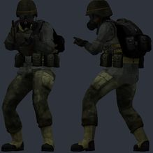 | `models/player/gmod/adrian_shephard/adrian_shephard.vmdl` | Adrian Shephard (EP4) | [EP4 Adrian Shephard [PM/NPC/RAGDOLL]](https://steamcommunity.com/sharedfiles/filedetails/?id=3806163613) by PSYCH0S0C14L | 6202 | compiled | **WARN** bulky torso: chest 5.5 u further forward than a stock agent; CS2 hand poses (two-handed weapons) will clip into it; hand_R inside the torso in the CS2 preview pose (chest surface 3.9 u in front of the wrist); stand-in/glass: eyeball_r, eyeball_l |
| 2 | 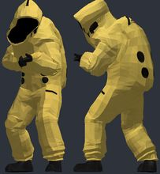 | `models/player/gmod/async_researcher/async_researcher.vmdl` | Async hazmat researcher | [Async Hazmat Researcher [Playermodel/Ragdoll]](https://steamcommunity.com/sharedfiles/filedetails/?id=3743395000) by WatersYourMelon | 12378 | compiled | **WARN** bulky torso: chest 6.4 u further forward than a stock agent; CS2 hand poses (two-handed weapons) will clip into it; hand_R inside the torso in the CS2 preview pose (chest surface 5.5 u in front of the wrist) |
| 2 | 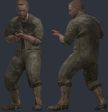 | `models/player/gmod/bo1_dempsey/bo1_dempsey.vmdl` | Dempsey (Black Ops 1 Ultimis) | [CoD: BO1 - Ultimis Playermodels](https://steamcommunity.com/sharedfiles/filedetails/?id=3715032179) by Hidden | 8454 | compiled |  |
| 2 | 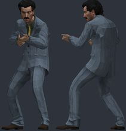 | `models/player/gmod/borat/borat.vmdl` | Borat cosplayer | [Borat_09 PM](https://steamcommunity.com/sharedfiles/filedetails/?id=3382190351) by panman | 15315 | compiled | stand-in/glass: mouth, eyeball_r, eyeball_l |
| 2 | 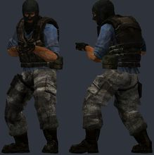 | `models/player/gmod/css_t_extended/css_t_extended.vmdl` | CS:S terrorist (extended) | [[CSS] Extended [PM/Ragdolls]](https://steamcommunity.com/sharedfiles/filedetails/?id=3737922257) by Chaos Star | 5780 | compiled | **WARN** bulky torso: chest 6.8 u further forward than a stock agent; CS2 hand poses (two-handed weapons) will clip into it; hand_R inside the torso in the CS2 preview pose (chest surface 5.4 u in front of the wrist) |
| 2 | 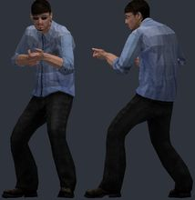 | `models/player/gmod/filthy_frank/filthy_frank.vmdl` | Filthy Frank | [Joji And The Filthy Frank Crew Playermodels](https://steamcommunity.com/sharedfiles/filedetails/?id=3442012037) by Gordon Freakman | 6048 | compiled | stand-in/glass: eyeball_r, eyeball_l, mouth, glassesfront_walter, glass2 |
| 2 | 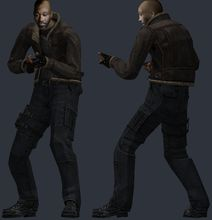 | `models/player/gmod/freddie_gibbs/freddie_gibbs.vmdl` | Freddie Gibbs (RE4 style) | [Freddie Gibbs (RE4)](https://steamcommunity.com/sharedfiles/filedetails/?id=3639562227) by pvnished dej | 12574 | compiled |  |
| 2 | 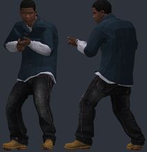 | `models/player/gmod/gta5_franklin/gta5_franklin.vmdl` | Franklin (GTA 5) | [GTA 5 Improved Models](https://steamcommunity.com/sharedfiles/filedetails/?id=3567271959) by Mango | 28197 | compiled |  |
| 2 | 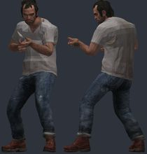 | `models/player/gmod/gta5_trevor/gta5_trevor.vmdl` | Trevor (GTA 5) | [GTA 5 Improved Models](https://steamcommunity.com/sharedfiles/filedetails/?id=3567271959) by Mango | 26412 | compiled |  |
| 2 | 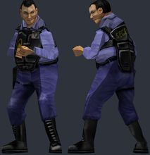 | `models/player/gmod/hlew_security/hlew_security.vmdl` | Black Mesa security (Otis) | [Half-Life: Extended Workforce Playermodels](https://steamcommunity.com/sharedfiles/filedetails/?id=3478625938) by Bikos77 | 845 | compiled | **WARN** bulky torso: chest 6.6 u further forward than a stock agent; CS2 hand poses (two-handed weapons) will clip into it; skeleton does not match CS2 (limb joints more than 6 u off: leg_upper_L 6.4, leg_upper_R 6.4): CS2 will bend the limbs away from the joints of the model; hand_L not aligned to CS2 (the rig has no index finger plus an outer finger): fingers will bend about the wrong points; hand_R not aligned to CS2 (the rig has no index finger plus an outer finger): fingers will bend about the wrong points |
| 2 | 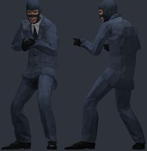 | `models/player/gmod/infiltrator/infiltrator.vmdl` | The Infiltrator | [[PM/RAGDOLL] The Infiltrator](https://steamcommunity.com/sharedfiles/filedetails/?id=3505084592) by Ashbird | 5641 | compiled | stand-in/glass: mouth, eyeball_l, eyeball_r |
| 2 | 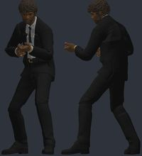 | `models/player/gmod/jules_winnfield/jules_winnfield.vmdl` | Jules Winnfield | [Pulp Fiction - Jules Winnfield & Vincent Vega [PM/NPC]](https://steamcommunity.com/sharedfiles/filedetails/?id=3637286336) by finished my contracts award | 41000 | compiled |  |
| 2 | 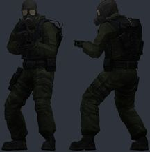 | `models/player/gmod/l4d_sacrifice_soldier/l4d_sacrifice_soldier.vmdl` | L4D The Sacrifice comic soldier | [L4D The Sacrifice Comic Soldier REMASTERED](https://steamcommunity.com/sharedfiles/filedetails/?id=3690639069) by Vitaliy Puzin | 8593 | compiled |  |
| 2 | 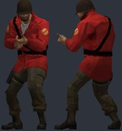 | `models/player/gmod/l4d_soldier/l4d_soldier.vmdl` | Left 4 Dead styled soldier | [Left 4 Dead styled soldier (Playermodel/Ragdoll)](https://steamcommunity.com/sharedfiles/filedetails/?id=3452810040) by devious critter | 11605 | compiled |  |
| 2 | 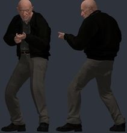 | `models/player/gmod/mike_ehrmantraut/mike_ehrmantraut.vmdl` | Mike Ehrmantraut | [[Breaking Bad] Mike Ehrmantraut](https://steamcommunity.com/sharedfiles/filedetails/?id=3639826393) by Azkabath | 113415 | compiled |  |
| 2 | 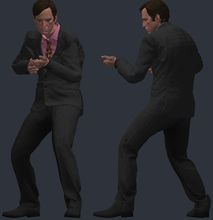 | `models/player/gmod/saul_goodman/saul_goodman.vmdl` | Saul Goodman | [[Breaking Bad] Saul Goodman](https://steamcommunity.com/sharedfiles/filedetails/?id=3698609418) by Azkabath | 73719 | compiled |  |
| 2 | 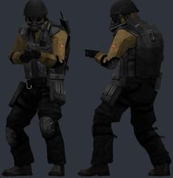 | `models/player/gmod/scp_ntf/scp_ntf.vmdl` | SCP Foundation MTF | [Oldschool SCP Pack (Playermodels)](https://steamcommunity.com/sharedfiles/filedetails/?id=3591454343) by Gunslinger | 5498 | compiled |  |
| 2 | 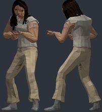 | `models/player/gmod/stilllife_mary/stilllife_mary.vmdl` | Mary (Still Life) | [Still Life Playermodels](https://steamcommunity.com/sharedfiles/filedetails/?id=3750015271) by schlimbodimblo | 7373 | compiled |  |
| 2 | 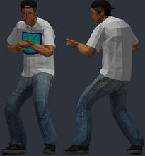 | `models/player/gmod/terry_davis/terry_davis.vmdl` | Terry A. Davis (HL2 style) | [Terry A. Davis (HL2 Styled)](https://steamcommunity.com/sharedfiles/filedetails/?id=3728868335) by panman | 8726 | compiled | stand-in/glass: eyeball_l, eyeball_r, mouth |
| 2 | 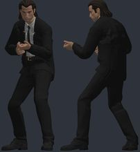 | `models/player/gmod/vincent_vega/vincent_vega.vmdl` | Vincent Vega | [Pulp Fiction - Jules Winnfield & Vincent Vega [PM/NPC]](https://steamcommunity.com/sharedfiles/filedetails/?id=3637286336) by finished my contracts award | 40733 | compiled |  |
| 3 |  | `models/player/gmod/bf4_us_assault/bf4_us_assault.vmdl` | BF4 US Assault | [[PM] [Part 1] Battlefield 4 United States Assault & Support Playermodels Revamp](https://steamcommunity.com/sharedfiles/filedetails/?id=3552973123) by MUNCH | 111569 | compiled | **WARN** bulky torso: chest 6.1 u further forward than a stock agent; CS2 hand poses (two-handed weapons) will clip into it; hand_R inside the torso in the CS2 preview pose (chest surface 4.4 u in front of the wrist) |
| 3 |  | `models/player/gmod/bf4_us_support/bf4_us_support.vmdl` | BF4 US Support | [[PM] [Part 1] Battlefield 4 United States Assault & Support Playermodels Revamp](https://steamcommunity.com/sharedfiles/filedetails/?id=3552973123) by MUNCH | 122207 | compiled | **WARN** bulky torso: chest 6.4 u further forward than a stock agent; CS2 hand poses (two-handed weapons) will clip into it |
| 3 |  | `models/player/gmod/errorman/errorman.vmdl` | ERRORMAN | [ERRORMAN [Playermodel + Ragdoll]](https://steamcommunity.com/sharedfiles/filedetails/?id=3383431402) by Davy | 28270 | compiled |  |
| 3 | 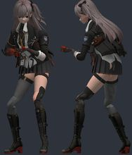 | `models/player/gmod/gfl2_leva/gfl2_leva.vmdl` | Leva (Girls Frontline 2) | [Girls Frontline 2 - Leva [UMP45] 5 Pack Playermodels & NPCs](https://steamcommunity.com/sharedfiles/filedetails/?id=3453547126) by 8sianDude | 72945 | compiled | **WARN** bulky torso: chest 4.8 u further forward than a stock agent; CS2 hand poses (two-handed weapons) will clip into it |
| 3 |  | `models/player/gmod/jack_sparrow/jack_sparrow.vmdl` | Captain Jack Sparrow (KH3) | [{Olejus} Captain Jack Sparrow Playermodel/Ragdoll](https://steamcommunity.com/sharedfiles/filedetails/?id=3554769255) by Olejus | 87840 | compiled |  |
| 3 |  | `models/player/gmod/lethal_employee/lethal_employee.vmdl` | Lethal Company employee | [Lethal Company - Employee (Scavenger) [Playermodels/NPCS]](https://steamcommunity.com/sharedfiles/filedetails/?id=3120023020) by Stranger | 63396 | compiled | **WARN** bulky torso: chest 5.1 u further forward than a stock agent; CS2 hand poses (two-handed weapons) will clip into it |
| 3 |  | `models/player/gmod/mgs5_dd_female/mgs5_dd_female.vmdl` | MGS5 Diamond Dog soldier (female) | [MGS5 Diamond Dog Soldier Playermodel + NPC](https://steamcommunity.com/sharedfiles/filedetails/?id=3401507374) by CLANKERt_ | 18818 | compiled |  |
| 3 |  | `models/player/gmod/mgs5_dd_male/mgs5_dd_male.vmdl` | MGS5 Diamond Dog soldier (male) | [MGS5 Diamond Dog Soldier Playermodel + NPC](https://steamcommunity.com/sharedfiles/filedetails/?id=3401507374) by CLANKERt_ | 18944 | compiled | **WARN** bulky torso: chest 4.3 u further forward than a stock agent; CS2 hand poses (two-handed weapons) will clip into it |
| 3 |  | `models/player/gmod/michael_scott/michael_scott.vmdl` | Michael Scott | [Michael Scott Playermodel & npcs](https://steamcommunity.com/sharedfiles/filedetails/?id=3564388370) by eggnood11es | 30702 | compiled |  |
| 3 |  | `models/player/gmod/picolas_cage/picolas_cage.vmdl` | Picolas Cage | [Picolas Cage playermodel](https://steamcommunity.com/sharedfiles/filedetails/?id=674702181) by aap15 | 24032 | compiled |  |
| 3 |  | `models/player/gmod/re4_leon_jacket/re4_leon_jacket.vmdl` | Leon (RE4, jacket; Willi Wakker) | [Resident Evil 4 - Leon Playermodel](https://steamcommunity.com/sharedfiles/filedetails/?id=3339300694) by Willi Wakker | 5524 | compiled |  |
| 3 |  | `models/player/gmod/scp_class_d/scp_class_d.vmdl` | SCP:CB Class-D | [SCP:CB STAFF PLAYERMODELS & NPCS](https://steamcommunity.com/sharedfiles/filedetails/?id=3640396751) by cool_dude1823 | 1658 | compiled |  |
| 3 |  | `models/player/gmod/scp_guard/scp_guard.vmdl` | SCP:CB guard | [SCP:CB STAFF PLAYERMODELS & NPCS](https://steamcommunity.com/sharedfiles/filedetails/?id=3640396751) by cool_dude1823 | 18278 | compiled |  |
| 3 |  | `models/player/gmod/scp_serpents_hand/scp_serpents_hand.vmdl` | SCP:CB Serpent's Hand | [SCP:CB STAFF PLAYERMODELS & NPCS](https://steamcommunity.com/sharedfiles/filedetails/?id=3640396751) by cool_dude1823 | 77348 | compiled |  |
| 3 |  | `models/player/gmod/steamhappy/steamhappy.vmdl` | Steamhappy citizen | [Steamhappy citizen (Playermodel & Ragdoll)](https://steamcommunity.com/sharedfiles/filedetails/?id=3649330814) by aggusn4 | 4523 | compiled |  |
| 3 |  | `models/player/gmod/ua_eclipse_merc/ua_eclipse_merc.vmdl` | Urban Assault: Eclipse Division merc | [Urban Assault Playermodels (WIP)](https://steamcommunity.com/sharedfiles/filedetails/?id=3772745299) by TalonSolid | 16344 | compiled | **WARN** bulky torso: chest 6.0 u further forward than a stock agent; CS2 hand poses (two-handed weapons) will clip into it; hand_R inside the torso in the CS2 preview pose (chest surface 5.7 u in front of the wrist) |
| 3 |  | `models/player/gmod/ua_eclipse_pilot/ua_eclipse_pilot.vmdl` | Urban Assault: Eclipse Division pilot | [Urban Assault Playermodels (WIP)](https://steamcommunity.com/sharedfiles/filedetails/?id=3772745299) by TalonSolid | 27407 | compiled | **WARN** bulky torso: chest 5.8 u further forward than a stock agent; CS2 hand poses (two-handed weapons) will clip into it; hand_R inside the torso in the CS2 preview pose (chest surface 3.8 u in front of the wrist) |
| 3 |  | `models/player/gmod/ua_falcon_commander/ua_falcon_commander.vmdl` | Urban Assault: Falcon commander | [Urban Assault Playermodels (WIP)](https://steamcommunity.com/sharedfiles/filedetails/?id=3772745299) by TalonSolid | 12750 | compiled | **WARN** bulky torso: chest 5.8 u further forward than a stock agent; CS2 hand poses (two-handed weapons) will clip into it; hand_R inside the torso in the CS2 preview pose (chest surface 3.8 u in front of the wrist) |
| 3 |  | `models/player/gmod/ua_hmc_security/ua_hmc_security.vmdl` | Urban Assault: HMC security | [Urban Assault Playermodels (WIP)](https://steamcommunity.com/sharedfiles/filedetails/?id=3772745299) by TalonSolid | 30875 | compiled | **WARN** bulky torso: chest 5.6 u further forward than a stock agent; CS2 hand poses (two-handed weapons) will clip into it; hand_R inside the torso in the CS2 preview pose (chest surface 3.6 u in front of the wrist) |
| 3 |  | `models/player/gmod/ua_marcus/ua_marcus.vmdl` | Urban Assault: Marcus | [Urban Assault Playermodels (WIP)](https://steamcommunity.com/sharedfiles/filedetails/?id=3772745299) by TalonSolid | 13157 | compiled | **WARN** bulky torso: chest 5.8 u further forward than a stock agent; CS2 hand poses (two-handed weapons) will clip into it; hand_R inside the torso in the CS2 preview pose (chest surface 3.8 u in front of the wrist) |
| 4 |  | `models/player/gmod/agent_47/agent_47.vmdl` | Agent 47 | [Hitman Absolution: Agent 47 Playermodel](https://steamcommunity.com/sharedfiles/filedetails/?id=157660704) by Voikanaa | 19922 | compiled |  |
| 4 |  | `models/player/gmod/agent_smith/agent_smith.vmdl` | Agent Smith (The Matrix: Path of Neo) | [Agents (The Matrix: Path of Neo) Player Model/NPC Pack](https://steamcommunity.com/sharedfiles/filedetails/?id=3425493121) by tchaek | 4328 | compiled |  |
| 4 |  | `models/player/gmod/aiden_pearce/aiden_pearce.vmdl` | Aiden Pearce (Watch Dogs) | [WATCH_DOGS: Aiden Pearce Playermodel](https://steamcommunity.com/sharedfiles/filedetails/?id=295788137) by Voikanaa | 36507 | compiled |  |
| 4 |  | `models/player/gmod/big_boss/big_boss.vmdl` | Big Boss (MGS3) | [Metal Gear Solid 3: Big Boss Playermodel](https://steamcommunity.com/sharedfiles/filedetails/?id=184512071) by Voikanaa | 4674 | compiled |  |
| 4 |  | `models/player/gmod/black_operator/black_operator.vmdl` | BLACK operator | [BLACK (2006) Goons & Operators (Playermodels & NPCs)](https://steamcommunity.com/sharedfiles/filedetails/?id=3215765831) by Kapitano Krunchyman | 2976 | compiled | **WARN** bulky torso: chest 5.9 u further forward than a stock agent; CS2 hand poses (two-handed weapons) will clip into it; hand_R inside the torso in the CS2 preview pose (chest surface 3.9 u in front of the wrist) |
| 4 |  | `models/player/gmod/chester_stone/chester_stone.vmdl` | Chester Stone (HL2 style) | [HL2 "styled" Chester Stone [Playermodel + Ragdoll]](https://steamcommunity.com/sharedfiles/filedetails/?id=3363837903) by Davy | 6324 | compiled |  |
| 4 |  | `models/player/gmod/cof_simon/cof_simon.vmdl` | Simon (Cry of Fear) | [[PM] Simon - Cry Of Fear](https://steamcommunity.com/sharedfiles/filedetails/?id=3249363824) by salvare000 | 3200 | compiled |  |
| 4 |  | `models/player/gmod/combine_soldier_pm/combine_soldier_pm.vmdl` | Combine soldier | [[PM] Combine Unit Playermodels (w/accurate c_hands)](https://steamcommunity.com/sharedfiles/filedetails/?id=3411853782) by salvare000 | 4976 | compiled | **WARN** bulky torso: chest 4.2 u further forward than a stock agent; CS2 hand poses (two-handed weapons) will clip into it |
| 4 |  | `models/player/gmod/dexter_morgan/dexter_morgan.vmdl` | Dexter Morgan | [Dexter: The Game Playermodels](https://steamcommunity.com/sharedfiles/filedetails/?id=3826383575) by Chloe Frazer | 3566 | compiled |  |
| 4 |  | `models/player/gmod/doom_marine/doom_marine.vmdl` | Doom Marine (DOOM 2016) | [DOOM 2016: Doom Marine (PM&NPC + Ragdoll)](https://steamcommunity.com/sharedfiles/filedetails/?id=3485116477) by Kerosenn | 80937 | compiled | **WARN** bulky torso: chest 4.8 u further forward than a stock agent; CS2 hand poses (two-handed weapons) will clip into it |
| 4 |  | `models/player/gmod/evrart_claire/evrart_claire.vmdl` | Evrart Claire (Disco Elysium) | [Evrart Claire playermodel + ragdoll [Disco Elysium]](https://steamcommunity.com/sharedfiles/filedetails/?id=3811403972) by hainzofelps | 5408 | compiled | **WARN** bulky torso: chest 7.6 u further forward than a stock agent; CS2 hand poses (two-handed weapons) will clip into it; hand_R inside the torso in the CS2 preview pose (chest surface 5.3 u in front of the wrist) |
| 4 |  | `models/player/gmod/ezio/ezio.vmdl` | Ezio Auditore | [Assassins Creed II: Ezio Auditore Playermodel](https://steamcommunity.com/sharedfiles/filedetails/?id=237984526) by Voikanaa | 20569 | compiled |  |
| 4 |  | `models/player/gmod/f76_secret_service/f76_secret_service.vmdl` | Fallout 76 Secret Service | [[F76] Secret Service Soldiers [Playermodel+Ragdoll]](https://steamcommunity.com/sharedfiles/filedetails/?id=3568561943) by Davy | 24268 | compiled |  |
| 4 |  | `models/player/gmod/faith_connors/faith_connors.vmdl` | Faith Connors (Mirror's Edge) | [Mirrors Edge: Faith Connors Playermodel](https://steamcommunity.com/sharedfiles/filedetails/?id=271967400) by Voikanaa | 20655 | compiled |  |
| 4 |  | `models/player/gmod/gopnik_freeman/gopnik_freeman.vmdl` | Gopnik Freeman | [Gopnik Freeman Playermodel](https://steamcommunity.com/sharedfiles/filedetails/?id=3351061882) by TheBigCube | 5085 | compiled |  |
| 4 |  | `models/player/gmod/harry_du_bois/harry_du_bois.vmdl` | Harry Du Bois (Disco Elysium) | [Harry Du Bois aka Tequila Sunset PM & NPC](https://steamcommunity.com/sharedfiles/filedetails/?id=3600797062) by Dakasin | 6276 | compiled |  |
| 4 |  | `models/player/gmod/lara_croft/lara_croft.vmdl` | Lara Croft | [Tomb Raider: Lara Croft Playermodel](https://steamcommunity.com/sharedfiles/filedetails/?id=156925148) by Voikanaa | 23262 | compiled | **WARN** bulky torso: chest 4.9 u further forward than a stock agent; CS2 hand poses (two-handed weapons) will clip into it; hand_R inside the torso in the CS2 preview pose (chest surface 3.2 u in front of the wrist) |
| 4 |  | `models/player/gmod/mw2_soldier/mw2_soldier.vmdl` | MW2 soldier (Viper) | [Viper's Operators Playermodels 'Remastered'](https://steamcommunity.com/sharedfiles/filedetails/?id=636790055) by maJor | 10469 | compiled | **WARN** bulky torso: chest 4.1 u further forward than a stock agent; CS2 hand poses (two-handed weapons) will clip into it |
| 4 |  | `models/player/gmod/mw_allegiance/mw_allegiance.vmdl` | MW Allegiance operator | [CoD: Modern Warfare - Allegiance Operator (Playermodel & NPC)](https://steamcommunity.com/sharedfiles/filedetails/?id=2090758421) by kuma7 | 55862 | compiled | **WARN** bulky torso: chest 7.8 u further forward than a stock agent; CS2 hand poses (two-handed weapons) will clip into it; hand_R inside the torso in the CS2 preview pose (chest surface 4.5 u in front of the wrist) |
| 4 |  | `models/player/gmod/nbc_hazmat/nbc_hazmat.vmdl` | Tactical NBC hazmat | [[Backrooms] Tactical NBC Hazmat (Mark Blume) [Playermodel]](https://steamcommunity.com/sharedfiles/filedetails/?id=2907374323) by X Ray | 56840 | compiled | **WARN** bulky torso: chest 7.5 u further forward than a stock agent; CS2 hand poses (two-handed weapons) will clip into it; hand_R inside the torso in the CS2 preview pose (chest surface 6.8 u in front of the wrist); skeleton does not match CS2 (limb joints more than 6 u off: leg_lower_L 8.0, leg_lower_R 7.9, leg_upper_L 6.2, leg_upper_R 6.1): CS2 will bend the limbs away from the joints of the model |
| 4 |  | `models/player/gmod/ncr_ranger/ncr_ranger.vmdl` | NCR Veteran Ranger | [[COMM] NCR Veteran Ranger - [Playermodel]](https://steamcommunity.com/sharedfiles/filedetails/?id=3823590914) by Alvaro | 62142 | compiled | **WARN** skeleton does not match CS2 (limb joints more than 6 u off: leg_upper_L 8.6, leg_upper_R 8.6): CS2 will bend the limbs away from the joints of the model |
| 4 |  | `models/player/gmod/postal_dude/postal_dude.vmdl` | Postal Dude (Postal X) | [Postal X [PM & NPC]](https://steamcommunity.com/sharedfiles/filedetails/?id=3674111517) by RKiRra | 44558 | compiled |  |
| 4 |  | `models/player/gmod/re2_hunk/re2_hunk.vmdl` | HUNK (RE2 Remake) | [Resident Evil 2 Remake - Hunk [PM](https://steamcommunity.com/sharedfiles/filedetails/?id=1639925476) by jolly ol' chap | 69942 | compiled | **WARN** bulky torso: chest 5.6 u further forward than a stock agent; CS2 hand poses (two-handed weapons) will clip into it |
| 4 |  | `models/player/gmod/robber_shirt/robber_shirt.vmdl` | Robber (suits and robbers) | [suits and robbers playermodels](https://steamcommunity.com/sharedfiles/filedetails/?id=412149725) by ムyce | 10116 | compiled | **WARN** bulky torso: chest 7.0 u further forward than a stock agent; CS2 hand poses (two-handed weapons) will clip into it; hand_R inside the torso in the CS2 preview pose (chest surface 6.0 u in front of the wrist); stand-in/glass: eyeball_r, eyeball_l |
| 4 |  | `models/player/gmod/sam_bridges/sam_bridges.vmdl` | Sam Porter Bridges | [DEATH STRANDING - Sam Porter Bridges Playermodel](https://steamcommunity.com/sharedfiles/filedetails/?id=3818416616) by sammy sam | 117980 | compiled |  |
| 4 |  | `models/player/gmod/security_guard/security_guard.vmdl` | Security guard | [Security Guard Playermodels](https://steamcommunity.com/sharedfiles/filedetails/?id=169011381) by Voikanaa | 9189 | compiled |  |
| 4 |  | `models/player/gmod/t800/t800.vmdl` | The Terminator (T-800) | [The Terminator (T-800) [PM/RAG]](https://steamcommunity.com/sharedfiles/filedetails/?id=3589878364) by Terrywitt | 20448 | compiled |  |
| 4 |  | `models/player/gmod/uk_police/uk_police.vmdl` | UK police officer | [UK Police Playermodels](https://steamcommunity.com/sharedfiles/filedetails/?id=229922346) by Voikanaa | 10968 | compiled |  |
| 4 |  | `models/player/gmod/walter_white/walter_white.vmdl` | Walter White | [Walter White Playermodel](https://steamcommunity.com/sharedfiles/filedetails/?id=2787370699) by HarryA | 30286 | compiled | **WARN** hand_L not aligned to CS2 (the rig has no index finger plus an outer finger): fingers will bend about the wrong points; hand_R not aligned to CS2 (the rig has no index finger plus an outer finger): fingers will bend about the wrong points |
| 4 |  | `models/player/gmod/wesker/wesker.vmdl` | Albert Wesker (RE0) | [Resident Evil 0: HD Remaster - Albert Wesker (Playermodel](https://steamcommunity.com/sharedfiles/filedetails/?id=3101353600) by Chocolat | 22009 | compiled |  |
