# Converted player models

Every GMod player model converted by this toolkit (generated by `listmodels.py` from `catalog.json` and the reports; re-run after a batch).
Addon: `gmod_playermodels` (content: `csgo_addons/gmod_playermodels`). In a map: a hidden `prop_dynamic` of the model so it is precached, then
`pawn.SetModel("<model>")`. Rights: local testing only unless the author agrees (see [the guide](../../docs/creation/gmod-playermodels.md#rights)).

691 models, 691 compiled, 300 with fit warnings. Per-batch notes: [BATCH1.md](BATCH1.md), [BATCH2.md](BATCH2.md), [BATCH3.md](BATCH3.md), [BATCH4.md](BATCH4.md), [BATCH5.md](BATCH5.md), [BATCH6.md](BATCH6.md), [BATCH7.md](BATCH7.md), [BATCH8.md](BATCH8.md), [BATCH9.md](BATCH9.md).

Each picture is the converted model in CS2's own pose (skinned to the agent skeleton the game animates), front and three-quarter.

| batch | picture | CS2 model | name | workshop item | tris | status | notes |
|---|---|---|---|---|---|---|---|
| 1 | 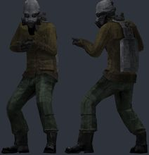 | `models/player/gmod/caste_graffiti/caste_graffiti.vmdl` | Caste Graffiti Guy | [CASTE Graffiti Playermodel + NPC](https://steamcommunity.com/sharedfiles/filedetails/?id=3673818635) by VHBC | 5213 | compiled |  |
| 1 | 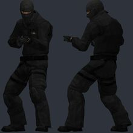 | `models/player/gmod/css_swat/css_swat.vmdl` | CS:S Enhanced SWAT | [CSS ENHANCED SPECIAL FORCES /// SEB & SWAT /// PLAYERMODEL](https://steamcommunity.com/sharedfiles/filedetails/?id=3387382988) by Gruchk | 4173 | compiled |  |
| 1 | 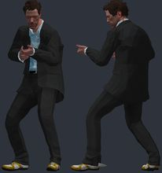 | `models/player/gmod/dr_house/dr_house.vmdl` | Dr Gregory House | [House M.D: Dr Gregory House](https://steamcommunity.com/sharedfiles/filedetails/?id=3419019710) by Bunny | 38061 | compiled |  |
| 1 | 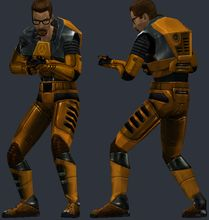 | `models/player/gmod/gordon_promo/gordon_promo.vmdl` | Gordon Freeman (promo art) | [[PM+NPC] Promo Art Gordon Freeman](https://steamcommunity.com/sharedfiles/filedetails/?id=3361691203) by Vuthakral | 5850 | compiled |  |
| 1 | 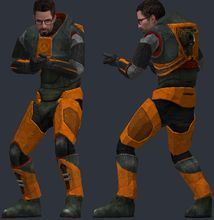 | `models/player/gmod/gordon_restored/gordon_restored.vmdl` | Gordon Freeman Restored | [Gordon Freeman Restored (PM/NPC)](https://steamcommunity.com/sharedfiles/filedetails/?id=3320656757) by Gordon Freakman | 19463 | compiled |  |
| 1 | 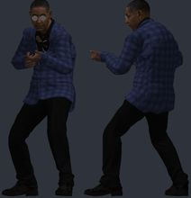 | `models/player/gmod/gus_fring/gus_fring.vmdl` | Gus Fring (suit) | [[Breaking Bad] Gustavo Fring](https://steamcommunity.com/sharedfiles/filedetails/?id=3412497213) by Azkabath | 53714 | compiled |  |
| 1 | 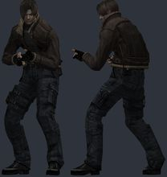 | `models/player/gmod/leon_re4/leon_re4.vmdl` | Leon S. Kennedy (RE4 2005) | [Resident Evil 4 (2005) Leon S. Kennedy Playermodel](https://steamcommunity.com/sharedfiles/filedetails/?id=3735230220) by acres | 8733 | compiled | **WARN** possible duplicate of `leon_s_kennedy_re4`, `leon_s_kennedy_re4_mafia` |
| 1 | 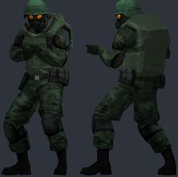 | `models/player/gmod/rotd_guard/rotd_guard.vmdl` | Road of The Dead: National Guard | [Road of The Dead: Military](https://steamcommunity.com/sharedfiles/filedetails/?id=3415757440) by pvnished dej | 10953 | compiled |  |
| 1 | 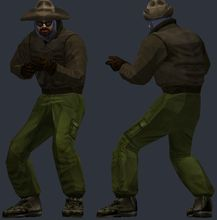 | `models/player/gmod/thing_macready/thing_macready.vmdl` | The Thing: MacReady | [The Thing (2002) Humans (Playermodels & Ragdolls)](https://steamcommunity.com/sharedfiles/filedetails/?id=3456405055) by Kapitano Krunchyman | 1956 | compiled |  |
| 1 | 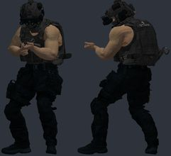 | `models/player/gmod/vart_agent/vart_agent.vmdl` | V.A.R.T | [Valve Account Recovery Taskforce [PM]](https://steamcommunity.com/sharedfiles/filedetails/?id=3626678503) by Fozer_T89 | 98787 | compiled | **WARN** bulky torso: chest 5.2 u further forward than a stock agent; CS2 hand poses (two-handed weapons) will clip into it; hand_R inside the torso in the CS2 preview pose (chest surface 3.5 u in front of the wrist) |
| 2 |  | `models/player/gmod/adrian_shephard/adrian_shephard.vmdl` | Adrian Shephard (EP4) | [EP4 Adrian Shephard [PM/NPC/RAGDOLL]](https://steamcommunity.com/sharedfiles/filedetails/?id=3806163613) by PSYCH0S0C14L | 6164 | compiled | **WARN** bulky torso: chest 5.5 u further forward than a stock agent; CS2 hand poses (two-handed weapons) will clip into it; hand_R inside the torso in the CS2 preview pose (chest surface 4.1 u in front of the wrist); stand-in/glass: eyeball_r, eyeball_l |
| 2 |  | `models/player/gmod/async_researcher/async_researcher.vmdl` | Async hazmat researcher | [Async Hazmat Researcher [Playermodel/Ragdoll]](https://steamcommunity.com/sharedfiles/filedetails/?id=3743395000) by WatersYourMelon | 12376 | compiled | **WARN** bulky torso: chest 6.4 u further forward than a stock agent; CS2 hand poses (two-handed weapons) will clip into it; hand_R inside the torso in the CS2 preview pose (chest surface 5.1 u in front of the wrist) |
| 2 |  | `models/player/gmod/bo1_dempsey/bo1_dempsey.vmdl` | Dempsey (Black Ops 1 Ultimis) | [CoD: BO1 - Ultimis Playermodels](https://steamcommunity.com/sharedfiles/filedetails/?id=3715032179) by Hidden | 8450 | compiled |  |
| 2 |  | `models/player/gmod/borat/borat.vmdl` | Borat cosplayer | [Borat_09 PM](https://steamcommunity.com/sharedfiles/filedetails/?id=3382190351) by panman | 15311 | compiled |  |
| 2 |  | `models/player/gmod/css_t_extended/css_t_extended.vmdl` | CS:S terrorist (extended) | [[CSS] Extended [PM/Ragdolls]](https://steamcommunity.com/sharedfiles/filedetails/?id=3737922257) by Chaos Star | 5762 | compiled | **WARN** bulky torso: chest 6.8 u further forward than a stock agent; CS2 hand poses (two-handed weapons) will clip into it; hand_R inside the torso in the CS2 preview pose (chest surface 4.7 u in front of the wrist) |
| 2 |  | `models/player/gmod/filthy_frank/filthy_frank.vmdl` | Filthy Frank | [Joji And The Filthy Frank Crew Playermodels](https://steamcommunity.com/sharedfiles/filedetails/?id=3442012037) by Gordon Freakman | 5930 | compiled |  |
| 2 |  | `models/player/gmod/freddie_gibbs/freddie_gibbs.vmdl` | Freddie Gibbs (RE4 style) | [Freddie Gibbs (RE4)](https://steamcommunity.com/sharedfiles/filedetails/?id=3639562227) by pvnished dej | 12556 | compiled |  |
| 2 |  | `models/player/gmod/gta5_franklin/gta5_franklin.vmdl` | Franklin (GTA 5) | [GTA 5 Improved Models](https://steamcommunity.com/sharedfiles/filedetails/?id=3567271959) by Mango | 28197 | compiled |  |
| 2 |  | `models/player/gmod/gta5_trevor/gta5_trevor.vmdl` | Trevor (GTA 5) | [GTA 5 Improved Models](https://steamcommunity.com/sharedfiles/filedetails/?id=3567271959) by Mango | 26412 | compiled |  |
| 2 |  | `models/player/gmod/hlew_security/hlew_security.vmdl` | Black Mesa security (Otis) | [Half-Life: Extended Workforce Playermodels](https://steamcommunity.com/sharedfiles/filedetails/?id=3478625938) by Bikos77 | 813 | compiled | **WARN** bulky torso: chest 6.6 u further forward than a stock agent; CS2 hand poses (two-handed weapons) will clip into it; hand_L not aligned to CS2 (the rig has no index finger plus an outer finger): fingers will bend about the wrong points; hand_R not aligned to CS2 (the rig has no index finger plus an outer finger): fingers will bend about the wrong points |
| 2 |  | `models/player/gmod/infiltrator/infiltrator.vmdl` | The Infiltrator | [[PM/RAGDOLL] The Infiltrator](https://steamcommunity.com/sharedfiles/filedetails/?id=3505084592) by Ashbird | 5627 | compiled |  |
| 2 |  | `models/player/gmod/jules_winnfield/jules_winnfield.vmdl` | Jules Winnfield | [Pulp Fiction - Jules Winnfield & Vincent Vega [PM/NPC]](https://steamcommunity.com/sharedfiles/filedetails/?id=3637286336) by finished my contracts award | 41000 | compiled |  |
| 2 |  | `models/player/gmod/l4d_sacrifice_soldier/l4d_sacrifice_soldier.vmdl` | L4D The Sacrifice comic soldier | [L4D The Sacrifice Comic Soldier REMASTERED](https://steamcommunity.com/sharedfiles/filedetails/?id=3690639069) by Vitaliy Puzin | 8595 | compiled |  |
| 2 |  | `models/player/gmod/l4d_soldier/l4d_soldier.vmdl` | Left 4 Dead styled soldier | [Left 4 Dead styled soldier (Playermodel/Ragdoll)](https://steamcommunity.com/sharedfiles/filedetails/?id=3452810040) by devious critter | 11563 | compiled |  |
| 2 |  | `models/player/gmod/mike_ehrmantraut/mike_ehrmantraut.vmdl` | Mike Ehrmantraut | [[Breaking Bad] Mike Ehrmantraut](https://steamcommunity.com/sharedfiles/filedetails/?id=3639826393) by Azkabath | 113415 | compiled |  |
| 2 |  | `models/player/gmod/saul_goodman/saul_goodman.vmdl` | Saul Goodman | [[Breaking Bad] Saul Goodman](https://steamcommunity.com/sharedfiles/filedetails/?id=3698609418) by Azkabath | 73719 | compiled |  |
| 2 |  | `models/player/gmod/scp_ntf/scp_ntf.vmdl` | SCP Foundation MTF | [Oldschool SCP Pack (Playermodels)](https://steamcommunity.com/sharedfiles/filedetails/?id=3591454343) by Gunslinger | 5484 | compiled |  |
| 2 |  | `models/player/gmod/stilllife_mary/stilllife_mary.vmdl` | Mary (Still Life) | [Still Life Playermodels](https://steamcommunity.com/sharedfiles/filedetails/?id=3750015271) by schlimbodimblo | 7373 | compiled | **WARN** possible duplicate of `still_life` |
| 2 |  | `models/player/gmod/terry_davis/terry_davis.vmdl` | Terry A. Davis (HL2 style) | [Terry A. Davis (HL2 Styled)](https://steamcommunity.com/sharedfiles/filedetails/?id=3728868335) by panman | 8728 | compiled |  |
| 2 |  | `models/player/gmod/vincent_vega/vincent_vega.vmdl` | Vincent Vega | [Pulp Fiction - Jules Winnfield & Vincent Vega [PM/NPC]](https://steamcommunity.com/sharedfiles/filedetails/?id=3637286336) by finished my contracts award | 40733 | compiled |  |
| 3 | 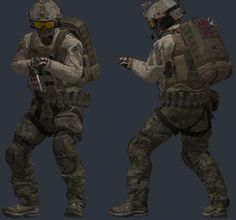 | `models/player/gmod/bf4_us_assault/bf4_us_assault.vmdl` | BF4 US Assault | [[PM] [Part 1] Battlefield 4 United States Assault & Support Playermodels Revamp](https://steamcommunity.com/sharedfiles/filedetails/?id=3552973123) by MUNCH | 111569 | compiled | **WARN** bulky torso: chest 6.1 u further forward than a stock agent; CS2 hand poses (two-handed weapons) will clip into it; hand_R inside the torso in the CS2 preview pose (chest surface 4.5 u in front of the wrist) |
| 3 | 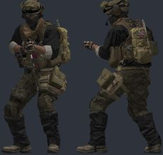 | `models/player/gmod/bf4_us_support/bf4_us_support.vmdl` | BF4 US Support | [[PM] [Part 1] Battlefield 4 United States Assault & Support Playermodels Revamp](https://steamcommunity.com/sharedfiles/filedetails/?id=3552973123) by MUNCH | 122201 | compiled | **WARN** bulky torso: chest 6.4 u further forward than a stock agent; CS2 hand poses (two-handed weapons) will clip into it; hand_R inside the torso in the CS2 preview pose (chest surface 5.5 u in front of the wrist) |
| 3 | 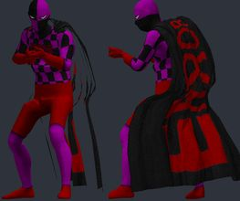 | `models/player/gmod/errorman/errorman.vmdl` | ERRORMAN | [ERRORMAN [Playermodel + Ragdoll]](https://steamcommunity.com/sharedfiles/filedetails/?id=3383431402) by Davy | 28273 | compiled |  |
| 3 | 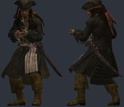 | `models/player/gmod/jack_sparrow/jack_sparrow.vmdl` | Captain Jack Sparrow (KH3) | [{Olejus} Captain Jack Sparrow Playermodel/Ragdoll](https://steamcommunity.com/sharedfiles/filedetails/?id=3554769255) by Olejus | 87840 | compiled |  |
| 3 | 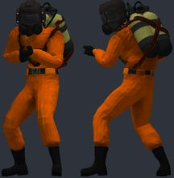 | `models/player/gmod/lethal_employee/lethal_employee.vmdl` | Lethal Company employee | [Lethal Company - Employee (Scavenger) [Playermodels/NPCS]](https://steamcommunity.com/sharedfiles/filedetails/?id=3120023020) by Stranger | 63396 | compiled | **WARN** bulky torso: chest 5.1 u further forward than a stock agent; CS2 hand poses (two-handed weapons) will clip into it |
| 3 | 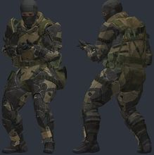 | `models/player/gmod/mgs5_dd_female/mgs5_dd_female.vmdl` | MGS5 Diamond Dog soldier (female) | [MGS5 Diamond Dog Soldier Playermodel + NPC](https://steamcommunity.com/sharedfiles/filedetails/?id=3401507374) by CLANKERt_ | 18814 | compiled |  |
| 3 | 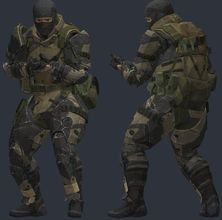 | `models/player/gmod/mgs5_dd_male/mgs5_dd_male.vmdl` | MGS5 Diamond Dog soldier (male) | [MGS5 Diamond Dog Soldier Playermodel + NPC](https://steamcommunity.com/sharedfiles/filedetails/?id=3401507374) by CLANKERt_ | 18922 | compiled | **WARN** bulky torso: chest 4.3 u further forward than a stock agent; CS2 hand poses (two-handed weapons) will clip into it |
| 3 | 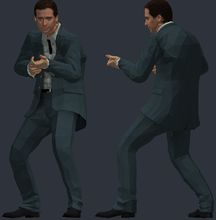 | `models/player/gmod/michael_scott/michael_scott.vmdl` | Michael Scott | [Michael Scott Playermodel & npcs](https://steamcommunity.com/sharedfiles/filedetails/?id=3564388370) by eggnood11es | 30696 | compiled |  |
| 3 | 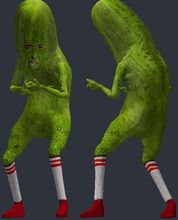 | `models/player/gmod/picolas_cage/picolas_cage.vmdl` | Picolas Cage | [Picolas Cage playermodel](https://steamcommunity.com/sharedfiles/filedetails/?id=674702181) by aap15 | 24032 | compiled |  |
| 3 | 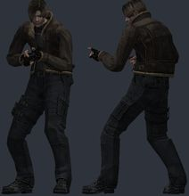 | `models/player/gmod/re4_leon_jacket/re4_leon_jacket.vmdl` | Leon (RE4, jacket; Willi Wakker) | [Resident Evil 4 - Leon Playermodel](https://steamcommunity.com/sharedfiles/filedetails/?id=3339300694) by Willi Wakker | 5506 | compiled |  |
| 3 | 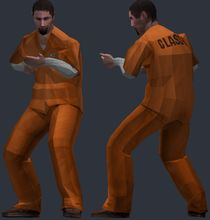 | `models/player/gmod/scp_class_d/scp_class_d.vmdl` | SCP:CB Class-D | [SCP:CB STAFF PLAYERMODELS & NPCS](https://steamcommunity.com/sharedfiles/filedetails/?id=3640396751) by cool_dude1823 | 1662 | compiled |  |
| 3 | 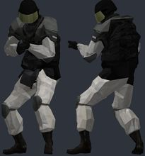 | `models/player/gmod/scp_guard/scp_guard.vmdl` | SCP:CB guard | [SCP:CB STAFF PLAYERMODELS & NPCS](https://steamcommunity.com/sharedfiles/filedetails/?id=3640396751) by cool_dude1823 | 18310 | compiled |  |
| 3 | 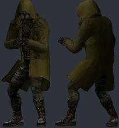 | `models/player/gmod/scp_serpents_hand/scp_serpents_hand.vmdl` | SCP:CB Serpent's Hand | [SCP:CB STAFF PLAYERMODELS & NPCS](https://steamcommunity.com/sharedfiles/filedetails/?id=3640396751) by cool_dude1823 | 77348 | compiled |  |
| 3 | 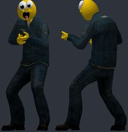 | `models/player/gmod/steamhappy/steamhappy.vmdl` | Steamhappy citizen | [Steamhappy citizen (Playermodel & Ragdoll)](https://steamcommunity.com/sharedfiles/filedetails/?id=3649330814) by aggusn4 | 4523 | compiled |  |
| 3 | 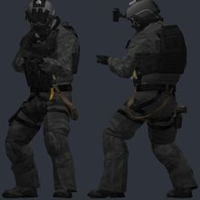 | `models/player/gmod/ua_eclipse_merc/ua_eclipse_merc.vmdl` | Urban Assault: Eclipse Division merc | [Urban Assault Playermodels (WIP)](https://steamcommunity.com/sharedfiles/filedetails/?id=3772745299) by TalonSolid | 16280 | compiled | **WARN** bulky torso: chest 6.0 u further forward than a stock agent; CS2 hand poses (two-handed weapons) will clip into it; hand_R inside the torso in the CS2 preview pose (chest surface 5.7 u in front of the wrist) |
| 3 | 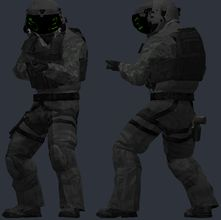 | `models/player/gmod/ua_eclipse_pilot/ua_eclipse_pilot.vmdl` | Urban Assault: Eclipse Division pilot | [Urban Assault Playermodels (WIP)](https://steamcommunity.com/sharedfiles/filedetails/?id=3772745299) by TalonSolid | 27343 | compiled | **WARN** bulky torso: chest 5.8 u further forward than a stock agent; CS2 hand poses (two-handed weapons) will clip into it; hand_R inside the torso in the CS2 preview pose (chest surface 3.9 u in front of the wrist) |
| 3 | 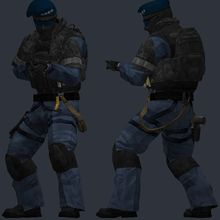 | `models/player/gmod/ua_falcon_commander/ua_falcon_commander.vmdl` | Urban Assault: Falcon commander | [Urban Assault Playermodels (WIP)](https://steamcommunity.com/sharedfiles/filedetails/?id=3772745299) by TalonSolid | 12686 | compiled | **WARN** bulky torso: chest 5.8 u further forward than a stock agent; CS2 hand poses (two-handed weapons) will clip into it; hand_R inside the torso in the CS2 preview pose (chest surface 3.9 u in front of the wrist) |
| 3 | 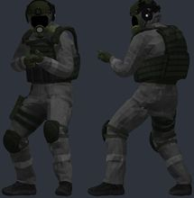 | `models/player/gmod/ua_hmc_security/ua_hmc_security.vmdl` | Urban Assault: HMC security | [Urban Assault Playermodels (WIP)](https://steamcommunity.com/sharedfiles/filedetails/?id=3772745299) by TalonSolid | 30877 | compiled | **WARN** bulky torso: chest 5.6 u further forward than a stock agent; CS2 hand poses (two-handed weapons) will clip into it; hand_R inside the torso in the CS2 preview pose (chest surface 3.1 u in front of the wrist) |
| 3 | 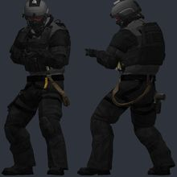 | `models/player/gmod/ua_marcus/ua_marcus.vmdl` | Urban Assault: Marcus | [Urban Assault Playermodels (WIP)](https://steamcommunity.com/sharedfiles/filedetails/?id=3772745299) by TalonSolid | 13093 | compiled | **WARN** bulky torso: chest 5.8 u further forward than a stock agent; CS2 hand poses (two-handed weapons) will clip into it; hand_R inside the torso in the CS2 preview pose (chest surface 3.9 u in front of the wrist) |
| 4 | 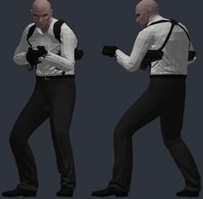 | `models/player/gmod/agent_47/agent_47.vmdl` | Agent 47 | [Hitman Absolution: Agent 47 Playermodel](https://steamcommunity.com/sharedfiles/filedetails/?id=157660704) by Voikanaa | 19896 | compiled | **WARN** possible duplicate of `agent` |
| 4 | 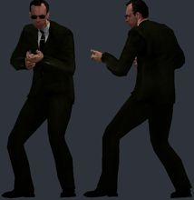 | `models/player/gmod/agent_smith/agent_smith.vmdl` | Agent Smith (The Matrix: Path of Neo) | [Agents (The Matrix: Path of Neo) Player Model/NPC Pack](https://steamcommunity.com/sharedfiles/filedetails/?id=3425493121) by tchaek | 4344 | compiled | **WARN** possible duplicate of `agent_smith_2`, `matrix_neo` |
| 4 | 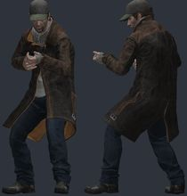 | `models/player/gmod/aiden_pearce/aiden_pearce.vmdl` | Aiden Pearce (Watch Dogs) | [WATCH_DOGS: Aiden Pearce Playermodel](https://steamcommunity.com/sharedfiles/filedetails/?id=295788137) by Voikanaa | 36495 | compiled |  |
| 4 | 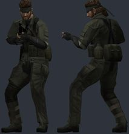 | `models/player/gmod/big_boss/big_boss.vmdl` | Big Boss (MGS3) | [Metal Gear Solid 3: Big Boss Playermodel](https://steamcommunity.com/sharedfiles/filedetails/?id=184512071) by Voikanaa | 4668 | compiled |  |
| 4 | 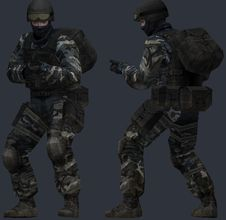 | `models/player/gmod/black_operator/black_operator.vmdl` | BLACK operator | [BLACK (2006) Goons & Operators (Playermodels & NPCs)](https://steamcommunity.com/sharedfiles/filedetails/?id=3215765831) by Kapitano Krunchyman | 2960 | compiled | **WARN** bulky torso: chest 5.9 u further forward than a stock agent; CS2 hand poses (two-handed weapons) will clip into it; hand_R inside the torso in the CS2 preview pose (chest surface 3.7 u in front of the wrist) |
| 4 | 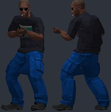 | `models/player/gmod/chester_stone/chester_stone.vmdl` | Chester Stone (HL2 style) | [HL2 "styled" Chester Stone [Playermodel + Ragdoll]](https://steamcommunity.com/sharedfiles/filedetails/?id=3363837903) by Davy | 6314 | compiled |  |
| 4 | 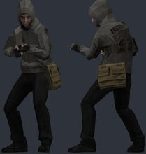 | `models/player/gmod/cof_simon/cof_simon.vmdl` | Simon (Cry of Fear) | [[PM] Simon - Cry Of Fear](https://steamcommunity.com/sharedfiles/filedetails/?id=3249363824) by salvare000 | 3192 | compiled |  |
| 4 | 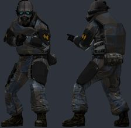 | `models/player/gmod/combine_soldier_pm/combine_soldier_pm.vmdl` | Combine soldier | [[PM] Combine Unit Playermodels (w/accurate c_hands)](https://steamcommunity.com/sharedfiles/filedetails/?id=3411853782) by salvare000 | 4958 | compiled | **WARN** bulky torso: chest 4.2 u further forward than a stock agent; CS2 hand poses (two-handed weapons) will clip into it |
| 4 | 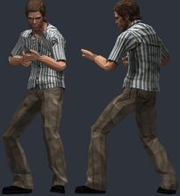 | `models/player/gmod/dexter_morgan/dexter_morgan.vmdl` | Dexter Morgan | [Dexter: The Game Playermodels](https://steamcommunity.com/sharedfiles/filedetails/?id=3826383575) by Chloe Frazer | 3566 | compiled |  |
| 4 | 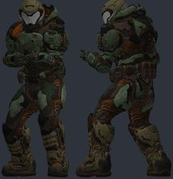 | `models/player/gmod/doom_marine/doom_marine.vmdl` | Doom Marine (DOOM 2016) | [DOOM 2016: Doom Marine (PM&NPC + Ragdoll)](https://steamcommunity.com/sharedfiles/filedetails/?id=3485116477) by Kerosenn | 80937 | compiled | **WARN** bulky torso: chest 4.8 u further forward than a stock agent; CS2 hand poses (two-handed weapons) will clip into it; hand_R inside the torso in the CS2 preview pose (chest surface 3.5 u in front of the wrist) |
| 4 | 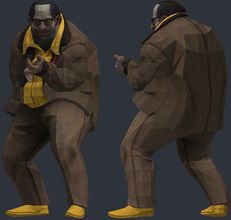 | `models/player/gmod/evrart_claire/evrart_claire.vmdl` | Evrart Claire (Disco Elysium) | [Evrart Claire playermodel + ragdoll [Disco Elysium]](https://steamcommunity.com/sharedfiles/filedetails/?id=3811403972) by hainzofelps | 5404 | compiled | **WARN** bulky torso: chest 7.6 u further forward than a stock agent; CS2 hand poses (two-handed weapons) will clip into it; hand_R inside the torso in the CS2 preview pose (chest surface 5.2 u in front of the wrist) |
| 4 | 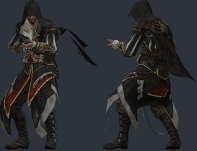 | `models/player/gmod/ezio/ezio.vmdl` | Ezio Auditore | [Assassins Creed II: Ezio Auditore Playermodel](https://steamcommunity.com/sharedfiles/filedetails/?id=237984526) by Voikanaa | 20532 | compiled |  |
| 4 | 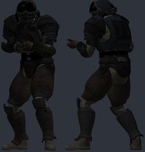 | `models/player/gmod/f76_secret_service/f76_secret_service.vmdl` | Fallout 76 Secret Service | [[F76] Secret Service Soldiers [Playermodel+Ragdoll]](https://steamcommunity.com/sharedfiles/filedetails/?id=3568561943) by Davy | 24268 | compiled |  |
| 4 | 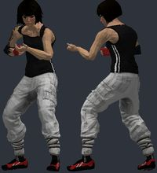 | `models/player/gmod/faith_connors/faith_connors.vmdl` | Faith Connors (Mirror's Edge) | [Mirrors Edge: Faith Connors Playermodel](https://steamcommunity.com/sharedfiles/filedetails/?id=271967400) by Voikanaa | 20655 | compiled |  |
| 4 | 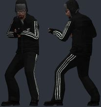 | `models/player/gmod/gopnik_freeman/gopnik_freeman.vmdl` | Gopnik Freeman | [Gopnik Freeman Playermodel](https://steamcommunity.com/sharedfiles/filedetails/?id=3351061882) by TheBigCube | 5087 | compiled |  |
| 4 | 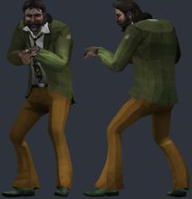 | `models/player/gmod/harry_du_bois/harry_du_bois.vmdl` | Harry Du Bois (Disco Elysium) | [Harry Du Bois aka Tequila Sunset PM & NPC](https://steamcommunity.com/sharedfiles/filedetails/?id=3600797062) by Dakasin | 6276 | compiled |  |
| 4 | 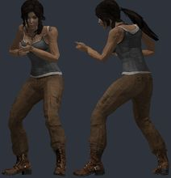 | `models/player/gmod/lara_croft/lara_croft.vmdl` | Lara Croft | [Tomb Raider: Lara Croft Playermodel](https://steamcommunity.com/sharedfiles/filedetails/?id=156925148) by Voikanaa | 23262 | compiled | **WARN** bulky torso: chest 4.9 u further forward than a stock agent; CS2 hand poses (two-handed weapons) will clip into it |
| 4 | 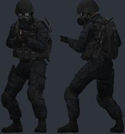 | `models/player/gmod/mw2_soldier/mw2_soldier.vmdl` | MW2 soldier (Viper) | [Viper's Operators Playermodels 'Remastered'](https://steamcommunity.com/sharedfiles/filedetails/?id=636790055) by maJor | 10463 | compiled | **WARN** bulky torso: chest 4.1 u further forward than a stock agent; CS2 hand poses (two-handed weapons) will clip into it |
| 4 | 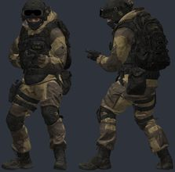 | `models/player/gmod/mw_allegiance/mw_allegiance.vmdl` | MW Allegiance operator | [CoD: Modern Warfare - Allegiance Operator (Playermodel & NPC)](https://steamcommunity.com/sharedfiles/filedetails/?id=2090758421) by kuma7 | 55862 | compiled | **WARN** bulky torso: chest 7.8 u further forward than a stock agent; CS2 hand poses (two-handed weapons) will clip into it; hand_R inside the torso in the CS2 preview pose (chest surface 5.2 u in front of the wrist) |
| 4 | 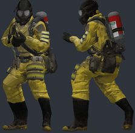 | `models/player/gmod/nbc_hazmat/nbc_hazmat.vmdl` | Tactical NBC hazmat | [[Backrooms] Tactical NBC Hazmat (Mark Blume) [Playermodel]](https://steamcommunity.com/sharedfiles/filedetails/?id=2907374323) by X Ray | 56744 | compiled | **WARN** bulky torso: chest 7.5 u further forward than a stock agent; CS2 hand poses (two-handed weapons) will clip into it; hand_R inside the torso in the CS2 preview pose (chest surface 4.5 u in front of the wrist) |
| 4 | 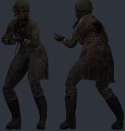 | `models/player/gmod/ncr_ranger/ncr_ranger.vmdl` | NCR Veteran Ranger | [[COMM] NCR Veteran Ranger - [Playermodel]](https://steamcommunity.com/sharedfiles/filedetails/?id=3823590914) by Alvaro | 62128 | compiled |  |
| 4 |  | `models/player/gmod/postal_dude/postal_dude.vmdl` | Postal Dude (Postal X) | [Postal X [PM & NPC]](https://steamcommunity.com/sharedfiles/filedetails/?id=3674111517) by RKiRra | 44474 | compiled | **WARN** possible duplicate of `postal_dude_2` |
| 4 |  | `models/player/gmod/re2_hunk/re2_hunk.vmdl` | HUNK (RE2 Remake) | [Resident Evil 2 Remake - Hunk [PM](https://steamcommunity.com/sharedfiles/filedetails/?id=1639925476) by jolly ol' chap | 67994 | compiled | **WARN** bulky torso: chest 5.6 u further forward than a stock agent; CS2 hand poses (two-handed weapons) will clip into it |
| 4 |  | `models/player/gmod/robber_shirt/robber_shirt.vmdl` | Robber (suits and robbers) | [suits and robbers playermodels](https://steamcommunity.com/sharedfiles/filedetails/?id=412149725) by ムyce | 10112 | compiled | **WARN** bulky torso: chest 7.0 u further forward than a stock agent; CS2 hand poses (two-handed weapons) will clip into it; hand_R inside the torso in the CS2 preview pose (chest surface 6.1 u in front of the wrist) |
| 4 |  | `models/player/gmod/sam_bridges/sam_bridges.vmdl` | Sam Porter Bridges | [DEATH STRANDING - Sam Porter Bridges Playermodel](https://steamcommunity.com/sharedfiles/filedetails/?id=3818416616) by sammy sam | 117980 | compiled |  |
| 4 |  | `models/player/gmod/security_guard/security_guard.vmdl` | Security guard | [Security Guard Playermodels](https://steamcommunity.com/sharedfiles/filedetails/?id=169011381) by Voikanaa | 9187 | compiled |  |
| 4 |  | `models/player/gmod/t800/t800.vmdl` | The Terminator (T-800) | [The Terminator (T-800) [PM/RAG]](https://steamcommunity.com/sharedfiles/filedetails/?id=3589878364) by Terrywitt | 20442 | compiled |  |
| 4 |  | `models/player/gmod/uk_police/uk_police.vmdl` | UK police officer | [UK Police Playermodels](https://steamcommunity.com/sharedfiles/filedetails/?id=229922346) by Voikanaa | 10968 | compiled |  |
| 4 |  | `models/player/gmod/walter_white/walter_white.vmdl` | Walter White | [Walter White Playermodel](https://steamcommunity.com/sharedfiles/filedetails/?id=2787370699) by HarryA | 30284 | compiled | **WARN** hand_L not aligned to CS2 (the rig has no index finger plus an outer finger): fingers will bend about the wrong points; hand_R not aligned to CS2 (the rig has no index finger plus an outer finger): fingers will bend about the wrong points; possible duplicate of `walter_white_2` |
| 4 |  | `models/player/gmod/wesker/wesker.vmdl` | Albert Wesker (RE0) | [Resident Evil 0: HD Remaster - Albert Wesker (Playermodel](https://steamcommunity.com/sharedfiles/filedetails/?id=3101353600) by Chocolat | 22009 | compiled |  |
| 5 |  | `models/player/gmod/ao_joker/ao_joker.vmdl` | Joker (Arkham Origins) | [Arkham Origins Joker NPC/playermodel](https://steamcommunity.com/sharedfiles/filedetails/?id=400762901) by True | 18971 | compiled |  |
| 5 |  | `models/player/gmod/apocalypse_citizen/apocalypse_citizen.vmdl` | Apocalypse citizen | [Apocalypse Citizens (Playermodels)](https://steamcommunity.com/sharedfiles/filedetails/?id=3122592785) by Gunslinger ☢ | 5580 | compiled |  |
| 5 |  | `models/player/gmod/arnold/arnold.vmdl` | Arnold Schwarzenegger | [The Terminator: Arnold Schwarzenegger Playermodel](https://steamcommunity.com/sharedfiles/filedetails/?id=157674327) by Voikanaa | 3215 | compiled |  |
| 5 |  | `models/player/gmod/assassin_walter/assassin_walter.vmdl` | Assassin Walter White | [Assassin Walter White Playermodel and Ragdoll](https://steamcommunity.com/sharedfiles/filedetails/?id=3677776589) by Igloo enjoyer | 21502 | compiled |  |
| 5 |  | `models/player/gmod/async_personnel/async_personnel.vmdl` | A-Sync personnel (hazmat) | [[Backrooms] A-Sync Personnel (Hazmat) [Playermodel + Ragdoll]](https://steamcommunity.com/sharedfiles/filedetails/?id=2857328584) by X Ray | 98093 | compiled | **WARN** bulky torso: chest 6.7 u further forward than a stock agent; CS2 hand poses (two-handed weapons) will clip into it; hand_R inside the torso in the CS2 preview pose (chest surface 5.2 u in front of the wrist) |
| 5 |  | `models/player/gmod/batman_mk/batman_mk.vmdl` | Batman (MK vs DCU) | [Batman Playermodel](https://steamcommunity.com/sharedfiles/filedetails/?id=141049673) by cowboy | 15956 | compiled |  |
| 5 |  | `models/player/gmod/cgi_death/cgi_death.vmdl` | Death (Clone Wars CGI trooper) | [CGI Death Playermodel v 1.1](https://steamcommunity.com/sharedfiles/filedetails/?id=2822953104) by ? | 10999 | compiled | **WARN** bulky torso: chest 4.5 u further forward than a stock agent; CS2 hand poses (two-handed weapons) will clip into it; hand_R inside the torso in the CS2 preview pose (chest surface 3.0 u in front of the wrist) |
| 5 |  | `models/player/gmod/clone_anakin/clone_anakin.vmdl` | General Anakin (Clone Wars 2003) | [SW: Clone Wars 2003 / Playermodel Pack](https://steamcommunity.com/sharedfiles/filedetails/?id=3743556887) by Bananakin | 18782 | compiled | **WARN** hand_L not aligned to CS2 (the rig has no index finger plus an outer finger): fingers will bend about the wrong points; hand_R not aligned to CS2 (the rig has no index finger plus an outer finger): fingers will bend about the wrong points |
| 5 |  | `models/player/gmod/corvo/corvo.vmdl` | Corvo (Dishonored) | [Corvo playermodel](https://steamcommunity.com/sharedfiles/filedetails/?id=159269477) by Alpharius | 13201 | compiled |  |
| 5 |  | `models/player/gmod/crysis_cell/crysis_cell.vmdl` | C.E.L.L. operative (Crysis) | [Crysis C.E.L.L. Assault Operative NPCs and Playermodels](https://steamcommunity.com/sharedfiles/filedetails/?id=221823653) by Professor Heavy | 14286 | compiled | **WARN** bulky torso: chest 6.5 u further forward than a stock agent; CS2 hand poses (two-handed weapons) will clip into it; hand_R inside the torso in the CS2 preview pose (chest surface 4.9 u in front of the wrist) |
| 5 |  | `models/player/gmod/csgo_pirate/csgo_pirate.vmdl` | CS:GO pirate | [Counter Strike: Global Offensive T Playermodels and NPCs](https://steamcommunity.com/sharedfiles/filedetails/?id=481607813) by Professor Heavy | 13202 | compiled |  |
| 5 |  | `models/player/gmod/csgo_st6/csgo_st6.vmdl` | CS:GO SEAL Team 6 | [Counter Strike: Global Offensive CT Playermodels and NPCs](https://steamcommunity.com/sharedfiles/filedetails/?id=481358078) by Professor Heavy | 16388 | compiled | **WARN** bulky torso: chest 5.7 u further forward than a stock agent; CS2 hand poses (two-handed weapons) will clip into it; hand_R inside the torso in the CS2 preview pose (chest surface 4.0 u in front of the wrist) |
| 5 |  | `models/player/gmod/daft_punk/daft_punk.vmdl` | Daft Punk (gold) | [Daft Punk Player Models](https://steamcommunity.com/sharedfiles/filedetails/?id=148628139) by Wayne | 8844 | compiled |  |
| 5 |  | `models/player/gmod/darth_vader/darth_vader.vmdl` | Darth Vader | [STAR WARS Darth Vader Playermodel](https://steamcommunity.com/sharedfiles/filedetails/?id=452065494) by Voikanaa | 24297 | compiled | **WARN** possible duplicate of `bp_vader` |
| 5 |  | `models/player/gmod/deadpool/deadpool.vmdl` | Deadpool | [Deadpool Playermodel](https://steamcommunity.com/sharedfiles/filedetails/?id=200700693) by o u t l a w | 29364 | compiled | **WARN** possible duplicate of `deadpool_2` |
| 5 |  | `models/player/gmod/deathstroke/deathstroke.vmdl` | Deathstroke (Arkham Origins) | [DeathStroke PlayerModel](https://steamcommunity.com/sharedfiles/filedetails/?id=204411482) by r9 | 23785 | compiled | **WARN** bulky torso: chest 5.6 u further forward than a stock agent; CS2 hand poses (two-handed weapons) will clip into it |
| 5 |  | `models/player/gmod/donald_trump/donald_trump.vmdl` | Donald Trump | [Donald Trump Playermodel](https://steamcommunity.com/sharedfiles/filedetails/?id=722374307) by Buu342 | 23723 | compiled | **WARN** possible duplicate of `donald_trump_2` |
| 5 |  | `models/player/gmod/doom_slayer/doom_slayer.vmdl` | Doom Slayer (Eternal) | [DooM Eternal - Doom Slayer [PM]](https://steamcommunity.com/sharedfiles/filedetails/?id=2039547466) by o u t l a w | 40779 | compiled | **WARN** bulky torso: chest 5.2 u further forward than a stock agent; CS2 hand poses (two-handed weapons) will clip into it |
| 5 |  | `models/player/gmod/dovahkiin/dovahkiin.vmdl` | Dovahkiin (Skyrim) | [The Elder Scrolls V Skyrim: Dovahkiin Playermodel](https://steamcommunity.com/sharedfiles/filedetails/?id=156922874) by Voikanaa | 13910 | compiled |  |
| 5 |  | `models/player/gmod/edward_kenway/edward_kenway.vmdl` | Edward Kenway (AC IV) | [Assassins Creed IV: Edward Kenway Playermodel](https://steamcommunity.com/sharedfiles/filedetails/?id=238213159) by Voikanaa | 29044 | compiled |  |
| 5 |  | `models/player/gmod/fbi_agent/fbi_agent.vmdl` | FBI agent | [FBI Playermodels](https://steamcommunity.com/sharedfiles/filedetails/?id=107411755) by Voikanaa | 5886 | compiled |  |
| 5 |  | `models/player/gmod/fo3_tesla_armor/fo3_tesla_armor.vmdl` | Tesla power armour (Fallout 3) | [Fallout 3 Player Models](https://steamcommunity.com/sharedfiles/filedetails/?id=133401340) by Knuckle | 17150 | compiled | **WARN** bulky torso: chest 8.9 u further forward than a stock agent; CS2 hand poses (two-handed weapons) will clip into it; hand_R inside the torso in the CS2 preview pose (chest surface 8.8 u in front of the wrist) |
| 5 |  | `models/player/gmod/genji/genji.vmdl` | Genji (Overwatch) | [Overwatch - Genji Playermodel/Ragdoll](https://steamcommunity.com/sharedfiles/filedetails/?id=706860888) by SeroRonin | 31690 | compiled |  |
| 5 |  | `models/player/gmod/ghost_rider/ghost_rider.vmdl` | Ghost Rider | [Ghost Rider Playermodel](https://steamcommunity.com/sharedfiles/filedetails/?id=313268673) by Rokay | 11836 | compiled |  |
| 5 |  | `models/player/gmod/green_goblin/green_goblin.vmdl` | Green Goblin | [Green Goblin Playermodels](https://steamcommunity.com/sharedfiles/filedetails/?id=3811516550) by FRITAS | 23250 | compiled |  |
| 5 |  | `models/player/gmod/grim_reaper/grim_reaper.vmdl` | Grim Reaper | [(Working) Grim Reaper Playermodel](https://steamcommunity.com/sharedfiles/filedetails/?id=288629547) by ? | 8927 | compiled |  |
| 5 |  | `models/player/gmod/gta5_michael/gta5_michael.vmdl` | Michael (GTA 5) | [GTA 5 Playermodels](https://steamcommunity.com/sharedfiles/filedetails/?id=216408135) by Dusty | 24868 | compiled | **WARN** possible duplicate of `michael` |
| 5 |  | `models/player/gmod/gtaiv_male/gtaiv_male.vmdl` | GTA IV multiplayer male | [Grand Theft Auto IV Multiplayer Characters [PMs; NPCs; Ragdolls]](https://steamcommunity.com/sharedfiles/filedetails/?id=3660594257) by BęŁkÁ 🐿 | 5244 | compiled |  |
| 5 |  | `models/player/gmod/halo3_spartan/halo3_spartan.vmdl` | Halo 3 Spartan | [Halo 3 Spartan Playermodels (MPSC)](https://steamcommunity.com/sharedfiles/filedetails/?id=283815805) by Vipes | 5390 | compiled |  |
| 5 |  | `models/player/gmod/halo4_chief/halo4_chief.vmdl` | Master Chief (Halo 4) | [Halo 4 - Master Chief (NPC/Playermodel/Ragdoll)](https://steamcommunity.com/sharedfiles/filedetails/?id=139247091) by Dusty | 24644 | compiled | **WARN** bulky torso: chest 4.6 u further forward than a stock agent; CS2 hand poses (two-handed weapons) will clip into it |
| 5 |  | `models/player/gmod/han_solo/han_solo.vmdl` | Han Solo | [STAR WARS Han Solo and Chewbacca Playermodels](https://steamcommunity.com/sharedfiles/filedetails/?id=448581592) by Voikanaa | 8424 | compiled |  |
| 5 |  | `models/player/gmod/heavy_combine/heavy_combine.vmdl` | Heavy Combine soldier | [Heavy Combine NPCs and Playermodels](https://steamcommunity.com/sharedfiles/filedetails/?id=188562859) by Professor Heavy | 12569 | compiled | **WARN** bulky torso: chest 5.3 u further forward than a stock agent; CS2 hand poses (two-handed weapons) will clip into it; hand_R inside the torso in the CS2 preview pose (chest surface 3.4 u in front of the wrist) |
| 5 |  | `models/player/gmod/iron_man/iron_man.vmdl` | Iron Man (Mark 7) | [Iron Man [Playermodel/NPC]](https://steamcommunity.com/sharedfiles/filedetails/?id=158326196) by Dusty | 7796 | compiled |  |
| 5 |  | `models/player/gmod/jason_savini/jason_savini.vmdl` | Jason Voorhees (Savini) | [Friday the 13th - Savini Jason (PM+NPC)](https://steamcommunity.com/sharedfiles/filedetails/?id=951736106) by Konnie | 93024 | compiled |  |
| 5 |  | `models/player/gmod/john_cena/john_cena.vmdl` | John Cena | [John Cena Playermodel](https://steamcommunity.com/sharedfiles/filedetails/?id=546377707) by FZone96 | 16582 | compiled |  |
| 5 |  | `models/player/gmod/kapkan/kapkan.vmdl` | Kapkan (Rainbow Six Siege) | [R6S: Kapkan P.M. and Ragdoll](https://steamcommunity.com/sharedfiles/filedetails/?id=572447657) by Lenoax | 42298 | compiled | **WARN** bulky torso: chest 4.8 u further forward than a stock agent; CS2 hand poses (two-handed weapons) will clip into it; hand_R inside the torso in the CS2 preview pose (chest surface 3.5 u in front of the wrist) |
| 5 |  | `models/player/gmod/kylo_ren/kylo_ren.vmdl` | Kylo Ren | [Kylo Ren : The Force Awakens PlayerModel](https://steamcommunity.com/sharedfiles/filedetails/?id=599977698) by Acrow | 7804 | compiled |  |
| 5 |  | `models/player/gmod/luke_skywalker/luke_skywalker.vmdl` | Luke Skywalker | [STAR WARS Luke Skywalker Playermodel](https://steamcommunity.com/sharedfiles/filedetails/?id=450353431) by Voikanaa | 7422 | compiled |  |
| 5 |  | `models/player/gmod/mace_windu/mace_windu.vmdl` | Mace Windu | [Sith & Jedi Playermodel Pack](https://steamcommunity.com/sharedfiles/filedetails/?id=518960557) by J0kingg | 8423 | compiled |  |
| 5 |  | `models/player/gmod/madness_hank/madness_hank.vmdl` | Hank (Madness Combat) | [[Madness Combat] Hank - [Playermodel]](https://steamcommunity.com/sharedfiles/filedetails/?id=3051673992) by Alvaro | 11686 | compiled |  |
| 5 |  | `models/player/gmod/mandalorian/mandalorian.vmdl` | Mandalorian bounty hunter | [Star Wars: Mandalorian Bounty Hunter (playermodel & NPC)](https://steamcommunity.com/sharedfiles/filedetails/?id=617141518) by Porky-da-Corgi | 17429 | compiled |  |
| 5 |  | `models/player/gmod/mgs2_snake/mgs2_snake.vmdl` | Solid Snake (MGS2) | [MGS2 Solid Snake Playermodel (Outdated)](https://steamcommunity.com/sharedfiles/filedetails/?id=471518115) by Aaron No. 893 | 5934 | compiled | **WARN** bulky torso: chest 5.4 u further forward than a stock agent; CS2 hand poses (two-handed weapons) will clip into it; hand_R inside the torso in the CS2 preview pose (chest surface 3.5 u in front of the wrist) |
| 5 |  | `models/player/gmod/nanosuit/nanosuit.vmdl` | Nanosuit 2 (Crysis 2) | [Crysis 2 - Nanosuit 2 NPC and Playermodel](https://steamcommunity.com/sharedfiles/filedetails/?id=124565516) by Nightmare Ω | 19454 | compiled |  |
| 5 |  | `models/player/gmod/ow_reaper/ow_reaper.vmdl` | Reaper (Overwatch) | [OW- Reaper Playermodel](https://steamcommunity.com/sharedfiles/filedetails/?id=726069482) by Zynth | 22690 | compiled | **WARN** bulky torso: chest 4.1 u further forward than a stock agent; CS2 hand poses (two-handed weapons) will clip into it |
| 5 |  | `models/player/gmod/palpatine/palpatine.vmdl` | Emperor Palpatine | [STAR WARS Emperor Palpatine Playermodel](https://steamcommunity.com/sharedfiles/filedetails/?id=457212613) by Voikanaa | 7372 | compiled | **WARN** possible duplicate of `emperor_palpatine` |
| 5 |  | `models/player/gmod/pmc_operator/pmc_operator.vmdl` | PMC operator | [PMC playermodels](https://steamcommunity.com/sharedfiles/filedetails/?id=232636218) by maJor | 16517 | compiled | **WARN** bulky torso: chest 4.4 u further forward than a stock agent; CS2 hand poses (two-handed weapons) will clip into it; hand_R inside the torso in the CS2 preview pose (chest surface 4.5 u in front of the wrist); possible duplicate of `pmc_operator2` |
| 5 |  | `models/player/gmod/raiden/raiden.vmdl` | Raiden (MGR prologue) | [Metal Gear Raiden Player Model Pack](https://steamcommunity.com/sharedfiles/filedetails/?id=257102395) by KraiKKonen11 | 21134 | compiled |  |
| 5 |  | `models/player/gmod/raven_team_leader/raven_team_leader.vmdl` | Raven Team Leader (Fortnite) | [Fortnite: Raven Team Leader (Playermodel + Ragdoll)](https://steamcommunity.com/sharedfiles/filedetails/?id=3105637302) by keepitwilde | 58462 | compiled |  |
| 5 |  | `models/player/gmod/re_vector/re_vector.vmdl` | Vector (RE Raccoon City) | [Resident Evil - Vector Playermodel](https://steamcommunity.com/sharedfiles/filedetails/?id=220687225) by Vipes | 13077 | compiled | **WARN** bulky torso: chest 5.9 u further forward than a stock agent; CS2 hand poses (two-handed weapons) will clip into it; hand_R inside the torso in the CS2 preview pose (chest surface 4.1 u in front of the wrist) |
| 5 |  | `models/player/gmod/santa/santa.vmdl` | Santa Claus | [Santa Claus Playermodel and NPC](https://steamcommunity.com/sharedfiles/filedetails/?id=572267883) by Voikanaa | 7335 | compiled | **WARN** bulky torso: chest 5.7 u further forward than a stock agent; CS2 hand poses (two-handed weapons) will clip into it; hand_R inside the torso in the CS2 preview pose (chest surface 5.5 u in front of the wrist) |
| 5 |  | `models/player/gmod/skyrim_daedric/skyrim_daedric.vmdl` | Daedric armour (Skyrim) | [The Elder Scrolls V Skyrim: Daedric Playermodel](https://steamcommunity.com/sharedfiles/filedetails/?id=175697854) by Voikanaa | 9394 | compiled | **WARN** bulky torso: chest 4.9 u further forward than a stock agent; CS2 hand poses (two-handed weapons) will clip into it |
| 5 |  | `models/player/gmod/spiderman/spiderman.vmdl` | Spider-Man | [Spiderman - Ultimate Playermodel Bundle](https://steamcommunity.com/sharedfiles/filedetails/?id=1418637320) by Kryptonite | 2914 | compiled |  |
| 5 |  | `models/player/gmod/squid_soldier/squid_soldier.vmdl` | Squid Game soldier (BO6) | [COD:BO6 x Squid Game 2 - Worker/Soldier/Manager [Playermodels/ PM]](https://steamcommunity.com/sharedfiles/filedetails/?id=3401898295) by Artyom | 125608 | compiled |  |
| 5 |  | `models/player/gmod/thanos/thanos.vmdl` | Thanos | [Thanos - Avengers: Infinity War Playermodel](https://steamcommunity.com/sharedfiles/filedetails/?id=1371823037) by Kryptonite | 6687 | compiled | **WARN** bulky torso: chest 4.2 u further forward than a stock agent; CS2 hand poses (two-handed weapons) will clip into it |
| 5 |  | `models/player/gmod/tron_anon/tron_anon.vmdl` | TRON Anon | [TRON Anon Playermodel](https://steamcommunity.com/sharedfiles/filedetails/?id=241187700) by Rokay | 9804 | compiled |  |
| 6 |  | `models/player/gmod/art_clown/art_clown.vmdl` | Art the Clown | [Art the Clown / Playermodel](https://steamcommunity.com/sharedfiles/filedetails/?id=3829024645) by ๋ | 31648 | compiled |  |
| 6 |  | `models/player/gmod/banana_combine/banana_combine.vmdl` | Banana Combine | [Banana Combine Playermodel](https://steamcommunity.com/sharedfiles/filedetails/?id=3824585333) by bucketofdrums | 7350 | compiled | **WARN** bulky torso: chest 6.8 u further forward than a stock agent; CS2 hand poses (two-handed weapons) will clip into it; hand_R inside the torso in the CS2 preview pose (chest surface 5.3 u in front of the wrist); stand-in/glass: combinesoldiersheet |
| 6 |  | `models/player/gmod/big_dew/big_dew.vmdl` | Big Dew (DewRitos) | [DewRitos Playermodels](https://steamcommunity.com/sharedfiles/filedetails/?id=232539187) by ellie | 1210 | compiled | **WARN** hand_L not aligned to CS2 (the rig has no index finger plus an outer finger): fingers will bend about the wrong points; hand_R not aligned to CS2 (the rig has no index finger plus an outer finger): fingers will bend about the wrong points |
| 6 |  | `models/player/gmod/chicken_dude/chicken_dude.vmdl` | Chicken citizen | [Bird Citizen Playermodels + NPCs](https://steamcommunity.com/sharedfiles/filedetails/?id=3062759591) by Serika | 6030 | compiled |  |
| 6 |  | `models/player/gmod/crow_dude/crow_dude.vmdl` | Crow citizen | [Bird Citizen Playermodels + NPCs](https://steamcommunity.com/sharedfiles/filedetails/?id=3062759591) by Serika | 2552 | compiled |  |
| 6 |  | `models/player/gmod/ena/ena.vmdl` | ENA | [ENA[Joel G] Playermodel](https://steamcommunity.com/sharedfiles/filedetails/?id=2242241647) by 엽떡 시켰는데 안 엽기적이라고 환불한 엔냥이 | 11416 | compiled |  |
| 6 |  | `models/player/gmod/funny_rat/funny_rat.vmdl` | Funny Rat | [Funny Rat Playermodel](https://steamcommunity.com/sharedfiles/filedetails/?id=2793580726) by Electric Blood Mage | 835 | compiled | **WARN** bulky torso: chest 4.4 u further forward than a stock agent; CS2 hand poses (two-handed weapons) will clip into it; skeleton does not match CS2 (limb joints more than 5 u off: leg_lower_L 5.2, leg_lower_R 5.3, leg_upper_L 13.4, leg_upper_R 13.4): CS2 will bend the limbs away from the joints of the model; hand_L not aligned to CS2 (the rig has no index finger plus an outer finger): fingers will bend about the wrong points; hand_R not aligned to CS2 (the rig has no index finger plus an outer finger): fingers will bend about the wrong points |
| 6 |  | `models/player/gmod/gmod_chan/gmod_chan.vmdl` | Gmod-chan | [Gmod-Chan Playermodel (PM)](https://steamcommunity.com/sharedfiles/filedetails/?id=3759475080) by TopWay | 6193 | compiled | **WARN** skeleton does not match CS2 (limb joints more than 5 u off: leg_lower_L 7.5, leg_lower_R 7.5, leg_upper_L 8.2, leg_upper_R 8.2): CS2 will bend the limbs away from the joints of the model |
| 6 |  | `models/player/gmod/homer/homer.vmdl` | Homer Simpson | [Homer Simpson [High Quality Model] (The Simpsons) Playermodel & NPC](https://steamcommunity.com/sharedfiles/filedetails/?id=2599659126) by Hell Inspector | 24574 | compiled | **WARN** bulky torso: chest 4.4 u further forward than a stock agent; CS2 hand poses (two-handed weapons) will clip into it; skeleton does not match CS2 (limb joints more than 5 u off: leg_upper_L 6.4, leg_upper_R 6.4): CS2 will bend the limbs away from the joints of the model |
| 6 |  | `models/player/gmod/jonkler/jonkler.vmdl` | Jonkler | [Jonkler playermodel](https://steamcommunity.com/sharedfiles/filedetails/?id=3743617033) by Pirata Manhattan | 19113 | compiled |  |
| 6 |  | `models/player/gmod/kermit/kermit.vmdl` | Kermit the Frog | [Kermit The Frog Player Model & NPC](https://steamcommunity.com/sharedfiles/filedetails/?id=485879458) by Lord Shoopington | 13446 | compiled | **WARN** hand_L fingers sit 2.4 u from their CS2 finger bones: CS2 finger curls will distort them; hand_R fingers sit 2.3 u from their CS2 finger bones: CS2 finger curls will distort them |
| 6 |  | `models/player/gmod/low_tier_god/low_tier_god.vmdl` | Low Tier God | [Low Tier God (HL2 Style) Playermodel](https://steamcommunity.com/sharedfiles/filedetails/?id=3677358615) by panman | 4923 | compiled |  |
| 6 |  | `models/player/gmod/meeseeks/meeseeks.vmdl` | Mr. Meeseeks | [Mr. Meeseeks playermodel & NPC](https://steamcommunity.com/sharedfiles/filedetails/?id=550768935) by Hummy_Seed | 10244 | compiled | **WARN** hand_L not aligned to CS2 (the rig has no index finger plus an outer finger): fingers will bend about the wrong points |
| 6 |  | `models/player/gmod/msn_stickman/msn_stickman.vmdl` | MSN stick figure | [MSN Stick Figure [Playermodel+Sounds]](https://steamcommunity.com/sharedfiles/filedetails/?id=3566617779) by Davy | 6854 | compiled |  |
| 6 |  | `models/player/gmod/old_wizard/old_wizard.vmdl` | The Wizard | [The Wizard (Playermodel/NPCs)](https://steamcommunity.com/sharedfiles/filedetails/?id=3375440207) by Electric Kool-Aid | 10185 | compiled | **WARN** bulky torso: chest 5.2 u further forward than a stock agent; CS2 hand poses (two-handed weapons) will clip into it; hand_R inside the torso in the CS2 preview pose (chest surface 3.3 u in front of the wrist); skeleton does not match CS2 (limb joints more than 5 u off: leg_lower_L 11.7, leg_lower_R 11.6, leg_upper_L 9.6, leg_upper_R 9.5): CS2 will bend the limbs away from the joints of the model |
| 6 |  | `models/player/gmod/peashooter/peashooter.vmdl` | Peashooter Dancer | [Peashooter Dancer Playermodel](https://steamcommunity.com/sharedfiles/filedetails/?id=3129140947) by Electric Blood Mage | 5615 | compiled |  |
| 6 |  | `models/player/gmod/pigeon_dude/pigeon_dude.vmdl` | Pigeon citizen | [Bird Citizen Playermodels + NPCs](https://steamcommunity.com/sharedfiles/filedetails/?id=3062759591) by Serika | 3576 | compiled |  |
| 6 |  | `models/player/gmod/po/po.vmdl` | Po (Teletubbies) | [Teletubbies Playermodel + NPC](https://steamcommunity.com/sharedfiles/filedetails/?id=356485444) by manatails | 2650 | compiled | **WARN** bulky torso: chest 4.5 u further forward than a stock agent; CS2 hand poses (two-handed weapons) will clip into it; hand_L not aligned to CS2 (the rig has no index finger plus an outer finger): fingers will bend about the wrong points; hand_R not aligned to CS2 (the rig has no index finger plus an outer finger): fingers will bend about the wrong points |
| 6 |  | `models/player/gmod/rick_sanchez/rick_sanchez.vmdl` | Rick Sanchez | [Rick playermodel](https://steamcommunity.com/sharedfiles/filedetails/?id=557711922) by Hummy_Seed | 16906 | compiled |  |
| 6 |  | `models/player/gmod/saxton_hale/saxton_hale.vmdl` | Saxton Hale | [[TF2] Saxton Hale Playermodel (VSH)](https://steamcommunity.com/sharedfiles/filedetails/?id=3822321444) by danishevsky | 19094 | compiled |  |
| 6 |  | `models/player/gmod/scary_man/scary_man.vmdl` | Scary Man | [Scary Man Playermodel + NPCS](https://steamcommunity.com/sharedfiles/filedetails/?id=3827997124) by Brendan Makes | 4084 | compiled | **WARN** skeleton does not match CS2 (limb joints more than 5 u off: arm_lower_L 5.2, arm_lower_R 5.2): CS2 will bend the limbs away from the joints of the model |
| 6 |  | `models/player/gmod/skull_trumpet/skull_trumpet.vmdl` | Skull Trumpet (doot) | [Authentic Skull Trumpet (Playermodel)](https://steamcommunity.com/sharedfiles/filedetails/?id=3144011868) by xinus22 | 9096 | compiled | stand-in/glass: eyeball_r, eyeball_l |
| 6 |  | `models/player/gmod/spanish_skeleton/spanish_skeleton.vmdl` | Esqueleto Loquendo | [Chilean Skeleton Playermodel (Esqueleto Loquendo)](https://steamcommunity.com/sharedfiles/filedetails/?id=2801750344) by гадя хренова | 30617 | compiled |  |
| 6 |  | `models/player/gmod/tf2_engie/tf2_engie.vmdl` | Engineer (TF2) | [TF2 Player Model Pack](https://steamcommunity.com/sharedfiles/filedetails/?id=352668843) by Eligia | 7628 | compiled |  |
| 6 |  | `models/player/gmod/tf2_heavy/tf2_heavy.vmdl` | Heavy (TF2) | [TF2 Player Model Pack](https://steamcommunity.com/sharedfiles/filedetails/?id=352668843) by Eligia | 7346 | compiled | **WARN** bulky torso: chest 5.4 u further forward than a stock agent; CS2 hand poses (two-handed weapons) will clip into it; hand_L not aligned to CS2 (the rig has no index finger plus an outer finger): fingers will bend about the wrong points; hand_R not aligned to CS2 (the rig has no index finger plus an outer finger): fingers will bend about the wrong points |
| 6 |  | `models/player/gmod/tf2_sniper/tf2_sniper.vmdl` | Sniper (TF2) | [TF2 Player Model Pack](https://steamcommunity.com/sharedfiles/filedetails/?id=352668843) by Eligia | 6710 | compiled |  |
| 6 |  | `models/player/gmod/tinky_winky/tinky_winky.vmdl` | Tinky Winky (Teletubbies) | [Teletubbies Playermodel + NPC](https://steamcommunity.com/sharedfiles/filedetails/?id=356485444) by manatails | 2590 | compiled | **WARN** bulky torso: chest 4.5 u further forward than a stock agent; CS2 hand poses (two-handed weapons) will clip into it; hand_L not aligned to CS2 (the rig has no index finger plus an outer finger): fingers will bend about the wrong points; hand_R not aligned to CS2 (the rig has no index finger plus an outer finger): fingers will bend about the wrong points |
| 6 |  | `models/player/gmod/trex/trex.vmdl` | T. Rex | [T. Rex Playermodel](https://steamcommunity.com/sharedfiles/filedetails/?id=612053603) by 2XMM2 | 10438 | compiled |  |
| 6 |  | `models/player/gmod/troll_face/troll_face.vmdl` | Troll Face | [Rage Faces / Troll Face Playermodels and NPCs](https://steamcommunity.com/sharedfiles/filedetails/?id=2251043099) by Petaly | 5368 | compiled |  |
| 6 |  | `models/player/gmod/voldemort/voldemort.vmdl` | Lord Voldemort | [Lord Voldemort](https://steamcommunity.com/sharedfiles/filedetails/?id=659329169) by Voikanaa | 9899 | compiled |  |
| 6 |  | `models/player/gmod/woody/woody.vmdl` | Woody (Toy Story) | [Toy Story: Woody Playermodel](https://steamcommunity.com/sharedfiles/filedetails/?id=156924206) by Voikanaa | 2201 | compiled | **WARN** hand_L not aligned to CS2 (the rig has no index finger plus an outer finger): fingers will bend about the wrong points; hand_R not aligned to CS2 (the rig has no index finger plus an outer finger): fingers will bend about the wrong points |
| 7 |  | `models/player/gmod/apoc_female/apoc_female.vmdl` | Apocalypse survivor (female) | [Apocalypse Citizens (Playermodels)](https://steamcommunity.com/sharedfiles/filedetails/?id=3122592785) by Gunslinger ☢ | 4282 | compiled |  |
| 7 |  | `models/player/gmod/b2_droid/b2_droid.vmdl` | B2 battle droid | [SW: Clone Wars 2003 / Playermodel Pack](https://steamcommunity.com/sharedfiles/filedetails/?id=3743556887) by Bananakin | 11080 | compiled | **WARN** hand_L not aligned to CS2 (the rig has no index finger plus an outer finger): fingers will bend about the wrong points; hand_R not aligned to CS2 (the rig has no index finger plus an outer finger): fingers will bend about the wrong points |
| 7 |  | `models/player/gmod/black_enforcer/black_enforcer.vmdl` | BLACK enforcer | [BLACK (2006) Goons & Operators (Playermodels & NPCs)](https://steamcommunity.com/sharedfiles/filedetails/?id=3215765831) by Kapitano Krunchyman | 2948 | compiled |  |
| 7 |  | `models/player/gmod/black_riot/black_riot.vmdl` | BLACK riot grunt | [BLACK (2006) Goons & Operators (Playermodels & NPCs)](https://steamcommunity.com/sharedfiles/filedetails/?id=3215765831) by Kapitano Krunchyman | 2743 | compiled |  |
| 7 |  | `models/player/gmod/bo1_nikolai/bo1_nikolai.vmdl` | Nikolai (BO1 Ultimis) | [CoD: BO1 - Ultimis Playermodels](https://steamcommunity.com/sharedfiles/filedetails/?id=3715032179) by Hidden | 8175 | compiled | **WARN** bulky torso: chest 7.0 u further forward than a stock agent; CS2 hand poses (two-handed weapons) will clip into it; hand_R inside the torso in the CS2 preview pose (chest surface 5.2 u in front of the wrist) |
| 7 |  | `models/player/gmod/bo1_richtofen/bo1_richtofen.vmdl` | Richtofen (BO1 Ultimis) | [CoD: BO1 - Ultimis Playermodels](https://steamcommunity.com/sharedfiles/filedetails/?id=3715032179) by Hidden | 7426 | compiled |  |
| 7 |  | `models/player/gmod/bossk/bossk.vmdl` | Bossk | [SW: Clone Wars 2003 / Playermodel Pack](https://steamcommunity.com/sharedfiles/filedetails/?id=3743556887) by Bananakin | 5734 | compiled | **WARN** hand_L not aligned to CS2 (the rig has no index finger plus an outer finger): fingers will bend about the wrong points; hand_R not aligned to CS2 (the rig has no index finger plus an outer finger): fingers will bend about the wrong points |
| 7 |  | `models/player/gmod/chewbacca/chewbacca.vmdl` | Chewbacca | [STAR WARS Han Solo and Chewbacca Playermodels](https://steamcommunity.com/sharedfiles/filedetails/?id=448581592) by Voikanaa | 7650 | compiled | **WARN** bulky torso: chest 4.3 u further forward than a stock agent; CS2 hand poses (two-handed weapons) will clip into it |
| 7 |  | `models/player/gmod/combine_elite_pm/combine_elite_pm.vmdl` | Combine Elite | [[PM] Combine Unit Playermodels (w/accurate c_hands)](https://steamcommunity.com/sharedfiles/filedetails/?id=3411853782) by salvare000 | 5395 | compiled | **WARN** bulky torso: chest 4.4 u further forward than a stock agent; CS2 hand poses (two-handed weapons) will clip into it |
| 7 |  | `models/player/gmod/crysis_cell2/crysis_cell2.vmdl` | C.E.L.L. operative (2) | [Crysis C.E.L.L. Assault Operative NPCs and Playermodels](https://steamcommunity.com/sharedfiles/filedetails/?id=221823653) by Professor Heavy | 16586 | compiled | **WARN** bulky torso: chest 7.1 u further forward than a stock agent; CS2 hand poses (two-handed weapons) will clip into it; hand_R inside the torso in the CS2 preview pose (chest surface 6.8 u in front of the wrist) |
| 7 |  | `models/player/gmod/csgo_anarchist/csgo_anarchist.vmdl` | CS:GO Anarchist | [Counter Strike: Global Offensive T Playermodels and NPCs](https://steamcommunity.com/sharedfiles/filedetails/?id=481607813) by Professor Heavy | 13180 | compiled |  |
| 7 |  | `models/player/gmod/csgo_balkan/csgo_balkan.vmdl` | CS:GO Balkan | [Counter Strike: Global Offensive T Playermodels and NPCs](https://steamcommunity.com/sharedfiles/filedetails/?id=481607813) by Professor Heavy | 13592 | compiled | stand-in/glass: balkanterroristlowerbody_d1, tm_balkan_head_varianta |
| 7 |  | `models/player/gmod/csgo_fbi/csgo_fbi.vmdl` | CS:GO FBI | [Counter Strike: Global Offensive CT Playermodels and NPCs](https://steamcommunity.com/sharedfiles/filedetails/?id=481358078) by Professor Heavy | 15487 | compiled | **WARN** bulky torso: chest 5.3 u further forward than a stock agent; CS2 hand poses (two-handed weapons) will clip into it; hand_R inside the torso in the CS2 preview pose (chest surface 3.2 u in front of the wrist) |
| 7 |  | `models/player/gmod/csgo_gign/csgo_gign.vmdl` | CS:GO GIGN | [Counter Strike: Global Offensive CT Playermodels and NPCs](https://steamcommunity.com/sharedfiles/filedetails/?id=481358078) by Professor Heavy | 12310 | compiled | **WARN** bulky torso: chest 5.1 u further forward than a stock agent; CS2 hand poses (two-handed weapons) will clip into it |
| 7 |  | `models/player/gmod/daft_punk_silver/daft_punk_silver.vmdl` | Daft Punk (silver) | [Daft Punk Player Models](https://steamcommunity.com/sharedfiles/filedetails/?id=148628139) by Wayne | 7109 | compiled |  |
| 7 |  | `models/player/gmod/deadpool_classic/deadpool_classic.vmdl` | Deadpool (classic) | [Deadpool Playermodel](https://steamcommunity.com/sharedfiles/filedetails/?id=200700693) by o u t l a w | 25582 | compiled |  |
| 7 |  | `models/player/gmod/dipsy/dipsy.vmdl` | Dipsy (Teletubbies) | [Teletubbies Playermodel + NPC](https://steamcommunity.com/sharedfiles/filedetails/?id=356485444) by manatails | 2542 | compiled | **WARN** bulky torso: chest 4.5 u further forward than a stock agent; CS2 hand poses (two-handed weapons) will clip into it; hand_L not aligned to CS2 (the rig has no index finger plus an outer finger): fingers will bend about the wrong points; hand_R not aligned to CS2 (the rig has no index finger plus an outer finger): fingers will bend about the wrong points |
| 7 |  | `models/player/gmod/duck_dude/duck_dude.vmdl` | Duck citizen | [Bird Citizen Playermodels + NPCs](https://steamcommunity.com/sharedfiles/filedetails/?id=3062759591) by Serika | 2814 | compiled |  |
| 7 |  | `models/player/gmod/f76_enclave/f76_enclave.vmdl` | Fallout 76 Secret Service (Enclave) | [[F76] Secret Service Soldiers [Playermodel+Ragdoll]](https://steamcommunity.com/sharedfiles/filedetails/?id=3568561943) by Davy | 24268 | compiled |  |
| 7 |  | `models/player/gmod/fo3_ghoul/fo3_ghoul.vmdl` | Ghoul (Fallout 3) | [Fallout 3 Player Models](https://steamcommunity.com/sharedfiles/filedetails/?id=133401340) by Knuckle | 7571 | compiled |  |
| 7 |  | `models/player/gmod/fo3_glowing_one/fo3_glowing_one.vmdl` | Glowing One (Fallout 3) | [Fallout 3 Player Models](https://steamcommunity.com/sharedfiles/filedetails/?id=133401340) by Knuckle | 7571 | compiled |  |
| 7 |  | `models/player/gmod/gtaiv_female/gtaiv_female.vmdl` | GTA IV multiplayer female | [Grand Theft Auto IV Multiplayer Characters [PMs; NPCs; Ragdolls]](https://steamcommunity.com/sharedfiles/filedetails/?id=3660594257) by BęŁkÁ 🐿 | 5122 | compiled |  |
| 7 |  | `models/player/gmod/gus_pollos/gus_pollos.vmdl` | Gus Fring (Los Pollos) | [[Breaking Bad] Gustavo Fring](https://steamcommunity.com/sharedfiles/filedetails/?id=3412497213) by Azkabath | 56704 | compiled |  |
| 7 |  | `models/player/gmod/heavy_combine2/heavy_combine2.vmdl` | Heavy Combine soldier (AR) | [Heavy Combine NPCs and Playermodels](https://steamcommunity.com/sharedfiles/filedetails/?id=188562859) by Professor Heavy | 12345 | compiled | **WARN** bulky torso: chest 5.3 u further forward than a stock agent; CS2 hand poses (two-handed weapons) will clip into it; hand_R inside the torso in the CS2 preview pose (chest surface 3.4 u in front of the wrist) |
| 7 |  | `models/player/gmod/hell_hale/hell_hale.vmdl` | Saxton Hale (Hell) | [[TF2] Saxton Hale Playermodel (VSH)](https://steamcommunity.com/sharedfiles/filedetails/?id=3822321444) by danishevsky | 17038 | compiled | **WARN** bulky torso: chest 4.2 u further forward than a stock agent; CS2 hand poses (two-handed weapons) will clip into it |
| 7 |  | `models/player/gmod/laa_laa/laa_laa.vmdl` | Laa-Laa (Teletubbies) | [Teletubbies Playermodel + NPC](https://steamcommunity.com/sharedfiles/filedetails/?id=356485444) by manatails | 2854 | compiled | **WARN** bulky torso: chest 4.5 u further forward than a stock agent; CS2 hand poses (two-handed weapons) will clip into it; hand_L not aligned to CS2 (the rig has no index finger plus an outer finger): fingers will bend about the wrong points; hand_R not aligned to CS2 (the rig has no index finger plus an outer finger): fingers will bend about the wrong points |
| 7 |  | `models/player/gmod/pmc_operator2/pmc_operator2.vmdl` | PMC operator (2) | [PMC playermodels](https://steamcommunity.com/sharedfiles/filedetails/?id=232636218) by maJor | 15016 | compiled | **WARN** bulky torso: chest 4.4 u further forward than a stock agent; CS2 hand poses (two-handed weapons) will clip into it; hand_R inside the torso in the CS2 preview pose (chest surface 4.5 u in front of the wrist); possible duplicate of `pmc_operator` |
| 7 |  | `models/player/gmod/raiden_mgs4/raiden_mgs4.vmdl` | Raiden (MGS4) | [Metal Gear Raiden Player Model Pack](https://steamcommunity.com/sharedfiles/filedetails/?id=257102395) by KraiKKonen11 | 21159 | compiled |  |
| 7 |  | `models/player/gmod/rodian/rodian.vmdl` | Rodian cantina patron | [SW: Clone Wars 2003 / Playermodel Pack](https://steamcommunity.com/sharedfiles/filedetails/?id=3743556887) by Bananakin | 12816 | compiled | **WARN** hand_L not aligned to CS2 (the rig has no index finger plus an outer finger): fingers will bend about the wrong points; hand_R not aligned to CS2 (the rig has no index finger plus an outer finger): fingers will bend about the wrong points |
| 7 |  | `models/player/gmod/santa_hale/santa_hale.vmdl` | Saxton Hale (Santa) | [[TF2] Saxton Hale Playermodel (VSH)](https://steamcommunity.com/sharedfiles/filedetails/?id=3822321444) by danishevsky | 18160 | compiled |  |
| 7 |  | `models/player/gmod/scp_chaos/scp_chaos.vmdl` | Chaos Insurgency (SCP) | [Oldschool SCP Pack (Playermodels)](https://steamcommunity.com/sharedfiles/filedetails/?id=3591454343) by Gunslinger | 5334 | compiled | **WARN** bulky torso: chest 5.7 u further forward than a stock agent; CS2 hand poses (two-handed weapons) will clip into it; possible duplicate of `chaos` |
| 7 |  | `models/player/gmod/seagull_dude/seagull_dude.vmdl` | Seagull citizen | [Bird Citizen Playermodels + NPCs](https://steamcommunity.com/sharedfiles/filedetails/?id=3062759591) by Serika | 2358 | compiled | **WARN** possible duplicate of `seagulldude` |
| 7 |  | `models/player/gmod/tf2_pyro/tf2_pyro.vmdl` | Pyro (TF2) | [TF2 Player Model Pack](https://steamcommunity.com/sharedfiles/filedetails/?id=352668843) by Eligia | 4267 | compiled | **WARN** bulky torso: chest 7.7 u further forward than a stock agent; CS2 hand poses (two-handed weapons) will clip into it; hand_R inside the torso in the CS2 preview pose (chest surface 5.7 u in front of the wrist); hand_L fingers sit 3.9 u from their CS2 finger bones: CS2 finger curls will distort them; hand_R fingers sit 4.0 u from their CS2 finger bones: CS2 finger curls will distort them |
| 7 |  | `models/player/gmod/tf2_spy/tf2_spy.vmdl` | Spy (TF2) | [TF2 Player Model Pack](https://steamcommunity.com/sharedfiles/filedetails/?id=352668843) by Eligia | 5480 | compiled |  |
| 7 |  | `models/player/gmod/thing_burrows/thing_burrows.vmdl` | Burrows (The Thing) | [The Thing (2002) Humans (Playermodels & Ragdolls)](https://steamcommunity.com/sharedfiles/filedetails/?id=3456405055) by Kapitano Krunchyman | 2210 | compiled | **WARN** bulky torso: chest 4.7 u further forward than a stock agent; CS2 hand poses (two-handed weapons) will clip into it |
| 7 |  | `models/player/gmod/thing_cohen/thing_cohen.vmdl` | Cohen (The Thing) | [The Thing (2002) Humans (Playermodels & Ragdolls)](https://steamcommunity.com/sharedfiles/filedetails/?id=3456405055) by Kapitano Krunchyman | 1706 | compiled |  |
| 7 |  | `models/player/gmod/ua_rangemaster/ua_rangemaster.vmdl` | Urban Assault rangemaster | [Urban Assault Playermodels (WIP)](https://steamcommunity.com/sharedfiles/filedetails/?id=3772745299) by TalonSolid | 6280 | compiled |  |
| 7 |  | `models/player/gmod/walter_hazmat/walter_hazmat.vmdl` | Walter White (hazmat) | [Walter White Playermodel](https://steamcommunity.com/sharedfiles/filedetails/?id=2787370699) by HarryA | 26609 | compiled | **WARN** hand_L not aligned to CS2 (the rig has no index finger plus an outer finger): fingers will bend about the wrong points; hand_R not aligned to CS2 (the rig has no index finger plus an outer finger): fingers will bend about the wrong points |
| 7 |  | `models/player/gmod/wizard_hooded/wizard_hooded.vmdl` | The Wizard (hooded) | [The Wizard (Playermodel/NPCs)](https://steamcommunity.com/sharedfiles/filedetails/?id=3375440207) by Electric Kool-Aid | 8419 | compiled | **WARN** bulky torso: chest 4.5 u further forward than a stock agent; CS2 hand poses (two-handed weapons) will clip into it; hand_R inside the torso in the CS2 preview pose (chest surface 3.3 u in front of the wrist); skeleton does not match CS2 (limb joints more than 5 u off: leg_lower_L 11.7, leg_lower_R 11.6, leg_upper_L 9.6, leg_upper_R 9.5): CS2 will bend the limbs away from the joints of the model |
| 7 |  | `models/player/gmod/yoda/yoda.vmdl` | Yoda | [Sith & Jedi Playermodel Pack](https://steamcommunity.com/sharedfiles/filedetails/?id=518960557) by J0kingg | 3518 | compiled | **WARN** bulky torso: chest 4.5 u further forward than a stock agent; CS2 hand poses (two-handed weapons) will clip into it |
| 8 |  | `models/player/gmod/aaylasecura/aaylasecura.vmdl` | Cartoon Aaylasecura | [SW: Clone Wars 2003 / Playermodel Pack](https://steamcommunity.com/sharedfiles/filedetails/?id=3743556887) by Bananakin | 10542 | compiled | **WARN** hand_L not aligned to CS2 (the rig has no index finger plus an outer finger): fingers will bend about the wrong points; hand_R not aligned to CS2 (the rig has no index finger plus an outer finger): fingers will bend about the wrong points |
| 8 |  | `models/player/gmod/agent_brown_pon/agent_brown_pon.vmdl` | Agent Brown PoN | [Agents (The Matrix: Path of Neo) Player Model/NPC Pack](https://steamcommunity.com/sharedfiles/filedetails/?id=3425493121) by tchaek | 4291 | compiled |  |
| 8 |  | `models/player/gmod/agent_jackson_pon/agent_jackson_pon.vmdl` | Agent Jackson PoN | [Agents (The Matrix: Path of Neo) Player Model/NPC Pack](https://steamcommunity.com/sharedfiles/filedetails/?id=3425493121) by tchaek | 4292 | compiled |  |
| 8 |  | `models/player/gmod/agent_johnson_pon/agent_johnson_pon.vmdl` | Agent Johnson PoN | [Agents (The Matrix: Path of Neo) Player Model/NPC Pack](https://steamcommunity.com/sharedfiles/filedetails/?id=3425493121) by tchaek | 3958 | compiled |  |
| 8 |  | `models/player/gmod/agent_jones_pon/agent_jones_pon.vmdl` | Agent Jones PoN | [Agents (The Matrix: Path of Neo) Player Model/NPC Pack](https://steamcommunity.com/sharedfiles/filedetails/?id=3425493121) by tchaek | 4287 | compiled |  |
| 8 |  | `models/player/gmod/agent_thompson_pon/agent_thompson_pon.vmdl` | Agent Thompson PoN | [Agents (The Matrix: Path of Neo) Player Model/NPC Pack](https://steamcommunity.com/sharedfiles/filedetails/?id=3425493121) by tchaek | 4264 | compiled |  |
| 8 |  | `models/player/gmod/agent_white_pon/agent_white_pon.vmdl` | Agent White PoN | [Agents (The Matrix: Path of Neo) Player Model/NPC Pack](https://steamcommunity.com/sharedfiles/filedetails/?id=3425493121) by tchaek | 4627 | compiled |  |
| 8 |  | `models/player/gmod/ahsoka_tano/ahsoka_tano.vmdl` | Cartoon Ahsoka Tano | [SW: Clone Wars 2003 / Playermodel Pack](https://steamcommunity.com/sharedfiles/filedetails/?id=3743556887) by Bananakin | 13074 | compiled | **WARN** hand_L not aligned to CS2 (the rig has no index finger plus an outer finger): fingers will bend about the wrong points; hand_R not aligned to CS2 (the rig has no index finger plus an outer finger): fingers will bend about the wrong points |
| 8 |  | `models/player/gmod/anakin_est/anakin_est.vmdl` | Anakin (Episode III) | [Sith & Jedi Playermodel Pack](https://steamcommunity.com/sharedfiles/filedetails/?id=518960557) by J0kingg | 9593 | compiled | **WARN** possible duplicate of `anakin_skywalker_episode` |
| 8 |  | `models/player/gmod/ar_combine_soldierb/ar_combine_soldierb.vmdl` | Heavy Combine03 | [Heavy Combine NPCs and Playermodels](https://steamcommunity.com/sharedfiles/filedetails/?id=188562859) by Professor Heavy | 10203 | compiled | **WARN** bulky torso: chest 5.3 u further forward than a stock agent; CS2 hand poses (two-handed weapons) will clip into it; hand_R inside the torso in the CS2 preview pose (chest surface 3.4 u in front of the wrist) |
| 8 |  | `models/player/gmod/army_armor/army_armor.vmdl` | Army Power Armor | [Fallout 3 Player Models](https://steamcommunity.com/sharedfiles/filedetails/?id=133401340) by Knuckle | 15022 | compiled | **WARN** bulky torso: chest 4.8 u further forward than a stock agent; CS2 hand poses (two-handed weapons) will clip into it |
| 8 |  | `models/player/gmod/bl_grunt/bl_grunt.vmdl` | BLACK_Grunt | [BLACK (2006) Goons & Operators (Playermodels & NPCs)](https://steamcommunity.com/sharedfiles/filedetails/?id=3215765831) by Kapitano Krunchyman | 1632 | compiled |  |
| 8 |  | `models/player/gmod/bl_gruntvest/bl_gruntvest.vmdl` | BLACK_GruntVest | [BLACK (2006) Goons & Operators (Playermodels & NPCs)](https://steamcommunity.com/sharedfiles/filedetails/?id=3215765831) by Kapitano Krunchyman | 3572 | compiled | **WARN** bulky torso: chest 5.0 u further forward than a stock agent; CS2 hand poses (two-handed weapons) will clip into it |
| 8 |  | `models/player/gmod/bl_hwgrunt/bl_hwgrunt.vmdl` | BLACK_HWGrunt | [BLACK (2006) Goons & Operators (Playermodels & NPCs)](https://steamcommunity.com/sharedfiles/filedetails/?id=3215765831) by Kapitano Krunchyman | 2676 | compiled |  |
| 8 |  | `models/player/gmod/bl_militia/bl_militia.vmdl` | BLACK_Militia | [BLACK (2006) Goons & Operators (Playermodels & NPCs)](https://steamcommunity.com/sharedfiles/filedetails/?id=3215765831) by Kapitano Krunchyman | 3612 | compiled |  |
| 8 |  | `models/player/gmod/bl_riotgruntheavy/bl_riotgruntheavy.vmdl` | BLACK_RiotGruntHeavy | [BLACK (2006) Goons & Operators (Playermodels & NPCs)](https://steamcommunity.com/sharedfiles/filedetails/?id=3215765831) by Kapitano Krunchyman | 2818 | compiled |  |
| 8 |  | `models/player/gmod/bl_smggrunt/bl_smggrunt.vmdl` | BLACK_SMGGrunt | [BLACK (2006) Goons & Operators (Playermodels & NPCs)](https://steamcommunity.com/sharedfiles/filedetails/?id=3215765831) by Kapitano Krunchyman | 2676 | compiled |  |
| 8 |  | `models/player/gmod/bl_soldier/bl_soldier.vmdl` | BLACK_Soldier | [BLACK (2006) Goons & Operators (Playermodels & NPCs)](https://steamcommunity.com/sharedfiles/filedetails/?id=3215765831) by Kapitano Krunchyman | 2702 | compiled | **WARN** bulky torso: chest 4.5 u further forward than a stock agent; CS2 hand poses (two-handed weapons) will clip into it |
| 8 |  | `models/player/gmod/bl_triggerman/bl_triggerman.vmdl` | BLACK_Triggerman | [BLACK (2006) Goons & Operators (Playermodels & NPCs)](https://steamcommunity.com/sharedfiles/filedetails/?id=3215765831) by Kapitano Krunchyman | 3604 | compiled |  |
| 8 |  | `models/player/gmod/black_armor/black_armor.vmdl` | Black Power Armor | [Fallout 3 Player Models](https://steamcommunity.com/sharedfiles/filedetails/?id=133401340) by Knuckle | 15022 | compiled | **WARN** bulky torso: chest 4.8 u further forward than a stock agent; CS2 hand poses (two-handed weapons) will clip into it |
| 8 |  | `models/player/gmod/bp_vader/bp_vader.vmdl` | Darth Vader | [Sith & Jedi Playermodel Pack](https://steamcommunity.com/sharedfiles/filedetails/?id=518960557) by J0kingg | 5926 | compiled | **WARN** bulky torso: chest 4.9 u further forward than a stock agent; CS2 hand poses (two-handed weapons) will clip into it; possible duplicate of `darth_vader` |
| 8 |  | `models/player/gmod/cantinapatron_duros/cantinapatron_duros.vmdl` | Konnie Cantinapatron Duros | [SW: Clone Wars 2003 / Playermodel Pack](https://steamcommunity.com/sharedfiles/filedetails/?id=3743556887) by Bananakin | 8980 | compiled | **WARN** hand_L not aligned to CS2 (the rig has no index finger plus an outer finger): fingers will bend about the wrong points; hand_R not aligned to CS2 (the rig has no index finger plus an outer finger): fingers will bend about the wrong points |
| 8 |  | `models/player/gmod/caste_f/caste_f.vmdl` | Caste Graffiti Gal | [CASTE Graffiti Playermodel + NPC](https://steamcommunity.com/sharedfiles/filedetails/?id=3673818635) by VHBC | 5259 | compiled |  |
| 8 |  | `models/player/gmod/chaos/chaos.vmdl` | SCP:CB Chaos Insurgency | [SCP:CB STAFF PLAYERMODELS & NPCS](https://steamcommunity.com/sharedfiles/filedetails/?id=3640396751) by cool_dude1823 | 16792 | compiled | **WARN** possible duplicate of `scp_chaos` |
| 8 |  | `models/player/gmod/chinchin/chinchin.vmdl` | Chin Chin | [Joji And The Filthy Frank Crew Playermodels](https://steamcommunity.com/sharedfiles/filedetails/?id=3442012037) by Gordon Freakman | 4362 | compiled |  |
| 8 |  | `models/player/gmod/chr_deadpoolclassicface/chr_deadpoolclassicface.vmdl` | CHR_DeadpoolClassicFace | [Deadpool Playermodel](https://steamcommunity.com/sharedfiles/filedetails/?id=200700693) by o u t l a w | 26836 | compiled |  |
| 8 |  | `models/player/gmod/chr_deadpooldpooly/chr_deadpooldpooly.vmdl` | CHR_DeadpoolDpooly | [Deadpool Playermodel](https://steamcommunity.com/sharedfiles/filedetails/?id=200700693) by o u t l a w | 17980 | compiled |  |
| 8 |  | `models/player/gmod/chr_deadpoolface/chr_deadpoolface.vmdl` | CHR_DeadpoolFace | [Deadpool Playermodel](https://steamcommunity.com/sharedfiles/filedetails/?id=200700693) by o u t l a w | 23334 | compiled |  |
| 8 |  | `models/player/gmod/chr_deadpoolguts/chr_deadpoolguts.vmdl` | CHR_DeadpoolGuts | [Deadpool Playermodel](https://steamcommunity.com/sharedfiles/filedetails/?id=200700693) by o u t l a w | 5336 | compiled |  |
| 8 |  | `models/player/gmod/chr_deadpoolskin/chr_deadpoolskin.vmdl` | CHR_DeadpoolSkin | [Deadpool Playermodel](https://steamcommunity.com/sharedfiles/filedetails/?id=200700693) by o u t l a w | 11940 | compiled |  |
| 8 |  | `models/player/gmod/chr_deadpoolultimate/chr_deadpoolultimate.vmdl` | CHR_DeadpoolUltimate | [Deadpool Playermodel](https://steamcommunity.com/sharedfiles/filedetails/?id=200700693) by o u t l a w | 22220 | compiled |  |
| 8 |  | `models/player/gmod/chr_deadpoolultimateface/chr_deadpoolultimateface.vmdl` | CHR_DeadpoolUltimateFace | [Deadpool Playermodel](https://steamcommunity.com/sharedfiles/filedetails/?id=200700693) by o u t l a w | 23474 | compiled |  |
| 8 |  | `models/player/gmod/chr_deadpoolxman/chr_deadpoolxman.vmdl` | CHR_DeadpoolXman | [Deadpool Playermodel](https://steamcommunity.com/sharedfiles/filedetails/?id=200700693) by o u t l a w | 21188 | compiled |  |
| 8 |  | `models/player/gmod/chr_deadpoolxmanface/chr_deadpoolxmanface.vmdl` | CHR_DeadpoolXmanFace | [Deadpool Playermodel](https://steamcommunity.com/sharedfiles/filedetails/?id=200700693) by o u t l a w | 22442 | compiled |  |
| 8 |  | `models/player/gmod/clasedviejo/clasedviejo.vmdl` | SCP:CB 087-B Class-D | [SCP:CB STAFF PLAYERMODELS & NPCS](https://steamcommunity.com/sharedfiles/filedetails/?id=3640396751) by cool_dude1823 | 1148 | compiled | **WARN** hand_L not aligned to CS2 (the rig has no index finger plus an outer finger): fingers will bend about the wrong points; hand_R not aligned to CS2 (the rig has no index finger plus an outer finger): fingers will bend about the wrong points |
| 8 |  | `models/player/gmod/clerk/clerk.vmdl` | SCP:CB Clerk | [SCP:CB STAFF PLAYERMODELS & NPCS](https://steamcommunity.com/sharedfiles/filedetails/?id=3640396751) by cool_dude1823 | 2242 | compiled | **WARN** hand_L not aligned to CS2 (the rig has no index finger plus an outer finger): fingers will bend about the wrong points; hand_R not aligned to CS2 (the rig has no index finger plus an outer finger): fingers will bend about the wrong points |
| 8 |  | `models/player/gmod/combine_police/combine_police.vmdl` | Combine Police | [[PM] Combine Unit Playermodels (w/accurate c_hands)](https://steamcommunity.com/sharedfiles/filedetails/?id=3411853782) by salvare000 | 4064 | compiled | **WARN** bulky torso: chest 4.0 u further forward than a stock agent; CS2 hand poses (two-handed weapons) will clip into it |
| 8 |  | `models/player/gmod/cr/cr.vmdl` | StarWars Cartoon CR | [SW: Clone Wars 2003 / Playermodel Pack](https://steamcommunity.com/sharedfiles/filedetails/?id=3743556887) by Bananakin | 5954 | compiled | **WARN** bulky torso: chest 4.9 u further forward than a stock agent; CS2 hand poses (two-handed weapons) will clip into it |
| 8 |  | `models/player/gmod/csgogsg/csgogsg.vmdl` | csgo_gsg92 | [Counter Strike: Global Offensive CT Playermodels and NPCs](https://steamcommunity.com/sharedfiles/filedetails/?id=481358078) by Professor Heavy | 11609 | compiled |  |
| 8 |  | `models/player/gmod/csgoidf/csgoidf.vmdl` | csgo_idf2 | [Counter Strike: Global Offensive CT Playermodels and NPCs](https://steamcommunity.com/sharedfiles/filedetails/?id=481358078) by Professor Heavy | 12801 | compiled | **WARN** bulky torso: chest 6.8 u further forward than a stock agent; CS2 hand poses (two-handed weapons) will clip into it; hand_R inside the torso in the CS2 preview pose (chest surface 5.7 u in front of the wrist) |
| 8 |  | `models/player/gmod/csgoleet/csgoleet.vmdl` | csgo_leet4 | [Counter Strike: Global Offensive T Playermodels and NPCs](https://steamcommunity.com/sharedfiles/filedetails/?id=481607813) by Professor Heavy | 11768 | compiled |  |
| 8 |  | `models/player/gmod/csgopheonix/csgopheonix.vmdl` | csgo_pheonix1 | [Counter Strike: Global Offensive T Playermodels and NPCs](https://steamcommunity.com/sharedfiles/filedetails/?id=481607813) by Professor Heavy | 10755 | compiled |  |
| 8 |  | `models/player/gmod/csgoprofessional/csgoprofessional.vmdl` | csgo_professional4 | [Counter Strike: Global Offensive T Playermodels and NPCs](https://steamcommunity.com/sharedfiles/filedetails/?id=481607813) by Professor Heavy | 14393 | compiled | **WARN** bulky torso: chest 4.9 u further forward than a stock agent; CS2 hand poses (two-handed weapons) will clip into it; hand_R inside the torso in the CS2 preview pose (chest surface 3.2 u in front of the wrist) |
| 8 |  | `models/player/gmod/csgosas/csgosas.vmdl` | csgo_sas1 | [Counter Strike: Global Offensive CT Playermodels and NPCs](https://steamcommunity.com/sharedfiles/filedetails/?id=481358078) by Professor Heavy | 15514 | compiled |  |
| 8 |  | `models/player/gmod/csgoseparatist/csgoseparatist.vmdl` | csgo_separatist1 | [Counter Strike: Global Offensive T Playermodels and NPCs](https://steamcommunity.com/sharedfiles/filedetails/?id=481607813) by Professor Heavy | 11612 | compiled |  |
| 8 |  | `models/player/gmod/csgoswat/csgoswat.vmdl` | csgo_swat2 | [Counter Strike: Global Offensive CT Playermodels and NPCs](https://steamcommunity.com/sharedfiles/filedetails/?id=481358078) by Professor Heavy | 16347 | compiled | **WARN** bulky torso: chest 5.5 u further forward than a stock agent; CS2 hand poses (two-handed weapons) will clip into it |
| 8 |  | `models/player/gmod/css_ct_extended/css_ct_extended.vmdl` | CSS_ct_extended_pm | [[CSS] Extended [PM/Ragdolls]](https://steamcommunity.com/sharedfiles/filedetails/?id=3737922257) by Chaos Star | 5860 | compiled | **WARN** bulky torso: chest 5.9 u further forward than a stock agent; CS2 hand poses (two-handed weapons) will clip into it; hand_R inside the torso in the CS2 preview pose (chest surface 4.2 u in front of the wrist) |
| 8 |  | `models/player/gmod/css_ct_extended_alt_t/css_ct_extended_alt_t.vmdl` | CSS_ct_extended_alt_t_pm | [[CSS] Extended [PM/Ragdolls]](https://steamcommunity.com/sharedfiles/filedetails/?id=3737922257) by Chaos Star | 5860 | compiled | **WARN** bulky torso: chest 5.9 u further forward than a stock agent; CS2 hand poses (two-handed weapons) will clip into it; hand_R inside the torso in the CS2 preview pose (chest surface 4.2 u in front of the wrist) |
| 8 |  | `models/player/gmod/css_seb/css_seb.vmdl` | Css_enhanced_seb | [CSS ENHANCED SPECIAL FORCES /// SEB & SWAT /// PLAYERMODEL](https://steamcommunity.com/sharedfiles/filedetails/?id=3387382988) by Gruchk | 4173 | compiled |  |
| 8 |  | `models/player/gmod/darthsidious/darthsidious.vmdl` | Cartoon Darthsidious | [SW: Clone Wars 2003 / Playermodel Pack](https://steamcommunity.com/sharedfiles/filedetails/?id=3743556887) by Bananakin | 10245 | compiled | **WARN** bulky torso: chest 4.5 u further forward than a stock agent; CS2 hand poses (two-handed weapons) will clip into it; hand_L not aligned to CS2 (the rig has no index finger plus an outer finger): fingers will bend about the wrong points; hand_R not aligned to CS2 (the rig has no index finger plus an outer finger): fingers will bend about the wrong points |
| 8 |  | `models/player/gmod/dds_male/dds_male.vmdl` | DDS_male | [MGS5 Diamond Dog Soldier Playermodel + NPC](https://steamcommunity.com/sharedfiles/filedetails/?id=3401507374) by CLANKERt_ | 9283 | compiled | **WARN** bulky torso: chest 4.1 u further forward than a stock agent; CS2 hand poses (two-handed weapons) will clip into it |
| 8 |  | `models/player/gmod/debramorgan/debramorgan.vmdl` | Debra Morgan Pilot | [Dexter: The Game Playermodels](https://steamcommunity.com/sharedfiles/filedetails/?id=3826383575) by Chloe Frazer | 3448 | compiled |  |
| 8 |  | `models/player/gmod/dewrito/dewrito.vmdl` | Dewrito | [DewRitos Playermodels](https://steamcommunity.com/sharedfiles/filedetails/?id=232539187) by ellie | 4600 | compiled | **WARN** hand_L not aligned to CS2 (the rig has no index finger plus an outer finger): fingers will bend about the wrong points; hand_R not aligned to CS2 (the rig has no index finger plus an outer finger): fingers will bend about the wrong points |
| 8 |  | `models/player/gmod/dewrito_blue/dewrito_blue.vmdl` | Dewrito Blue | [DewRitos Playermodels](https://steamcommunity.com/sharedfiles/filedetails/?id=232539187) by ellie | 4600 | compiled | **WARN** hand_L not aligned to CS2 (the rig has no index finger plus an outer finger): fingers will bend about the wrong points; hand_R not aligned to CS2 (the rig has no index finger plus an outer finger): fingers will bend about the wrong points |
| 8 |  | `models/player/gmod/dewrito_custom/dewrito_custom.vmdl` | Dewrito Custom | [DewRitos Playermodels](https://steamcommunity.com/sharedfiles/filedetails/?id=232539187) by ellie | 4600 | compiled | **WARN** hand_L not aligned to CS2 (the rig has no index finger plus an outer finger): fingers will bend about the wrong points; hand_R not aligned to CS2 (the rig has no index finger plus an outer finger): fingers will bend about the wrong points |
| 8 |  | `models/player/gmod/dooku_est/dooku_est.vmdl` | Count Dooku | [Sith & Jedi Playermodel Pack](https://steamcommunity.com/sharedfiles/filedetails/?id=518960557) by J0kingg | 3650 | compiled |  |
| 8 |  | `models/player/gmod/durge/durge.vmdl` | Konnie Durge | [SW: Clone Wars 2003 / Playermodel Pack](https://steamcommunity.com/sharedfiles/filedetails/?id=3743556887) by Bananakin | 43996 | compiled | **WARN** bulky torso: chest 7.1 u further forward than a stock agent; CS2 hand poses (two-handed weapons) will clip into it; hand_R inside the torso in the CS2 preview pose (chest surface 5.2 u in front of the wrist) |
| 8 |  | `models/player/gmod/emperor_palpatine/emperor_palpatine.vmdl` | Emperor Palpatine | [Sith & Jedi Playermodel Pack](https://steamcommunity.com/sharedfiles/filedetails/?id=518960557) by J0kingg | 7372 | compiled | **WARN** possible duplicate of `palpatine` |
| 8 |  | `models/player/gmod/ena_m/ena_m.vmdl` | ENA(Maid) | [ENA[Joel G] Playermodel](https://steamcommunity.com/sharedfiles/filedetails/?id=2242241647) by 엽떡 시켰는데 안 엽기적이라고 환불한 엔냥이 | 11554 | compiled |  |
| 8 |  | `models/player/gmod/ena_swim/ena_swim.vmdl` | ENA(Summer) | [ENA[Joel G] Playermodel](https://steamcommunity.com/sharedfiles/filedetails/?id=2242241647) by 엽떡 시켰는데 안 엽기적이라고 환불한 엔냥이 | 12648 | compiled |  |
| 8 |  | `models/player/gmod/fakefrank/fakefrank.vmdl` | Fake Frank | [Joji And The Filthy Frank Crew Playermodels](https://steamcommunity.com/sharedfiles/filedetails/?id=3442012037) by Gordon Freakman | 7116 | compiled |  |
| 8 |  | `models/player/gmod/feyzara/feyzara.vmdl` | Konnie Feyzara | [SW: Clone Wars 2003 / Playermodel Pack](https://steamcommunity.com/sharedfiles/filedetails/?id=3743556887) by Bananakin | 24820 | compiled | **WARN** hand_L not aligned to CS2 (the rig has no index finger plus an outer finger): fingers will bend about the wrong points; hand_R not aligned to CS2 (the rig has no index finger plus an outer finger): fingers will bend about the wrong points |
| 8 |  | `models/player/gmod/foundation_hazmat/foundation_hazmat.vmdl` | Foundation Hazmat | [Oldschool SCP Pack (Playermodels)](https://steamcommunity.com/sharedfiles/filedetails/?id=3591454343) by Gunslinger | 4016 | compiled | **WARN** bulky torso: chest 9.4 u further forward than a stock agent; CS2 hand poses (two-handed weapons) will clip into it; hand_R inside the torso in the CS2 preview pose (chest surface 8.2 u in front of the wrist) |
| 8 |  | `models/player/gmod/foundation_ntf_classic/foundation_ntf_classic.vmdl` | Foundation Nine-Tailed-Fox (Classic) | [Oldschool SCP Pack (Playermodels)](https://steamcommunity.com/sharedfiles/filedetails/?id=3591454343) by Gunslinger | 5191 | compiled |  |
| 8 |  | `models/player/gmod/foundation_security/foundation_security.vmdl` | Foundation Security | [Oldschool SCP Pack (Playermodels)](https://steamcommunity.com/sharedfiles/filedetails/?id=3591454343) by Gunslinger | 5328 | compiled |  |
| 8 |  | `models/player/gmod/foundation_security_clas/foundation_security_clas.vmdl` | Foundation Security (Classic) | [Oldschool SCP Pack (Playermodels)](https://steamcommunity.com/sharedfiles/filedetails/?id=3591454343) by Gunslinger | 5191 | compiled |  |
| 8 |  | `models/player/gmod/gordonf/gordonf.vmdl` | Gordon Freeman Restored (Game Quality) | [Gordon Freeman Restored (PM/NPC)](https://steamcommunity.com/sharedfiles/filedetails/?id=3320656757) by Gordon Freakman | 9004 | compiled |  |
| 8 |  | `models/player/gmod/gordonf_cit/gordonf_cit.vmdl` | Gordon Freeman Restored (Citizen) | [Gordon Freeman Restored (PM/NPC)](https://steamcommunity.com/sharedfiles/filedetails/?id=3320656757) by Gordon Freakman | 6003 | compiled |  |
| 8 |  | `models/player/gmod/grievous/grievous.vmdl` | General Grievous | [Sith & Jedi Playermodel Pack](https://steamcommunity.com/sharedfiles/filedetails/?id=518960557) by J0kingg | 5806 | compiled | **WARN** hand_L not aligned to CS2 (the rig has no index finger plus an outer finger): fingers will bend about the wrong points; hand_R not aligned to CS2 (the rig has no index finger plus an outer finger): fingers will bend about the wrong points |
| 8 |  | `models/player/gmod/grievous_2/grievous_2.vmdl` | Cartoon Grievous | [SW: Clone Wars 2003 / Playermodel Pack](https://steamcommunity.com/sharedfiles/filedetails/?id=3743556887) by Bananakin | 22808 | compiled | **WARN** hand_L not aligned to CS2 (the rig has no index finger plus an outer finger): fingers will bend about the wrong points; hand_R not aligned to CS2 (the rig has no index finger plus an outer finger): fingers will bend about the wrong points |
| 8 |  | `models/player/gmod/gustavo_coat/gustavo_coat.vmdl` | Gustavo Fring (Coat) | [[Breaking Bad] Gustavo Fring](https://steamcommunity.com/sharedfiles/filedetails/?id=3412497213) by Azkabath | 77943 | compiled | **WARN** possible duplicate of `gustavo_fring` |
| 8 |  | `models/player/gmod/heatwave/heatwave.vmdl` | Doritos bag (Chilli Heatwave) | [DewRitos Playermodels](https://steamcommunity.com/sharedfiles/filedetails/?id=232539187) by ellie | 2224 | compiled | **WARN** bulky torso: chest 6.0 u further forward than a stock agent; CS2 hand poses (two-handed weapons) will clip into it |
| 8 |  | `models/player/gmod/hlflf_armor/hlflf_armor.vmdl` | HEV Power Armor | [Fallout 3 Player Models](https://steamcommunity.com/sharedfiles/filedetails/?id=133401340) by Knuckle | 15022 | compiled | **WARN** bulky torso: chest 4.8 u further forward than a stock agent; CS2 hand poses (two-handed weapons) will clip into it |
| 8 |  | `models/player/gmod/iv_female_naked/iv_female_naked.vmdl` | IV Female Naked | [Grand Theft Auto IV Multiplayer Characters [PMs; NPCs; Ragdolls]](https://steamcommunity.com/sharedfiles/filedetails/?id=3660594257) by BęŁkÁ 🐿 | 5562 | compiled |  |
| 8 |  | `models/player/gmod/iv_male_naked/iv_male_naked.vmdl` | IV Male Naked | [Grand Theft Auto IV Multiplayer Characters [PMs; NPCs; Ragdolls]](https://steamcommunity.com/sharedfiles/filedetails/?id=3660594257) by BęŁkÁ 🐿 | 4998 | compiled |  |
| 8 |  | `models/player/gmod/jango_fett/jango_fett.vmdl` | Jango Fett | [Star Wars: Jango Fett and Boba Fett Player Models](https://steamcommunity.com/sharedfiles/filedetails/?id=323108700) by Quandale Dingle | 10008 | compiled | **WARN** bulky torso: chest 4.8 u further forward than a stock agent; CS2 hand poses (two-handed weapons) will clip into it |
| 8 |  | `models/player/gmod/jangofett/jangofett.vmdl` | Cartoon Jangofett | [SW: Clone Wars 2003 / Playermodel Pack](https://steamcommunity.com/sharedfiles/filedetails/?id=3743556887) by Bananakin | 12632 | compiled | **WARN** bulky torso: chest 5.4 u further forward than a stock agent; CS2 hand poses (two-handed weapons) will clip into it; hand_L not aligned to CS2 (the rig has no index finger plus an outer finger): fingers will bend about the wrong points; hand_R not aligned to CS2 (the rig has no index finger plus an outer finger): fingers will bend about the wrong points |
| 8 |  | `models/player/gmod/janitorialstaff/janitorialstaff.vmdl` | SCP:CB Maintenance/Janitorial | [SCP:CB STAFF PLAYERMODELS & NPCS](https://steamcommunity.com/sharedfiles/filedetails/?id=3640396751) by cool_dude1823 | 1662 | compiled |  |
| 8 |  | `models/player/gmod/jarjarbinks/jarjarbinks.vmdl` | Cartoon Jarjarbinks | [SW: Clone Wars 2003 / Playermodel Pack](https://steamcommunity.com/sharedfiles/filedetails/?id=3743556887) by Bananakin | 11966 | compiled | **WARN** hand_L not aligned to CS2 (the rig has no index finger plus an outer finger): fingers will bend about the wrong points; hand_R not aligned to CS2 (the rig has no index finger plus an outer finger): fingers will bend about the wrong points |
| 8 |  | `models/player/gmod/jeditempleguard/jeditempleguard.vmdl` | Cartoon Jeditempleguard | [SW: Clone Wars 2003 / Playermodel Pack](https://steamcommunity.com/sharedfiles/filedetails/?id=3743556887) by Bananakin | 17012 | compiled | **WARN** hand_L not aligned to CS2 (the rig has no index finger plus an outer finger): fingers will bend about the wrong points; hand_R not aligned to CS2 (the rig has no index finger plus an outer finger): fingers will bend about the wrong points |
| 8 |  | `models/player/gmod/joji/joji.vmdl` | Joji | [Joji And The Filthy Frank Crew Playermodels](https://steamcommunity.com/sharedfiles/filedetails/?id=3442012037) by Gordon Freakman | 5380 | compiled |  |
| 8 |  | `models/player/gmod/kalani/kalani.vmdl` | Cartoon Kalani | [SW: Clone Wars 2003 / Playermodel Pack](https://steamcommunity.com/sharedfiles/filedetails/?id=3743556887) by Bananakin | 7174 | compiled | **WARN** hand_L not aligned to CS2 (the rig has no index finger plus an outer finger): fingers will bend about the wrong points; hand_R not aligned to CS2 (the rig has no index finger plus an outer finger): fingers will bend about the wrong points |
| 8 |  | `models/player/gmod/kitfisto/kitfisto.vmdl` | Konnie Kitfisto | [SW: Clone Wars 2003 / Playermodel Pack](https://steamcommunity.com/sharedfiles/filedetails/?id=3743556887) by Bananakin | 5518 | compiled | **WARN** bulky torso: chest 4.4 u further forward than a stock agent; CS2 hand poses (two-handed weapons) will clip into it; hand_L not aligned to CS2 (the rig has no index finger plus an outer finger): fingers will bend about the wrong points; hand_R not aligned to CS2 (the rig has no index finger plus an outer finger): fingers will bend about the wrong points |
| 8 |  | `models/player/gmod/laguerta/laguerta.vmdl` | Maria LaGuerta | [Dexter: The Game Playermodels](https://steamcommunity.com/sharedfiles/filedetails/?id=3826383575) by Chloe Frazer | 2814 | compiled |  |
| 8 |  | `models/player/gmod/macewindu/macewindu.vmdl` | Konnie Macewindu | [SW: Clone Wars 2003 / Playermodel Pack](https://steamcommunity.com/sharedfiles/filedetails/?id=3743556887) by Bananakin | 18568 | compiled | **WARN** bulky torso: chest 4.5 u further forward than a stock agent; CS2 hand poses (two-handed weapons) will clip into it; hand_L not aligned to CS2 (the rig has no index finger plus an outer finger): fingers will bend about the wrong points; hand_R not aligned to CS2 (the rig has no index finger plus an outer finger): fingers will bend about the wrong points |
| 8 |  | `models/player/gmod/male/male.vmdl` | Class D Male 8 | [Oldschool SCP Pack (Playermodels)](https://steamcommunity.com/sharedfiles/filedetails/?id=3591454343) by Gunslinger | 5099 | compiled |  |
| 8 |  | `models/player/gmod/male_closed_coat_tie/male_closed_coat_tie.vmdl` | Suit_9a | [suits and robbers playermodels](https://steamcommunity.com/sharedfiles/filedetails/?id=412149725) by ムyce | 9446 | compiled |  |
| 8 |  | `models/player/gmod/male_closed_tie/male_closed_tie.vmdl` | Suit_9b | [suits and robbers playermodels](https://steamcommunity.com/sharedfiles/filedetails/?id=412149725) by ムyce | 8608 | compiled |  |
| 8 |  | `models/player/gmod/male_open/male_open.vmdl` | Suit_9c | [suits and robbers playermodels](https://steamcommunity.com/sharedfiles/filedetails/?id=412149725) by ムyce | 9069 | compiled |  |
| 8 |  | `models/player/gmod/male_open_tie/male_open_tie.vmdl` | Suit_9d | [suits and robbers playermodels](https://steamcommunity.com/sharedfiles/filedetails/?id=412149725) by ムyce | 8887 | compiled |  |
| 8 |  | `models/player/gmod/male_open_waistcoat/male_open_waistcoat.vmdl` | Suit_9e | [suits and robbers playermodels](https://steamcommunity.com/sharedfiles/filedetails/?id=412149725) by ムyce | 9425 | compiled |  |
| 8 |  | `models/player/gmod/male_shirt/male_shirt.vmdl` | Suit_9f | [suits and robbers playermodels](https://steamcommunity.com/sharedfiles/filedetails/?id=412149725) by ムyce | 7517 | compiled |  |
| 8 |  | `models/player/gmod/male_shirt_tie/male_shirt_tie.vmdl` | Suit_9g | [suits and robbers playermodels](https://steamcommunity.com/sharedfiles/filedetails/?id=412149725) by ムyce | 7637 | compiled |  |
| 8 |  | `models/player/gmod/maul/maul.vmdl` | darth maul | [Sith & Jedi Playermodel Pack](https://steamcommunity.com/sharedfiles/filedetails/?id=518960557) by J0kingg | 9244 | compiled | **WARN** possible duplicate of `tfa_sw_cyber_darth_maul` |
| 8 |  | `models/player/gmod/maul_2/maul_2.vmdl` | Cartoon Maul | [SW: Clone Wars 2003 / Playermodel Pack](https://steamcommunity.com/sharedfiles/filedetails/?id=3743556887) by Bananakin | 10118 | compiled | **WARN** hand_L not aligned to CS2 (the rig has no index finger plus an outer finger): fingers will bend about the wrong points; hand_R not aligned to CS2 (the rig has no index finger plus an outer finger): fingers will bend about the wrong points |
| 8 |  | `models/player/gmod/michael/michael.vmdl` | GTA 5 Michael De Santa | [GTA 5 Improved Models](https://steamcommunity.com/sharedfiles/filedetails/?id=3567271959) by Mango | 32386 | compiled | **WARN** possible duplicate of `gta5_michael` |
| 8 |  | `models/player/gmod/moony_thinner/moony_thinner.vmdl` | Moony(Thinner) | [ENA[Joel G] Playermodel](https://steamcommunity.com/sharedfiles/filedetails/?id=2242241647) by 엽떡 시켰는데 안 엽기적이라고 환불한 엔냥이 | 3242 | compiled |  |
| 8 |  | `models/player/gmod/nachocheese/nachocheese.vmdl` | Doritos bag (Nacho Cheese) | [DewRitos Playermodels](https://steamcommunity.com/sharedfiles/filedetails/?id=232539187) by ellie | 2224 | compiled | **WARN** bulky torso: chest 6.0 u further forward than a stock agent; CS2 hand poses (two-handed weapons) will clip into it |
| 8 |  | `models/player/gmod/ninetailfox/ninetailfox.vmdl` | SCP:CB Nine Tailed Fox | [SCP:CB STAFF PLAYERMODELS & NPCS](https://steamcommunity.com/sharedfiles/filedetails/?id=3640396751) by cool_dude1823 | 23304 | compiled |  |
| 8 |  | `models/player/gmod/nutegunaray/nutegunaray.vmdl` | Cartoon Nutegunaray | [SW: Clone Wars 2003 / Playermodel Pack](https://steamcommunity.com/sharedfiles/filedetails/?id=3743556887) by Bananakin | 11896 | compiled | **WARN** bulky torso: chest 5.1 u further forward than a stock agent; CS2 hand poses (two-handed weapons) will clip into it; hand_R inside the torso in the CS2 preview pose (chest surface 3.1 u in front of the wrist); hand_L not aligned to CS2 (the rig has no index finger plus an outer finger): fingers will bend about the wrong points; hand_R not aligned to CS2 (the rig has no index finger plus an outer finger): fingers will bend about the wrong points |
| 8 |  | `models/player/gmod/obiwan/obiwan.vmdl` | Cartoon Obiwan | [SW: Clone Wars 2003 / Playermodel Pack](https://steamcommunity.com/sharedfiles/filedetails/?id=3743556887) by Bananakin | 18231 | compiled | **WARN** bulky torso: chest 4.1 u further forward than a stock agent; CS2 hand poses (two-handed weapons) will clip into it |
| 8 |  | `models/player/gmod/obiwan_est/obiwan_est.vmdl` | Obi-Wan (Episode III) | [Sith & Jedi Playermodel Pack](https://steamcommunity.com/sharedfiles/filedetails/?id=518960557) by J0kingg | 8140 | compiled | **WARN** possible duplicate of `obi_wan_kenobi_episode_i` |
| 8 |  | `models/player/gmod/oldguard/oldguard.vmdl` | SCP:CB v0.5 GUARD | [SCP:CB STAFF PLAYERMODELS & NPCS](https://steamcommunity.com/sharedfiles/filedetails/?id=3640396751) by cool_dude1823 | 15372 | compiled |  |
| 8 |  | `models/player/gmod/padme/padme.vmdl` | Cartoon Padme | [SW: Clone Wars 2003 / Playermodel Pack](https://steamcommunity.com/sharedfiles/filedetails/?id=3743556887) by Bananakin | 12133 | compiled | **WARN** hand_L not aligned to CS2 (the rig has no index finger plus an outer finger): fingers will bend about the wrong points; hand_R not aligned to CS2 (the rig has no index finger plus an outer finger): fingers will bend about the wrong points |
| 8 |  | `models/player/gmod/patriot/patriot.vmdl` | Iron Patriot | [Iron Man [Playermodel/NPC]](https://steamcommunity.com/sharedfiles/filedetails/?id=158326196) by Dusty | 5297 | compiled |  |
| 8 |  | `models/player/gmod/pinkguy/pinkguy.vmdl` | Pink Guy | [Joji And The Filthy Frank Crew Playermodels](https://steamcommunity.com/sharedfiles/filedetails/?id=3442012037) by Gordon Freakman | 4386 | compiled |  |
| 8 |  | `models/player/gmod/plokoon/plokoon.vmdl` | Cartoon Plokoon | [SW: Clone Wars 2003 / Playermodel Pack](https://steamcommunity.com/sharedfiles/filedetails/?id=3743556887) by Bananakin | 5614 | compiled | **WARN** hand_L not aligned to CS2 (the rig has no index finger plus an outer finger): fingers will bend about the wrong points; hand_R not aligned to CS2 (the rig has no index finger plus an outer finger): fingers will bend about the wrong points |
| 8 |  | `models/player/gmod/plokoon_est/plokoon_est.vmdl` | Plo Koon | [Sith & Jedi Playermodel Pack](https://steamcommunity.com/sharedfiles/filedetails/?id=518960557) by J0kingg | 7543 | compiled |  |
| 8 |  | `models/player/gmod/pm_cartereng/pm_cartereng.vmdl` | tt_carter_(engineer) | [The Thing (2002) Humans (Playermodels & Ragdolls)](https://steamcommunity.com/sharedfiles/filedetails/?id=3456405055) by Kapitano Krunchyman | 2110 | compiled | **WARN** bulky torso: chest 4.2 u further forward than a stock agent; CS2 hand poses (two-handed weapons) will clip into it |
| 8 |  | `models/player/gmod/pm_cartersol/pm_cartersol.vmdl` | tt_carter_(soldier) | [The Thing (2002) Humans (Playermodels & Ragdolls)](https://steamcommunity.com/sharedfiles/filedetails/?id=3456405055) by Kapitano Krunchyman | 1724 | compiled |  |
| 8 |  | `models/player/gmod/pm_collins/pm_collins.vmdl` | tt_collins | [The Thing (2002) Humans (Playermodels & Ragdolls)](https://steamcommunity.com/sharedfiles/filedetails/?id=3456405055) by Kapitano Krunchyman | 1890 | compiled | **WARN** bulky torso: chest 5.0 u further forward than a stock agent; CS2 hand poses (two-handed weapons) will clip into it; hand_R inside the torso in the CS2 preview pose (chest surface 3.1 u in front of the wrist) |
| 8 |  | `models/player/gmod/pm_cruz/pm_cruz.vmdl` | tt_cruz | [The Thing (2002) Humans (Playermodels & Ragdolls)](https://steamcommunity.com/sharedfiles/filedetails/?id=3456405055) by Kapitano Krunchyman | 1910 | compiled |  |
| 8 |  | `models/player/gmod/pm_dixon/pm_dixon.vmdl` | tt_dixon | [The Thing (2002) Humans (Playermodels & Ragdolls)](https://steamcommunity.com/sharedfiles/filedetails/?id=3456405055) by Kapitano Krunchyman | 1704 | compiled |  |
| 8 |  | `models/player/gmod/pm_falchek/pm_falchek.vmdl` | tt_falchek | [The Thing (2002) Humans (Playermodels & Ragdolls)](https://steamcommunity.com/sharedfiles/filedetails/?id=3456405055) by Kapitano Krunchyman | 1702 | compiled |  |
| 8 |  | `models/player/gmod/pm_faraday/pm_faraday.vmdl` | tt_faraday | [The Thing (2002) Humans (Playermodels & Ragdolls)](https://steamcommunity.com/sharedfiles/filedetails/?id=3456405055) by Kapitano Krunchyman | 1926 | compiled |  |
| 8 |  | `models/player/gmod/pm_fisk/pm_fisk.vmdl` | tt_fisk | [The Thing (2002) Humans (Playermodels & Ragdolls)](https://steamcommunity.com/sharedfiles/filedetails/?id=3456405055) by Kapitano Krunchyman | 1258 | compiled | **WARN** bulky torso: chest 4.5 u further forward than a stock agent; CS2 hand poses (two-handed weapons) will clip into it |
| 8 |  | `models/player/gmod/pm_guy/pm_guy.vmdl` | tt_guy | [The Thing (2002) Humans (Playermodels & Ragdolls)](https://steamcommunity.com/sharedfiles/filedetails/?id=3456405055) by Kapitano Krunchyman | 1712 | compiled |  |
| 8 |  | `models/player/gmod/pm_hawk/pm_hawk.vmdl` | tt_hawk | [The Thing (2002) Humans (Playermodels & Ragdolls)](https://steamcommunity.com/sharedfiles/filedetails/?id=3456405055) by Kapitano Krunchyman | 1698 | compiled |  |
| 8 |  | `models/player/gmod/pm_hobson/pm_hobson.vmdl` | tt_hobson | [The Thing (2002) Humans (Playermodels & Ragdolls)](https://steamcommunity.com/sharedfiles/filedetails/?id=3456405055) by Kapitano Krunchyman | 1716 | compiled |  |
| 8 |  | `models/player/gmod/pm_iversen/pm_iversen.vmdl` | tt_iversen | [The Thing (2002) Humans (Playermodels & Ragdolls)](https://steamcommunity.com/sharedfiles/filedetails/?id=3456405055) by Kapitano Krunchyman | 1767 | compiled |  |
| 8 |  | `models/player/gmod/pm_larsen/pm_larsen.vmdl` | tt_larsen | [The Thing (2002) Humans (Playermodels & Ragdolls)](https://steamcommunity.com/sharedfiles/filedetails/?id=3456405055) by Kapitano Krunchyman | 1896 | compiled | **WARN** bulky torso: chest 5.0 u further forward than a stock agent; CS2 hand poses (two-handed weapons) will clip into it; hand_R inside the torso in the CS2 preview pose (chest surface 3.1 u in front of the wrist) |
| 8 |  | `models/player/gmod/pm_lavelle/pm_lavelle.vmdl` | tt_lavelle | [The Thing (2002) Humans (Playermodels & Ragdolls)](https://steamcommunity.com/sharedfiles/filedetails/?id=3456405055) by Kapitano Krunchyman | 1712 | compiled |  |
| 8 |  | `models/player/gmod/pm_north/pm_north.vmdl` | tt_north | [The Thing (2002) Humans (Playermodels & Ragdolls)](https://steamcommunity.com/sharedfiles/filedetails/?id=3456405055) by Kapitano Krunchyman | 1880 | compiled |  |
| 8 |  | `models/player/gmod/pm_pace/pm_pace.vmdl` | tt_pace | [The Thing (2002) Humans (Playermodels & Ragdolls)](https://steamcommunity.com/sharedfiles/filedetails/?id=3456405055) by Kapitano Krunchyman | 2130 | compiled | **WARN** bulky torso: chest 4.2 u further forward than a stock agent; CS2 hand poses (two-handed weapons) will clip into it |
| 8 |  | `models/player/gmod/pm_parnevik/pm_parnevik.vmdl` | tt_parnevik | [The Thing (2002) Humans (Playermodels & Ragdolls)](https://steamcommunity.com/sharedfiles/filedetails/?id=3456405055) by Kapitano Krunchyman | 1829 | compiled |  |
| 8 |  | `models/player/gmod/pm_peltola/pm_peltola.vmdl` | tt_peltola | [The Thing (2002) Humans (Playermodels & Ragdolls)](https://steamcommunity.com/sharedfiles/filedetails/?id=3456405055) by Kapitano Krunchyman | 1714 | compiled |  |
| 8 |  | `models/player/gmod/pm_pierce/pm_pierce.vmdl` | tt_pierce | [The Thing (2002) Humans (Playermodels & Ragdolls)](https://steamcommunity.com/sharedfiles/filedetails/?id=3456405055) by Kapitano Krunchyman | 1878 | compiled |  |
| 8 |  | `models/player/gmod/pm_powell/pm_powell.vmdl` | tt_powell | [The Thing (2002) Humans (Playermodels & Ragdolls)](https://steamcommunity.com/sharedfiles/filedetails/?id=3456405055) by Kapitano Krunchyman | 1674 | compiled |  |
| 8 |  | `models/player/gmod/pm_price/pm_price.vmdl` | tt_price | [The Thing (2002) Humans (Playermodels & Ragdolls)](https://steamcommunity.com/sharedfiles/filedetails/?id=3456405055) by Kapitano Krunchyman | 1704 | compiled |  |
| 8 |  | `models/player/gmod/pm_reed/pm_reed.vmdl` | tt_reed | [The Thing (2002) Humans (Playermodels & Ragdolls)](https://steamcommunity.com/sharedfiles/filedetails/?id=3456405055) by Kapitano Krunchyman | 1712 | compiled |  |
| 8 |  | `models/player/gmod/pm_ryan/pm_ryan.vmdl` | tt_ryan | [The Thing (2002) Humans (Playermodels & Ragdolls)](https://steamcommunity.com/sharedfiles/filedetails/?id=3456405055) by Kapitano Krunchyman | 1704 | compiled |  |
| 8 |  | `models/player/gmod/pm_stanmore/pm_stanmore.vmdl` | tt_stanmore | [The Thing (2002) Humans (Playermodels & Ragdolls)](https://steamcommunity.com/sharedfiles/filedetails/?id=3456405055) by Kapitano Krunchyman | 1714 | compiled |  |
| 8 |  | `models/player/gmod/pm_stolls/pm_stolls.vmdl` | tt_stolls | [The Thing (2002) Humans (Playermodels & Ragdolls)](https://steamcommunity.com/sharedfiles/filedetails/?id=3456405055) by Kapitano Krunchyman | 1712 | compiled |  |
| 8 |  | `models/player/gmod/pm_temple/pm_temple.vmdl` | tt_temple | [The Thing (2002) Humans (Playermodels & Ragdolls)](https://steamcommunity.com/sharedfiles/filedetails/?id=3456405055) by Kapitano Krunchyman | 1696 | compiled |  |
| 8 |  | `models/player/gmod/pm_weldon/pm_weldon.vmdl` | tt_weldon | [The Thing (2002) Humans (Playermodels & Ragdolls)](https://steamcommunity.com/sharedfiles/filedetails/?id=3456405055) by Kapitano Krunchyman | 2172 | compiled | **WARN** bulky torso: chest 6.6 u further forward than a stock agent; CS2 hand poses (two-handed weapons) will clip into it; hand_R inside the torso in the CS2 preview pose (chest surface 5.0 u in front of the wrist) |
| 8 |  | `models/player/gmod/pm_whitely/pm_whitely.vmdl` | tt_whitley | [The Thing (2002) Humans (Playermodels & Ragdolls)](https://steamcommunity.com/sharedfiles/filedetails/?id=3456405055) by Kapitano Krunchyman | 1994 | compiled |  |
| 8 |  | `models/player/gmod/pm_williams/pm_williams.vmdl` | tt_williams | [The Thing (2002) Humans (Playermodels & Ragdolls)](https://steamcommunity.com/sharedfiles/filedetails/?id=3456405055) by Kapitano Krunchyman | 2142 | compiled | **WARN** bulky torso: chest 6.6 u further forward than a stock agent; CS2 hand poses (two-handed weapons) will clip into it; hand_R inside the torso in the CS2 preview pose (chest surface 5.0 u in front of the wrist) |
| 8 |  | `models/player/gmod/power_armor/power_armor.vmdl` | Power Armor | [Fallout 3 Player Models](https://steamcommunity.com/sharedfiles/filedetails/?id=133401340) by Knuckle | 15022 | compiled | **WARN** bulky torso: chest 4.8 u further forward than a stock agent; CS2 hand poses (two-handed weapons) will clip into it |
| 8 |  | `models/player/gmod/power_armor_admin/power_armor_admin.vmdl` | Admin Power Armor | [Fallout 3 Player Models](https://steamcommunity.com/sharedfiles/filedetails/?id=133401340) by Knuckle | 15022 | compiled | **WARN** bulky torso: chest 4.8 u further forward than a stock agent; CS2 hand poses (two-handed weapons) will clip into it |
| 8 |  | `models/player/gmod/power_armor_outcast/power_armor_outcast.vmdl` | Outcast Power Armor | [Fallout 3 Player Models](https://steamcommunity.com/sharedfiles/filedetails/?id=133401340) by Knuckle | 15022 | compiled | **WARN** bulky torso: chest 4.8 u further forward than a stock agent; CS2 hand poses (two-handed weapons) will clip into it |
| 8 |  | `models/player/gmod/power_armor_pink/power_armor_pink.vmdl` | Pink Power Armor | [Fallout 3 Player Models](https://steamcommunity.com/sharedfiles/filedetails/?id=133401340) by Knuckle | 15022 | compiled | **WARN** bulky torso: chest 4.8 u further forward than a stock agent; CS2 hand poses (two-handed weapons) will clip into it |
| 8 |  | `models/player/gmod/power_armor_tribal/power_armor_tribal.vmdl` | Tribal Power Armor | [Fallout 3 Player Models](https://steamcommunity.com/sharedfiles/filedetails/?id=133401340) by Knuckle | 15022 | compiled | **WARN** bulky torso: chest 4.8 u further forward than a stock agent; CS2 hand poses (two-handed weapons) will clip into it |
| 8 |  | `models/player/gmod/power_armor_woodland/power_armor_woodland.vmdl` | Woodland Power Armor | [Fallout 3 Player Models](https://steamcommunity.com/sharedfiles/filedetails/?id=133401340) by Knuckle | 15022 | compiled | **WARN** bulky torso: chest 4.8 u further forward than a stock agent; CS2 hand poses (two-handed weapons) will clip into it |
| 8 |  | `models/player/gmod/raidenmgr/raidenmgr.vmdl` | Raiden Rising | [Metal Gear Raiden Player Model Pack](https://steamcommunity.com/sharedfiles/filedetails/?id=257102395) by KraiKKonen11 | 68822 | compiled |  |
| 8 |  | `models/player/gmod/raidenmgrmexicano/raidenmgrmexicano.vmdl` | Raiden Mexicano | [Metal Gear Raiden Player Model Pack](https://steamcommunity.com/sharedfiles/filedetails/?id=257102395) by KraiKKonen11 | 53029 | compiled | **WARN** bulky torso: chest 4.5 u further forward than a stock agent; CS2 hand poses (two-handed weapons) will clip into it |
| 8 |  | `models/player/gmod/raidenmgrprologuesuit/raidenmgrprologuesuit.vmdl` | Raiden Suit | [Metal Gear Raiden Player Model Pack](https://steamcommunity.com/sharedfiles/filedetails/?id=257102395) by KraiKKonen11 | 22243 | compiled |  |
| 8 |  | `models/player/gmod/rita/rita.vmdl` | Rita Bennett | [Dexter: The Game Playermodels](https://steamcommunity.com/sharedfiles/filedetails/?id=3826383575) by Chloe Frazer | 3114 | compiled |  |
| 8 |  | `models/player/gmod/robber_open/robber_open.vmdl` | Robber_1 | [suits and robbers playermodels](https://steamcommunity.com/sharedfiles/filedetails/?id=412149725) by ムyce | 10992 | compiled | **WARN** bulky torso: chest 6.4 u further forward than a stock agent; CS2 hand poses (two-handed weapons) will clip into it; hand_R inside the torso in the CS2 preview pose (chest surface 5.5 u in front of the wrist); possible duplicate of `robber_tie`, `robber_tuckedtie` |
| 8 |  | `models/player/gmod/robber_tie/robber_tie.vmdl` | Robber_4 | [suits and robbers playermodels](https://steamcommunity.com/sharedfiles/filedetails/?id=412149725) by ムyce | 10812 | compiled | **WARN** bulky torso: chest 6.4 u further forward than a stock agent; CS2 hand poses (two-handed weapons) will clip into it; hand_R inside the torso in the CS2 preview pose (chest surface 5.5 u in front of the wrist); possible duplicate of `robber_open`, `robber_tuckedtie` |
| 8 |  | `models/player/gmod/robber_tuckedtie/robber_tuckedtie.vmdl` | Robber_5 | [suits and robbers playermodels](https://steamcommunity.com/sharedfiles/filedetails/?id=412149725) by ムyce | 10734 | compiled | **WARN** bulky torso: chest 6.4 u further forward than a stock agent; CS2 hand poses (two-handed weapons) will clip into it; hand_R inside the torso in the CS2 preview pose (chest surface 5.5 u in front of the wrist); possible duplicate of `robber_open`, `robber_tie` |
| 8 |  | `models/player/gmod/saeseetiin/saeseetiin.vmdl` | Cartoon Saeseetiin | [SW: Clone Wars 2003 / Playermodel Pack](https://steamcommunity.com/sharedfiles/filedetails/?id=3743556887) by Bananakin | 5024 | compiled | **WARN** hand_L not aligned to CS2 (the rig has no index finger plus an outer finger): fingers will bend about the wrong points; hand_R not aligned to CS2 (the rig has no index finger plus an outer finger): fingers will bend about the wrong points |
| 8 |  | `models/player/gmod/salamanderman/salamanderman.vmdl` | Salamander Man | [Joji And The Filthy Frank Crew Playermodels](https://steamcommunity.com/sharedfiles/filedetails/?id=3442012037) by Gordon Freakman | 4610 | compiled |  |
| 8 |  | `models/player/gmod/savageopress/savageopress.vmdl` | Cartoon Savageopress | [SW: Clone Wars 2003 / Playermodel Pack](https://steamcommunity.com/sharedfiles/filedetails/?id=3743556887) by Bananakin | 6104 | compiled | **WARN** hand_L not aligned to CS2 (the rig has no index finger plus an outer finger): fingers will bend about the wrong points; hand_R not aligned to CS2 (the rig has no index finger plus an outer finger): fingers will bend about the wrong points |
| 8 |  | `models/player/gmod/seagulldude/seagulldude.vmdl` | Seagull Citizen | [Bird Citizen Playermodels + NPCs](https://steamcommunity.com/sharedfiles/filedetails/?id=3062759591) by Serika | 2358 | compiled | **WARN** possible duplicate of `seagull_dude` |
| 8 |  | `models/player/gmod/secretservice_alaska/secretservice_alaska.vmdl` | Secret Service Alaska | [[F76] Secret Service Soldiers [Playermodel+Ragdoll]](https://steamcommunity.com/sharedfiles/filedetails/?id=3568561943) by Davy | 24268 | compiled |  |
| 8 |  | `models/player/gmod/secretservice_camo/secretservice_camo.vmdl` | Secret Service Camo | [[F76] Secret Service Soldiers [Playermodel+Ragdoll]](https://steamcommunity.com/sharedfiles/filedetails/?id=3568561943) by Davy | 24268 | compiled |  |
| 8 |  | `models/player/gmod/secretservice_classic/secretservice_classic.vmdl` | Secret Service Classic | [[F76] Secret Service Soldiers [Playermodel+Ragdoll]](https://steamcommunity.com/sharedfiles/filedetails/?id=3568561943) by Davy | 24268 | compiled |  |
| 8 |  | `models/player/gmod/seenoevil/seenoevil.vmdl` | SCP:CB See No Evil | [SCP:CB STAFF PLAYERMODELS & NPCS](https://steamcommunity.com/sharedfiles/filedetails/?id=3640396751) by cool_dude1823 | 18310 | compiled |  |
| 8 |  | `models/player/gmod/shaakti/shaakti.vmdl` | Cartoon Shaakti | [SW: Clone Wars 2003 / Playermodel Pack](https://steamcommunity.com/sharedfiles/filedetails/?id=3743556887) by Bananakin | 6330 | compiled | **WARN** bulky torso: chest 4.2 u further forward than a stock agent; CS2 hand poses (two-handed weapons) will clip into it; hand_L not aligned to CS2 (the rig has no index finger plus an outer finger): fingers will bend about the wrong points; hand_R not aligned to CS2 (the rig has no index finger plus an outer finger): fingers will bend about the wrong points |
| 8 |  | `models/player/gmod/shepherd/shepherd.vmdl` | Shepherd(JoelG) | [ENA[Joel G] Playermodel](https://steamcommunity.com/sharedfiles/filedetails/?id=2242241647) by 엽떡 시켰는데 안 엽기적이라고 환불한 엔냥이 | 3894 | compiled |  |
| 8 |  | `models/player/gmod/sl_bald/sl_bald.vmdl` | Still Life - Bald | [Still Life Playermodels](https://steamcommunity.com/sharedfiles/filedetails/?id=3750015271) by schlimbodimblo | 11157 | compiled |  |
| 8 |  | `models/player/gmod/sl_bearded/sl_bearded.vmdl` | Still Life - Bearded | [Still Life Playermodels](https://steamcommunity.com/sharedfiles/filedetails/?id=3750015271) by schlimbodimblo | 8174 | compiled |  |
| 8 |  | `models/player/gmod/sl_ff/sl_ff.vmdl` | Still Life - FF3 Fellow | [Still Life Playermodels](https://steamcommunity.com/sharedfiles/filedetails/?id=3750015271) by schlimbodimblo | 6553 | compiled | **WARN** bulky torso: chest 4.5 u further forward than a stock agent; CS2 hand poses (two-handed weapons) will clip into it |
| 8 |  | `models/player/gmod/sl_redhead/sl_redhead.vmdl` | Still Life - Redheaded | [Still Life Playermodels](https://steamcommunity.com/sharedfiles/filedetails/?id=3750015271) by schlimbodimblo | 6991 | compiled |  |
| 8 |  | `models/player/gmod/smithy_pon/smithy_pon.vmdl` | MegaSmith PoN | [Agents (The Matrix: Path of Neo) Player Model/NPC Pack](https://steamcommunity.com/sharedfiles/filedetails/?id=3425493121) by tchaek | 10934 | compiled | **WARN** bulky torso: chest 4.1 u further forward than a stock agent; CS2 hand poses (two-handed weapons) will clip into it |
| 8 |  | `models/player/gmod/sody/sody.vmdl` | L4D Soldier | [L4D The Sacrifice Comic Soldier REMASTERED](https://steamcommunity.com/sharedfiles/filedetails/?id=3690639069) by Vitaliy Puzin | 24979 | compiled |  |
| 8 |  | `models/player/gmod/spiderman_cyborg/spiderman_cyborg.vmdl` | [K] Spiderman Cyborg | [Spiderman - Ultimate Playermodel Bundle](https://steamcommunity.com/sharedfiles/filedetails/?id=1418637320) by Kryptonite | 3774 | compiled |  |
| 8 |  | `models/player/gmod/spiderman_homecoming/spiderman_homecoming.vmdl` | [K] Spiderman Homecoming | [Spiderman - Ultimate Playermodel Bundle](https://steamcommunity.com/sharedfiles/filedetails/?id=1418637320) by Kryptonite | 2922 | compiled |  |
| 8 |  | `models/player/gmod/spiderman_laststand/spiderman_laststand.vmdl` | [K] Spiderman Last Stand | [Spiderman - Ultimate Playermodel Bundle](https://steamcommunity.com/sharedfiles/filedetails/?id=1418637320) by Kryptonite | 2750 | compiled |  |
| 8 |  | `models/player/gmod/spiderman_new_year/spiderman_new_year.vmdl` | [K] Spiderman New Year | [Spiderman - Ultimate Playermodel Bundle](https://steamcommunity.com/sharedfiles/filedetails/?id=1418637320) by Kryptonite | 4028 | compiled |  |
| 8 |  | `models/player/gmod/spiderman_noir/spiderman_noir.vmdl` | [K] Spiderman Noir | [Spiderman - Ultimate Playermodel Bundle](https://steamcommunity.com/sharedfiles/filedetails/?id=1418637320) by Kryptonite | 3109 | compiled |  |
| 8 |  | `models/player/gmod/spiderman_punk/spiderman_punk.vmdl` | [K] Spiderman Punk | [Spiderman - Ultimate Playermodel Bundle](https://steamcommunity.com/sharedfiles/filedetails/?id=1418637320) by Kryptonite | 3114 | compiled |  |
| 8 |  | `models/player/gmod/staffcience/staffcience.vmdl` | SCP:CB Researchers/Security Staff | [SCP:CB STAFF PLAYERMODELS & NPCS](https://steamcommunity.com/sharedfiles/filedetails/?id=3640396751) by cool_dude1823 | 1662 | compiled |  |
| 8 |  | `models/player/gmod/super_battle_droid/super_battle_droid.vmdl` | Cartoon Super Battle Droid | [SW: Clone Wars 2003 / Playermodel Pack](https://steamcommunity.com/sharedfiles/filedetails/?id=3743556887) by Bananakin | 5742 | compiled | **WARN** hand_R inside the torso in the CS2 preview pose (chest surface 5.2 u in front of the wrist); hand_L not aligned to CS2 (the rig has no index finger plus an outer finger): fingers will bend about the wrong points; hand_R not aligned to CS2 (the rig has no index finger plus an outer finger): fingers will bend about the wrong points |
| 8 |  | `models/player/gmod/surgeon/surgeon.vmdl` | SCP:CB Surgeon | [SCP:CB STAFF PLAYERMODELS & NPCS](https://steamcommunity.com/sharedfiles/filedetails/?id=3640396751) by cool_dude1823 | 1532 | compiled | **WARN** hand_L not aligned to CS2 (the rig has no index finger plus an outer finger): fingers will bend about the wrong points; hand_R not aligned to CS2 (the rig has no index finger plus an outer finger): fingers will bend about the wrong points |
| 8 |  | `models/player/gmod/t_police/t_police.vmdl` | T-800 (Police Station Outfit) | [The Terminator (T-800) [PM/RAG]](https://steamcommunity.com/sharedfiles/filedetails/?id=3589878364) by Terrywitt | 20442 | compiled |  |
| 8 |  | `models/player/gmod/t_punk/t_punk.vmdl` | T-800 (Punk Outfit) | [The Terminator (T-800) [PM/RAG]](https://steamcommunity.com/sharedfiles/filedetails/?id=3589878364) by Terrywitt | 7782 | compiled |  |
| 8 |  | `models/player/gmod/tarfful/tarfful.vmdl` | Cartoon Tarfful | [SW: Clone Wars 2003 / Playermodel Pack](https://steamcommunity.com/sharedfiles/filedetails/?id=3743556887) by Bananakin | 11320 | compiled | **WARN** bulky torso: chest 6.4 u further forward than a stock agent; CS2 hand poses (two-handed weapons) will clip into it; hand_L not aligned to CS2 (the rig has no index finger plus an outer finger): fingers will bend about the wrong points; hand_R not aligned to CS2 (the rig has no index finger plus an outer finger): fingers will bend about the wrong points |
| 8 |  | `models/player/gmod/tb/tb.vmdl` | T-51b Power Armor | [Fallout 3 Player Models](https://steamcommunity.com/sharedfiles/filedetails/?id=133401340) by Knuckle | 12859 | compiled | **WARN** bulky torso: chest 4.9 u further forward than a stock agent; CS2 hand poses (two-handed weapons) will clip into it |
| 8 |  | `models/player/gmod/toxin/toxin.vmdl` | [K] Toxin | [Spiderman - Ultimate Playermodel Bundle](https://steamcommunity.com/sharedfiles/filedetails/?id=1418637320) by Kryptonite | 9698 | compiled |  |
| 8 |  | `models/player/gmod/trex_player_gray/trex_player_gray.vmdl` | T. Rex gray | [T. Rex Playermodel](https://steamcommunity.com/sharedfiles/filedetails/?id=612053603) by 2XMM2 | 10424 | compiled |  |
| 8 |  | `models/player/gmod/tseries/tseries.vmdl` | Konnie Tseries | [SW: Clone Wars 2003 / Playermodel Pack](https://steamcommunity.com/sharedfiles/filedetails/?id=3743556887) by Bananakin | 5528 | compiled | **WARN** hand_L not aligned to CS2 (the rig has no index finger plus an outer finger): fingers will bend about the wrong points; hand_R not aligned to CS2 (the rig has no index finger plus an outer finger): fingers will bend about the wrong points |
| 8 |  | `models/player/gmod/tuskenraider/tuskenraider.vmdl` | Cartoon Tuskenraider | [SW: Clone Wars 2003 / Playermodel Pack](https://steamcommunity.com/sharedfiles/filedetails/?id=3743556887) by Bananakin | 10282 | compiled | **WARN** hand_L not aligned to CS2 (the rig has no index finger plus an outer finger): fingers will bend about the wrong points; hand_R not aligned to CS2 (the rig has no index finger plus an outer finger): fingers will bend about the wrong points |
| 8 |  | `models/player/gmod/ua_advisor/ua_advisor.vmdl` | UA Advisor | [Urban Assault Playermodels (WIP)](https://steamcommunity.com/sharedfiles/filedetails/?id=3772745299) by TalonSolid | 9543 | compiled |  |
| 8 |  | `models/player/gmod/ua_falconjuggernaut/ua_falconjuggernaut.vmdl` | UA Falcon Forces Juggernaut | [Urban Assault Playermodels (WIP)](https://steamcommunity.com/sharedfiles/filedetails/?id=3772745299) by TalonSolid | 74901 | compiled | **WARN** bulky torso: chest 4.9 u further forward than a stock agent; CS2 hand poses (two-handed weapons) will clip into it |
| 8 |  | `models/player/gmod/ua_falconpirate/ua_falconpirate.vmdl` | UA Falcon Forces Pirate | [Urban Assault Playermodels (WIP)](https://steamcommunity.com/sharedfiles/filedetails/?id=3772745299) by TalonSolid | 24801 | compiled | **WARN** bulky torso: chest 5.6 u further forward than a stock agent; CS2 hand poses (two-handed weapons) will clip into it; hand_R inside the torso in the CS2 preview pose (chest surface 3.1 u in front of the wrist) |
| 8 |  | `models/player/gmod/ua_falconsoldier/ua_falconsoldier.vmdl` | UA Falcon Forces Soldier | [Urban Assault Playermodels (WIP)](https://steamcommunity.com/sharedfiles/filedetails/?id=3772745299) by TalonSolid | 17663 | compiled | **WARN** bulky torso: chest 4.4 u further forward than a stock agent; CS2 hand poses (two-handed weapons) will clip into it; hand_R inside the torso in the CS2 preview pose (chest surface 4.5 u in front of the wrist) |
| 8 |  | `models/player/gmod/ua_falconsoldierelite/ua_falconsoldierelite.vmdl` | UA Falcon Forces Elite | [Urban Assault Playermodels (WIP)](https://steamcommunity.com/sharedfiles/filedetails/?id=3772745299) by TalonSolid | 15560 | compiled | **WARN** bulky torso: chest 5.8 u further forward than a stock agent; CS2 hand poses (two-handed weapons) will clip into it; hand_R inside the torso in the CS2 preview pose (chest surface 3.9 u in front of the wrist) |
| 8 |  | `models/player/gmod/ua_falconwatchman/ua_falconwatchman.vmdl` | UA Falcon Forces Watchman | [Urban Assault Playermodels (WIP)](https://steamcommunity.com/sharedfiles/filedetails/?id=3772745299) by TalonSolid | 24932 | compiled | **WARN** bulky torso: chest 4.4 u further forward than a stock agent; CS2 hand poses (two-handed weapons) will clip into it; hand_R inside the torso in the CS2 preview pose (chest surface 4.5 u in front of the wrist) |
| 8 |  | `models/player/gmod/ua_hmcmono/ua_hmcmono.vmdl` | UA Mono | [Urban Assault Playermodels (WIP)](https://steamcommunity.com/sharedfiles/filedetails/?id=3772745299) by TalonSolid | 27870 | compiled | **WARN** bulky torso: chest 8.6 u further forward than a stock agent; CS2 hand poses (two-handed weapons) will clip into it; hand_R inside the torso in the CS2 preview pose (chest surface 6.9 u in front of the wrist) |
| 8 |  | `models/player/gmod/ua_hmcworker/ua_hmcworker.vmdl` | UA Hazardous Material Control Worker | [Urban Assault Playermodels (WIP)](https://steamcommunity.com/sharedfiles/filedetails/?id=3772745299) by TalonSolid | 16191 | compiled |  |
| 8 |  | `models/player/gmod/vclassd/vclassd.vmdl` | SCP:CB V0.1 Class-D | [SCP:CB STAFF PLAYERMODELS & NPCS](https://steamcommunity.com/sharedfiles/filedetails/?id=3640396751) by cool_dude1823 | 9647 | compiled | **WARN** hand_L not aligned to CS2 (the rig has no index finger plus an outer finger): fingers will bend about the wrong points; hand_R not aligned to CS2 (the rig has no index finger plus an outer finger): fingers will bend about the wrong points |
| 8 |  | `models/player/gmod/venom/venom.vmdl` | [K] Venom 2099 | [Spiderman - Ultimate Playermodel Bundle](https://steamcommunity.com/sharedfiles/filedetails/?id=1418637320) by Kryptonite | 4684 | compiled |  |
| 8 |  | `models/player/gmod/ventress/ventress.vmdl` | Cartoon Ventress | [SW: Clone Wars 2003 / Playermodel Pack](https://steamcommunity.com/sharedfiles/filedetails/?id=3743556887) by Bananakin | 13056 | compiled | **WARN** hand_L not aligned to CS2 (the rig has no index finger plus an outer finger): fingers will bend about the wrong points; hand_R not aligned to CS2 (the rig has no index finger plus an outer finger): fingers will bend about the wrong points |
| 8 |  | `models/player/gmod/wattambor/wattambor.vmdl` | Cartoon Wattambor | [SW: Clone Wars 2003 / Playermodel Pack](https://steamcommunity.com/sharedfiles/filedetails/?id=3743556887) by Bananakin | 6802 | compiled | **WARN** bulky torso: chest 4.9 u further forward than a stock agent; CS2 hand poses (two-handed weapons) will clip into it; hand_L not aligned to CS2 (the rig has no index finger plus an outer finger): fingers will bend about the wrong points; hand_R not aligned to CS2 (the rig has no index finger plus an outer finger): fingers will bend about the wrong points |
| 9 |  | `models/player/gmod/11thdoctor/11thdoctor.vmdl` | 11thDoctor | [11th Doctor Player Model](https://steamcommunity.com/sharedfiles/filedetails/?id=361952720) by BlueCube | 17027 | compiled |  |
| 9 |  | `models/player/gmod/aaaa/aaaa.vmdl` | AAAA | [SCP 096 Player Model](https://steamcommunity.com/sharedfiles/filedetails/?id=426985804) by Magic Bacon | 22890 | compiled | **WARN** hand_L not aligned to CS2 (the rig has no index finger plus an outer finger): fingers will bend about the wrong points; hand_R not aligned to CS2 (the rig has no index finger plus an outer finger): fingers will bend about the wrong points |
| 9 |  | `models/player/gmod/aeon/aeon.vmdl` | Aeon | [Aeon Playermodel](https://steamcommunity.com/sharedfiles/filedetails/?id=703704383) by 2XMM2 | 8918 | compiled | **WARN** bulky torso: chest 7.1 u further forward than a stock agent; CS2 hand poses (two-handed weapons) will clip into it; hand_R inside the torso in the CS2 preview pose (chest surface 5.4 u in front of the wrist) |
| 9 |  | `models/player/gmod/agent/agent.vmdl` | agent_9 | [(Official Pack) Police Agents { Playermodels](https://steamcommunity.com/sharedfiles/filedetails/?id=610419332) by [CZ] Colonel Clanny | 8368 | compiled | **WARN** possible duplicate of `agent_47` |
| 9 |  | `models/player/gmod/agent_smith_2/agent_smith_2.vmdl` | Agent Smith | [Agent Smith Playermodel & NPC](https://steamcommunity.com/sharedfiles/filedetails/?id=119222908) by Rain | 3253 | compiled | **WARN** hand_L not aligned to CS2 (the rig has no index finger plus an outer finger): fingers will bend about the wrong points; hand_R not aligned to CS2 (the rig has no index finger plus an outer finger): fingers will bend about the wrong points; possible duplicate of `matrix_neo`, `agent_smith` |
| 9 |  | `models/player/gmod/akdemonbatman/akdemonbatman.vmdl` | akdemonbatman | [Batman Arkham Knight Demon Batman Playermodel/Npc](https://steamcommunity.com/sharedfiles/filedetails/?id=518803939) by ImReallyJ5 | 53191 | compiled |  |
| 9 |  | `models/player/gmod/akita_neru_psp/akita_neru_psp.vmdl` | Akita Neru (PSP) | [TRIPLE BAKA PLAYERMODEL PACK (Akita Neru](https://steamcommunity.com/sharedfiles/filedetails/?id=3199830438) by Electric Blood Mage | 3651 | compiled |  |
| 9 |  | `models/player/gmod/alucard_los2/alucard_los2.vmdl` | Alucard LoS2 | [Alucard Playermodel](https://steamcommunity.com/sharedfiles/filedetails/?id=672009017) by 2XMM2 | 22439 | compiled |  |
| 9 |  | `models/player/gmod/anakin_skywalker_episode/anakin_skywalker_episode.vmdl` | Anakin Skywalker (Episode III) | [Star Wars: Episode III RoTS Anakin Skywalker [Playermodel/Ragdoll]](https://steamcommunity.com/sharedfiles/filedetails/?id=607317947) by calmoon | 9593 | compiled | **WARN** possible duplicate of `anakin_est` |
| 9 |  | `models/player/gmod/antman_classic/antman_classic.vmdl` | [K] Antman Classic | [Antman & The Wasp Playermodel Bundle](https://steamcommunity.com/sharedfiles/filedetails/?id=1431467857) by Kryptonite | 8660 | compiled |  |
| 9 |  | `models/player/gmod/assaultron/assaultron.vmdl` | Assaultron | [Assaultron (Fallout 4) Playermodel & NPC](https://steamcommunity.com/sharedfiles/filedetails/?id=1428235294) by kuma7 | 17570 | compiled | **WARN** hand_L not aligned to CS2 (the rig has no index finger plus an outer finger): fingers will bend about the wrong points; hand_R not aligned to CS2 (the rig has no index finger plus an outer finger): fingers will bend about the wrong points |
| 9 |  | `models/player/gmod/astolfo/astolfo.vmdl` | Astolfo | [[Fate/Apocrypha] - Astolfo. Player Model / NPC](https://steamcommunity.com/sharedfiles/filedetails/?id=1173213662) by CyanBlue | 84625 | compiled |  |
| 9 |  | `models/player/gmod/asuna/asuna.vmdl` | Asuna | [Asuna Ragdoll Playermodel NPC](https://steamcommunity.com/sharedfiles/filedetails/?id=309011389) by Akumetsu | 12103 | compiled |  |
| 9 |  | `models/player/gmod/azumanga_daioh_osaka/azumanga_daioh_osaka.vmdl` | Azumanga Daioh - Osaka | [Azumanga Daioh (PM & Ragdolls)](https://steamcommunity.com/sharedfiles/filedetails/?id=3306078032) by bootybutt™ | 35300 | compiled |  |
| 9 |  | `models/player/gmod/azumanga_daioh_sakaki/azumanga_daioh_sakaki.vmdl` | Azumanga Daioh - Sakaki | [Azumanga Daioh (PM & Ragdolls)](https://steamcommunity.com/sharedfiles/filedetails/?id=3306078032) by bootybutt™ | 35815 | compiled |  |
| 9 |  | `models/player/gmod/ben_swolo/ben_swolo.vmdl` | [K] Ben Swolo | [Ben Swolo - The Meme Of The Year Playermodel](https://steamcommunity.com/sharedfiles/filedetails/?id=1269812661) by Kryptonite | 52585 | compiled |  |
| 9 |  | `models/player/gmod/bf4_us_assaultpm/bf4_us_assaultpm.vmdl` | bf4_us_assaultpm | [Battlefield 4 Bodygrouped MP US [PM/NPCS]](https://steamcommunity.com/sharedfiles/filedetails/?id=1408804905) by Styrofoam.Mendoza | 21079 | compiled | **WARN** bulky torso: chest 6.8 u further forward than a stock agent; CS2 hand poses (two-handed weapons) will clip into it; hand_R inside the torso in the CS2 preview pose (chest surface 6.0 u in front of the wrist); stand-in/glass: eyeball_assault_l, eyeball_assault_r |
| 9 |  | `models/player/gmod/black_gold_saw/black_gold_saw.vmdl` | Black Gold Saw | [Black Gold Saw (Digitrevx) Playermodel and NPC](https://steamcommunity.com/sharedfiles/filedetails/?id=491162829) by JazzMcNade | 59733 | compiled | **WARN** hand_L fingers sit 2.4 u from their CS2 finger bones: CS2 finger curls will distort them; hand_R fingers sit 2.0 u from their CS2 finger bones: CS2 finger curls will distort them |
| 9 |  | `models/player/gmod/blake_belladonna/blake_belladonna.vmdl` | Blake Belladonna | [Blake Belladonna Playermodel](https://steamcommunity.com/sharedfiles/filedetails/?id=503472222) by JazzMcNade | 30447 | compiled |  |
| 9 |  | `models/player/gmod/blockhead_bot/blockhead_bot.vmdl` | blockhead bot | [Blockhead Robot Playermodel](https://steamcommunity.com/sharedfiles/filedetails/?id=1636700119) by Hog Cranker | 8828 | compiled | **WARN** bulky torso: chest 5.6 u further forward than a stock agent; CS2 hand poses (two-handed weapons) will clip into it |
| 9 |  | `models/player/gmod/bon_burger/bon_burger.vmdl` | Bon_Burger_PM | [Bon The Rabbit [PM] {VB](https://steamcommunity.com/sharedfiles/filedetails/?id=3553717033) by Gapster !!! | 25666 | compiled | **WARN** hand_R inside the torso in the CS2 preview pose (chest surface 12.4 u in front of the wrist) |
| 9 |  | `models/player/gmod/bon_burger_jig/bon_burger_jig.vmdl` | Bon_Burger_Jig_PM | [Bon The Rabbit [PM] {VB](https://steamcommunity.com/sharedfiles/filedetails/?id=3553717033) by Gapster !!! | 25666 | compiled | **WARN** hand_R inside the torso in the CS2 preview pose (chest surface 12.4 u in front of the wrist) |
| 9 |  | `models/player/gmod/bonez_vrchat/bonez_vrchat.vmdl` | Bonez - VRChat | [[VRChat] Bonez & kitty - [Playermodel]](https://steamcommunity.com/sharedfiles/filedetails/?id=3691794008) by Alvaro | 110566 | compiled | **WARN** bulky torso: chest 6.4 u further forward than a stock agent; CS2 hand poses (two-handed weapons) will clip into it |
| 9 |  | `models/player/gmod/brawl_bowser/brawl_bowser.vmdl` | Brawl Bowser 00 | [Super Smash Bros. Brawl - Playermodels/NPCs](https://steamcommunity.com/sharedfiles/filedetails/?id=3566054041) by Mario | 6544 | compiled | **WARN** bulky torso: chest 30.2 u further forward than a stock agent; CS2 hand poses (two-handed weapons) will clip into it; hand_L inside the torso in the CS2 preview pose (chest surface 3.7 u in front of the wrist); hand_R inside the torso in the CS2 preview pose (chest surface 17.5 u in front of the wrist); hand_L not aligned to CS2 (the rig has no index finger plus an outer finger): fingers will bend about the wrong points; hand_R not aligned to CS2 (the rig has no index finger plus an outer finger): fingers will bend about the wrong points |
| 9 |  | `models/player/gmod/brawl_donkey_kong/brawl_donkey_kong.vmdl` | Brawl Donkey Kong 00 | [Super Smash Bros. Brawl - Playermodels/NPCs](https://steamcommunity.com/sharedfiles/filedetails/?id=3566054041) by Mario | 5235 | compiled | **WARN** bulky torso: chest 12.5 u further forward than a stock agent; CS2 hand poses (two-handed weapons) will clip into it; hand_R inside the torso in the CS2 preview pose (chest surface 6.4 u in front of the wrist) |
| 9 |  | `models/player/gmod/brit_scotsman/brit_scotsman.vmdl` | brit_scotsman | [WW1 NPCs and playermodels](https://steamcommunity.com/sharedfiles/filedetails/?id=194172212) by Professor Heavy | 6053 | compiled |  |
| 9 |  | `models/player/gmod/bubble_nurse/bubble_nurse.vmdl` | Bubble Nurse | [Silent Hill Nurse [ Playermodel PM Ragdoll & NPC ]](https://steamcommunity.com/sharedfiles/filedetails/?id=1875540126) by PsycedeliMuc | 5014 | compiled | **WARN** hand_L not aligned to CS2 (the rig has no index finger plus an outer finger): fingers will bend about the wrong points; hand_R not aligned to CS2 (the rig has no index finger plus an outer finger): fingers will bend about the wrong points |
| 9 |  | `models/player/gmod/bucky_barney/bucky_barney.vmdl` | [K] Bucky Barney | [Winter Soldier - Avengers: Infinity War Playermodel](https://steamcommunity.com/sharedfiles/filedetails/?id=1372669935) by Kryptonite | 7017 | compiled |  |
| 9 |  | `models/player/gmod/c6_t1_0ca/c6_t1_0ca.vmdl` | c6_t1_0ca | [Cod IW C6 Robot Playermodel](https://steamcommunity.com/sharedfiles/filedetails/?id=2887756524) by barrett | 54093 | compiled |  |
| 9 |  | `models/player/gmod/c_3po/c_3po.vmdl` | C-3PO | [STAR WARS R2-D2 and C-3PO Playermodels](https://steamcommunity.com/sharedfiles/filedetails/?id=452796046) by Voikanaa | 9420 | compiled |  |
| 9 |  | `models/player/gmod/call_of_duty_modern_warf/call_of_duty_modern_warf.vmdl` | Call of Duty Modern Warfare 2019 - Shadow Compan | [CoD: Modern Warfare - Shadow Company Mil-Sim (V2) [PM/NPC]](https://steamcommunity.com/sharedfiles/filedetails/?id=2859700228) by Bread | 91583 | compiled | **WARN** bulky torso: chest 6.2 u further forward than a stock agent; CS2 hand poses (two-handed weapons) will clip into it; hand_R inside the torso in the CS2 preview pose (chest surface 5.2 u in front of the wrist) |
| 9 |  | `models/player/gmod/captain_kirk/captain_kirk.vmdl` | Captain Kirk | [Star Trek - Captain Kirk Playermodel and NPC's [ALPHA 3]](https://steamcommunity.com/sharedfiles/filedetails/?id=468263788) by OtisCampbell | 22002 | compiled |  |
| 9 |  | `models/player/gmod/captain_phasma/captain_phasma.vmdl` | Captain Phasma | [The Force Awakens - Captain Phasma Playermodel & NPC](https://steamcommunity.com/sharedfiles/filedetails/?id=599525295) by Dusty | 12233 | compiled |  |
| 9 |  | `models/player/gmod/carnotaurus/carnotaurus.vmdl` | Carnotaurus | [Carnotaurus Playermodel + NPC](https://steamcommunity.com/sharedfiles/filedetails/?id=640544506) by 2XMM2 | 10958 | compiled | **WARN** bulky torso: chest 5.5 u further forward than a stock agent; CS2 hand poses (two-handed weapons) will clip into it; hand_R inside the torso in the CS2 preview pose (chest surface 5.0 u in front of the wrist); hand_L fingers sit 2.2 u from their CS2 finger bones: CS2 finger curls will distort them; hand_R fingers sit 2.2 u from their CS2 finger bones: CS2 finger curls will distort them |
| 9 |  | `models/player/gmod/carnotaurus_white/carnotaurus_white.vmdl` | Carnotaurus white | [Carnotaurus Playermodel + NPC](https://steamcommunity.com/sharedfiles/filedetails/?id=640544506) by 2XMM2 | 10958 | compiled | **WARN** bulky torso: chest 5.5 u further forward than a stock agent; CS2 hand poses (two-handed weapons) will clip into it; hand_R inside the torso in the CS2 preview pose (chest surface 5.0 u in front of the wrist); hand_L fingers sit 2.2 u from their CS2 finger bones: CS2 finger curls will distort them; hand_R fingers sit 2.2 u from their CS2 finger bones: CS2 finger curls will distort them |
| 9 |  | `models/player/gmod/chains/chains.vmdl` | Chains | [Payday 2 NPCs and Player Models](https://steamcommunity.com/sharedfiles/filedetails/?id=184396116) by Shaklin | 11830 | compiled |  |
| 9 |  | `models/player/gmod/chinese_soldier/chinese_soldier.vmdl` | Chinese Soldier | [Fallout 3 Chinese Soldier [PM/NPC]](https://steamcommunity.com/sharedfiles/filedetails/?id=1120572784) by kuma7 | 9373 | compiled |  |
| 9 |  | `models/player/gmod/chuck_chica/chuck_chica.vmdl` | Chuck Chica | [Chuck Chica Playermodel](https://steamcommunity.com/sharedfiles/filedetails/?id=3631545841) by A_Thing | 24102 | compiled | **WARN** bulky torso: chest 5.3 u further forward than a stock agent; CS2 hand poses (two-handed weapons) will clip into it |
| 9 |  | `models/player/gmod/cj/cj.vmdl` | CJ | [CJ Playermodel](https://steamcommunity.com/sharedfiles/filedetails/?id=2866162190) by Masya | 2450 | compiled | **WARN** hand_R not aligned to CS2 (the rig has no index finger plus an outer finger): fingers will bend about the wrong points |
| 9 |  | `models/player/gmod/closers_tina/closers_tina.vmdl` | Closers Tina | [Closers - Tina 5 Pack Playermodels & NPCs](https://steamcommunity.com/sharedfiles/filedetails/?id=1366202060) by 8sianDude | 16698 | compiled | **WARN** bulky torso: chest 4.5 u further forward than a stock agent; CS2 hand poses (two-handed weapons) will clip into it |
| 9 |  | `models/player/gmod/closers_tina_wedding_dre/closers_tina_wedding_dre.vmdl` | Closers Tina Wedding Dress | [Closers - Tina 5 Pack Playermodels & NPCs](https://steamcommunity.com/sharedfiles/filedetails/?id=1366202060) by 8sianDude | 9526 | compiled | **WARN** bulky torso: chest 4.2 u further forward than a stock agent; CS2 hand poses (two-handed weapons) will clip into it |
| 9 |  | `models/player/gmod/clover_low_poly/clover_low_poly.vmdl` | Clover (Low-Poly) | [[PM/RAGDOLL] DELTARUNE: CARD KINGDOM](https://steamcommunity.com/sharedfiles/filedetails/?id=3766756024) by mochi | 2226 | compiled |  |
| 9 |  | `models/player/gmod/combineheavy/combineheavy.vmdl` | CombineHeavy | [Combine Armored PMs and NPCs](https://steamcommunity.com/sharedfiles/filedetails/?id=1357960725) by FaZale | 8279 | compiled | **WARN** bulky torso: chest 5.0 u further forward than a stock agent; CS2 hand poses (two-handed weapons) will clip into it; hand_R inside the torso in the CS2 preview pose (chest surface 3.2 u in front of the wrist) |
| 9 |  | `models/player/gmod/compa/compa.vmdl` | Compa | [Compa Playermodel & NPC](https://steamcommunity.com/sharedfiles/filedetails/?id=451142486) by ❤Yuki❤ | 8389 | compiled | **WARN** hand_L not aligned to CS2 (the rig has no index finger plus an outer finger): fingers will bend about the wrong points; hand_R not aligned to CS2 (the rig has no index finger plus an outer finger): fingers will bend about the wrong points |
| 9 |  | `models/player/gmod/creeper_girl/creeper_girl.vmdl` | Creeper Girl | [Creeper Girl - Player Model / NPC](https://steamcommunity.com/sharedfiles/filedetails/?id=609478456) by Loyalists™ | 21340 | compiled |  |
| 9 |  | `models/player/gmod/creepy_mita/creepy_mita.vmdl` | Creepy Mita | [MiSide Playermodel Pack](https://steamcommunity.com/sharedfiles/filedetails/?id=3388072848) by sharaj00 | 16503 | compiled |  |
| 9 |  | `models/player/gmod/czech_civilian_female04/czech_civilian_female04.vmdl` | Czech Civilian Female04 | [Czech Civilians (PlayerModels and NPCs)](https://steamcommunity.com/sharedfiles/filedetails/?id=842630939) by Drem • DeBoKah | 5321 | compiled |  |
| 9 |  | `models/player/gmod/czech_civilian_male08/czech_civilian_male08.vmdl` | Czech Civilian Male08 | [Czech Civilians (PlayerModels and NPCs)](https://steamcommunity.com/sharedfiles/filedetails/?id=842630939) by Drem • DeBoKah | 5974 | compiled |  |
| 9 |  | `models/player/gmod/dark_world_kris_low_poly/dark_world_kris_low_poly.vmdl` | Dark World Kris (Low-Poly) | [[PM/RAGDOLL] DELTARUNE: HEROES OF LIGHT: V2](https://steamcommunity.com/sharedfiles/filedetails/?id=3509456728) by mochi | 1860 | compiled |  |
| 9 |  | `models/player/gmod/dark_world_susie_low_pol/dark_world_susie_low_pol.vmdl` | Dark World Susie (Low-Poly) | [[PM/RAGDOLL] DELTARUNE: HEROES OF LIGHT: V2](https://steamcommunity.com/sharedfiles/filedetails/?id=3509456728) by mochi | 2359 | compiled | **WARN** bulky torso: chest 8.7 u further forward than a stock agent; CS2 hand poses (two-handed weapons) will clip into it; hand_R inside the torso in the CS2 preview pose (chest surface 6.8 u in front of the wrist) |
| 9 |  | `models/player/gmod/datboi/datboi.vmdl` | datboi | [dat boi Player Model and Npc](https://steamcommunity.com/sharedfiles/filedetails/?id=727825760) by KittyHawk | 9402 | compiled |  |
| 9 |  | `models/player/gmod/ddlc_sayori/ddlc_sayori.vmdl` | DDLC__Sayori | [Doki Doki Literature Club Playermodels & NPC](https://steamcommunity.com/sharedfiles/filedetails/?id=1596883781) by Goonya | 71528 | compiled |  |
| 9 |  | `models/player/gmod/ddlc_yuri/ddlc_yuri.vmdl` | DDLC__Yuri | [Doki Doki Literature Club Playermodels & NPC](https://steamcommunity.com/sharedfiles/filedetails/?id=1596883781) by Goonya | 55697 | compiled | **WARN** bulky torso: chest 4.2 u further forward than a stock agent; CS2 hand poses (two-handed weapons) will clip into it |
| 9 |  | `models/player/gmod/deadpool_2/deadpool_2.vmdl` | [K] Deadpool | [Deadpool - Movie Playermodel +7 Others](https://steamcommunity.com/sharedfiles/filedetails/?id=1389809127) by Kryptonite | 50008 | compiled | **WARN** possible duplicate of `deadpool` |
| 9 |  | `models/player/gmod/deadpool_torbjorn/deadpool_torbjorn.vmdl` | [K] Deadpool Torbjorn? | [Deadpool - Movie Playermodel +7 Others](https://steamcommunity.com/sharedfiles/filedetails/?id=1389809127) by Kryptonite | 11693 | compiled | **WARN** bulky torso: chest 4.5 u further forward than a stock agent; CS2 hand poses (two-handed weapons) will clip into it |
| 9 |  | `models/player/gmod/deadshot/deadshot.vmdl` | [K] Deadshot | [Deadshot - Playermodel (Injustice 2 IOS)](https://steamcommunity.com/sharedfiles/filedetails/?id=1253717208) by Kryptonite | 15071 | compiled |  |
| 9 |  | `models/player/gmod/death_puss_in_boots/death_puss_in_boots.vmdl` | Death - Puss in Boots | [[Puss in Boots] Death - [Playermodel]](https://steamcommunity.com/sharedfiles/filedetails/?id=3135841842) by Alvaro | 23411 | compiled | **WARN** bulky torso: chest 5.0 u further forward than a stock agent; CS2 hand poses (two-handed weapons) will clip into it; hand_R inside the torso in the CS2 preview pose (chest surface 5.9 u in front of the wrist) |
| 9 |  | `models/player/gmod/deathclaw/deathclaw.vmdl` | Deathclaw | [Deathclaw Playermodel v2](https://steamcommunity.com/sharedfiles/filedetails/?id=616973356) by 2XMM2 | 8490 | compiled | **WARN** bulky torso: chest 7.9 u further forward than a stock agent; CS2 hand poses (two-handed weapons) will clip into it; hand_R inside the torso in the CS2 preview pose (chest surface 5.5 u in front of the wrist) |
| 9 |  | `models/player/gmod/deathclaw_albino/deathclaw_albino.vmdl` | Deathclaw Albino | [Deathclaw Playermodel v2](https://steamcommunity.com/sharedfiles/filedetails/?id=616973356) by 2XMM2 | 8490 | compiled | **WARN** bulky torso: chest 7.9 u further forward than a stock agent; CS2 hand poses (two-handed weapons) will clip into it; hand_R inside the torso in the CS2 preview pose (chest surface 5.5 u in front of the wrist) |
| 9 |  | `models/player/gmod/defalt/defalt.vmdl` | defalt_playermodel | [Watch Dogs - Defalt Playermodel](https://steamcommunity.com/sharedfiles/filedetails/?id=403874382) by Katazuro | 21571 | compiled |  |
| 9 |  | `models/player/gmod/delirious/delirious.vmdl` | Delirious | [H2O Delirious Player Model](https://steamcommunity.com/sharedfiles/filedetails/?id=282455774) by Super Chief | 12782 | compiled |  |
| 9 |  | `models/player/gmod/deliriousold/deliriousold.vmdl` | DeliriousOLD | [H2O Delirious Player Model](https://steamcommunity.com/sharedfiles/filedetails/?id=282455774) by Super Chief | 18474 | compiled |  |
| 9 |  | `models/player/gmod/detroit_connor/detroit_connor.vmdl` | Detroit - Connor | [Detroit: Become Human - Connor (PM+NPC)](https://steamcommunity.com/sharedfiles/filedetails/?id=1697736161) by Konnie | 52685 | compiled |  |
| 9 |  | `models/player/gmod/detroit_swat_soldier/detroit_swat_soldier.vmdl` | Detroit - SWAT Soldier | [Detroit: Become Human - SWAT (PM)](https://steamcommunity.com/sharedfiles/filedetails/?id=1898375881) by Konnie | 46615 | compiled |  |
| 9 |  | `models/player/gmod/dj_sona_ethereal/dj_sona_ethereal.vmdl` | DJ Sona Ethereal | [DJ Sona Playermodel & NPC](https://steamcommunity.com/sharedfiles/filedetails/?id=409305648) by ❤Yuki❤ | 24136 | compiled |  |
| 9 |  | `models/player/gmod/dj_sona_kinetic/dj_sona_kinetic.vmdl` | DJ Sona Kinetic | [DJ Sona Playermodel & NPC](https://steamcommunity.com/sharedfiles/filedetails/?id=409305648) by ❤Yuki❤ | 24172 | compiled |  |
| 9 |  | `models/player/gmod/doctor_strange/doctor_strange.vmdl` | [K] Doctor Strange | [Doctor Strange Playermodel](https://steamcommunity.com/sharedfiles/filedetails/?id=1144912321) by Kryptonite | 58332 | compiled |  |
| 9 |  | `models/player/gmod/donald_trump_2/donald_trump_2.vmdl` | Donald Trump | [[The Ship] Donald Trump [Ragdoll/PM]](https://steamcommunity.com/sharedfiles/filedetails/?id=725320580) by omgw1fbbq | 17372 | compiled | **WARN** possible duplicate of `donald_trump` |
| 9 |  | `models/player/gmod/doomguy/doomguy.vmdl` | [K] Doomguy | [DOOM - Doomguy Playermodel - Quake Champions](https://steamcommunity.com/sharedfiles/filedetails/?id=1168176632) by Kryptonite | 55993 | compiled | **WARN** bulky torso: chest 4.2 u further forward than a stock agent; CS2 hand poses (two-handed weapons) will clip into it |
| 9 |  | `models/player/gmod/dr_doofenshmirtz/dr_doofenshmirtz.vmdl` | Dr. Doofenshmirtz | [Dr. Doofenshmirtz Player Model & NPC](https://steamcommunity.com/sharedfiles/filedetails/?id=2099414290) by Hell Inspector | 5446 | compiled | **WARN** bulky torso: chest 18.4 u further forward than a stock agent; CS2 hand poses (two-handed weapons) will clip into it; hand_L fingers sit 2.4 u from their CS2 finger bones: CS2 finger curls will distort them; hand_R fingers sit 2.3 u from their CS2 finger bones: CS2 finger curls will distort them |
| 9 |  | `models/player/gmod/dr_gordon_freeman/dr_gordon_freeman.vmdl` | Dr. Gordon Freeman | [Gordon Freeman (Gorgeous Freeman) Playermodel](https://steamcommunity.com/sharedfiles/filedetails/?id=1344177917) by Dopey | 20599 | compiled |  |
| 9 |  | `models/player/gmod/eg_jedi_hunter_droid/eg_jedi_hunter_droid.vmdl` | EG-5 Jedi Hunter Droid | [Star Wars: EG-5 Jedi Hunter Droid [PM/NPC/RAG]](https://steamcommunity.com/sharedfiles/filedetails/?id=668821867) by Echo | 10636 | compiled |  |
| 9 |  | `models/player/gmod/endgame_iron_man/endgame_iron_man.vmdl` | [K] Endgame: Iron-Man | [Iron Man - Avengers: Endgame Playermodel](https://steamcommunity.com/sharedfiles/filedetails/?id=1723842951) by Kryptonite | 8701 | compiled |  |
| 9 |  | `models/player/gmod/evan/evan.vmdl` | Evan | [Vanoss Player Model](https://steamcommunity.com/sharedfiles/filedetails/?id=398410749) by Super Chief | 10926 | compiled |  |
| 9 |  | `models/player/gmod/forceawakens_finn/forceawakens_finn.vmdl` | ForceAwakens_Finn | [Star Wars: The Force Awakens - Finn (Playermodel & NPC)](https://steamcommunity.com/sharedfiles/filedetails/?id=601714920) by //RatedR4Ryan// | 9330 | compiled |  |
| 9 |  | `models/player/gmod/forceawakens_finntrooper/forceawakens_finntrooper.vmdl` | ForceAwakens_FinnTrooper | [Star Wars: The Force Awakens - Finn Trooper (Playermodel & NPC)](https://steamcommunity.com/sharedfiles/filedetails/?id=601715333) by //RatedR4Ryan// | 11616 | compiled |  |
| 9 |  | `models/player/gmod/forceawakens_rey/forceawakens_rey.vmdl` | ForceAwakens_Rey | [Star Wars: The Force Awakens - Rey (Playermodel & NPC) *BETA*](https://steamcommunity.com/sharedfiles/filedetails/?id=600129142) by //RatedR4Ryan// | 24134 | compiled |  |
| 9 |  | `models/player/gmod/fr_police08/fr_police08.vmdl` | FR_Police08 | [French Police Playermodel](https://steamcommunity.com/sharedfiles/filedetails/?id=885234720) by Silon | 8961 | compiled |  |
| 9 |  | `models/player/gmod/gasmasked_citizen/gasmasked_citizen.vmdl` | GasMasked Citizen | [GasMask Citizen + PlayerModel and NPC](https://steamcommunity.com/sharedfiles/filedetails/?id=691422631) by ArachnitCZ | 6993 | compiled |  |
| 9 |  | `models/player/gmod/genshin_impact_fischl_ei/genshin_impact_fischl_ei.vmdl` | Genshin Impact Fischl Ein Immernachtstraum | [Genshin Impact Character Outfit Alternatives - PMs and NPCs](https://steamcommunity.com/sharedfiles/filedetails/?id=2514139627) by 8sianDude | 28215 | compiled |  |
| 9 |  | `models/player/gmod/genshin_impact_kaeya_sai/genshin_impact_kaeya_sai.vmdl` | Genshin Impact Kaeya Sailwind Shadow | [Genshin Impact Character Outfit Alternatives - PMs and NPCs](https://steamcommunity.com/sharedfiles/filedetails/?id=2514139627) by 8sianDude | 30055 | compiled |  |
| 9 |  | `models/player/gmod/georgian_riot_police/georgian_riot_police.vmdl` | Georgian Riot Police | [Georgian Riot Police - PM](https://steamcommunity.com/sharedfiles/filedetails/?id=1379568172) by ArachnitCZ | 37877 | compiled | **WARN** bulky torso: chest 4.1 u further forward than a stock agent; CS2 hand poses (two-handed weapons) will clip into it |
| 9 |  | `models/player/gmod/german/german.vmdl` | German 01 | [German Police Playermodel](https://steamcommunity.com/sharedfiles/filedetails/?id=181105751) by Panda (Old *******) | 5752 | compiled |  |
| 9 |  | `models/player/gmod/german_male02/german_male02.vmdl` | german_male02 | [WW1 NPCs and playermodels](https://steamcommunity.com/sharedfiles/filedetails/?id=194172212) by Professor Heavy | 7149 | compiled |  |
| 9 |  | `models/player/gmod/ghillie_forest/ghillie_forest.vmdl` | Ghillie Forest | [Ghillie Suit [Forest] Player Model](https://steamcommunity.com/sharedfiles/filedetails/?id=428102413) by Joheskeller | 11196 | compiled | **WARN** bulky torso: chest 4.4 u further forward than a stock agent; CS2 hand poses (two-handed weapons) will clip into it |
| 9 |  | `models/player/gmod/ghostface/ghostface.vmdl` | Ghostface (006) | [Ghostface [PM/NPC/VOX]](https://steamcommunity.com/sharedfiles/filedetails/?id=1883593157) by Pars | 22972 | compiled |  |
| 9 |  | `models/player/gmod/ghostface_red_devil/ghostface_red_devil.vmdl` | Ghostface (Red Devil) | [Ghostface [PM/NPC/VOX]](https://steamcommunity.com/sharedfiles/filedetails/?id=1883593157) by Pars | 22030 | compiled |  |
| 9 |  | `models/player/gmod/giga_queen_low_poly/giga_queen_low_poly.vmdl` | Giga Queen (Low-Poly) | [(FLOWERY!) [PM/RAGDOLL] DELTARUNE: RULERS OF DARK](https://steamcommunity.com/sharedfiles/filedetails/?id=3594171888) by mochi | 1634 | compiled |  |
| 9 |  | `models/player/gmod/gign/gign.vmdl` | GIGN_05 | [RAID Playermodels - POLICE NATIONALE](https://steamcommunity.com/sharedfiles/filedetails/?id=850046180) by MatraIgn | 16071 | compiled | **WARN** bulky torso: chest 4.4 u further forward than a stock agent; CS2 hand poses (two-handed weapons) will clip into it; hand_R inside the torso in the CS2 preview pose (chest surface 4.5 u in front of the wrist); possible duplicate of `gign_2` |
| 9 |  | `models/player/gmod/gign_2/gign_2.vmdl` | gign remastered | [R.A.I.D. Police Nationale Player Model](https://steamcommunity.com/sharedfiles/filedetails/?id=689650521) by mehdi | 5195 | compiled | **WARN** possible duplicate of `gign` |
| 9 |  | `models/player/gmod/girlfrontline_negev/girlfrontline_negev.vmdl` | GirlFrontline Negev | [GirlsFrontline Negev[Playermodel&NPC]](https://steamcommunity.com/sharedfiles/filedetails/?id=1949744684) by John Clamcy | 70143 | compiled |  |
| 9 |  | `models/player/gmod/glados_humanoid_rw22/glados_humanoid_rw22.vmdl` | GLaDOS_Humanoid_RW22 | [GLaDOS Humanoid - PM/NPC [Ruffleswinner22]](https://steamcommunity.com/sharedfiles/filedetails/?id=3359505040) by MeerCat | 86728 | compiled |  |
| 9 |  | `models/player/gmod/godzilla_2k/godzilla_2k.vmdl` | Godzilla 2k | [Godzilla 2000 Playermodel](https://steamcommunity.com/sharedfiles/filedetails/?id=917544552) by 2XMM2 | 7942 | compiled | **WARN** bulky torso: chest 28.7 u further forward than a stock agent; CS2 hand poses (two-handed weapons) will clip into it; hand_R inside the torso in the CS2 preview pose (chest surface 16.1 u in front of the wrist) |
| 9 |  | `models/player/gmod/gpd_sheriff_female_gta/gpd_sheriff_female_gta.vmdl` | GPD Sheriff Old Female GTA 01 | [Ancient GPD Sheriff (PM)](https://steamcommunity.com/sharedfiles/filedetails/?id=1593325443) by Ceiling★Spiders | 22515 | compiled |  |
| 9 |  | `models/player/gmod/gpd_sheriff_male_gta/gpd_sheriff_male_gta.vmdl` | GPD Sheriff Old Male GTA 01 | [Ancient GPD Sheriff (PM)](https://steamcommunity.com/sharedfiles/filedetails/?id=1593325443) by Ceiling★Spiders | 16905 | compiled |  |
| 9 |  | `models/player/gmod/gray_wolf/gray_wolf.vmdl` | Gray Wolf | [Kemono Friends - Gray Wolf [PM & NPC]](https://steamcommunity.com/sharedfiles/filedetails/?id=1448349187) by RKiRra | 25885 | compiled |  |
| 9 |  | `models/player/gmod/gru/gru.vmdl` | GRU | [Metal Gear Solid 3: Soldier Playermodels and NPCs](https://steamcommunity.com/sharedfiles/filedetails/?id=191065709) by Voikanaa | 5706 | compiled |  |
| 9 |  | `models/player/gmod/gustavo_fring/gustavo_fring.vmdl` | Gustavo Fring | [Gustavo Fring (Ragdoll + PM)](https://steamcommunity.com/sharedfiles/filedetails/?id=2859255554) by Alpaca | 20346 | compiled | **WARN** possible duplicate of `gustavo_coat` |
| 9 |  | `models/player/gmod/gustavo_fring_suit/gustavo_fring_suit.vmdl` | Gustavo Fring (Suit) | [Gustavo Fring (Ragdoll + PM)](https://steamcommunity.com/sharedfiles/filedetails/?id=2859255554) by Alpaca | 21292 | compiled |  |
| 9 |  | `models/player/gmod/harley_quinn/harley_quinn.vmdl` | Harley Quinn | [Harley Quinn - Suicide Squad (Player Model)](https://steamcommunity.com/sharedfiles/filedetails/?id=739308623) by Ratlysh | 6481 | compiled |  |
| 9 |  | `models/player/gmod/hatsune_miku/hatsune_miku.vmdl` | Hatsune Miku V3 | [Hatsune Miku V3 - [PM & NPC]](https://steamcommunity.com/sharedfiles/filedetails/?id=1529164892) by RKiRra | 37526 | compiled | **WARN** possible duplicate of `mesmerizer_hatsune_miku` |
| 9 |  | `models/player/gmod/hatsune_miku_no_transpar/hatsune_miku_no_transpar.vmdl` | Hatsune Miku V3 No Transparent Sleeve | [Hatsune Miku V3 - [PM & NPC]](https://steamcommunity.com/sharedfiles/filedetails/?id=1529164892) by RKiRra | 37526 | compiled |  |
| 9 |  | `models/player/gmod/helghast/helghast.vmdl` | Helghast | [Killzone 3: Helghast Player Model](https://steamcommunity.com/sharedfiles/filedetails/?id=410461946) by Quandale Dingle | 11285 | compiled | **WARN** bulky torso: chest 8.0 u further forward than a stock agent; CS2 hand poses (two-handed weapons) will clip into it; hand_R inside the torso in the CS2 preview pose (chest surface 6.7 u in front of the wrist) |
| 9 |  | `models/player/gmod/hello_neighbor/hello_neighbor.vmdl` | Hello Neighbor | [Hello Neighbor [PM/NPC/Ragdoll]](https://steamcommunity.com/sharedfiles/filedetails/?id=904226911) by EnergyFlamer [COMM CLOSED] | 38849 | compiled |  |
| 9 |  | `models/player/gmod/hitman_agent_classic_sui/hitman_agent_classic_sui.vmdl` | Hitman Agent 47 Classic Suit | [Hitman Absolution Agent 47 Classic Playermodel & NPC](https://steamcommunity.com/sharedfiles/filedetails/?id=1286986406) by 8sianDude | 16714 | compiled |  |
| 9 |  | `models/player/gmod/hl1_kasane_teto/hl1_kasane_teto.vmdl` | HL1 Kasane Teto | [Kasane Teto (Playermodel/Ragdoll) (Half Life)](https://steamcommunity.com/sharedfiles/filedetails/?id=3494100922) by FarboД | 1481 | compiled | **WARN** hand_L fingers sit 3.1 u from their CS2 finger bones: CS2 finger curls will distort them; hand_R fingers sit 3.1 u from their CS2 finger bones: CS2 finger curls will distort them; hand_L not aligned to CS2 (the rig has no index finger plus an outer finger): fingers will bend about the wrong points; hand_R not aligned to CS2 (the rig has no index finger plus an outer finger): fingers will bend about the wrong points; possible duplicate of `kasane_teto_synth`, `mesmerizer_kasane_teto`, `kasane_teto`, `kasane_teto_psp` |
| 9 |  | `models/player/gmod/hollow_knight/hollow_knight.vmdl` | The Hollow Knight | [Hollow Knight - Main Characters [PM]](https://steamcommunity.com/sharedfiles/filedetails/?id=2253679214) by Kermit the Frog | 49744 | compiled |  |
| 9 |  | `models/player/gmod/hoxton/hoxton.vmdl` | Hoxton | [Payday 2 NPCs and Player Models](https://steamcommunity.com/sharedfiles/filedetails/?id=184396116) by Shaklin | 11558 | compiled |  |
| 9 |  | `models/player/gmod/humanhuntr/humanhuntr.vmdl` | HumanHuntr | ["Hobo" Player Model](https://steamcommunity.com/sharedfiles/filedetails/?id=943530315) by DrKnaw | 6211 | compiled |  |
| 9 |  | `models/player/gmod/hunk_cvp/hunk_cvp.vmdl` | HUNK_cvp | [Resident Evil - HUNK Playermodel](https://steamcommunity.com/sharedfiles/filedetails/?id=166239934) by Vipes | 11346 | compiled | **WARN** bulky torso: chest 4.7 u further forward than a stock agent; CS2 hand poses (two-handed weapons) will clip into it; hand_R inside the torso in the CS2 preview pose (chest surface 3.0 u in front of the wrist) |
| 9 |  | `models/player/gmod/insane_black_rock_shoote/insane_black_rock_shoote.vmdl` | Insane Black Rock Shooter | [Insane Black Rock Shooter (Digitrevx) Playermodel and NPC](https://steamcommunity.com/sharedfiles/filedetails/?id=569813346) by JazzMcNade | 35910 | compiled |  |
| 9 |  | `models/player/gmod/iron_man_mk50/iron_man_mk50.vmdl` | [K] Iron Man MK50 | [Ironman Mark 50 - Avengers: Infinity War Playermodel](https://steamcommunity.com/sharedfiles/filedetails/?id=1424378548) by Kryptonite | 6270 | compiled |  |
| 9 |  | `models/player/gmod/iron_man_mk50_other/iron_man_mk50_other.vmdl` | [K] Iron Man MK50 Other 2 | [Ironman Mark 50 - Avengers: Infinity War Playermodel](https://steamcommunity.com/sharedfiles/filedetails/?id=1424378548) by Kryptonite | 8302 | compiled |  |
| 9 |  | `models/player/gmod/iron_spiderman/iron_spiderman.vmdl` | [K] Iron Spiderman | [Iron Spiderman - Avengers: Infinity War Playermodel](https://steamcommunity.com/sharedfiles/filedetails/?id=1371696069) by Kryptonite | 5203 | compiled | **WARN** bulky torso: chest 11.8 u further forward than a stock agent; CS2 hand poses (two-handed weapons) will clip into it; hand_R inside the torso in the CS2 preview pose (chest surface 9.0 u in front of the wrist) |
| 9 |  | `models/player/gmod/ironman_mk48/ironman_mk48.vmdl` | [K] Ironman MK48 | [Ironman Mark 50 - Avengers: Infinity War Playermodel](https://steamcommunity.com/sharedfiles/filedetails/?id=1371645567) by Kryptonite | 10908 | compiled | **WARN** bulky torso: chest 5.0 u further forward than a stock agent; CS2 hand poses (two-handed weapons) will clip into it |
| 9 |  | `models/player/gmod/jarmy/jarmy.vmdl` | jarmy_08 | [US Military Generals Playermodels](https://steamcommunity.com/sharedfiles/filedetails/?id=1340444324) by Juaket | 6331 | compiled |  |
| 9 |  | `models/player/gmod/jean_grey_x2/jean_grey_x2.vmdl` | Jean Grey (X2) | [Jean Grey (X-Men 2) PMs](https://steamcommunity.com/sharedfiles/filedetails/?id=3782746994) by ? | 4067 | compiled |  |
| 9 |  | `models/player/gmod/jean_grey_x2_vessie_anim/jean_grey_x2_vessie_anim.vmdl` | Jean Grey (X2 - Vessie Anims) | [Jean Grey (X-Men 2) PMs](https://steamcommunity.com/sharedfiles/filedetails/?id=3782746994) by ? | 4067 | compiled |  |
| 9 |  | `models/player/gmod/jenny/jenny.vmdl` | jenny_pm | [Jenny XJ9 - My life as a teenage robot (Playermodel + Ragdoll)](https://steamcommunity.com/sharedfiles/filedetails/?id=1146101164) by Estefanoida™ | 31934 | compiled |  |
| 9 |  | `models/player/gmod/jnavy/jnavy.vmdl` | jnavy_09 | [US Military Generals Playermodels](https://steamcommunity.com/sharedfiles/filedetails/?id=1340444324) by Juaket | 6149 | compiled | stand-in/glass: glass |
| 9 |  | `models/player/gmod/joker/joker.vmdl` | Joker 2019 | [Joker (Joaquin Phoenix) [ PM / NPC / Ragdoll ]](https://steamcommunity.com/sharedfiles/filedetails/?id=1899345304) by Kemot44 | 58473 | compiled |  |
| 9 |  | `models/player/gmod/jonesy/jonesy.vmdl` | Jonesy | [Jonesy Playermodel](https://steamcommunity.com/sharedfiles/filedetails/?id=1508368791) by IntrepidNeon | 19241 | compiled |  |
| 9 |  | `models/player/gmod/jump_force_dark_magician/jump_force_dark_magician.vmdl` | Jump Force - Dark Magician Girl | [Jump Force - Dark Magician Girl (PM+NPC)](https://steamcommunity.com/sharedfiles/filedetails/?id=1672095587) by Konnie | 52973 | compiled |  |
| 9 |  | `models/player/gmod/jump_force_gaara/jump_force_gaara.vmdl` | Jump Force - Gaara | [Jump Force - Gaara (PM+NPC)](https://steamcommunity.com/sharedfiles/filedetails/?id=1662667687) by Konnie | 55942 | compiled | **WARN** bulky torso: chest 9.5 u further forward than a stock agent; CS2 hand poses (two-handed weapons) will clip into it; hand_R inside the torso in the CS2 preview pose (chest surface 5.7 u in front of the wrist) |
| 9 |  | `models/player/gmod/karin_asuka/karin_asuka.vmdl` | Karin Asuka | [Karin Asuka (PM/NPC)](https://steamcommunity.com/sharedfiles/filedetails/?id=1430089152) by Ceiling★Spiders | 22230 | compiled |  |
| 9 |  | `models/player/gmod/kasane_teto/kasane_teto.vmdl` | Kasane Teto V1.02 | [Kasane Teto V1.0.2 - [PM & NPC]](https://steamcommunity.com/sharedfiles/filedetails/?id=1546962892) by RKiRra | 37594 | compiled | **WARN** possible duplicate of `kasane_teto_synth`, `mesmerizer_kasane_teto`, `hl1_kasane_teto`, `kasane_teto_psp` |
| 9 |  | `models/player/gmod/kasane_teto_psp/kasane_teto_psp.vmdl` | Kasane Teto (PSP) | [TRIPLE BAKA PLAYERMODEL PACK (Akita Neru](https://steamcommunity.com/sharedfiles/filedetails/?id=3199830438) by Electric Blood Mage | 3727 | compiled | **WARN** possible duplicate of `kasane_teto_synth`, `mesmerizer_kasane_teto`, `kasane_teto`, `hl1_kasane_teto` |
| 9 |  | `models/player/gmod/kasane_teto_synth/kasane_teto_synth.vmdl` | Kasane Teto Synth V2 | [Vocaloid - Kasane Teto Synth V - V2 [PM & NPC]](https://steamcommunity.com/sharedfiles/filedetails/?id=3017162326) by RKiRra | 106058 | compiled | **WARN** possible duplicate of `mesmerizer_kasane_teto`, `kasane_teto`, `hl1_kasane_teto`, `kasane_teto_psp` |
| 9 |  | `models/player/gmod/kim_jong_un/kim_jong_un.vmdl` | Kim_Jong_Un | [North Korea Kim Jong Un NPC & Player model](https://steamcommunity.com/sharedfiles/filedetails/?id=667678266) by 울트라홍 | 9924 | compiled |  |
| 9 |  | `models/player/gmod/kitty_vrchat/kitty_vrchat.vmdl` | Kitty - VRChat | [[VRChat] Bonez & kitty - [Playermodel]](https://steamcommunity.com/sharedfiles/filedetails/?id=3691794008) by Alvaro | 92543 | compiled | **WARN** bulky torso: chest 6.4 u further forward than a stock agent; CS2 hand poses (two-handed weapons) will clip into it |
| 9 |  | `models/player/gmod/l4d2riotofficer8/l4d2riotofficer8.vmdl` | L4D2RiotOfficer8 | [L4D2 Human Riot Police Playermodels](https://steamcommunity.com/sharedfiles/filedetails/?id=726207884) by bug crusher | 7005 | compiled |  |
| 9 |  | `models/player/gmod/l4dhunter/l4dhunter.vmdl` | l4dhunter | [Left 4 Dead 2 Hunter Playermodel/Npc](https://steamcommunity.com/sharedfiles/filedetails/?id=753353801) by ImReallyJ5 | 11701 | compiled |  |
| 9 |  | `models/player/gmod/laalaa_colour/laalaa_colour.vmdl` | laalaa_colour_player | [Colourable Teletubbies PMs & NPCs](https://steamcommunity.com/sharedfiles/filedetails/?id=271424414) by Saint Baron | 2672 | compiled | **WARN** bulky torso: chest 4.5 u further forward than a stock agent; CS2 hand poses (two-handed weapons) will clip into it; hand_R inside the torso in the CS2 preview pose (chest surface 4.8 u in front of the wrist); hand_L not aligned to CS2 (the rig has no index finger plus an outer finger): fingers will bend about the wrong points; hand_R not aligned to CS2 (the rig has no index finger plus an outer finger): fingers will bend about the wrong points |
| 9 |  | `models/player/gmod/lady_maria/lady_maria.vmdl` | Lady Maria | [Lady Maria of the Astral Clocktower (Bloodborne) [PM/NPC]](https://steamcommunity.com/sharedfiles/filedetails/?id=1402257343) by kuma7 | 85289 | compiled | **WARN** bulky torso: chest 4.7 u further forward than a stock agent; CS2 hand poses (two-handed weapons) will clip into it |
| 9 |  | `models/player/gmod/lady_maria_resized/lady_maria_resized.vmdl` | Lady Maria RESIZED | [Lady Maria of the Astral Clocktower (Bloodborne) [PM/NPC]](https://steamcommunity.com/sharedfiles/filedetails/?id=1402257343) by kuma7 | 85289 | compiled | **WARN** bulky torso: chest 4.7 u further forward than a stock agent; CS2 hand poses (two-handed weapons) will clip into it |
| 9 |  | `models/player/gmod/lamarr_girl/lamarr_girl.vmdl` | Lamarr Girl | [(HL2) Headcrab Monster Girl V2 PM/RAGDOLL](https://steamcommunity.com/sharedfiles/filedetails/?id=2870187909) by mochi | 7422 | compiled | **WARN** hand_L not aligned to CS2 (the rig has no index finger plus an outer finger): fingers will bend about the wrong points; hand_R not aligned to CS2 (the rig has no index finger plus an outer finger): fingers will bend about the wrong points |
| 9 |  | `models/player/gmod/lc_don_quixote/lc_don_quixote.vmdl` | LC Don Quixote | [Limbus Company - Don Quixote [PM/NPC] 돈키호테](https://steamcommunity.com/sharedfiles/filedetails/?id=3271190159) by finished my contracts award | 63422 | compiled |  |
| 9 |  | `models/player/gmod/leon_s_kennedy_re4/leon_s_kennedy_re4.vmdl` | Leon S. Kennedy (RE4) | [Leon S. Kennedy (HD) - Resident Evil 4 - [Ragdoll/NPC/PM]](https://steamcommunity.com/sharedfiles/filedetails/?id=1428613972) by cassius | 12966 | compiled | **WARN** possible duplicate of `leon_s_kennedy_re4_mafia`, `leon_re4` |
| 9 |  | `models/player/gmod/leon_s_kennedy_re4_mafia/leon_s_kennedy_re4_mafia.vmdl` | Leon S. Kennedy (RE4) (Mafia) | [Leon S. Kennedy (HD) - Resident Evil 4 - [Ragdoll/NPC/PM]](https://steamcommunity.com/sharedfiles/filedetails/?id=1428613972) by cassius | 10545 | compiled | **WARN** possible duplicate of `leon_s_kennedy_re4`, `leon_re4` |
| 9 |  | `models/player/gmod/loki/loki.vmdl` | Loki | [Loki (Tom Hiddleston) Playermodel](https://steamcommunity.com/sharedfiles/filedetails/?id=431439524) by Voikanaa | 25280 | compiled |  |
| 9 |  | `models/player/gmod/london_cop/london_cop.vmdl` | London Cop 06 | [United Kingdom Police Playermodels and NPCs](https://steamcommunity.com/sharedfiles/filedetails/?id=562486594) by Voikanaa | 5189 | compiled |  |
| 9 |  | `models/player/gmod/loona_vrchat/loona_vrchat.vmdl` | Loona - VRChat 2024 | [[VRChat] Loona - [Playermodel]](https://steamcommunity.com/sharedfiles/filedetails/?id=3402225742) by Alvaro | 25311 | compiled | **WARN** bulky torso: chest 7.7 u further forward than a stock agent; CS2 hand poses (two-handed weapons) will clip into it |
| 9 |  | `models/player/gmod/mad_mew_mew_pink_low_pol/mad_mew_mew_pink_low_pol.vmdl` | Mad Mew Mew / Pink (Low-Poly) | [(PINK) [PM/RAGDOLL] DELTARUNE: SHADOWCRYSTAL](https://steamcommunity.com/sharedfiles/filedetails/?id=3516647029) by mochi | 2402 | compiled | **WARN** bulky torso: chest 11.5 u further forward than a stock agent; CS2 hand poses (two-handed weapons) will clip into it; hand_R inside the torso in the CS2 preview pose (chest surface 9.0 u in front of the wrist) |
| 9 |  | `models/player/gmod/magneto_jim_lee/magneto_jim_lee.vmdl` | Magneto (Jim Lee) | [X-Men (Marvel Comics) - Magneto (PM/Ragdoll)
](https://steamcommunity.com/sharedfiles/filedetails/?id=3512651104) by ? | 44334 | compiled | **WARN** hand_R inside the torso in the CS2 preview pose (chest surface 3.2 u in front of the wrist) |
| 9 |  | `models/player/gmod/maneken/maneken.vmdl` | Maneken | [MiSide Playermodel Pack](https://steamcommunity.com/sharedfiles/filedetails/?id=3388072848) by sharaj00 | 13460 | compiled |  |
| 9 |  | `models/player/gmod/marine_aviator/marine_aviator.vmdl` | Marine Aviator | [United States Marine Corps: Playermodels and NPCS](https://steamcommunity.com/sharedfiles/filedetails/?id=563049398) by Sanikku | 13259 | compiled | **WARN** bulky torso: chest 5.7 u further forward than a stock agent; CS2 hand poses (two-handed weapons) will clip into it |
| 9 |  | `models/player/gmod/marine_combat_armor_fema/marine_combat_armor_fema.vmdl` | Marine Combat Armor Female | [Marine Combat Armors (Fallout 4) Playermodel & NPC](https://steamcommunity.com/sharedfiles/filedetails/?id=1478903778) by kuma7 | 22355 | compiled | **WARN** bulky torso: chest 4.4 u further forward than a stock agent; CS2 hand poses (two-handed weapons) will clip into it |
| 9 |  | `models/player/gmod/marine_combat_armor_male/marine_combat_armor_male.vmdl` | Marine Combat Armor Male | [Marine Combat Armors (Fallout 4) Playermodel & NPC](https://steamcommunity.com/sharedfiles/filedetails/?id=1478903778) by kuma7 | 22111 | compiled | **WARN** bulky torso: chest 5.0 u further forward than a stock agent; CS2 hand poses (two-handed weapons) will clip into it; hand_R inside the torso in the CS2 preview pose (chest surface 3.1 u in front of the wrist) |
| 9 |  | `models/player/gmod/markgrayson/markgrayson.vmdl` | MarkGrayson | [[PM] Invincible](https://steamcommunity.com/sharedfiles/filedetails/?id=2926129386) by gus | 19914 | compiled |  |
| 9 |  | `models/player/gmod/marvel_hereos_ant_man_mo/marvel_hereos_ant_man_mo.vmdl` | Marvel Hereos Ant-Man Movie Costume | [Marvel Heroes Ant-Man Movie Costume NPC/Playermodel](https://steamcommunity.com/sharedfiles/filedetails/?id=495990009) by True | 15256 | compiled |  |
| 9 |  | `models/player/gmod/marvel_hereos_scarlet_wi/marvel_hereos_scarlet_wi.vmdl` | Marvel Hereos Scarlet Witch Age of Ultron | [Marvel Heroes Scarlet Witch Age of Ultron NPC/Playermodel](https://steamcommunity.com/sharedfiles/filedetails/?id=497791445) by True | 13572 | compiled |  |
| 9 |  | `models/player/gmod/marvel_hereos_star_lord/marvel_hereos_star_lord.vmdl` | Marvel Hereos Star-Lord Gaurdians of the Galaxy | [Marvel Heroes Star-Lord Gaurdians Movie costume NPC/Playermodel](https://steamcommunity.com/sharedfiles/filedetails/?id=497718395) by True | 14804 | compiled |  |
| 9 |  | `models/player/gmod/marvel_hereos_winter_sol/marvel_hereos_winter_sol.vmdl` | Marvel Hereos Winter Soldier Movie Costume | [Marvel Heroes Winter Soldier Movie Costume NPC/Playermodel](https://steamcommunity.com/sharedfiles/filedetails/?id=500564086) by True | 20802 | compiled |  |
| 9 |  | `models/player/gmod/matrix_neo/matrix_neo.vmdl` | Matrix Neo | [Matrix Neo Playermodel](https://steamcommunity.com/sharedfiles/filedetails/?id=864602663) by 2XMM2 | 9863 | compiled | **WARN** possible duplicate of `agent_smith_2`, `agent_smith` |
| 9 |  | `models/player/gmod/mechanic/mechanic.vmdl` | Mechanic | [Mechanic Playermodel](https://steamcommunity.com/sharedfiles/filedetails/?id=734781319) by Konnie | 6334 | compiled | **WARN** hand_L not aligned to CS2 (the rig has no index finger plus an outer finger): fingers will bend about the wrong points; hand_R not aligned to CS2 (the rig has no index finger plus an outer finger): fingers will bend about the wrong points |
| 9 |  | `models/player/gmod/mei_sakurajima/mei_sakurajima.vmdl` | Mei Sakurajima [School Outfit] | [Seishun Buta Yarou wa Bunny Girl Senpai no Yume wo Minai - Mai Sakurajima - (School and Bunny Outfit) [PM & NPC]](https://steamcommunity.com/sharedfiles/filedetails/?id=1757257613) by RKiRra | 34001 | compiled | **WARN** possible duplicate of `mei_sakurajima_2` |
| 9 |  | `models/player/gmod/mei_sakurajima_2/mei_sakurajima_2.vmdl` | Mei Sakurajima [Bunny Outfit] | [Seishun Buta Yarou wa Bunny Girl Senpai no Yume wo Minai - Mai Sakurajima - (School and Bunny Outfit) [PM & NPC]](https://steamcommunity.com/sharedfiles/filedetails/?id=1757257613) by RKiRra | 29965 | compiled | **WARN** possible duplicate of `mei_sakurajima` |
| 9 |  | `models/player/gmod/meme_chan/meme_chan.vmdl` | Meme Chan | [Meme Chan [PM & NPC]](https://steamcommunity.com/sharedfiles/filedetails/?id=2306466848) by RKiRra | 61467 | compiled |  |
| 9 |  | `models/player/gmod/meowscarada/meowscarada.vmdl` | Meowscarada | [Meowscarada Playermodel](https://steamcommunity.com/sharedfiles/filedetails/?id=2987919454) by Oxxy (Real) | 6326 | compiled |  |
| 9 |  | `models/player/gmod/mesmerizer_hatsune_miku/mesmerizer_hatsune_miku.vmdl` | Mesmerizer Hatsune Miku | [Mesmerizer - Hatsune Miku/Kasane Teto [PM/Ragdoll]](https://steamcommunity.com/sharedfiles/filedetails/?id=3431027230) by Сонный Гэри | 100083 | compiled | **WARN** possible duplicate of `hatsune_miku` |
| 9 |  | `models/player/gmod/mesmerizer_kasane_teto/mesmerizer_kasane_teto.vmdl` | Mesmerizer Kasane Teto | [Mesmerizer - Hatsune Miku/Kasane Teto [PM/Ragdoll]](https://steamcommunity.com/sharedfiles/filedetails/?id=3431027230) by Сонный Гэри | 51870 | compiled | **WARN** possible duplicate of `kasane_teto_synth`, `kasane_teto`, `hl1_kasane_teto`, `kasane_teto_psp` |
| 9 |  | `models/player/gmod/miku_tactical/miku_tactical.vmdl` | Miku Tactical | [Tactical Hatsune Miku [PM+NPC]](https://steamcommunity.com/sharedfiles/filedetails/?id=3447350407) by bababooey | 66460 | compiled | **WARN** bulky torso: chest 4.0 u further forward than a stock agent; CS2 hand poses (two-handed weapons) will clip into it |
| 9 |  | `models/player/gmod/monster_boy/monster_boy.vmdl` | Monster Boy | [Monster Boys (PM & NPC)](https://steamcommunity.com/sharedfiles/filedetails/?id=1720614156) by Spooky Bala | 10219 | compiled |  |
| 9 |  | `models/player/gmod/mortal_kombat_noob/mortal_kombat_noob.vmdl` | Mortal Kombat Noob | [MK Noob Npc/playermodel](https://steamcommunity.com/sharedfiles/filedetails/?id=464136465) by True | 23435 | compiled |  |
| 9 |  | `models/player/gmod/msn_buddy/msn_buddy.vmdl` | MSN Buddy | [MSN Buddy PM](https://steamcommunity.com/sharedfiles/filedetails/?id=3425707194) by CharD | 7772 | compiled | **WARN** hand_L fingers sit 2.9 u from their CS2 finger bones: CS2 finger curls will distort them; hand_R fingers sit 3.5 u from their CS2 finger bones: CS2 finger curls will distort them |
| 9 |  | `models/player/gmod/mtf_guard/mtf_guard.vmdl` | MTF Guard | [MTF Guard PM and NPC](https://steamcommunity.com/sharedfiles/filedetails/?id=181917561) by Vinrax | 7724 | compiled |  |
| 9 |  | `models/player/gmod/mw3_us_ranger/mw3_us_ranger.vmdl` | MW3 US Ranger 1 | [Modern Warfare 3 Rangers Player Models](https://steamcommunity.com/sharedfiles/filedetails/?id=206927994) by Blue_Skies | 13716 | compiled |  |
| 9 |  | `models/player/gmod/mw3_zombie_ranger/mw3_zombie_ranger.vmdl` | MW3 Zombie Ranger | [Modern Warfare 3 Rangers Player Models](https://steamcommunity.com/sharedfiles/filedetails/?id=206927994) by Blue_Skies | 12268 | compiled |  |
| 9 |  | `models/player/gmod/mystique_fox_x_men/mystique_fox_x_men.vmdl` | Mystique (FOX X-Men; 2000) | [X-Men (FOX) - Wolverine & Mystique (PMs & Ragdolls)](https://steamcommunity.com/sharedfiles/filedetails/?id=3479012296) by ? | 22363 | compiled |  |
| 9 |  | `models/player/gmod/nanosuit_2/nanosuit_2.vmdl` | Nanosuit | [Nanosuit Playermodel and NPC](https://steamcommunity.com/sharedfiles/filedetails/?id=490907525) by Zackyo | 15971 | compiled |  |
| 9 |  | `models/player/gmod/nick_fury/nick_fury.vmdl` | [K] Nick Fury | [Nick Fury Playermodel](https://steamcommunity.com/sharedfiles/filedetails/?id=1739807857) by Kryptonite | 6609 | compiled |  |
| 9 |  | `models/player/gmod/nier_automata_2b/nier_automata_2b.vmdl` | NieR:Automata - 2B | [NieR:Automata - 2B [PM/NPC & Ragdoll]](https://steamcommunity.com/sharedfiles/filedetails/?id=1473577388) by ArachnitCZ | 61036 | compiled | **WARN** bulky torso: chest 4.5 u further forward than a stock agent; CS2 hand poses (two-handed weapons) will clip into it; hand_R inside the torso in the CS2 preview pose (chest surface 3.9 u in front of the wrist) |
| 9 |  | `models/player/gmod/nier_automata_2b_kaine/nier_automata_2b_kaine.vmdl` | NieR:Automata - 2B Kaine | [NieR:Automata - 2B [PM/NPC & Ragdoll]](https://steamcommunity.com/sharedfiles/filedetails/?id=1473577388) by ArachnitCZ | 65151 | compiled | **WARN** bulky torso: chest 5.1 u further forward than a stock agent; CS2 hand poses (two-handed weapons) will clip into it; hand_R inside the torso in the CS2 preview pose (chest surface 3.3 u in front of the wrist) |
| 9 |  | `models/player/gmod/night_owl/night_owl.vmdl` | Night Owl | [Bat Owl Player Model](https://steamcommunity.com/sharedfiles/filedetails/?id=487458984) by Super Chief | 19457 | compiled |  |
| 9 |  | `models/player/gmod/noire/noire.vmdl` | Noire | [Noire Playermodel & NPC](https://steamcommunity.com/sharedfiles/filedetails/?id=453678096) by ❤Yuki❤ | 11389 | compiled |  |
| 9 |  | `models/player/gmod/nosacz/nosacz.vmdl` | Nosacz | [Proboscis Monkey Playermodel](https://steamcommunity.com/sharedfiles/filedetails/?id=1286716330) by Tuscan37 | 3838 | compiled | **WARN** bulky torso: chest 4.7 u further forward than a stock agent; CS2 hand poses (two-handed weapons) will clip into it |
| 9 |  | `models/player/gmod/nva_soldier/nva_soldier.vmdl` | NVA Soldier | [Vietnam Player Models](https://steamcommunity.com/sharedfiles/filedetails/?id=129903045) by Blue_Skies | 6058 | compiled | **WARN** bulky torso: chest 5.9 u further forward than a stock agent; CS2 hand poses (two-handed weapons) will clip into it |
| 9 |  | `models/player/gmod/obi_wan_kenobi_episode_i/obi_wan_kenobi_episode_i.vmdl` | Obi-Wan Kenobi (Episode III) | [Star Wars: Episode III RoTS Obi-Wan Kenobi [Playermodel/Ragdoll]](https://steamcommunity.com/sharedfiles/filedetails/?id=608308050) by calmoon | 8140 | compiled | **WARN** possible duplicate of `obiwan_est` |
| 9 |  | `models/player/gmod/obunga_gman/obunga_gman.vmdl` | Obunga Gman | [Obunga Gman Playermodel](https://steamcommunity.com/sharedfiles/filedetails/?id=1655438202) by Kaydax | 7387 | compiled |  |
| 9 |  | `models/player/gmod/ocelot_unit/ocelot_unit.vmdl` | Ocelot Unit | [Metal Gear Solid 3: Soldier Playermodels and NPCs](https://steamcommunity.com/sharedfiles/filedetails/?id=191065709) by Voikanaa | 5056 | compiled |  |
| 9 |  | `models/player/gmod/omega_flowery_low_poly/omega_flowery_low_poly.vmdl` | Omega Flowery (Low-Poly) | [(FLOWERY!) [PM/RAGDOLL] DELTARUNE: RULERS OF DARK](https://steamcommunity.com/sharedfiles/filedetails/?id=3594171888) by mochi | 3788 | compiled |  |
| 9 |  | `models/player/gmod/operator1/operator1.vmdl` | Operator1 | [(Ready Or Not) Swat Operator PM/Ragdoll](https://steamcommunity.com/sharedfiles/filedetails/?id=1195774784) by Tech | 34519 | compiled | **WARN** bulky torso: chest 4.2 u further forward than a stock agent; CS2 hand poses (two-handed weapons) will clip into it |
| 9 |  | `models/player/gmod/ow_officer_dva/ow_officer_dva.vmdl` | OW Officer Dva | [Overwatch / Officer D.va / NPC + Playermodel](https://steamcommunity.com/sharedfiles/filedetails/?id=928188218) by Sneglen | 15564 | compiled | **WARN** bulky torso: chest 5.4 u further forward than a stock agent; CS2 hand poses (two-handed weapons) will clip into it |
| 9 |  | `models/player/gmod/ow_sombra_epics/ow_sombra_epics.vmdl` | OW Sombra Epics | [Overwatch / Sombra / NPC + Playermodel + Vox Pack](https://steamcommunity.com/sharedfiles/filedetails/?id=862820888) by Sneglen | 31524 | compiled |  |
| 9 |  | `models/player/gmod/ow_sombra_rares/ow_sombra_rares.vmdl` | OW Sombra Rares | [Overwatch / Sombra / NPC + Playermodel + Vox Pack](https://steamcommunity.com/sharedfiles/filedetails/?id=862820888) by Sneglen | 31524 | compiled |  |
| 9 |  | `models/player/gmod/ow_symmetra/ow_symmetra.vmdl` | OW Symmetra | [Overwatch / Symmetra / NPC + Playermodel](https://steamcommunity.com/sharedfiles/filedetails/?id=832951483) by Sneglen | 25385 | compiled | **WARN** bulky torso: chest 4.2 u further forward than a stock agent; CS2 hand poses (two-handed weapons) will clip into it |
| 9 |  | `models/player/gmod/pac/pac.vmdl` | pac | [Jenssons PacMan 2015 Playermodel](https://steamcommunity.com/sharedfiles/filedetails/?id=544637389) by Jenssons | 12362 | compiled | **WARN** bulky torso: chest 17.8 u further forward than a stock agent; CS2 hand poses (two-handed weapons) will clip into it; hand_R inside the torso in the CS2 preview pose (chest surface 13.1 u in front of the wrist); hand_L not aligned to CS2 (the rig has no index finger plus an outer finger): fingers will bend about the wrong points; hand_R not aligned to CS2 (the rig has no index finger plus an outer finger): fingers will bend about the wrong points |
| 9 |  | `models/player/gmod/pd2_bulldozer_zeal/pd2_bulldozer_zeal.vmdl` | PD2_bulldozer_Zeal | [Bulldozer Zeal Team (Payday 2) [pm/npc]](https://steamcommunity.com/sharedfiles/filedetails/?id=813261576) by MARK2580 | 9096 | compiled | **WARN** bulky torso: chest 6.6 u further forward than a stock agent; CS2 hand poses (two-handed weapons) will clip into it; hand_R inside the torso in the CS2 preview pose (chest surface 5.8 u in front of the wrist) |
| 9 |  | `models/player/gmod/pd2_heavyswat_zeal/pd2_heavyswat_zeal.vmdl` | PD2_HeavySWAT_Zeal | [SWAT Heavy Zeal Team (Payday 2) [pm/npc]](https://steamcommunity.com/sharedfiles/filedetails/?id=814233342) by MARK2580 | 8774 | compiled |  |
| 9 |  | `models/player/gmod/pd2_swatshield_zeal/pd2_swatshield_zeal.vmdl` | PD2_SWATShield_Zeal | [SWAT/Shield Zeal Team [PayDay 2] [pm/npc]](https://steamcommunity.com/sharedfiles/filedetails/?id=817439512) by MARK2580 | 12137 | compiled |  |
| 9 |  | `models/player/gmod/police/police.vmdl` | Police_8 | [USA Police officers Playermodel](https://steamcommunity.com/sharedfiles/filedetails/?id=1438376108) by Firyo | 12309 | compiled |  |
| 9 |  | `models/player/gmod/policeelitearmored/policeelitearmored.vmdl` | PoliceEliteArmored | [Combine Armored PMs and NPCs](https://steamcommunity.com/sharedfiles/filedetails/?id=1357960725) by FaZale | 5772 | compiled | **WARN** bulky torso: chest 5.5 u further forward than a stock agent; CS2 hand poses (two-handed weapons) will clip into it; hand_R inside the torso in the CS2 preview pose (chest surface 4.8 u in front of the wrist) |
| 9 |  | `models/player/gmod/polish_soldier/polish_soldier.vmdl` | Polish Soldier | [Polish Soldier (PM+NPC)](https://steamcommunity.com/sharedfiles/filedetails/?id=928947918) by Konnie | 12300 | compiled |  |
| 9 |  | `models/player/gmod/postal_dude_2/postal_dude_2.vmdl` | Postal 1 Dude | [[POSTAL Redux] Postal Dude - [Playermodel]](https://steamcommunity.com/sharedfiles/filedetails/?id=3112603293) by Alvaro | 15938 | compiled | **WARN** bulky torso: chest 4.1 u further forward than a stock agent; CS2 hand poses (two-handed weapons) will clip into it; possible duplicate of `postal_dude` |
| 9 |  | `models/player/gmod/princess_anna/princess_anna.vmdl` | Princess Anna | [Elsa & Anna Playermodel & NPC](https://steamcommunity.com/sharedfiles/filedetails/?id=308133794) by ❤Yuki❤ | 4280 | compiled |  |
| 9 |  | `models/player/gmod/puggamaximus/puggamaximus.vmdl` | PuggaMaximus | [PuggaMaximus Playermodel](https://steamcommunity.com/sharedfiles/filedetails/?id=635658981) by MonkeysInRavenholm | 25209 | compiled |  |
| 9 |  | `models/player/gmod/r6s_tachanka/r6s_tachanka.vmdl` | R6S - Tachanka | [Rainbow Six Siege - Enhanced Tachanka [PM](https://steamcommunity.com/sharedfiles/filedetails/?id=1105240468) by jolly ol' chap | 54076 | compiled |  |
| 9 |  | `models/player/gmod/rainbow_six_siege_ela/rainbow_six_siege_ela.vmdl` | Rainbow Six| Siege: Ela | [Rainbow Six Siege - Ela [PM](https://steamcommunity.com/sharedfiles/filedetails/?id=1178217926) by jolly ol' chap | 42512 | compiled | **WARN** bulky torso: chest 4.2 u further forward than a stock agent; CS2 hand poses (two-handed weapons) will clip into it |
| 9 |  | `models/player/gmod/raptor/raptor.vmdl` | Raptor | [Raptor Playermodel](https://steamcommunity.com/sharedfiles/filedetails/?id=609850164) by 2XMM2 | 9468 | compiled |  |
| 9 |  | `models/player/gmod/raptor_red/raptor_red.vmdl` | Raptor red | [Raptor Playermodel](https://steamcommunity.com/sharedfiles/filedetails/?id=609850164) by 2XMM2 | 9468 | compiled |  |
| 9 |  | `models/player/gmod/re_zero_ram/re_zero_ram.vmdl` | Re Zero - Ram | [Re:Zero - Rem & Ram (Ragdoll & Playermodel)](https://steamcommunity.com/sharedfiles/filedetails/?id=783254539) by Kitsumy ✦ | 80548 | compiled |  |
| 9 |  | `models/player/gmod/re_zero_rem/re_zero_rem.vmdl` | Re Zero - Rem | [Re:Zero - Rem & Ram (Ragdoll & Playermodel)](https://steamcommunity.com/sharedfiles/filedetails/?id=783254539) by Kitsumy ✦ | 80542 | compiled |  |
| 9 |  | `models/player/gmod/reaper/reaper.vmdl` | Reaper | [[DIZ] Black Ops 3: The Reaper [PM]](https://steamcommunity.com/sharedfiles/filedetails/?id=1397646470) by TheDizcordumSeventh | 67432 | compiled |  |
| 9 |  | `models/player/gmod/roaring_knight_low_poly/roaring_knight_low_poly.vmdl` | The Roaring Knight (Low-Poly) | [(PINK) [PM/RAGDOLL] DELTARUNE: SHADOWCRYSTAL](https://steamcommunity.com/sharedfiles/filedetails/?id=3516647029) by mochi | 3076 | compiled |  |
| 9 |  | `models/player/gmod/rogue_mrs_x/rogue_mrs_x.vmdl` | Rogue (Mrs. X) | [Rogue (Marvel Rivals) PM + Ragdolls](https://steamcommunity.com/sharedfiles/filedetails/?id=3823986694) by Foolio | 128095 | compiled | **WARN** bulky torso: chest 8.0 u further forward than a stock agent; CS2 hand poses (two-handed weapons) will clip into it; hand_R inside the torso in the CS2 preview pose (chest surface 5.3 u in front of the wrist) |
| 9 |  | `models/player/gmod/rogue_xmen97/rogue_xmen97.vmdl` | Rogue (X-Men '97) | [Rogue (Marvel Rivals) PM + Ragdolls](https://steamcommunity.com/sharedfiles/filedetails/?id=3823986694) by Foolio | 95911 | compiled | **WARN** bulky torso: chest 4.7 u further forward than a stock agent; CS2 hand poses (two-handed weapons) will clip into it |
| 9 |  | `models/player/gmod/ronald_mcdonald/ronald_mcdonald.vmdl` | Ronald McDonald | [Ronald McDonald PM](https://steamcommunity.com/sharedfiles/filedetails/?id=692342876) by Saint Jordan | 5698 | compiled |  |
| 9 |  | `models/player/gmod/rouxls_kaard_low_poly/rouxls_kaard_low_poly.vmdl` | Rouxls Kaard (Low-Poly) | [[PM/RAGDOLL] DELTARUNE: CARD KINGDOM](https://steamcommunity.com/sharedfiles/filedetails/?id=3766756024) by mochi | 3444 | compiled |  |
| 9 |  | `models/player/gmod/ruby_rose/ruby_rose.vmdl` | Ruby Rose | [Ruby Rose Playermodel](https://steamcommunity.com/sharedfiles/filedetails/?id=465761506) by JazzMcNade | 50792 | compiled |  |
| 9 |  | `models/player/gmod/rust_arctic_hazmat/rust_arctic_hazmat.vmdl` | Rust Arctic Hazmat | [Rust Arctic Suit PM/Ragdoll](https://steamcommunity.com/sharedfiles/filedetails/?id=2743974910) by Darsu | 38501 | compiled | **WARN** bulky torso: chest 7.8 u further forward than a stock agent; CS2 hand poses (two-handed weapons) will clip into it; hand_R inside the torso in the CS2 preview pose (chest surface 4.6 u in front of the wrist) |
| 9 |  | `models/player/gmod/rust_nomad_suit/rust_nomad_suit.vmdl` | Rust Nomad Suit | [Rust Nomad Suit PM/Ragdoll](https://steamcommunity.com/sharedfiles/filedetails/?id=2659607667) by Darsu | 18939 | compiled | **WARN** bulky torso: chest 10.4 u further forward than a stock agent; CS2 hand poses (two-handed weapons) will clip into it; hand_R inside the torso in the CS2 preview pose (chest surface 9.1 u in front of the wrist) |
| 9 |  | `models/player/gmod/sar_shirt_male1/sar_shirt_male1.vmdl` | SAR Shirt Male1 | [Suits and Robbers + Hats Playermodel Pack](https://steamcommunity.com/sharedfiles/filedetails/?id=2538658790) by Sentryandreas | 7279 | compiled |  |
| 9 |  | `models/player/gmod/sar_shirt_tie_male1/sar_shirt_tie_male1.vmdl` | SAR Shirt Tie Male1 | [Suits and Robbers + Hats Playermodel Pack](https://steamcommunity.com/sharedfiles/filedetails/?id=2538658790) by Sentryandreas | 7399 | compiled |  |
| 9 |  | `models/player/gmod/scavenger/scavenger.vmdl` | Scavenger | [Lethal Company Scavenger Playermodel (+ NPCs)](https://steamcommunity.com/sharedfiles/filedetails/?id=3091530697) by Electric Blood Mage | 8758 | compiled | **WARN** bulky torso: chest 4.7 u further forward than a stock agent; CS2 hand poses (two-handed weapons) will clip into it |
| 9 |  | `models/player/gmod/scp/scp.vmdl` | Scp 049 | [SCP 049 PM and NPC model](https://steamcommunity.com/sharedfiles/filedetails/?id=183901628) by Vinrax | 19192 | compiled | **WARN** possible duplicate of `scp_5`, `scp_2`, `scp_3`, `scp_4` |
| 9 |  | `models/player/gmod/scp_2/scp_2.vmdl` | SCP 106 | [SCP 106 PM and NPC](https://steamcommunity.com/sharedfiles/filedetails/?id=280961678) by Vinrax | 5802 | compiled | **WARN** hand_L not aligned to CS2 (the rig has no index finger plus an outer finger): fingers will bend about the wrong points; hand_R not aligned to CS2 (the rig has no index finger plus an outer finger): fingers will bend about the wrong points; possible duplicate of `scp_5`, `scp`, `scp_3`, `scp_4` |
| 9 |  | `models/player/gmod/scp_3/scp_3.vmdl` | SCP-966 | [SCP-966 Playermodel & Ragdoll](https://steamcommunity.com/sharedfiles/filedetails/?id=910206946) by fentanylenjoyer96 | 10412 | compiled | **WARN** hand_L not aligned to CS2 (the rig has no index finger plus an outer finger): fingers will bend about the wrong points; hand_R not aligned to CS2 (the rig has no index finger plus an outer finger): fingers will bend about the wrong points; possible duplicate of `scp_5`, `scp`, `scp_2`, `scp_4` |
| 9 |  | `models/player/gmod/scp_4/scp_4.vmdl` | Scp 035 | [SCP 035 PM and NPC](https://steamcommunity.com/sharedfiles/filedetails/?id=268195264) by Vinrax | 3448 | compiled | **WARN** hand_L not aligned to CS2 (the rig has no index finger plus an outer finger): fingers will bend about the wrong points; hand_R not aligned to CS2 (the rig has no index finger plus an outer finger): fingers will bend about the wrong points; possible duplicate of `scp_5`, `scp`, `scp_2`, `scp_3` |
| 9 |  | `models/player/gmod/scp_5/scp_5.vmdl` | SCP_1471 | [SCP 1471 by Dead_Unicorns [PM/NPC/Ragdoll]](https://steamcommunity.com/sharedfiles/filedetails/?id=3492034006) by blop | 33074 | compiled | **WARN** hand_L not aligned to CS2 (the rig has no index finger plus an outer finger): fingers will bend about the wrong points; hand_R not aligned to CS2 (the rig has no index finger plus an outer finger): fingers will bend about the wrong points; possible duplicate of `scp`, `scp_2`, `scp_3`, `scp_4` |
| 9 |  | `models/player/gmod/scp_unity/scp_unity.vmdl` | SCP 106 Unity | [SCP: Containment Breach - Unity: SCP-106 PM & NPC](https://steamcommunity.com/sharedfiles/filedetails/?id=1267850660) by jQueary | 19331 | compiled |  |
| 9 |  | `models/player/gmod/sebastian_castellanos/sebastian_castellanos.vmdl` | Sebastian Castellanos | [Sebastian Castellanos - The Evil Within - [Ragdoll/NPC/PM]](https://steamcommunity.com/sharedfiles/filedetails/?id=1121741396) by cassius | 42194 | compiled |  |
| 9 |  | `models/player/gmod/sebastian_castellanos_al/sebastian_castellanos_al.vmdl` | Sebastian Castellanos (Alt) | [Sebastian Castellanos - The Evil Within - [Ragdoll/NPC/PM]](https://steamcommunity.com/sharedfiles/filedetails/?id=1121741396) by cassius | 38620 | compiled |  |
| 9 |  | `models/player/gmod/seu_madruga/seu_madruga.vmdl` | Seu Madruga | [Seu Madruga/Don Ramon - Playermodel](https://steamcommunity.com/sharedfiles/filedetails/?id=3431254772) by seu madrugaYTPbr | 55382 | compiled | stand-in/glass: AvatarTeethUpper, AvatarTeethLower |
| 9 |  | `models/player/gmod/shoto_todoroki/shoto_todoroki.vmdl` | [K] Shoto Todoroki | [Shoto Todoroki Playermodel - My Hero One's Justice [Skins]](https://steamcommunity.com/sharedfiles/filedetails/?id=1846439340) by Kryptonite | 34410 | compiled |  |
| 9 |  | `models/player/gmod/shrek_2/shrek_2.vmdl` | shrek | [Shrek Playermodel](https://steamcommunity.com/sharedfiles/filedetails/?id=314261589) by Gnarsupial | 3536 | compiled | **WARN** bulky torso: chest 5.9 u further forward than a stock agent; CS2 hand poses (two-handed weapons) will clip into it; hand_R inside the torso in the CS2 preview pose (chest surface 5.3 u in front of the wrist); hand_L not aligned to CS2 (the rig has no index finger plus an outer finger): fingers will bend about the wrong points; hand_R not aligned to CS2 (the rig has no index finger plus an outer finger): fingers will bend about the wrong points; possible duplicate of `shrek_3` |
| 9 |  | `models/player/gmod/shrek_3/shrek_3.vmdl` | Shrek (2001-2004) | [Shrek & Donkey (Playermodel/Ragdolls)](https://steamcommunity.com/sharedfiles/filedetails/?id=3594437625) by Mr. P Gremlin | 29572 | compiled | **WARN** bulky torso: chest 8.7 u further forward than a stock agent; CS2 hand poses (two-handed weapons) will clip into it; hand_R inside the torso in the CS2 preview pose (chest surface 12.1 u in front of the wrist); possible duplicate of `shrek_2` |
| 9 |  | `models/player/gmod/simon/simon.vmdl` | simon | [Cry of Fear: Simon Costumes Playermodels (V2)](https://steamcommunity.com/sharedfiles/filedetails/?id=1071725769) by Kralich/Gonzo | 3172 | compiled | **WARN** hand_L not aligned to CS2 (the rig has no index finger plus an outer finger): fingers will bend about the wrong points; hand_R not aligned to CS2 (the rig has no index finger plus an outer finger): fingers will bend about the wrong points |
| 9 |  | `models/player/gmod/simonaom/simonaom.vmdl` | simonaom | [Cry of Fear: Simon Costumes Playermodels (V2)](https://steamcommunity.com/sharedfiles/filedetails/?id=1071725769) by Kralich/Gonzo | 3172 | compiled | **WARN** hand_L not aligned to CS2 (the rig has no index finger plus an outer finger): fingers will bend about the wrong points; hand_R not aligned to CS2 (the rig has no index finger plus an outer finger): fingers will bend about the wrong points |
| 9 |  | `models/player/gmod/sinister_invincible/sinister_invincible.vmdl` | Sinister Invincible | [Invincible - Playermodels](https://steamcommunity.com/sharedfiles/filedetails/?id=3484606425) by Mario | 21660 | compiled |  |
| 9 |  | `models/player/gmod/siren_head_jq/siren_head_jq.vmdl` | Siren Head JQ | [Siren Head (Ragdoll/PM)](https://steamcommunity.com/sharedfiles/filedetails/?id=1865137680) by jQueary | 30046 | compiled | **WARN** hand_L not aligned to CS2 (the rig has no index finger plus an outer finger): fingers will bend about the wrong points; hand_R not aligned to CS2 (the rig has no index finger plus an outer finger): fingers will bend about the wrong points |
| 9 |  | `models/player/gmod/snopp_dogg/snopp_dogg.vmdl` | Snopp Dogg | [Snoop Dogg Playermodel](https://steamcommunity.com/sharedfiles/filedetails/?id=348376962) by big titty bitch | 5459 | compiled |  |
| 9 |  | `models/player/gmod/soldier_boy/soldier_boy.vmdl` | Soldier Boy | [[PM] Soldier Boy](https://steamcommunity.com/sharedfiles/filedetails/?id=2866385867) by gus | 100264 | compiled |  |
| 9 |  | `models/player/gmod/soviet/soviet.vmdl` | Soviet 01 | [Soviets Playermodels Minipack](https://steamcommunity.com/sharedfiles/filedetails/?id=181009795) by Panda (Old *******) | 10644 | compiled |  |
| 9 |  | `models/player/gmod/soviet_soldier/soviet_soldier.vmdl` | Soviet Soldier | [Sniper Elite V2 Soviet Playermodels](https://steamcommunity.com/sharedfiles/filedetails/?id=203869383) by Blue_Skies | 10803 | compiled |  |
| 9 |  | `models/player/gmod/spiderman_civil_war/spiderman_civil_war.vmdl` | [K] Spiderman: Civil War | [Spiderman Playermodel](https://steamcommunity.com/sharedfiles/filedetails/?id=1154384700) by Kryptonite | 9445 | compiled |  |
| 9 |  | `models/player/gmod/spiderman_far_from_home/spiderman_far_from_home.vmdl` | [K] Spiderman: Far From Home (Custom) | [Spiderman: Far From Home Playermodel (Custom)](https://steamcommunity.com/sharedfiles/filedetails/?id=1586714339) by Kryptonite | 9445 | compiled |  |
| 9 |  | `models/player/gmod/spinel/spinel.vmdl` | spinel_pm | [Spinel - Steven Universe The Movie (Playermodels and Ragdolls)](https://steamcommunity.com/sharedfiles/filedetails/?id=1861614878) by Estefanoida™ | 15688 | compiled |  |
| 9 |  | `models/player/gmod/spinosaurus/spinosaurus.vmdl` | Spinosaurus | [Spinosaurus Playermodel](https://steamcommunity.com/sharedfiles/filedetails/?id=609224166) by 2XMM2 | 12340 | compiled | **WARN** bulky torso: chest 6.9 u further forward than a stock agent; CS2 hand poses (two-handed weapons) will clip into it; hand_R inside the torso in the CS2 preview pose (chest surface 5.7 u in front of the wrist) |
| 9 |  | `models/player/gmod/stalker_merc_exo/stalker_merc_exo.vmdl` | STALKER - Merc Exo | [S.T.A.L.K.E.R. - Mercenaries Redux [PMs](https://steamcommunity.com/sharedfiles/filedetails/?id=1282510299) by jolly ol' chap | 51092 | compiled | **WARN** bulky torso: chest 5.3 u further forward than a stock agent; CS2 hand poses (two-handed weapons) will clip into it; hand_R inside the torso in the CS2 preview pose (chest surface 3.4 u in front of the wrist) |
| 9 |  | `models/player/gmod/stalker_merca/stalker_merca.vmdl` | STALKER - MercA | [S.T.A.L.K.E.R. - Mercenaries Redux [PMs](https://steamcommunity.com/sharedfiles/filedetails/?id=1282510299) by jolly ol' chap | 37789 | compiled | **WARN** bulky torso: chest 7.0 u further forward than a stock agent; CS2 hand poses (two-handed weapons) will clip into it; hand_R inside the torso in the CS2 preview pose (chest surface 4.9 u in front of the wrist) |
| 9 |  | `models/player/gmod/stanmcgcorp_enforcer_b/stanmcgcorp_enforcer_b.vmdl` | stanmcgcorp - enforcer B | [Enforcer Robot Playermodel](https://steamcommunity.com/sharedfiles/filedetails/?id=1607872004) by Hog Cranker | 36326 | compiled | **WARN** bulky torso: chest 5.3 u further forward than a stock agent; CS2 hand poses (two-handed weapons) will clip into it; hand_R inside the torso in the CS2 preview pose (chest surface 4.1 u in front of the wrist) |
| 9 |  | `models/player/gmod/stanmcgcorp_enforcer_cle/stanmcgcorp_enforcer_cle.vmdl` | stanmcgcorp - enforcer custom - clean | [Enforcer Robot Playermodel](https://steamcommunity.com/sharedfiles/filedetails/?id=1607872004) by Hog Cranker | 36326 | compiled | **WARN** bulky torso: chest 5.3 u further forward than a stock agent; CS2 hand poses (two-handed weapons) will clip into it; hand_R inside the torso in the CS2 preview pose (chest surface 4.1 u in front of the wrist) |
| 9 |  | `models/player/gmod/still_life/still_life.vmdl` | Still Life | [FF3 Still Life (Playermodel) - (Backrooms)](https://steamcommunity.com/sharedfiles/filedetails/?id=3730029277) by DocoDummy | 27399 | compiled | **WARN** possible duplicate of `stilllife_mary` |
| 9 |  | `models/player/gmod/stonksman/stonksman.vmdl` | Stonksman | [Stonks playermodel](https://steamcommunity.com/sharedfiles/filedetails/?id=1826106073) by Harr_Hoodi | 6532 | compiled |  |
| 9 |  | `models/player/gmod/stylized_miku/stylized_miku.vmdl` | Stylized Miku | [( STYLIZED MIKU ) PM NPC and RAGDOLL](https://steamcommunity.com/sharedfiles/filedetails/?id=3751197143) by anasjam (José Anás) | 71808 | compiled | **WARN** bulky torso: chest 4.3 u further forward than a stock agent; CS2 hand poses (two-handed weapons) will clip into it |
| 9 |  | `models/player/gmod/stylized_miku_casual/stylized_miku_casual.vmdl` | Stylized Miku Casual | [( STYLIZED MIKU ) PM NPC and RAGDOLL](https://steamcommunity.com/sharedfiles/filedetails/?id=3751197143) by anasjam (José Anás) | 62510 | compiled | **WARN** bulky torso: chest 4.3 u further forward than a stock agent; CS2 hand poses (two-handed weapons) will clip into it |
| 9 |  | `models/player/gmod/suits/suits.vmdl` | suits_01 | [Citizens Suits Playermodel [1.0]](https://steamcommunity.com/sharedfiles/filedetails/?id=111270915) by สีเขียวววว!! | 8784 | compiled |  |
| 9 |  | `models/player/gmod/superman/superman.vmdl` | [K] Superman | [Superman - Henry Cavill Playermodel (Injustice 2 IOS)](https://steamcommunity.com/sharedfiles/filedetails/?id=1206982557) by Kryptonite | 47545 | compiled |  |
| 9 |  | `models/player/gmod/talos/talos.vmdl` | Talos | [The Talos Principle playermodel](https://steamcommunity.com/sharedfiles/filedetails/?id=385866957) by Wellson | 64720 | compiled |  |
| 9 |  | `models/player/gmod/tamamo_no_mae_blue_magic/tamamo_no_mae_blue_magic.vmdl` | Tamamo no Mae Blue Magician Wear | [Fate/Extella Link - Tamamo no Mae Pack [PM & NPC]](https://steamcommunity.com/sharedfiles/filedetails/?id=1901381017) by RKiRra | 46741 | compiled | **WARN** bulky torso: chest 5.7 u further forward than a stock agent; CS2 hand poses (two-handed weapons) will clip into it; hand_R inside the torso in the CS2 preview pose (chest surface 13.5 u in front of the wrist) |
| 9 |  | `models/player/gmod/tamamo_no_mae_magical_ta/tamamo_no_mae_magical_ta.vmdl` | Tamamo no Mae Magical Tamamo | [Fate/Extella Link - Tamamo no Mae Pack [PM & NPC]](https://steamcommunity.com/sharedfiles/filedetails/?id=1901381017) by RKiRra | 44463 | compiled | **WARN** bulky torso: chest 11.6 u further forward than a stock agent; CS2 hand poses (two-handed weapons) will clip into it; hand_R inside the torso in the CS2 preview pose (chest surface 13.7 u in front of the wrist) |
| 9 |  | `models/player/gmod/taski/taski.vmdl` | taski | [Taski Maiden Playermodel (Ena Dream BBQ)](https://steamcommunity.com/sharedfiles/filedetails/?id=3576787378) by Corrupt Corrupt (Water Bobtle) | 14212 | compiled | **WARN** bulky torso: chest 9.5 u further forward than a stock agent; CS2 hand poses (two-handed weapons) will clip into it; hand_R inside the torso in the CS2 preview pose (chest surface 10.7 u in front of the wrist) |
| 9 |  | `models/player/gmod/tda_monster_miku/tda_monster_miku.vmdl` | TDA Monster Miku | [TDA Monster Miku Playermodel](https://steamcommunity.com/sharedfiles/filedetails/?id=730995670) by Haifisch | 26977 | compiled |  |
| 9 |  | `models/player/gmod/television_head/television_head.vmdl` | Television Head | [TV-Head Playermodel](https://steamcommunity.com/sharedfiles/filedetails/?id=1580359640) by Hog Cranker | 25246 | compiled |  |
| 9 |  | `models/player/gmod/tfa_sw_cyber_darth_maul/tfa_sw_cyber_darth_maul.vmdl` | TFA-SW-Cyber-Darth-Maul | [[GG] Starwars Clonewars Playermodels ( Jedi / Clonetroopers / Random )](https://steamcommunity.com/sharedfiles/filedetails/?id=700780874) by Stooge | 6940 | compiled | **WARN** possible duplicate of `maul` |
| 9 |  | `models/player/gmod/tfa_sw_grievous_nocloak/tfa_sw_grievous_nocloak.vmdl` | TFA-SW-Grievous-NoCloak | [CGI General Grievous PlayerModel](https://steamcommunity.com/sharedfiles/filedetails/?id=705124288) by Stooge | 16572 | compiled |  |
| 9 |  | `models/player/gmod/tfa_sw_ima_gundi/tfa_sw_ima_gundi.vmdl` | TFA-SW-Ima-Gundi | [[GG] Starwars Clonewars Playermodels ( Jedi / Clonetroopers / Random )](https://steamcommunity.com/sharedfiles/filedetails/?id=700780874) by Stooge | 9814 | compiled |  |
| 9 |  | `models/player/gmod/tfa_sw_magna_guard_combi/tfa_sw_magna_guard_combi.vmdl` | TFA-SW-Magna-Guard-Combined | [CGI Magna Guards Playermodel / NPC](https://steamcommunity.com/sharedfiles/filedetails/?id=722174342) by Stooge | 4355 | compiled | **WARN** bulky torso: chest 4.2 u further forward than a stock agent; CS2 hand poses (two-handed weapons) will clip into it |
| 9 |  | `models/player/gmod/tfa_sw_magna_guard_seaso/tfa_sw_magna_guard_seaso.vmdl` | TFA-SW-Magna-Guard-Season4 | [CGI Magna Guards Playermodel / NPC](https://steamcommunity.com/sharedfiles/filedetails/?id=722174342) by Stooge | 3483 | compiled |  |
| 9 |  | `models/player/gmod/tfa_sw_trandoshan_bounty/tfa_sw_trandoshan_bounty.vmdl` | TFA-SW-Trandoshan-Bounty-Hunter-V1-Skin1 | [CGI Trandoshan NPC/Playermodels](https://steamcommunity.com/sharedfiles/filedetails/?id=719263502) by Stooge | 5180 | compiled |  |
| 9 |  | `models/player/gmod/tfa_sw_trandoshan_bounty_2/tfa_sw_trandoshan_bounty_2.vmdl` | TFA-SW-Trandoshan-Bounty-Hunter-V1-Skin2 | [CGI Trandoshan NPC/Playermodels](https://steamcommunity.com/sharedfiles/filedetails/?id=719263502) by Stooge | 5180 | compiled |  |
| 9 |  | `models/player/gmod/thor/thor.vmdl` | [K] Thor | [Thor - Avengers: Infinity War Playermodel](https://steamcommunity.com/sharedfiles/filedetails/?id=1372622824) by Kryptonite | 6344 | compiled |  |
| 9 |  | `models/player/gmod/thresh/thresh.vmdl` | Thresh | [Thresh Playermodel](https://steamcommunity.com/sharedfiles/filedetails/?id=272249278) by Trane210 | 9066 | compiled | **WARN** bulky torso: chest 6.6 u further forward than a stock agent; CS2 hand poses (two-handed weapons) will clip into it; hand_R inside the torso in the CS2 preview pose (chest surface 6.9 u in front of the wrist); hand_L not aligned to CS2 (the rig has no index finger plus an outer finger): fingers will bend about the wrong points; hand_R not aligned to CS2 (the rig has no index finger plus an outer finger): fingers will bend about the wrong points |
| 9 |  | `models/player/gmod/tiger/tiger.vmdl` | tiger | [Anthro Tiger Playermodel](https://steamcommunity.com/sharedfiles/filedetails/?id=351358461) by Reoxur | 43666 | compiled |  |
| 9 |  | `models/player/gmod/titanfall_jack_cooper/titanfall_jack_cooper.vmdl` | Titanfall 2 - Jack Cooper | [Titanfall 2 - Jack Cooper [PM](https://steamcommunity.com/sharedfiles/filedetails/?id=1236181176) by jolly ol' chap | 41867 | compiled | **WARN** bulky torso: chest 5.3 u further forward than a stock agent; CS2 hand poses (two-handed weapons) will clip into it |
| 9 |  | `models/player/gmod/troupe_master_grimm/troupe_master_grimm.vmdl` | Troupe Master Grimm | [Hollow Knight - Grimm Troupe Characters [PM]](https://steamcommunity.com/sharedfiles/filedetails/?id=2407614970) by Kermit the Frog | 64064 | compiled |  |
| 9 |  | `models/player/gmod/tusken_raider/tusken_raider.vmdl` | Tusken Raider HD | [STAR WARS Alien Playermodels](https://steamcommunity.com/sharedfiles/filedetails/?id=505272513) by Jellik | 7413 | compiled |  |
| 9 |  | `models/player/gmod/tuxmale/tuxmale.vmdl` | tuxmale_08 | [Mafia II DLC Made man: Tuxedos Citizens NPCs and Playermodels](https://steamcommunity.com/sharedfiles/filedetails/?id=204120003) by Professor Heavy | 8461 | compiled |  |
| 9 |  | `models/player/gmod/ultrakill_gabriel_judge/ultrakill_gabriel_judge.vmdl` | Ultrakill - Gabriel - Judge of Hell | [Ultrakill: Gabriel (PM&NPC + Ragdoll)](https://steamcommunity.com/sharedfiles/filedetails/?id=2570511669) by Kerosenn | 4962 | compiled |  |
| 9 |  | `models/player/gmod/v/v.vmdl` | V1 | [ULTRAKILL'S V1 PLAYERMODEL](https://steamcommunity.com/sharedfiles/filedetails/?id=2144838742) by mav | 2942 | compiled | **WARN** hand_L not aligned to CS2 (the rig has no index finger plus an outer finger): fingers will bend about the wrong points; hand_R not aligned to CS2 (the rig has no index finger plus an outer finger): fingers will bend about the wrong points |
| 9 |  | `models/player/gmod/v_2/v_2.vmdl` | V1 | [ULTRAKILL - V1 & V2 Playermodels](https://steamcommunity.com/sharedfiles/filedetails/?id=2764584473) by 22050hz | 2942 | compiled | **WARN** hand_L not aligned to CS2 (the rig has no index finger plus an outer finger): fingers will bend about the wrong points; hand_R not aligned to CS2 (the rig has no index finger plus an outer finger): fingers will bend about the wrong points |
| 9 |  | `models/player/gmod/vaas_montenegro/vaas_montenegro.vmdl` | Vaas Montenegro | [Fully Functional Vaas Montenegro Player Model and Ragdoll](https://steamcommunity.com/sharedfiles/filedetails/?id=113834524) by idie970 | 24070 | compiled |  |
| 9 |  | `models/player/gmod/vessel/vessel.vmdl` | Vessel | [Hollow Knight - Main Characters [PM]](https://steamcommunity.com/sharedfiles/filedetails/?id=2253679214) by Kermit the Frog | 17036 | compiled | **WARN** hand_L not aligned to CS2 (the rig has no index finger plus an outer finger): fingers will bend about the wrong points; hand_R not aligned to CS2 (the rig has no index finger plus an outer finger): fingers will bend about the wrong points |
| 9 |  | `models/player/gmod/vietcong_soldier/vietcong_soldier.vmdl` | Vietcong Soldier | [Vietnam Player Models](https://steamcommunity.com/sharedfiles/filedetails/?id=129903045) by Blue_Skies | 6226 | compiled | **WARN** bulky torso: chest 5.9 u further forward than a stock agent; CS2 hand poses (two-handed weapons) will clip into it |
| 9 |  | `models/player/gmod/viper/viper.vmdl` | Viper | [Valorant: Viper [PM]](https://steamcommunity.com/sharedfiles/filedetails/?id=2832523601) by Riden1014 | 50426 | compiled |  |
| 9 |  | `models/player/gmod/w3_geralt_default/w3_geralt_default.vmdl` | W3-Geralt-Default | [The Witcher 3 - Viper School Geralt [PM/NPC]](https://steamcommunity.com/sharedfiles/filedetails/?id=904208280) by TFNeraZe | 74175 | compiled | stand-in/glass: mouth |
| 9 |  | `models/player/gmod/walter_white_2/walter_white_2.vmdl` | Walter White V2 | [Walter White (PM](https://steamcommunity.com/sharedfiles/filedetails/?id=3163908850) by Rob Black | 29756 | compiled | **WARN** possible duplicate of `walter_white` |
| 9 |  | `models/player/gmod/war_machine_mk4/war_machine_mk4.vmdl` | [K] War Machine MK4 | [War Machine MK IV - Avengers: Infinity War Playermodel](https://steamcommunity.com/sharedfiles/filedetails/?id=1424285294) by Kryptonite | 6171 | compiled | **WARN** bulky torso: chest 5.8 u further forward than a stock agent; CS2 hand poses (two-handed weapons) will clip into it |
| 9 |  | `models/player/gmod/wasp/wasp.vmdl` | [K] Wasp | [Antman & The Wasp Playermodel Bundle](https://steamcommunity.com/sharedfiles/filedetails/?id=1431467857) by Kryptonite | 9373 | compiled |  |
| 9 |  | `models/player/gmod/weequay/weequay.vmdl` | Weequay HD | [STAR WARS Alien Playermodels](https://steamcommunity.com/sharedfiles/filedetails/?id=505272513) by Jellik | 8321 | compiled |  |
| 9 |  | `models/player/gmod/weiss_schnee/weiss_schnee.vmdl` | Weiss Schnee | [Weiss Schnee (RWBY) Playermodel and NPC](https://steamcommunity.com/sharedfiles/filedetails/?id=527188346) by JazzMcNade | 34849 | compiled |  |
| 9 |  | `models/player/gmod/white_rock_shooter/white_rock_shooter.vmdl` | White Rock Shooter | [White Rock Shooter (Digitrevx) Playermodel and NPC](https://steamcommunity.com/sharedfiles/filedetails/?id=638229249) by JazzMcNade | 40545 | compiled |  |
| 9 |  | `models/player/gmod/wick/wick.vmdl` | Wick | [John Wick (Player Model & NPC)](https://steamcommunity.com/sharedfiles/filedetails/?id=407143697) by korka007 | 15679 | compiled |  |
| 9 |  | `models/player/gmod/wildcat/wildcat.vmdl` | Wildcat | [I AM WILDCAT Player Model](https://steamcommunity.com/sharedfiles/filedetails/?id=289776822) by Super Chief | 12352 | compiled |  |
| 9 |  | `models/player/gmod/wolverine_fox_x_men/wolverine_fox_x_men.vmdl` | Wolverine (FOX X-Men; 2000) | [X-Men (FOX) - Wolverine & Mystique (PMs & Ragdolls)](https://steamcommunity.com/sharedfiles/filedetails/?id=3479012296) by ? | 45461 | compiled |  |
| 9 |  | `models/player/gmod/workingjoe/workingjoe.vmdl` | WorkingJoe | [Alien: Isolation - Working Joe Player Model](https://steamcommunity.com/sharedfiles/filedetails/?id=514192579) by Sire | 16980 | compiled |  |
| 9 |  | `models/player/gmod/x_men_bishop/x_men_bishop.vmdl` | X-Men Bishop | [[PM] Bishop / X-Men](https://steamcommunity.com/sharedfiles/filedetails/?id=3071218515) by ? | 17181 | compiled | **WARN** bulky torso: chest 4.3 u further forward than a stock agent; CS2 hand poses (two-handed weapons) will clip into it |
| 9 |  | `models/player/gmod/yahtzee/yahtzee.vmdl` | Yahtzee | [Zero Punctuation / Player Model](https://steamcommunity.com/sharedfiles/filedetails/?id=105292871) by B.Bud | 5156 | compiled | **WARN** bulky torso: chest 5.2 u further forward than a stock agent; CS2 hand poses (two-handed weapons) will clip into it; hand_L not aligned to CS2 (the rig has no index finger plus an outer finger): fingers will bend about the wrong points; hand_R not aligned to CS2 (the rig has no index finger plus an outer finger): fingers will bend about the wrong points |
| 9 |  | `models/player/gmod/zed/zed.vmdl` | Zed | [Zed Playermodel](https://steamcommunity.com/sharedfiles/filedetails/?id=284505901) by Trane210 | 7177 | compiled | **WARN** bulky torso: chest 4.3 u further forward than a stock agent; CS2 hand poses (two-handed weapons) will clip into it; hand_R inside the torso in the CS2 preview pose (chest surface 3.6 u in front of the wrist); hand_L not aligned to CS2 (the rig has no index finger plus an outer finger): fingers will bend about the wrong points; hand_R not aligned to CS2 (the rig has no index finger plus an outer finger): fingers will bend about the wrong points |
| 9 |  | `models/player/gmod/zenless_zone_zero_ellen/zenless_zone_zero_ellen.vmdl` | Zenless Zone Zero Ellen Joe | [Zenless Zone Zero Ellen Joe [PM&NPCs]](https://steamcommunity.com/sharedfiles/filedetails/?id=3289335684) by R. Star? | 24493 | compiled | **WARN** bulky torso: chest 30.0 u further forward than a stock agent; CS2 hand poses (two-handed weapons) will clip into it; hand_R inside the torso in the CS2 preview pose (chest surface 17.2 u in front of the wrist) |
| 9 |  | `models/player/gmod/zenless_zone_zero_hoshim/zenless_zone_zero_hoshim.vmdl` | Zenless Zone Zero Hoshimi Miaybi | [Zenless Zone Zero Hoshimi Miyabi [PM&NPCs]](https://steamcommunity.com/sharedfiles/filedetails/?id=3431637057) by R. Star? | 33654 | compiled | **WARN** bulky torso: chest 5.6 u further forward than a stock agent; CS2 hand poses (two-handed weapons) will clip into it |
